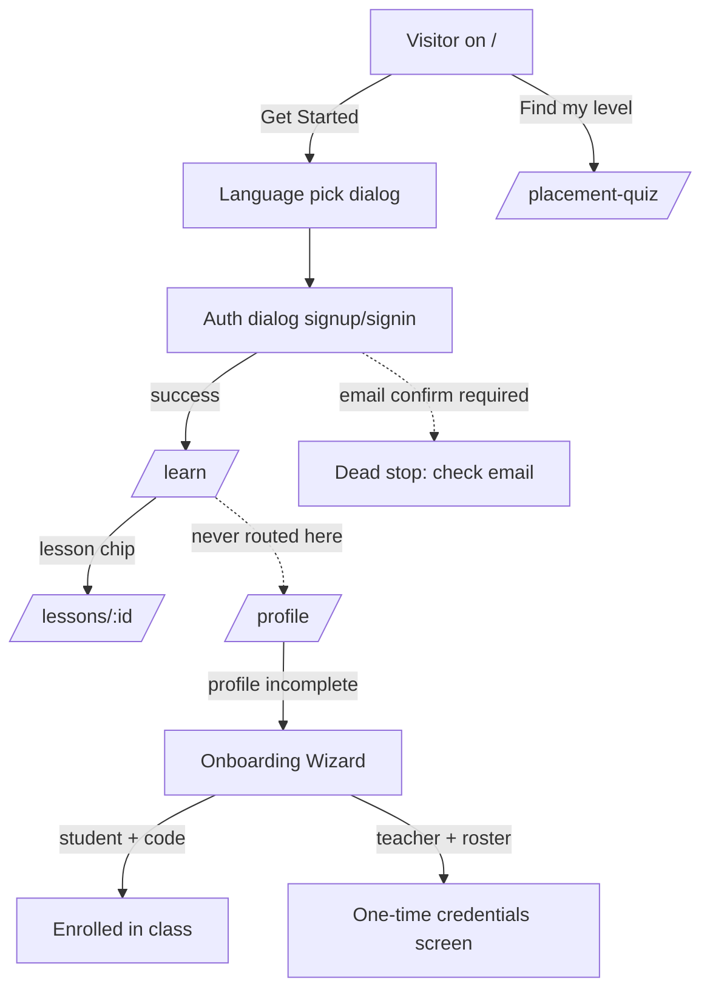
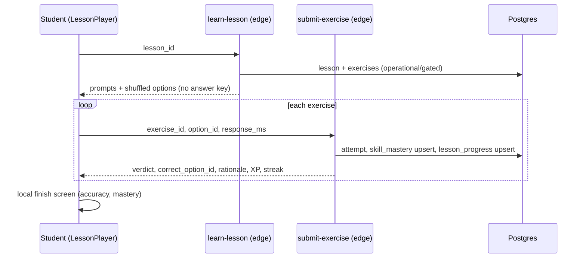
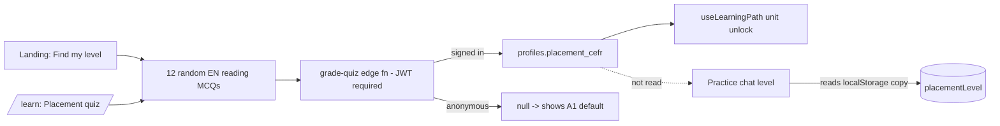
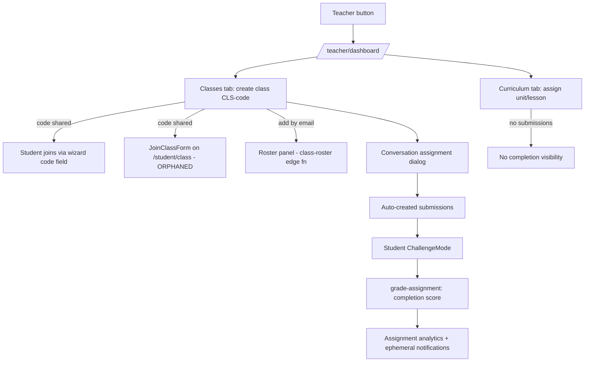

# WIP-02 — Current User Flows: Learner Journey & UX Audit

**Repo:** `/Users/calebjaworski/fluentforge-app` · **Branch:** `overhaul` · **Commit:** `7cbaadd9` ("fix: dedupe leaderboard entries and make auth errors actionable")
**Auditor:** Learner Journey & UX specialist (planning phase, read-only)
**Date:** 2026-07-30

**Labels used:** `[observed]` = seen in repo code at this commit · `[inferred]` = deduced from code, not executed · `[estimated]` · `[requires validation]` = needs a live run / DB check to confirm.

This document describes **current behavior only**. Where I note what "should" happen, it is marked as commentary, not a proposal spec.

---

## 0. Status of prior findings (verified against 7cbaadd9)

| Prior finding | Current status | Evidence |
|---|---|---|
| Placement quiz discarded results / 404 CTA | **Fixed.** Results now graded server-side, persisted to `profiles.placement_cefr`, CTA routes to `/learn` | `src/pages/PlacementQuiz.tsx:60-91,116-119` [observed] |
| Fake auth guard (always authenticated) | **Fixed.** `useAuthGuard` returns real state; comment documents the old bug | `src/hooks/useAuthGuard.ts:4-9` [observed] |
| Vocab review queue pulled from all published lessons | **Fixed.** Queue seeds only from lessons this learner started/completed, plus cards with existing history | `supabase/functions/vocab-review/index.ts:47-76` [observed] |
| Lesson player MCQ-only | **Still true.** Client filters out any exercise without options; only option-pick UI exists. Schema supports 9 types | `src/hooks/useLessonRunner.ts:72-79`; `src/pages/LessonPlayer.tsx:232-278`; migration `20260729164446` line 91 [observed] |
| No audio in lessons/review | **Fixed.** `SpeakButton` on lesson prompts, passages, review lemmas and example sentences | `src/components/ui/speak-button.tsx`; `LessonPlayer.tsx:212,229`; `VocabReview.tsx:120,149` [observed] |
| XP achievements permanently empty | **Hidden now.** Tables don't exist; fetch stubbed to `[]`; section renders only if `achievements.length > 0` (never) | `src/components/xp/StudentXPDashboard.tsx:51-53,180-182` [observed] |
| Two assignment inboxes | **Still true.** `/assignments` shows only conversation assignments; curriculum assignments appear only inside `StudentHomePanel` on `/learn` | `src/pages/Assignments.tsx:51-55`; `src/components/learner/StudentHomePanel.tsx:171-210` [observed] |
| Five separate teacher rosters | **Partially fixed.** Single enrollment table (`student_enrollments`) everywhere, but ≥18 files still run their own ad-hoc roster queries; 3 distinct roster UIs remain | grep across `src` (see §4.2) [observed] |
| Three class pickers | **Still true — now at least 4** independent, non-shared pickers | §4.6 [observed] |
| Curriculum assignments have no submission tracking | **Still true.** No completion/submission table; teacher cannot see who did an assigned unit/lesson | migration `20260729175720`; `src/hooks/useCurriculumAssignments.ts` [observed] |
| Notifications read-state per-browser | **Still true.** Derived on the fly, `read: false` always; read-IDs stored in `localStorage` only | `src/hooks/useTeacherNotifications.ts:74-76,154`; `NotificationDropdown.tsx:31,43-69` [observed] |
| Onboarding bulk-create lost passwords | **Fixed.** Credentials screen (step 4) + CSV download added | `src/components/onboarding/OnboardingWizard.tsx:549-615,220-235` [observed] |
| Rostering integrations are stubs | **Still true.** UI says "district sync is not wired up yet" | `src/components/teacher/curriculum/ClassRosterPanel.tsx:147-149` [observed] |
| `join_class_by_code` RPC added | **Confirmed**, with SECURITY DEFINER + normalization; wired into JoinClassForm and OnboardingWizard | migration `20260730020000`; `JoinClassForm.tsx:69-74`; `OnboardingWizard.tsx:258-261` [observed] |
| Teacher role detection fixed | **Confirmed.** Role=teacher OR owns ≥1 class | `src/hooks/useTeacherStatus.ts:31-38` [observed] |
| Nav rebuilt: visible items + Teacher button; signed-in "/" → /learn | **Confirmed** | `NewLayout.tsx:73-89,151-203`; `NewLandingPage.tsx:45` [observed] |

---

## 1. Flow 1 — Visitor → signup → onboarding → first lesson

### 1.1 Stepwise (as coded)

1. **Visitor lands on `/`** — hero, "Get Started", "Find my level" (→ `/placement-quiz`), feature strip. `NewLandingPage.tsx:229-243` [observed]
2. **"Get Started"** opens a dialog: pick native + target language (`LanguageSelectionCard`), stored in `secureStorage`/`sessionStorage` (plain localStorage under the hood, `dataEncryption.ts:156-166`), then after a 1s `setTimeout` the **auth dialog** opens (`NewLandingPage.tsx:78-117`). Sign in / Sign up buttons are also available directly in the dialog (`:302-322`). [observed]
3. **Signup** via `useAuthFlow` → `supabase.auth.signUp` with language prefs in user metadata (`useAuthFlow.ts:120-130`). A DB trigger (`handle_new_user`, migration `20260327225632:8-30`) creates a `profiles` row with **no role**. [observed]
   - If email confirmation is on, user is told "Check your email…" and the flow stops (`useAuthFlow.ts:157-170`). [observed]
4. **On auth success** → `navigate('/learn')` (`NewLandingPage.tsx:57-62`). **The onboarding wizard is NOT invoked here.** [observed]
5. **Onboarding wizard** (`OnboardingWizard.tsx`) is mounted **only** by `NoProfileState`, which renders **only on `/profile`** when the profile lacks role or languages (`src/pages/Profile.tsx:31-50`; `NoProfileState.tsx:11`). [observed]
6. **Wizard student path:** Role → Languages → optional class code. Code tries `join_class_by_code` (teacher CLS-codes), falls back to `process_access_code` (legacy access-codes table) (`OnboardingWizard.tsx:254-280`). [observed]
7. **Wizard teacher path:** Role → Languages → class name → optional student roster (name/email/password rows) → `bulk-create-students` edge function → **step 4 one-time credentials screen** with class join code + CSV download (`OnboardingWizard.tsx:155-199,549-615`). [observed]
8. **First lesson:** learner opens `/learn`, sees units, clicks a lesson chip → `/lessons/:lessonId` (`Learn.tsx:192-215`). [observed]

### 1.2 Diagram

### 1.3 Breakdowns in this flow

- **F1-1 (critical): Onboarding is effectively unreachable for self-signup users.** Signup lands on `/learn`; nothing routes an incomplete profile to `/profile`. A new learner never picks a role, never enters a class code, and `isTeacher` stays false for real teachers until they stumble into `/profile`. The landing-page comment "Profile completeness (role/onboarding) is enforced by the profile flow" (`NewLandingPage.tsx:59-60`) only holds if the user happens to visit Profile. [observed code path; live behavior requires validation]
  - *Concerns:* pedagogy (no L1 selection → English-only UI for an ESL beginner), district use (students never join their class), maintenance (two divergent "first-run" paths).
- **F1-2: Signup language metadata may be empty.** `useAuthFlow` reads `localStorage.getItem("nativeLanguage")` — populated only if the visitor used the Get Started language dialog first; signing up directly from the dialog's Sign Up button after skipping languages leaves profile languages null. [inferred from `useAuthFlow.ts:126-127` + `NewLandingPage.tsx:302-322`]
- **F1-3: UI language is only settable on the visitor landing page.** `setCurrentLanguage` is called exactly once in the app (`NewLandingPage.tsx:89`). Signed-in users are redirected off `/` (`:45`), and Settings has no language switcher (`src/pages/Settings.tsx` — usage/legal only). A signed-in learner cannot change (or ever set) the UI language. 41+ language packs exist (`src/translations/`, 46 entries). [observed]
- **F1-4: Teacher-created students skip onboarding cleanly** (role set server-side, `bulk-create-students/index.ts:110-119`) — good — but they receive **plaintext passwords chosen by the teacher**, `email_confirm: true`, and there is **no forced password change** on first login. [observed] *Concerns:* security/privacy (minors, FERPA-adjacent), district use.
- **F1-5: Two class-code systems with three entry surfaces that behave differently.** Wizard and JoinClassForm try both RPCs; the Profile page's `AccessCodeInput` calls **only** `processAccessCode` (`AccessCodeInput.tsx:38`), so a teacher's `CLS-XXXXXX` class code typed there fails even though its help text lists "CLS - class" (`:145-150`). [observed]
- **F1-6: Class code generation is client-side `Math.random()`**, duplicated in wizard and dashboard (`OnboardingWizard.tsx:158`; `TeacherClassesTab.tsx:94`), no uniqueness retry. Collision odds are low but nonzero at scale. [observed] *Concern:* scalability.

---

## 2. Flow 2 — Student daily loop

### 2.1 `/learn` (home)

`Learn.tsx` renders: header with course title, "Placement quiz" + "Vocabulary review (N due)" buttons (`:55-67`), `StudentHomePanel` (streak, XP, reviews due, projected band, "Keep going" continue button, next can-do targets, teacher curriculum assignments) (`StudentHomePanel.tsx:61-210`), then unit cards with skills and lesson chips; locked units show unlock guidance (`Learn.tsx:159-162`). Data: `useLearningPath` fetches the full course tree + `skill_mastery` + `lesson_progress` + due-card count + `placement_cefr` in one parallel batch (`useLearningPath.ts:75-102`). Unit unlock = previous unit cleared (all skills mastered at ≥0.8 with ≥5 attempts, or all lessons completed) OR unit CEFR ≤ placement CEFR (`:146-162`). [observed]

**Strengths worth preserving:** single-query-batch path load; dual unlock route (mastery OR completion) prevents mastery-threshold deadlock; placement short-circuit; explicit empty states.

### 2.2 Lesson play

- Answer keys never reach the client; options shuffled server-side (`learn-lesson/index.ts:91-99`). XP only for **first** correct answer per exercise, lesson completion, and new mastery; streak touches only when XP was earned (`submit-exercise/index.ts:168-201`). [observed] **Strength.**
- Exercise ordering adapts to learner ability (`orderByAbility`, `learn-lesson/index.ts:91`). [observed]
- **F2-1:** All non-MCQ exercise types (`cloze`, `dictation`, `speaking`, `ordering`, `matching`, `translation`, `dialogue` — allowed by schema) are silently dropped client-side (`useLessonRunner.ts:72-79`). Pedagogy: zero productive practice in the entire lesson pipeline. [observed]
- **F2-2:** Lesson completion requires a correct answer on **every** published exercise (`submit-exercise/index.ts:129-141` — `solved >= publishedIds.length`), but the player presents each item **once** and moves on. A student who misses one item finishes the session with "Lesson complete" screen (local `finished` state, `LessonPlayer.tsx:90-94,123-156`) yet the lesson stays `in_progress` server-side; the chip on /learn stays un-done with no explanation, and re-entering replays all items. UI truth ≠ server truth. [observed → inferred consequence]
- **F2-3:** `intro_md` (lesson introduction) is fetched but never rendered (`useLessonRunner.ts:29`; no usage in `LessonPlayer.tsx`). Teaching content authored there is invisible. [observed]

### 2.3 Vocabulary review

`/review` (`VocabReview.tsx`) — FSRS deck via `vocab-review` edge function; ratings with simple-English hints ("I did not know it"); XP per review; queue caps 10 new / 30 total (`vocab-review/index.ts:24-25`). Audio on lemma + example. Empty states distinguish "deck cleared" vs "nothing due" (`:98-113`). [observed] **This is the best-executed student surface** (deliberate A1-A2 copy, `VocabReview.tsx:15`).

- **F2-4:** New words enter the deck only after a lesson is *started* (any `lesson_progress` row) — reasonable — but there is no in-lesson vocabulary presentation step; the first encounter with a word can be its review card. [observed → pedagogy concern]

### 2.4 Practice chat (`/practice`)

- Level (`basic/intermediate/advanced`) from URL param → localStorage → **local** placement level (`secureStorage.getItem("placementLevel")`, `Practice.tsx:74-84`) — **not** `profiles.placement_cefr`, so on a new device the placement is ignored. [observed]
- **F2-5:** Practice chat remains **fully disconnected from the curriculum**: no lesson vocabulary, skill, or can-do context is passed into `useChatMessages(conversationLevel)` (`Practice.tsx:126-137`). Prior finding still true. [observed]
- **F2-6:** The page disables text selection, copy, and context menu (`Practice.tsx:175` — `select-none`, `onCopy`/`onContextMenu` prevented). An ESL learner cannot copy a word to a dictionary; screen-reader/assistive interaction is degraded. [observed] *Concerns:* pedagogy, accessibility.

### 2.5 Voice chat (`/voice-chat`)

Browser speech-recognition + TTS conversation; level mapping mirrors Practice but does **not** read placement at all (`VoiceChat.tsx:75-100`). Nav item disabled when Whisper STT minutes exhausted (`NewLayout.tsx:62,83`) — disabled with no explanation of *why* or how to get more. [observed]

### 2.6 Assignment (ChallengeMode)

Entry: `/assignments` → `StudentAssignmentsView.handleStart` → `navigate('/challenge-mode', { state })` (`StudentAssignmentsView.tsx:20-47`). Also an auto-popup — but it is mounted only inside `StudentProfile` (Profile page), so the nudge appears only when a student visits `/profile` (`AssignmentPopup.tsx:34-47`; `StudentProfile.tsx:11`). [observed]

- Resume works: transcript autosaved (1s debounce) to `assignment_submissions.transcript` and restored on mount (`ChallengeMode.tsx:88-140`). Prior fix confirmed. [observed]
- **F2-7:** ChallengeMode depends entirely on `location.state`; a page refresh loses state and bounces to `/assignments` with a toast ("No Assignment") — resume then requires re-clicking Start. Deep-linking an assignment is impossible. (`ChallengeMode.tsx:50,76-85`) [observed]
- Grading is **completion-based**: `message_count >= min_messages` ⇒ score 100, else null/incomplete, +XP (`grade-assignment/index.ts:53-70`). No language-quality assessment; a student can send 10 low-effort messages. [observed] *Concern:* pedagogy/assessment integrity.

### 2.7 XP / streak effects

XP events written server-side only (`_shared/learnerProgress.ts` via `awardXp`); surfaced as toasts (`LessonPlayer.tsx:80-87`), XP bar in header (`NewLayout.tsx:125-133`), `/xp` dashboard (achievements hidden), `/progress` KPIs. Streak from `learner_streaks` w/ freezes shown on the home panel (`StudentHomePanel.tsx:64-73`). [observed]

- **F2-8:** Two parallel progression stores are read in different places: `user_progression` (gamification hook) vs `learner_streaks`/`xp_events` (curriculum spine). `StudentHomePanel` reads both and prefers `learner_streaks` (`:29-59`); the header XP bar reads `user_progression` only. Values can disagree. [observed] *Concern:* maintenance/data.

---

## 3. Flow 3 — Placement quiz

### 3.1 Current flow

1. Entry points: landing "Find my level" (`NewLandingPage.tsx:238-242`) and `/learn` header button (`Learn.tsx:55-58`). No auth required to view. [observed]
2. Client picks 2 random questions per CEFR level from the **hard-coded English reading bank** (`READING_QUESTIONS` from `src/components/certifications/data/readingQuestions`) and shuffles (`PlacementQuiz.tsx:23-39`). 12 MCQs, no listening/speaking/writing. [observed]
3. Answers (question **text** + selected index) sent to `grade-quiz`, which normalizes text and looks up a server-side answer key; thresholds map score→level (95→C2 … 0→A1) (`grade-quiz/index.ts:14-27,58-60`). [observed]
4. Result persisted to `secureStorage("placementLevel")` and, if signed in, `profiles.placement_cefr` + `placement_taken_at` (`PlacementQuiz.tsx:74-90`). CTA "Start Learning" → `/learn`. [observed]

### 3.2 Where `placement_cefr` is consumed

- **Only one consumer:** `useLearningPath` unit unlock (`useLearningPath.ts:100,119,149`). [observed]
- Practice chat uses the **local** `placementLevel` copy only (`Practice.tsx:79`); VoiceChat, vocab-review, learn-lesson, conversation prompts, and teacher surfaces do not read it at all. [observed]

### 3.3 Breakdowns

- **F3-1 (critical): Anonymous "Find my level" is a trap.** `grade-quiz` requires a JWT (`requireUser`, `authGuard.ts:94-114`). A signed-out visitor completes all 12 questions, grading returns null, and the results screen renders the **default "A1"** with score 0 and no error (`PlacementQuiz.tsx:70,93-95`). Misleading result + wasted effort. [observed code; end-to-end behavior requires validation]
- **F3-2: Copy contradicts mechanics.** Results say "we'll start you at level {one-below}" (`:249-252`), but what's stored is the **assessed** level and `/learn` unlocks all units *at or below* it (`useLearningPath.ts:149`) — nothing implements "one level below," and nothing on /learn confirms what placement did. [observed]
- **F3-3:** English-only reading questions regardless of target language; a Spanish-track learner would be placed via English items (bank language check: `readingQuestions` used by both placement and the *English* reading cert). [observed → requires validation for Spanish track content]
- **F3-4:** Retakes unlimited, no attempt history (persist:false for placement, `grade-quiz/index.ts:47`), fine for practice but nothing distinguishes a proctored/first placement for district reporting. [observed] *Concern:* district use.

---

## 4. Flow 4 — Teacher loop

### 4.1 Entry

`useTeacherStatus` (role=teacher OR owns a class) shows the header **Teacher** button → `/teacher/dashboard` (`NewLayout.tsx:193-203`). Dashboard gates on `profiles.role ∈ {teacher, admin}` (`TeacherDashboard.tsx:77-90`) — note: a class-owning user without the role passes the nav check but is **denied at the dashboard** ("accessDenied") — inconsistent gating. [observed]

Six tabs: Overview, Manage Classes, Students, Assignments, Curriculum, Benchmarks (`TeacherDashboard.tsx:164-208`). The tab strip is a `grid-cols-2 sm:grid-cols-3` list holding 6 triggers, so on desktop-lg it renders inline but on small screens it wraps into a 2×3 grid of unequal rows — cramped but functional. The dashboard "back" arrow goes to `/profile` (`:111-119`). [observed]

### 4.2 Class creation & roster (3 join paths)

1. **Bulk-create (onboarding wizard):** teacher enters name/email/password rows; `bulk-create-students` creates confirmed accounts, sets role, enrolls (`bulk-create-students/index.ts:79-133`); one-time credential screen + CSV. Not available from the dashboard afterward — the wizard is one-shot. [observed]
2. **Student self-join by class code:** `join_class_by_code` RPC (SECURITY DEFINER, upserts enrollment; migration `20260730020000`). Reachable from OnboardingWizard step 3b and `JoinClassForm` — but `JoinClassForm` lives only on `/student/class`, which **no nav item or link points to** (grep: zero references outside `App.tsx`). Post-onboarding, a student has no discoverable way to join a class. [observed]
3. **Legacy access codes:** `process_access_code` (access_codes table; DIST/SCH/TCH/CLS role codes) via Profile's `AccessCodeInput` — which does **not** try `join_class_by_code` (F1-5). [observed]
4. **Teacher-side add-by-email:** Curriculum tab → Roster panel → `class-roster` edge fn (`add_by_email`), server-verifies teacher-of-class (`useClassRoster.ts:22-63`; `ClassRosterPanel.tsx:59-75`). **Strength:** clean server boundary. [observed]

Roster **views**: ClassStudentsList dialog (Classes tab), ClassRosterPanel (Curriculum tab), StudentProgressTable (Students tab) — three UIs over the same table with independent fetches. Student counts on class cards are an N+1 loop (`TeacherClassesTab.tsx:73-84`). [observed] *Concern:* scalability, maintenance.

**Destructive action:** class delete hard-deletes class + enrollments after a confirm dialog (`TeacherClassesTab.tsx:129-136,300-330`); no archive/undo. Honest copy, but risky for districts. [observed]

### 4.3 Assignment creation (two systems, still)

- **Conversation assignments** (`assignments` + `assignment_submissions`): Classes tab → class card → "Assignments" dialog → `CreateAssignmentDialog` (topic, CEFR, min messages, due date; default B1/10). Creation auto-creates a `pending` submission per selected student (`useTeacherAssignments.ts:123-148`). Click depth from dashboard landing: Classes tab → card → Assignments → Create → fill → submit ≈ 5-6 interactions. [observed]
- **Curriculum assignments** (`class_curriculum_assignments`): Curriculum tab → class picker → "Assign curriculum" → unit/lesson + title + due + CEFR/WIDA targets + group label (`CurriculumAssignmentsPanel.tsx:122-236`). [observed]

### 4.4 Student completes → teacher sees

- **Conversation path:** student submits in ChallengeMode → `grade-assignment` auto-scores completion → teacher sees submissions in `AssignmentsList` / transcript modal, and a derived "notification." Notifications are recomputed each minute; **read state is localStorage-only, so unread counts reset per browser** and "mark all read" does not persist server-side (`useTeacherNotifications.ts:151,74-76`; `NotificationDropdown.tsx:31-69`). [observed]
- **Curriculum path: no feedback loop exists.** No submission table, no per-student status; the student card just links to the lesson (`StudentHomePanel.tsx:193-205`). A teacher can only infer completion indirectly from Benchmarks/mastery views. [observed]
- **F4-1: "Differentiation" targeting is cosmetic.** Panel copy claims level targets make the assignment "only land for the students in that band" (`CurriculumAssignmentsPanel.tsx:117-119`), but the student query fetches **all** assignments for enrolled classes with no CEFR/WIDA filtering (`useCurriculumAssignments.ts:108-126`), and RLS grants SELECT to any enrolled student (migration `20260729175720:31-35`). Every student sees every group's assignment. [observed]
- **F4-2:** Target CEFR toggle offers only A1/A2/B1 (`CurriculumAssignmentsPanel.tsx:24`) while placement/certs span A1-C2 — inconsistent scales. [observed]

### 4.5 Grading & metrics

- Conversation "grading" is automatic completion scoring (§2.6); manual teacher grading UI: not present in `TeacherAssignmentsView` (list + delete + transcripts only, `TeacherAssignmentsView.tsx:56-80`). [observed]
- Metrics: Overview (`ClassPerformanceOverview`), Students table w/ drilldown modal, Assignment analytics, Benchmarks (can-do heatmap, readiness projections, needs-help groups — `useClassCanDoMastery.ts`, `ClassBenchmarksTab.tsx`). The benchmarks/can-do layer is genuinely differentiated work worth preserving. [observed]

### 4.6 Class pickers (count: ≥4, none shared)

| Surface | Picker | Source |
|---|---|---|
| Curriculum tab | `Select` | `ClassCurriculumTab.tsx:22-26` |
| Benchmarks tab | `Select` | `ClassBenchmarksTab.tsx:23-24` |
| /assignments (teacher view) | `Select` | `TeacherAssignmentsPage.tsx:26-55` |
| Students tab | class filter `Select` | `StudentProgressTable.tsx:30-34,69` |
| Classes tab | card grid (implicit picker) | `TeacherClassesTab.tsx:228-335` |

Selecting a class in one tab does not carry to any other tab. [observed] *Concern:* 6-click paths persist for cross-tab tasks.

---

## 5. Flow 5 — Certifications & premium voice

### 5.1 Reading certification

`/certificates` hub → Reading card routes `/reading-certification[/:level]` (fixed; `CertificatesLayout.tsx:62-69`). Version chosen by **UI language**: English-UI users get the Spanish test, everyone else the English test (`src/pages/ReadingCertification.tsx:12-26`) — a proxy that breaks for, e.g., an English-native Spanish learner using English UI... actually that case works, but a Spanish-native learner who somehow has English UI gets the wrong-direction test; target_language from the profile is not consulted. [observed] Grading via `grade-quiz` (server key, persists reading attempts, `grade-quiz/index.ts:47`). [observed]

### 5.2 Writing certification

`/writing-certification` → `grade-writing` edge fn (AI-graded; page shell at `WritingCertification.tsx`). Attempt quota consumed via `track-usage` (`serverWrites.ts:111-118`). [observed; scoring quality requires validation]

### 5.3 Certificates hub misc

`onTestComplete` refetches on a 0.5s/1.5s/3s timer cascade (`Certificates.tsx:28-34`) — race-condition patching. Hard-coded `text-gray-600` copy breaks dark theme (`CertificatesLayout.tsx:83,100`). [observed]

### 5.4 Premium voice practice

`/premium-voice-practice`: OpenAI realtime voice session; gate `checkCanStartPremiumVoiceSession` (15 min/month default), time warnings + hard stop events, session usage recorded server-side (`PremiumVoicePractice.tsx:39,78-97,56-76`). A second "custom" provider mode is exposed to end users as a raw mode selector (`:26-37`) — an engineering concept leaking into learner UI. `/premium-voice` (marketing/upsell page) is **orphaned** — zero in-app links. Speaking cert entry on /certificates routes here, labeled "Speaking Practice," blurring practice vs certification. [observed]

---

## 6. Mobile behavior & accessibility posture (code spot-checks)

**Mobile [observed]:**
- No bottom tab bar; primary nav is desktop-only (`hidden lg:flex`, `NewLayout.tsx:151`). On phones, all navigation funnels through the full-width dropdown (2-col grid of 12 items, `top-navigation-dropdown.tsx:81`). One tap + scan of 12 tiles for every hop — heavy for young learners.
- `use-mobile.tsx` exists but is only consumed by the shadcn sidebar (unused in main layout).
- Teacher dashboard tab strip wraps 6 tabs into 2-3 columns on phones; dialogs (`max-w-4xl`) get scrolly. ChallengeMode uses `fixed inset-0` + `h-[calc(100vh-140px)]` — [requires validation] on iOS keyboard-open viewports.
- Landing animated orbs/grid + framer-motion everywhere; `prefers-reduced-motion` is globally honored via CSS (`index.css:392`) — good — but JS-driven `motion.div` loops (e.g. `NewLandingPage.tsx:137-154`) run regardless. [observed]

**Accessibility [observed]:**
- Good: global `:focus-visible` ring (`index.css:101`); lesson options are real `<button>`s with letter badges; `SpeakButton` has dynamic `aria-label` (`speak-button.tsx:65`); loaders use `role="status"` (`App.tsx:50-52`); form fields in roster/assignment panels have proper `Label htmlFor`.
- Gaps: nav dropdown is a custom popover with **no `aria-expanded`/`aria-haspopup`, no Escape handling, no focus trap/return**, and a click-only backdrop (`top-navigation-dropdown.tsx:44-77`). Lesson answer feedback is color+icon (icons do help) but correctness is not announced to screen readers (no `aria-live` region in `LessonPlayer.tsx`). XP toasts are transient-only. Practice page blocks copy/selection (§F2-6). Hard-coded grays (`text-gray-600/900` in certificates/reading pages, `Compliance.tsx:17`) fail dark-mode contrast. Brand-gradient buttons use fixed `text-[#06263A]` on mint/sky gradient — contrast plausible but unverified [requires validation with contrast tooling].

---

## 7. Frank UX assessment for an ESL beginner (possibly a minor, low reading level)

**Where each flow breaks down for this persona:**

1. **Landing/signup:** The entire signup, email-confirmation instruction, and error copy is English-first (translations exist for many keys, but see below — the core learning surfaces aren't localized). A 12-year-old newcomer cannot self-serve past "Check your email to finish signing in."
2. **Onboarding:** They will most likely never see it (F1-1) — so the app never learns their L1, never joins them to a class, and the UI stays in English.
3. **/learn:** "Structured units aligned to CEFR and WIDA can-do statements" is meaningless to the learner it describes. "Skill mastery 45% · 3 attempts" is teacher-speak on a student screen.
4. **Lesson:** solid interaction pattern (tap option → check → explanation + audio), but explanations/rationales are English-only and the missed-one-question completion trap (F2-2) is invisible and demotivating.
5. **Review:** genuinely appropriate (short words, hints, audio). The one place the persona is well served.
6. **Practice/voice chat:** open-ended AI chat with no scaffold, suggested replies, or vocabulary tie-in; a true beginner has nothing to say and no help saying it. Copy-blocking removes their main coping tool.
7. **Assignments:** min-message counters and countdowns are clear enough, but "Ready to submit!"/"X more to go" is untranslated, and refresh loses the session (F2-7).
8. **i18n regression (critical):** `Learn.tsx`, `LessonPlayer.tsx`, `VocabReview.tsx`, `StudentHomePanel.tsx`, `PlacementQuiz.tsx` contain **zero** `t()` usage (grep: no `useLocalization` import in any of them); the OnboardingWizard is ~95% hard-coded English. The 41-pack translation system serves the older screens (Practice/VoiceChat/Profile) but not the new core loop. [observed]

### 7.1 Reading-level audit — 20 sampled student-facing strings

Flesch-Kincaid grade computed programmatically (script in session scratchpad; syllable heuristic ±1 grade). Target for A1-A2 ESL: ≤ grade 3-4 with familiar vocabulary.

| # | Source | String (truncated) | FK grade | Verdict |
|---|---|---|---|---|
| 1 | Learn.tsx:51 | "Structured units aligned to CEFR and WIDA can-do statements." | 11.5 | Fail — jargon |
| 2 | Learn.tsx:160 | "Finish the previous unit's lessons (or master its skills) to unlock…" | 9.5 | Fail |
| 3 | Learn.tsx:81 | "No published units yet. Approved curriculum content will appear here." | 10.0 | Fail |
| 4 | Learn.tsx:187 | "mastery 45% · 3 attempts" | ~13 | Fail — abstract metric |
| 5 | StudentHomePanel.tsx:152 | "Targets appear once your teacher's curriculum is mapped to can-do statements." | 11.2 | Fail |
| 6 | StudentHomePanel.tsx:108 | "medium confidence · projection" | 17.0 | Fail |
| 7 | LessonPlayer.tsx:142 | "This lesson has no published exercises yet…" | 6.5 | Marginal |
| 8 | LessonPlayer.tsx:137 | "You answered 3 of 5 correctly. Skill mastery is now 80%." | 7.1 | Marginal |
| 9 | VocabReview.tsx:78 | "Target retention 88%" | 13.1 | Fail |
| 10 | VocabReview.tsx:103 | "Deck cleared — 8 cards reviewed…" | 1.1 | Pass |
| 11 | VocabReview.tsx:104 | "Nothing is due right now. New words unlock as you work through lessons." | 1.5 | Pass |
| 12 | VocabReview.tsx:17-20 | rating hints ("I did not know it" …) | <1 | Pass — model copy |
| 13 | PlacementQuiz.tsx:139 | "…according to the Common European Framework of Reference (CEFR)." | 12.6 | Fail |
| 14 | PlacementQuiz.tsx:250 | "To ensure a solid foundation, we'll start you at level B1…" | 9.6 | Fail |
| 15 | PlacementQuiz.tsx:133 | "Discover your current language proficiency level" | 14.3 | Fail |
| 16 | OnboardingWizard.tsx:517 | "Enter a class code from your teacher, or skip to explore on your own." | 4.2 | Pass |
| 17 | StudentAssignmentsView.tsx:81 | "Your teacher will assign conversation challenges here" | 10.7 | Fail |
| 18 | NewLandingPage.tsx:202 | "AI tutor · CEFR curriculum · built for classrooms" | 6.0 | Marginal (marketing) |
| 19 | AuthRequiredPrompt.tsx:18 | "You can keep browsing. Sign in from the home page when needed." | 0.5 | Pass — but see F8-6: copy is factually stale |
| 20 | ChallengeMode.tsx:335 | "Your progress is saved! You've sent 4 messages…" | 3.7 | Pass |

**Summary [estimated]:** median ≈ grade 9-10 across path/placement/teacher-adjacent copy; only the vocab-review surface and a few dialogs hit A1-A2-appropriate levels. Add zero localization of these strings and the effective accessibility for the core persona is poor.

---

## 8. Dead ends, orphaned pages, inconsistencies (comprehensive)

**Orphaned routes** (in `App.tsx`, zero in-app links; grep-verified):
- **O1** `/student/class` (+`/:classId`) — contains the only post-onboarding JoinClassForm. `App.tsx:107-108` [observed]
- **O2** `/accuracy` — page exists (`Accuracy.tsx`), unlinked. [observed]
- **O3** `/premium-voice` — upsell page, unlinked. [observed]
- **O4** `/compliance` — unlinked AND has no client role gate (unlike `/author` which wraps `ProtectedRoute requireRole="admin"`, `Author.tsx:321`); RLS presumably protects data [requires validation]. [observed]
- **O5** `/safety-policy` — unlinked. [observed]
- **O6** `/certificate` (single-analysis certificate) — reachable only from `StudentAnalysisView` (`:206`), itself buried in profile/analysis. [observed]

**Dead ends / traps:**
- **D1** Anonymous placement quiz → silent "A1" (F3-1).
- **D2** Signup with email-confirmation on → toast only; no "resend / what now" screen (`useAuthFlow.ts:157-170`).
- **D3** Self-signup never routed to onboarding (F1-1) → role-less profile; teacher features invisible.
- **D4** ChallengeMode refresh → state lost, back to /assignments (F2-7).
- **D5** Lesson "complete" screen with server-side incomplete lesson (F2-2).
- **D6** Voice Chat nav item disabled with no explanation when minutes are exhausted (`NewLayout.tsx:62,83`).
- **D7** Student with no class has no discoverable join UI after onboarding (O1 + F1-5).
- **D8** Teacher deletes class → hard cascade, no undo (`TeacherClassesTab.tsx:129-136`).

**Inconsistencies:**
- **I1** Two assignment systems with different inboxes (§2.6/§4.3-4.4); students find conversation work at `/assignments` but curriculum work only on `/learn`.
- **I2** `AccessCodeInput` vs JoinClassForm vs wizard: only two of three try `join_class_by_code` (F1-5).
- **I3** Placement copy "one level below" vs actual unlock-at-level (F3-2).
- **I4** `Practice` reads localStorage placement; `Learn` reads DB placement; `VoiceChat` reads neither (§3.2).
- **I5** Teacher gating: nav shows Teacher for class-owners; dashboard requires role (§4.1).
- **I6** Curriculum-assignment CEFR targets A1-B1 vs A1-C2 elsewhere (F4-2).
- **I7** Differentiation targets stored but unenforced (F4-1).
- **I8** Landing "Get Started" for a signed-in user goes to `/practice` (`NewLandingPage.tsx:119-125`) while every other signed-in entry point centers `/learn` — minor, near-unreachable due to the `/` redirect, plus nav "Home" item for signed-in users bounces `/` → `/learn` (`NewLayout.tsx:74`; `NewLandingPage.tsx:45`).
- **I9** `AuthRequiredPrompt` toast says "Auth is temporarily optional. You can keep browsing." (`AuthRequiredPrompt.tsx:14-20`) — stale copy from the fake-guard era; auth is now required on those pages.
- **I10** Two localization context paths (`src/context` shim → `src/contexts`, `context/LocalizationContext.tsx:1-4`); 126 files import the shim, 2 the real one — works, but confusing. [observed]
- **I11** Dark-mode: hard-coded gray/white text in certificates, reading cert, compliance, placement quiz headers (`ReadingCertification.tsx:30`; `CertificatesLayout.tsx:83`; `PlacementQuiz.tsx:130-134`).
- **I12** Notifications: `unreadCount` prop from the hook (always = total) vs dropdown's localStorage-derived `actualUnreadCount` — two different numbers computed for the same badge (`TeacherDashboard.tsx:63`; `NotificationDropdown.tsx:71`).

---

## 9. Strengths worth preserving

1. **Server-authoritative learning core** — answer keys, grading, XP, streaks, FSRS scheduling, placement scoring, and quota checks all live in edge functions with JWT re-derivation; the client can't fabricate progress (`learn-lesson`, `submit-exercise`, `vocab-review`, `grade-quiz`, `serverWrites.ts` header comment). [observed]
2. **Anti-grind XP design** — first-correct-only, completion, and mastery bonuses; streak advances only with real progress (`submit-exercise/index.ts:168-201`). [observed]
3. **FSRS vocabulary review scoped to taught words** with humane, A1-level UI copy and audio (`vocab-review/index.ts:47-76`; `VocabReview.tsx`). [observed]
4. **Dual unit-unlock logic (mastery OR all-lessons-complete) + placement skip-ahead** avoids common progression deadlocks (`useLearningPath.ts:146-162`). [observed]
5. **Can-do/benchmark readiness layer for teachers** (heatmap, projections, needs-help grouping) — a real district differentiator (`useClassCanDoMastery.ts`, `benchmarkReadiness` utils). [observed]
6. **Roster mutations behind a teacher-of-class-verified edge function** rather than raw table writes (`useClassRoster.ts:5-12`). [observed]
7. **One-time credential screen + CSV for bulk-created students** (`OnboardingWizard.tsx:549-615`). [observed]
8. **Actionable auth error translation** and existing-email → switch-to-login recovery (`useAuthFlow.ts:12-48,140-146`). [observed]
9. **Server-decided age gate / strict safety mode** that the client cannot bypass (`AgeGate.tsx:6-11`). [observed]
10. **Route-level code splitting** with a labeled loader (`App.tsx:12-56`). [observed]

---

## 10. Concern matrix (top findings × dimensions)

| Finding | Scalability | Pedagogy | District/school | Security/privacy | Maintenance |
|---|---|---|---|---|---|
| F1-1 onboarding unreachable | — | ●● (no L1/level setup) | ●●● (class join broken) | ● (role-less accounts) | ●● |
| F3-1 anonymous placement trap | — | ●● (false A1) | ● | — | ● |
| F2-1 MCQ-only delivery | — | ●●● (no production) | ●● | — | ●● (schema-UI drift) |
| F2-2 completion mismatch | — | ●● | ● | — | ●● |
| I1 dual assignment systems | ● | ● | ●●● | — | ●●● |
| F4-1 fake differentiation | — | ●● | ●●● (compliance risk if promised) | ● (cross-band visibility) | ● |
| Curriculum assignments: no submissions | — | ●● | ●●● | — | ●● |
| i18n regression on core loop | — | ●●● | ●●● (EL programs) | — | ●● |
| Bulk-create plaintext passwords, no forced reset | — | — | ●● | ●●● | ● |
| Notifications ephemeral/local | ● (per-minute recompute over N tables) | — | ●● | — | ●● |
| N+1 counts, ad-hoc roster queries, refetch timers | ●●● | — | ● | — | ●●● |
| Reading-level of copy | — | ●●● | ●● | — | — |

---

## Appendix A — Route inventory vs navigation

Nav-visible (primary): `/` `/learn` `/practice` `/review` `/assignments` (`NewLayout.tsx:73-79`). Dropdown adds: `/progress` `/voice-chat` `/pronunciation-practice` `/certificates` `/xp` `/profile` `/settings` (`:81-89`). Teacher button: `/teacher/dashboard`. Contextual-only: `/lessons/:id`, `/challenge-mode`, `/placement-quiz`, `/reading-certification[/:level]`, `/writing-certification`, `/premium-voice-practice`, `/analysis`, `/certificate`, `/reset-password`, `/legal`. Redirects: `/personal-flashcards`→`/review`, `/classroom`→`/teacher/dashboard` (`App.tsx:87,106`). Orphans: see §8 O1-O6.

## Appendix B — Method

Static read of `src/` and `supabase/` at 7cbaadd9; grep-based reachability analysis for every route in `App.tsx`; FK grade computation script (Appendix table §7.1) run on 20 verbatim strings. No servers run, no DB writes, no files touched outside `docs/palavox-overhaul-plan/`.
