# 05 — Learning Engine & Mastery: Unified Spaced-Repetition and Learner-Memory Model

**Role:** Spaced-Repetition and Mastery-System Architect · **Phase:** planning only (no implementation)
**Repo evidence:** branch `overhaul`, commit `7cbaadd9`
**Depends on:** 02-current-user-flows.md, wip-01a-product-inventory.md, wip-03a-analytics-and-claims.md, wip-curriculum-\* band plans, conversation-engine plan (frozen tasks #15/#16 — mission/error-taxonomy schema is quarantined on `wip/conversation-engine-preplanning` and referenced here as [proposed])
**Labels:** [observed] = verified in code · [documented] = external published source · [estimated] · [proposed] · [assumption] · [requires validation]

---

## Decision summary (one paragraph)

Keep FSRS as the one scheduler, extend it from vocabulary to a **unified `learner_memory_items` model** covering nine target kinds (vocab, chunks, grammar patterns, pronunciation targets, phonemic distinctions, listening/writing micro-targets, communicative functions, error patterns), replace client **self-graded** ratings with **derived grades** computed server-side from correctness + hints + latency + modality, layer a **proficiency-evidence ladder** (recognition < cued recall < structured production < spontaneous use) on top of memory strength so mastery claims never rest on recognition or exposure, replace the frozen window-mean `skill_mastery` score with a **time-decayed Beta-posterior mastery score** replayed deterministically from `exercise_attempts`, make conversation/mission errors first-class scheduled items via a dedupe pipeline, and consolidate the dual XP economy on **System A** (`xp_events` + `awardXp`) with `award-xp` and `check-streak` retired to 410 stubs in the first release.

---

## 1. Current-state assessment

### 1.1 What the FSRS-ish vocab scheduler actually does

It is not "FSRS-ish" — it is **real FSRS-5** via the maintained `ts-fsrs@5.4.1` port (`supabase/functions/_shared/fsrs.ts:6-14`) [observed], configured with `request_retention = 0.88` (`fsrs.ts:17`) and fuzz enabled (`fsrs.ts:19-21`). Scheduling is server-side only; the client submits a 1–4 rating which maps to FSRS grades Again/Hard/Good/Easy, defaulting to Good (`fsrs.ts:58-69`). `schedule()` delegates entirely to `scheduler.next()` (`fsrs.ts:86-105`); card state and a full review log are persisted (`vocab-review/index.ts:146-154`; tables at migration `20260729171206:73-90` and `:101-115`).

Queue construction (`vocab-review/index.ts:47-116`) [observed]:
- Eligible vocabulary = words mapped to lessons this learner has started (`:51-61`) ∪ words with existing card state (`:65-74`) — a real fix over the old "every published lesson" bug noted in the code comment (`:49-52`).
- Due cards: `due <= now`, sorted ascending by due date (`:87-90`).
- New cards: eligible words without state, first `MAX_NEW_PER_DAY = 10` (`:24`, `:92`); total queue capped at `MAX_QUEUE = 30` (`:25`, `:93`).

**Sound** [observed]:
- Correct, published algorithm with a maintained implementation; per-card stability/difficulty; lapse counting; full immutable review log (enables later parameter optimization).
- Server-authoritative writes; RLS gives students SELECT-only (migration `20260729171206:91-98`).
- XP is flat and small per review (3 XP, 1 on lapse — `learnerProgress.ts:166-172`, `vocab-review/index.ts:156-161`), so the review loop is not an XP faucet.

**Missing / unsound** [observed]:
1. **Self-report grading.** The learner supplies the rating (`vocab-review/index.ts:121-126`). A student can tap Easy forever; nothing corroborates the grade. For minors in schools this makes review data unusable as evidence, and it violates the owner rule that claims never come from self-assessed recognition.
2. **Recognition-only evidence.** The flashcard flip tests recognition of `translation_l1`; there is no recall or production channel anywhere in the review loop.
3. **`MAX_NEW_PER_DAY` is per-request, not per-day.** A learner who grades all 10 new cards and re-requests the queue gets 10 more the same day (`:24`, `:92` — no daily counter is read).
4. **New-card order is arbitrary** (insertion order of `taughtIds`), not frequency-ranked or lesson-ordered, despite `vocabulary.frequency_rank` existing (migration `20260729164446:114-127`).
5. **No linkage to lessons.** A correct in-lesson exercise about a word neither creates nor updates its card; the two systems never exchange retrieval evidence.
6. **Vocabulary only.** Grammar, chunks, pronunciation, functions — everything else the curriculum plans define — has no memory model at all.
7. **Default parameters, single retention target.** No per-learner optimization and no policy for who gets what retention target (fine for launch, but unplanned).

### 1.2 What `skill_mastery` actually computes

From `learnerProgress.ts:42-56` [observed], per (user, skill):

- `window` = last **10** outcomes as 0/1 (`MASTERY_WINDOW`, `:19`); `mastery = mean(window)` — a **rolling-window mean, not an EWMA** (wip-01a calls it EWMA; the code is a boxcar average) [observed].
- `ability` update (`nextAbility`, `:26-30`): `a′ = a + 0.08·(1−a)` on correct, `a′ = a − 0.16·a` on wrong, clamped to [0.05, 0.95] — an asymmetric exponential tracker (climb slowly, fall twice as fast).
- `mastered = attempts ≥ 5 AND mastery ≥ 0.8` (`:19-23`, `:52-55`); `newlyMastered` pays 30 XP once (`submit-exercise/index.ts:190-197`).
- `ability` drives adaptive ordering — items served nearest `|difficulty − ability|` (`orderByAbility`, `learnerProgress.ts:62-72`).

**Sound:** simple, explainable, monotone in recent evidence; server-side; `last_practiced_at` is stored (migration `20260729171206:36`).
**Missing / unsound** [observed]:
1. **No time decay.** `mastered` is forever: a skill mastered in September still reads 0.9 in June with zero retention evidence. Mastery and retention are conflated into one number that only ever reflects the last 10 attempts, whenever they happened.
2. **Recognition-only input.** Every attempt is an MCQ pick (`submit-exercise` grades a chosen option against `exercise_options.is_correct`, `submit-exercise/index.ts:69-77`; the client filters out all non-option exercise types, `src/hooks/useLessonRunner.ts:71-79`; 02-current-user-flows.md F2-1). So "mastered" currently means "8 of the last 10 multiple-choice taps were right" — exactly the claim the product rules forbid.
3. **Coarse granularity.** With a 10-item window, mastery moves in 0.1 steps and one skill covers a whole unit strand (skills schema, migration `20260729164446:33-44`); there is no per-target-item state.
4. **Ignores latency and hints.** `exercise_attempts.response_ms` is captured (`20260729171206:60`) but read by nothing [observed].

### 1.3 Lesson progress and the completion lie

`lessonComplete` requires a distinct correct answer on **every** published exercise (`submit-exercise/index.ts:123-141`), but the player shows each item once and renders a local "complete" screen regardless (02-current-user-flows.md F2-2) [observed]. Consequence for this doc: **completion is currently neither engagement nor mastery and the UI misrepresents it**; §5 gives completion a formal, honest definition and the exercise-engine doc owns the player fix.

### 1.4 The dual-economy problem

Two parallel systems write learner motivation state [observed, wip-01a §6]:

| | System A (new spine) | System B (legacy) |
|---|---|---|
| Award path | `_shared/learnerProgress.ts:175-218` (`awardXp`), called only by `submit-exercise` / `vocab-review` | `supabase/functions/award-xp/index.ts`, called from `src/hooks/useGamification.ts:138` |
| Amounts | Fixed server constants 1–30 XP (`learnerProgress.ts:166-172`) | `getXPReward(source, metadata)` from **client-supplied** metadata, up to 600 XP/request, unbounded (`_shared/levelSystem.ts:40-173`; wip-01a F6.1) |
| Ledger | Inserts `xp_events` (`learnerProgress.ts:184-191`) | **Never writes `xp_events`** (wip-01a F3.1) |
| Level formula | `floor(total_xp/500)+1` (`learnerProgress.ts:200`) | `100·level^1.5` curve (`levelSystem.ts:10-12`); diverges by 5,000 XP (wip-01a F6.4) |
| Streak | `learner_streaks` via `touchStreak` (`learnerProgress.ts:89-162`), gated on real progress (`submit-exercise/index.ts:198-201`) | `user_progression.current_streak_days` via `check-streak`, which parses the JWT by hand (`check-streak/index.ts:6-22`) and the leaderboard sorts by it (wip-01a F6.3) |

Additional exploit surface: `award-xp` increments `certifications_completed`, a teacher-visible counter (wip-01a F6.1). Consolidation path is §6.2: **System A wins everywhere; System B is retired, not merged.**

Also relevant: `touchStreak` uses UTC day boundaries (`learnerProgress.ts:76-78`), so late-evening learners west of UTC can lose streaks legitimately earned — a known limitation to fix with a stored timezone, out of scope here [observed → proposed for doc 09/analytics].

---

## 2. Target learner-memory entity model

### 2.1 Design principle: one card model, two axes

Every trackable thing a learner is acquiring becomes a **memory item** — one row, one FSRS card, one evidence ledger. Two orthogonal axes are tracked per item [proposed]:

- **Memory strength** (will they still have it next week?) — FSRS stability/difficulty/state. Answers *when to review*.
- **Evidence depth** (what kind of knowing is proven?) — the highest *corroborated* rung on the proficiency ladder: `0 unseen → 1 exposed → 2 recognized → 3 recalled (cued) → 4 produced (structured task) → 5 used spontaneously (open/guided conversation)`. Answers *what we may claim*. Rungs 0–2 can never contribute to proficiency claims (owner rule); rungs 4–5 require productive evidence graded server-side or teacher-confirmed.

An item can be FSRS-mature at rung 2 (a word you always recognize but never produce). The scheduler treats these differently (§3.5: it *upgrades the task type* rather than just lengthening the interval).

### 2.2 Entity kinds

| kind | Content anchor | Example (from band plans) | Primary evidence channels |
|---|---|---|---|
| `vocab` | `vocabulary.id` (existing, `20260729164446:114-127`) | *schedule* (n.) | flashcard recognition → typed recall → use in dialogue |
| `chunk` | new `memory_targets` row | "Nice to meet you." | listen-repeat, dialogue slot-fill, spontaneous use |
| `grammar` | new `memory_targets` row keyed to `skills.target_grammar_point` (`20260729164446:40`) | present-simple 3sg *-s* | cloze, transformation, error-free use in mission turns |
| `pronunciation` | new `memory_targets` row (word/segment) | word-stress on *thirteen/thirty* | pronunciation scoring events (doc 11 pipeline) |
| `phoneme_contrast` | new `memory_targets` row, **L1-parameterized** | /ɪ/–/iː/ for es-L1 | minimal-pair listening MC, production scoring |
| `listening` | new `memory_targets` row (micro-skill) | catch clock times in slow speech | listening MC vs. passages (`passages.skill_type`, `20260729164446:70`) |
| `writing` | new `memory_targets` row | question word order in *do/does* questions | dictation, guided writing graded server-side |
| `function` | `can_do_statements.id` (existing, `20260729164446:136-145`) | "ask for repetition" | mission outcome achieved, checkpoint task |
| `error_pattern` | derived (§4); links to a taxonomy code + optional target item | learner drops 3sg *-s* repeatedly | resolution tracked across productive events |

**Mission outcomes are evidence, not entities** [proposed]: a completed mission emits evidence events against the `function`, `vocab`, `chunk`, and `grammar` items it exercised (mapping supplied by mission content via `content_can_do_map`-style join, `20260729164446:146-153`), plus `error_pattern` captures (§4). This keeps the entity model closed and the mission runtime a pure evidence producer.

### 2.3 Proposed storage [proposed]

```
memory_targets            -- content-side registry (author-owned, per language, L1-parameterizable)
  id, kind, language, l1_scope (null = all L1s), ref_table, ref_id, payload jsonb,
  cefr_level, unit_id, status (draft/gated/operational/retired)

learner_memory_items      -- learner-side card (successor of vocab_card_state)
  id, user_id, target_id -> memory_targets,
  -- FSRS card (same columns as vocab_card_state, 20260729171206:73-90)
  stability, difficulty, due, state, reps, lapses, elapsed_days, scheduled_days,
  learning_steps, last_review,
  -- overlay
  evidence_rung smallint default 0,          -- highest corroborated rung (§2.1)
  provisional boolean default false,         -- placement-seeded, unconfirmed (§2.5)
  suspended_reason text null,                -- 'leech' | 'teacher' | 'curriculum_retired'
  source text,                               -- 'lesson' | 'placement' | 'error_pipeline' | 'teacher'
  pinned_until timestamptz null,             -- teacher-assigned priority window
  UNIQUE (user_id, target_id)

memory_evidence_log       -- append-only (successor/superset of vocab_review_log)
  id, user_id, target_id, event_kind ('review','in_lesson','mission','checkpoint','teacher'),
  channel ('recognition','cued_recall','production','spontaneous','perception'),
  correct boolean, derived_grade smallint, hint_count, latency_ms,
  intelligibility numeric null,              -- 0-1 from pronunciation pipeline (doc 11)
  counted_as_retrieval boolean,              -- §3.4 gating decision, logged for explainability
  fsrs_log jsonb,                            -- the ScheduleResult.log when scheduled
  session_id, mission_id null, exercise_id null, created_at
```

### 2.4 State machine

FSRS's own four states (`New=0, Learning=1, Review=2, Relearning=3`, `fsrs.ts:124` re-export) remain the scheduling core; product states are an overlay, never a fork of the math [proposed].

```mermaid
stateDiagram-v2
    [*] --> Unseen : target published / taught-set entry
    Unseen --> Learning : first exposure (lesson intro or first review)
    Learning --> Review : FSRS graduates card
    Review --> Relearning : lapse (derived grade = Again)
    Relearning --> Review : relearning steps passed
    Review --> Review : successful reviews (stability grows;\nyoung < 21d stability <= mature)
    Review --> Suspended : leech (lapses >= 8) or teacher suspend
    Suspended --> Relearning : remediation micro-lesson passed / teacher release
    Unseen --> ProvisionalReview : placement seeds assumed-known\n(provisional=true, seeded stability)
    ProvisionalReview --> Review : first real retrieval Good/Easy (confirmed)
    ProvisionalReview --> Learning : first real retrieval Again/Hard (demoted)
    Review --> Retired : curriculum retires target
    note right of Review
      Evidence rung climbs independently:
      recognized -> recalled -> produced -> spontaneous.
      Rung can only rise on corroborated evidence
      and falls one rung after 90d without
      evidence at that rung [proposed].
    end note
```



Transition rules worth pinning down [proposed]:
- **Decay is implicit, never punitive-visible**: retrievability `R(t)` decays continuously (§3.1); we never zero a learner's state. UI shows "due/overdue", not "you lost your streak of knowing".
- **Relearning** uses FSRS post-lapse stability (§3.1 `S_fail`), which correctly makes relearned items come back faster than new items [documented].
- **Long absence (≥ 60 days)**: no mass reset. On return, run *welcome-back triage*: serve the 20 due items with the **lowest current retrievability** across kinds, cap the visible backlog at 2 sessions' worth, and let FSRS re-estimate from outcomes. Items failed in triage go to Relearning naturally. Backlog display cap is UX-only; true due set is untouched [proposed].
- **Advanced learners / placement**: placement band seeds `provisional` items at Review with seeded stability (A2 placement → S₀ = 30d for A1-band targets [proposed, requires validation]); first genuine retrieval confirms or demotes. This is the test-out path — it also means an advanced learner's queue self-empties of trivial items after one confirming pass each.
- **Teacher-assigned review**: not a state — a queue source. Teacher assignment sets `pinned_until` and the queue places pinned items first (§3.3). School-context caps still apply.

### 2.5 Evidence semantics

| Signal | Use |
|---|---|
| Correctness | primary input to derived grade (§3.2) |
| Hint usage | any hint ⇒ grade ceiling Hard; logged per evidence row |
| Response latency | fast-correct ⇒ Easy eligibility; slow-correct ⇒ Good ceiling; bands relative to per-exercise-type expected latency published with content [proposed] |
| Intelligibility (0–1) | pronunciation/phoneme kinds: ≥ 0.80 counts correct, 0.60–0.79 Hard-correct, < 0.60 incorrect [proposed, requires validation against doc 11 scorer calibration] |
| Transfer into spontaneous conversation | mission turn uses target correctly without scaffold ⇒ rung 5 evidence + counts as retrieval (§3.4) |
| Recognition-only streams (flashcard flips, exposure, time-on-task) | update memory scheduling only; **never raise rung above 2, never feed proficiency/mastery claims** (owner rule) |

---

## 3. Scheduling

### 3.1 Algorithm choice

**FSRS-5, the algorithm** [documented — open-spaced-repetition/fsrs4anki wiki "The Algorithm"; Ye et al., KDD 2022; knowledge as of Jan 2026]: 19 learnable parameters w₀–w₁₈; power forgetting curve `R(t,S) = (1 + FACTOR·t/S)^DECAY` with `DECAY = −0.5`, `FACTOR = 19/81` (so `R(S,S) = 0.9` by construction); next interval for target retention r: `I(r,S) = (S/FACTOR)·(r^(1/DECAY) − 1)`; success stability growth multiplicative in (11−D), `S^(−w₉)`, and `e^(w₁₀·(1−R))` (harder, weaker, more-overdue items grow more); post-lapse stability `S_fail = w₁₁·D^(−w₁₂)·((S+1)^(w₁₃)−1)·e^(w₁₄·(1−R))`; difficulty mean-reverts toward w₄; same-day reviews handled via `S′ = S·e^(w₁₇·(g−3+w₁₈))`. At our configured r = 0.88: `I ≈ 1.24·S`; at r = 0.90, `I = S` exactly — a useful sanity anchor for tests. FSRS-6 (adds learnable decay, 21 params) exists upstream but `ts-fsrs@5.4.1` implements FSRS-5 [documented]; benchmark results (open-spaced-repetition/srs-benchmark) show FSRS variants dominating SM-2/Anki baselines on log-loss/AUC across ~20k learners [documented].

| Option | Pros | Cons |
|---|---|---|
| A. Keep current custom split (FSRS for vocab, window-mean for skills) | zero migration | two incompatible memory theories; skills never decay; §1 gaps persist |
| B. **FSRS-5 for all memory items, derived grades** (recommended) | already integrated and pinned (`fsrs.ts:14`); one theory, one queue, one explainability story; review log already FSRS-shaped for future optimizer | grammar/pronunciation as "cards" needs honest grade derivation (§3.2); parameters trained on flashcard corpora [assumption that transfer is acceptable at launch; requires validation via calibration monitoring §5.4] |
| C. SM-2 | trivial | strictly dominated by FSRS on benchmarks [documented]; loses what we already have |
| D. HLR (Settles & Meeder 2016) [documented] | designed for language items with feature vectors | needs training data we don't have yet; Duolingo-scale regression infra |
| E. Ebisu / Bayesian recall | elegant posterior | no difficulty model; weaker empirical support at scale; another dependency |

**Recommendation: B.** Rationale: it is the smallest honest step from working code; the evidence-rung overlay (§2.1) fixes the "FSRS measures memory, not proficiency" objection without touching the math; and the immutable `memory_evidence_log` keeps the door open to per-learner parameter optimization (run the FSRS optimizer per learner once review history ≥ ~1,000 reviews [documented threshold guidance; requires validation]) and to an FSRS-6 upgrade behind the same interface.

Retention targets [proposed]: default 0.88 (unchanged, `fsrs.ts:17`); error-derived items 0.92 until resolved (§4.4); teacher-pinned items 0.92 while pinned. Configurable per district later; never per-learner-visible.

### 3.2 Derived grades (replaces self-report)

```
function deriveGrade(e: Evidence): 1|2|3|4 {
  if (!e.correct) return 1;                       // Again
  if (e.hint_count > 0) return 2;                 // Hard: needed scaffolding
  if (e.intelligibility != null && e.intelligibility < 0.80) return 2;
  const L = e.latency_ms / expectedLatency(e.exercise_type);  // content-published constant
  if (L > 1.75) return 2;                         // Hard: slow retrieval
  if (L < 0.60 && e.channel !== 'recognition') return 4;      // Easy: fast productive recall
  return 3;                                       // Good
}
```
Self-graded flashcard flips remain possible UX but are capped: a self-reported "knew it" can never exceed Good, and flip-mode evidence stays rung ≤ 2 [proposed]. Latency thresholds 0.60/1.75 are launch constants [estimated; requires validation from pilot latency distributions].

### 3.3 Queue construction

```
function buildQueue(userId, ctx):                       // ctx: consumer | school_session
  caps = ctx==school ? {reviews:40, new:8}  : {reviews:60, new:10}   // [proposed]
  items = eligible(userId)                              // taught-set ∪ existing cards ∪ pinned
  pinned = items where pinned_until >= today, order by due asc
  due    = items where due <= now and not suspended
           priority p = kindWeight[kind]                // error_pattern 1.5, function 1.2,
                                                        // grammar/chunk 1.1, others 1.0 [proposed]
                    * min(overdueRatio, 3)              // overdueRatio = elapsed/scheduled_days
           order by p desc, due asc, id asc             // id tiebreak => deterministic
  newItems = items in state Unseen, order by
           (curriculum position, frequency_rank asc, id) // fixes §1.1 gap 4
           limit remainingNewAllowance(userId, today)    // per-day counter, fixes gap 3
  queue = pinned ++ interleave(due, newItems, ratio 4:1) // new items spaced, never front-loaded
  return take(queue, caps.reviews)
```
Every queue build emits `review.queue_served` with the counts and the top-10 priority trace (§5.5) so "why this order" is answerable.

Daily caps are hard server caps on *scheduled reviews consumed*, not on learning activity; lesson play is never blocked by them [proposed].

### 3.4 Interaction with lessons and missions — do in-lesson answers count as retrieval?

**Yes, with a spacing guard** [proposed]:
- An in-lesson or in-mission evidence event on an item with an existing card **counts as a retrieval event** (reschedules via FSRS) iff it is the **first attempt on that item this session** AND (`elapsed ≥ 0.25 × scheduled_days` OR the outcome is incorrect). Incorrect evidence *always* counts — forgetting evidence is always valid. Massed same-session repeats update the evidence log but not the schedule (`counted_as_retrieval=false`), preventing stability inflation from drilling. FSRS-5's same-day-review term (w₁₇/w₁₈) [documented] handles the legitimate same-day cases we do count.
- First exposure inside a lesson creates the card (`Unseen → Learning`) with the lesson as `source`, replacing today's disconnected seeding where review-eligibility only tracks lesson *starts* (`vocab-review/index.ts:51-61`).

### 3.5 Lapses, leeches, rung-aware task selection

- Lapse: derived grade 1 on a Review card → FSRS Relearning path (`S_fail`, §3.1), `lapses += 1` (column exists, `20260729171206:82`).
- **Leech**: `lapses ≥ 8` [proposed, Anki-conventional; requires validation] → suspend + open an `error_pattern` item (§4) + remediation trigger. Teacher notified in school context.
- **Rung-aware tasking**: when an item is due, the exercise renderer picks the task at `min(evidence_rung + 1, kind_max_rung)` when such content exists (e.g., a rung-2 vocab item gets a typed-recall or cloze task, not another flip). This is the mechanism that moves learners from recognition to production without a separate "promotion scheduler" [proposed; depends on exercise-engine doc for task inventory].

---

## 4. Conversation-to-review pipeline

Mission runtime (frozen plan, tasks #15/#16) emits per-turn **error captures** [proposed interface]: `{user_id, mission_id, turn_id, taxonomy_code, evidence_span, target_id?, severity, confidence}` where `taxonomy_code` comes from the quarantined error-taxonomy schema and `target_id` is resolved when the error maps to a known memory target (e.g., dropped 3sg *-s* → that grammar item).

1. **Normalization**: map capture → (taxonomy_code, target_id | null). Captures with `confidence < 0.7` are logged but never create items [proposed; requires validation against grader precision].
2. **Dedupe**: key = `(user_id, taxonomy_code, target_id)`. If an **open** `error_pattern` item exists for the key: `occurrence_count += 1`, `last_seen = now`, and if the item is not due, pull `due = min(due, now + 1 day)`. Else create the item: state Learning, retention target 0.92, `source='error_pipeline'`.
3. **Categorization**: `occurrence_count ≥ 3 within 14 days` → status `persistent` (teacher-visible flag); leech-suspended items (§3.5) join here.
4. **Resolution criteria** [proposed]: an `error_pattern` item resolves when the learner shows **3 consecutive successful productive uses of the underlying target across ≥ 2 distinct days with no recurrence of the taxonomy_code in between**; then the item retires and the underlying target continues normal scheduling. Recurrence after resolution reopens with history intact.
5. **Remediation triggers** (micro-lesson generation rules) [proposed]:
   - `persistent` reached → enqueue one micro-lesson (3–6 existing exercises targeting the pattern, assembled from operational content only, `LEARNER_STATUSES` discipline preserved, `learnerProgress.ts:226-231`) inserted at next session start; max **1** remediation insertion per session; never displaces teacher-pinned work.
   - Leech suspension → remediation micro-lesson is the only path back to the queue (§2.4 diagram).
   - If no matching operational content exists → flag to authoring backlog (`system.gate_run`-style event), do not generate on the fly for minors [proposed; consistent with content-gauntlet policy].

Every step emits events: `error.captured`, `error.deduped`, `error.item_opened`, `error.resolved`, `remediation.assigned` (§5.5).

---

## 5. Mastery semantics — formal definitions

### 5.1 The seven words

| Term | Definition (formal) | Computed by | May feed proficiency claims? |
|---|---|---|---|
| **Engagement** | Sessions, minutes, turns, streaks (`learner_streaks`) | analytics rollups (wip-03a) | **Never** |
| **Completion** | Lesson: distinct-correct on all published exercises (today's `submit-exercise/index.ts:123-141` rule, kept, but UI must tell the truth — fix owned by exercise-engine doc). Mission: outcome rubric met. | learning engine | **Never** (it gates sequence, not claims) |
| **Accuracy** | Raw correct/attempts per window; descriptive only | analytics | Never alone |
| **Mastery (per item)** | evidence_rung ≥ 4 AND FSRS state Review AND stability ≥ 21d [proposed] | learning engine | Contributes |
| **Mastery (per skill/can-do)** | `M = lower bound of 80% credible interval of Beta(α,β)` where `α = 1 + Σ wᵢ·cᵢ·2^(−Δtᵢ/30d)`, `β = 1 + Σ wᵢ·(1−cᵢ)·2^(−Δtᵢ/30d)`; wᵢ by channel: recognition 0 (excluded), cued recall 0.5, production 1.0, spontaneous 1.5 [proposed]. Mastered when `M ≥ 0.8` AND ≥ 2 production-or-better events AND newest evidence ≤ 21d old. Replaces window-mean; **decays by construction** (evidence half-life 30d). | learning engine (replayable from `memory_evidence_log` + `exercise_attempts`) | Contributes |
| **Retention** | Item-level: FSRS retrievability `R(t,S)` now. Cohort-level: measured recall rate at review time vs. target 0.88 (calibration, §5.4) | learning engine | Contributes |
| **Proficiency** | Band-level claim (A1/A2 sub-band) from **checkpoint/band-gate performance + rung-4/5 evidence density** per can-do — specified in assessment doc 12; never from XP, streaks, completion, recognition, exposure, or time (owner rule) | assessment system | Is the claim |
| **Certification** | Proctored/verified assessment artifacts only (doc 12); the `certifications_completed` counter inflated by `award-xp` is retired (§6.2) | assessment system | Is the claim |

### 5.2 Explainability ("why is this due?")

Every queue entry carries a teacher-readable trace, assembled from stored state only (no model calls) [proposed]:

> *"**thirteen vs. thirty** (phoneme contrast, Unit 2) — last practiced 9 days ago, estimated recall now 72% (target 88%). Missed twice in the 'Doctor's appointment' mission (May 3, May 7), so it reviews on a tighter schedule until Ana uses it correctly three times in conversation."*

Payload: `{target, kind, unit, last_review, R_now, R_target, scheduled_days, overdue_ratio, priority_trace, error_pattern?: {occurrences, last_seen, resolution_progress: "1/3"}}`. All fields come from `learner_memory_items` + `memory_evidence_log`; the sentence is a deterministic template per kind, localized via the l10n architecture (doc 13).

### 5.3 Deterministic unit-test design

FSRS outputs must be tested against the **pinned** `ts-fsrs@5.4.1` with `enable_fuzz=false` and a **fixed clock**; vectors are generated once, committed as golden JSON, and the CI test replays them (any silent library bump fails the build). Property tests assert the algebra we rely on [proposed]:

- P1: for fixed S, D: due(Again) < due(Hard) ≤ due(Good) ≤ due(Easy).
- P2: interval at r=0.90 equals S (±1 rounding day); at r=0.88 equals ~1.24·S (§3.1 anchor).
- P3: post-lapse stability < pre-lapse stability; relearned interval > first-learning interval for same grades.
- P4: `counted_as_retrieval=false` evidence never changes `due`.

Exact vectors for logic we own (expected values are definitional, not library-dependent):

| # | Component | Input state | Expected |
|---|---|---|---|
| V1 | deriveGrade | correct, hints 0, latency 3000, expected 6000, channel production | 4 (Easy) |
| V2 | deriveGrade | correct, hints 0, latency 3000, expected 6000, channel recognition | 3 (Good — recognition can't be Easy) |
| V3 | deriveGrade | correct, hints 1, latency 2000, expected 6000 | 2 (Hard) |
| V4 | deriveGrade | incorrect, hints 0 | 1 (Again) |
| V5 | deriveGrade | correct, intelligibility 0.71 | 2 (Hard) |
| V6 | retrieval gate | 2nd attempt this session, correct, elapsed 0.5×scheduled | counted_as_retrieval=false |
| V7 | retrieval gate | 1st attempt, correct, elapsed 0.1×scheduled | false (too early) |
| V8 | retrieval gate | 1st attempt, **incorrect**, elapsed 0.1×scheduled | true (forgetting always counts) |
| V9 | queue order | A(overdueRatio 2.0, vocab, id 1), B(1.2, error_pattern, id 2), C(2.0, vocab, id 3) | priorities: A=2.0×1.0=2.0, B=1.2×1.5=1.8, C=2.0×1.0=2.0 ⇒ order **A, C, B** (id breaks the A/C tie) |
| V10 | dedupe | open error item (u, T042, g-3sg), new capture same key | no new row; occurrence_count 2; due pulled to ≤ now+1d |
| V11 | resolution | successes on d1, d1, d2 (3 consecutive, 2 distinct days, no recurrence) | item resolved |
| V12 | resolution | successes d1, d2 with recurrence between | counter resets; not resolved |
| V13 | Beta mastery | 6 production-correct events all 60d old, nothing since | α=1+6·1.0·2^(−2)=2.5, β=1 ⇒ M = CI-lower(Beta(2.5,1)) < 0.8 AND staleness rule ⇒ **not** mastered (decay works) |
| V14 | Beta mastery | same 6 events today | α=7, β=1, M≈0.86 [estimated; exact from pinned Beta impl] ≥0.8, 2+ production, fresh ⇒ mastered |
| V15 | provisional | placement-seeded item, first retrieval grade 1 | provisional cleared, demoted to Learning |

### 5.4 Calibration monitoring [proposed]

Weekly job: bucket reviews by predicted R at review time; compare predicted vs. actual recall (reliability diagram). Alert when |predicted − actual| > 5 points in any decile with n ≥ 200. This is the tripwire for "FSRS parameters don't transfer to grammar/pronunciation items" [assumption in §3.1] and the go-signal for per-kind parameter fitting.

### 5.5 Analytics events (registered in the wip-03a closed taxonomy)

`review.queue_served` (counts, caps, priority trace), `review.item_graded` (derived_grade, channel, latency_ms, hint_count, counted_as_retrieval), `memory.item_state_changed` (from→to, reason), `memory.rung_changed`, `error.captured` / `error.deduped` / `error.item_opened` / `error.resolved`, `remediation.assigned` / `remediation.completed`, `mastery.skill_changed` (old M, new M, trigger), `mastery.item_mastered`. All fit the `learning_events` envelope (wip-03a §2.2); no PII, enumerated properties only.

---

## 6. Migration and consolidation

### 6.1 Data migration (with rollback)

Phase M1 — additive (reversible by dropping new objects):
1. Create `memory_targets`, `learner_memory_items`, `memory_evidence_log`. Backfill `memory_targets` kind='vocab' 1:1 from `vocabulary`; kind='function' from `can_do_statements`; other kinds land with authored content.
2. Backfill `learner_memory_items` from `vocab_card_state` (`20260729171206:73-90`) — column-for-column FSRS copy, `evidence_rung = 2` where `reps > 0` (recognition history only — honest), `source='lesson'`. Backfill `memory_evidence_log` from `vocab_review_log` (`:101-115`) with `channel='recognition'`, `derived_grade=rating`.
3. `skill_mastery`: **add** columns `mastery_v2`, `evidence jsonb`; compute `mastery_v2` by deterministic replay of `exercise_attempts` (timestamps and `response_ms` exist, `:51-62`) through the §5.1 Beta formula. Old columns untouched — rollback is "read the old columns".

Phase M2 — dual-write window (1 release): `vocab-review` and `submit-exercise` write both old and new stores; nightly diff job asserts equality of FSRS fields; discrepancy > 0 rows pages the release owner. Rollback = point reads back at old tables.

Phase M3 — cutover: reads move to new tables; `vocab_card_state`/`vocab_review_log` become views over the new store for one more release, then are dropped. Acceptance gate for M3 in §6.4.

### 6.2 XP economy consolidation — System A wins

Decision [proposed, follows wip-01a recommendation §439]: `xp_events` + `awardXp` (`learnerProgress.ts:175-218`) is the only award path.

1. **Release 1 (kill switch):** `award-xp` and `check-streak` return `410 Gone` and perform **zero writes** — this ends the 600-XP-per-request exploit and the `certifications_completed` inflation (wip-01a F6.1) on day one. Remove the callers (`src/hooks/useGamification.ts:138`; `PremiumVoicePractice.tsx:205,245`). Conversational/voice XP is *paused*, not re-implemented client-side; it returns only via server-corroborated awards emitted by the mission runtime (flat constants added to `XP`, `learnerProgress.ts:166-172`).
2. **Level formula:** standardize on A: `level = floor(total_xp/500)+1` (`learnerProgress.ts:200`); delete both `levelSystem.ts` curve copies (shared and `src/utils`) and derive display tiers from the single formula. One-time recompute of every user's level from ledger + baseline (below); an in-app changelog note covers visible level changes [proposed].
3. **Ledger truth:** do **not** fabricate historical `xp_events`. Emit one `xp.legacy_baseline` event per user with `amount = user_progression.total_xp − Σ xp_events.amount` (floor 0), `metadata:{legacy:true}`. Ledger-sum thereafter equals displayed total; leaderboards may exclude `legacy:true` from *earned-this-period* boards [proposed].
4. **Streaks:** `learner_streaks` is canonical; `user_progression.current_streak_days` frozen (kept for audit, never written); leaderboard sort switches off it (fixes wip-01a F6.3); `touchStreak` semantics unchanged (meaningful-work-gated, `submit-exercise/index.ts:198-201` — a strength to preserve).

Rollback for §6.2 step 1 is redeploying the old functions — but note this rollback is a **security regression** and requires the same sign-off as a new exploit ship [proposed].

### 6.3 Dependencies

- Exercise-engine doc: productive exercise types + expected-latency constants (§3.2) + rung-aware task inventory (§3.5) + honest lesson-complete UI (F2-2).
- Conversation-engine doc (frozen #15/#16): error-capture interface (§4), mission→target evidence mapping.
- Doc 11 (voice): intelligibility score contract (§2.5). Doc 12: checkpoint/proficiency ownership (§5.1). Doc 13: explainability-template localization. wip-03a: event registry.

### 6.4 Risks & measurable acceptance criteria

Risks: (R1) FSRS parameter transfer to non-vocab kinds [assumption] — mitigated by §5.4 tripwire; (R2) derived-grade latency thresholds wrong at launch [estimated] — shadow-log both grades for 2 weeks before switching; (R3) dual-write drift — nightly diff gate; (R4) removing legacy XP visibly changes levels — baseline event + changelog; (R5) error-pipeline precision < 0.7 creates junk items — confidence floor + teacher dismiss action.

Acceptance criteria (all deterministic or measurable):
1. Golden-vector suite V1–V15 plus FSRS property tests P1–P4 pass in CI against pinned `ts-fsrs@5.4.1`, fuzz off, fixed clock.
2. 0 writes reachable through `award-xp`/`check-streak` (integration test asserts 410 and unchanged rows).
3. `Σ xp_events.amount (incl. baseline) = user_progression.total_xp` for 100% of users post-migration.
4. M2 nightly diff reports 0 discrepant FSRS rows for 7 consecutive days before M3.
5. New-item allowance is per-calendar-day: two same-day queue requests never exceed the cap (regression test for §1.1 gap 3).
6. Every queue entry returns a non-empty explainability payload; teacher report renders it for a seeded fixture learner.
7. Calibration job produces its first reliability diagram within 14 days of launch; alert wiring verified by injected synthetic miscalibration.
8. No proficiency- or certification-facing surface reads XP, streaks, completion, recognition-rung evidence, or time-on-task (checked by a code-owners-gated allowlist on the proficiency computation's inputs).
