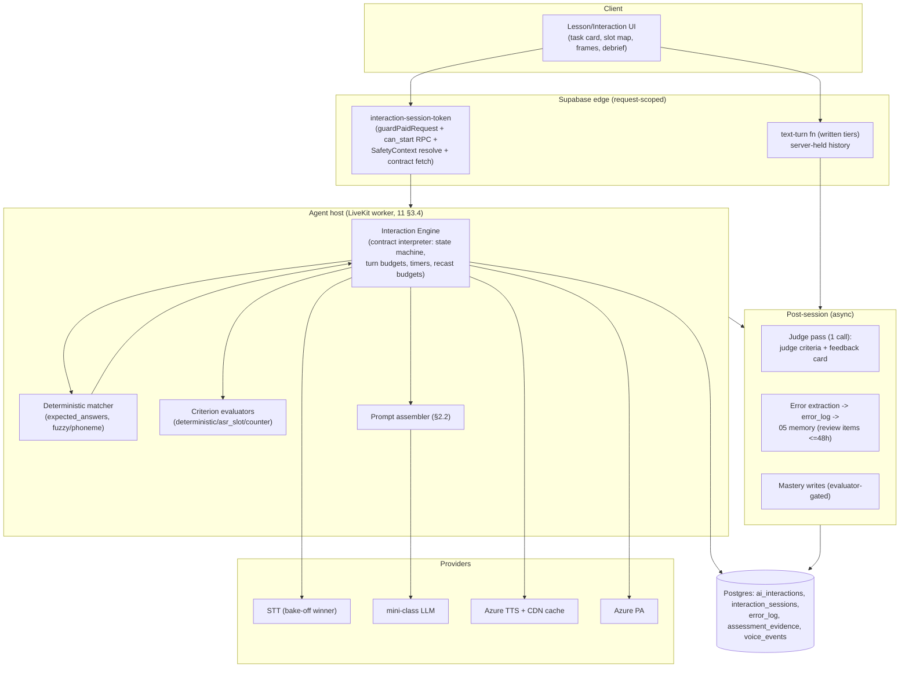

# 09 — Conversation Progression: Written + Spoken AI Interaction Architecture

**Status:** Planning deliverable — no implementation.
**Author:** Written + Spoken AI Interaction Architect (conversation progression).
**Date:** 2026-07-30. Repo `/Users/calebjaworski/fluentforge-app`, branch `overhaul`, commit `7cbaadd9`.
**Sources:** curriculum maps 07 (ESL) / 08 (ES) + the eight band plans (`wip-curriculum-*`), voice study 11 (+ wip-11a defects D1–D16), safety spec 15 §3, current edge functions (`chat-with-tutor`, `premium-voice-realtime`, `custom-realtime-conversation`, `_shared/curriculumContext.ts`).
**Labels:** [observed] (repo, file:line) · [documented] (plan doc, §) · [estimated] · [proposed] · [assumption] · [requires validation].
**Parallel dependency:** the mastery/memory model (doc 05) is being designed concurrently; this doc assumes [assumption] unified memory entities including error-derived review items and FSRS-style scheduling, and writes to it only through the interfaces named in §2.4 and §3.6.

This document is the definitive interaction architecture: the single contract schema every AI interaction ships with, how a contract executes on the Pattern D voice stack (11 §3.2), how progressive release is enforced, what varies per band, and the guarantees that prevent AI interactions from degrading into ungraded chat.

---

## 0. Current-state anchors (what this replaces and what it preserves)

**What ships today [observed]:** three prompt surfaces, none of which carries an objective, success criteria, turn budget, memory write, or correction policy:

- `chat-with-tutor/index.ts:359-379` — free-form tutor prompt; correction is a single all-or-nothing `correctGrammar` boolean producing a "📝 Grammar note" appendix (`:367-375`). No per-error prioritization, no post-session feedback object, no evidence capture.
- `premium-voice-realtime/index.ts:83-105` — open-ended "encouraging tutor" instructions; session config sends only `model/voice/instructions` (`:121-125`); nothing persists server-side at mint (`:138-147`); the client sends no body so personalization is dead (D4, wip-11a §4).
- `custom-realtime-conversation/index.ts:77` — "Keep responses 2-3 sentences. Use the speak_bilingual function" — the entire pedagogy.

**Strengths carried forward [observed]:**
1. **Graded L1 scaffolding tables** — the CEFR→native-language-ratio ladder (`chat-with-tutor/index.ts:316-357`, duplicated at `premium-voice-realtime/index.ts:56-105` and `custom-realtime-conversation/index.ts:67-77`). This becomes one shared, server-side prompt block (§3.2 layer 2); the ratios are re-keyed to course band, not raw CEFR guess.
2. **Curriculum snapshot injection** — `_shared/curriculumContext.ts:24-124` already resolves active unit, weakest skills, target vocab, due reviews into a system-prompt block (`chat-with-tutor/index.ts:381-392`). This is the seed of the learner-memory snapshot (§3.2 layer 4); it grows to include error-bank entries from the 05 model.
3. **Multi-voice bilingual SSML** (`custom-realtime-conversation/index.ts:93-119, 171-177`) — retained as the TTS mechanism for L1-supported AI turns in A1 bands (escaped per D9).
4. **Fail-closed auth/rate guard** (`_shared/authGuard.ts:24-91`) — every new interaction endpoint uses it (11 §3.4).

**What is retired:** the decorative-chat pattern itself. Today's "conversation practice" is structurally ungraded: no session entity, client-supplied history (`chat-with-tutor/index.ts:108,171-183` — tamperable), no outcome. Under this architecture **no AI turn is ever served without a resolved interaction contract** (§6, guarantee G1).

---

## 1. The unified interaction contract

### 1.1 Reconciling 07 §8.2c/d and 08 §9.3

The two maps carry the same owner-mandated payload — 07 counts 16 fields (07 §8.2c), 08 numbers 15 because it folds `failure_handling` into the list unnumbered (08 §9.3) — with naming/structure drift [documented]:

| Concern | 07 (ESL) | 08 (ES) | Unified resolution [proposed] |
|---|---|---|---|
| Interaction class | `profile: full\|micro` (07 §8.2c) | `tier: micro\|guided\|open\|mission` (08 §9.3) | **`tier: micro\|controlled\|guided\|open\|mission`** carries routing/ratio semantics; `profile: full\|micro` kept as an authoring-completeness flag only (micro inherits unit defaults). `controlled` added because both curricula distinguish controlled dialogue completion / guided Q&A from freer guided roleplay (en-early-a1 §9; es-early-a1 §9) and doc 11 routes them differently (Pattern C vs B, 11 §3.2). |
| Curriculum context | structured `{unit, lesson, prior, upcoming_receptive_only}` | prose "consumes …; feeds …" | Structured object with `consumes[]` / `feeds[]` refs + `upcoming_receptive_only[]`. |
| Scaffolding | `{attempt_1, attempt_2plus, fade_trigger, stall_behavior, floor}` | numbered levels 0–3 + `auto_escalate {idle_s, failed_sends}` | Ladder of named levels + fade schedule + escalation triggers + band floor (§1.3.2). Both bands' semantics expressible. |
| Correction rules | `{priority[4], in_flight, post_task}` | per-priority actions `p1..p4` + `post_session_feedback` | Per-priority **action + budget** table (§1.3.3) — the operationalized owner policy. |
| Mission extension | `{scenario, difficulty_tiers, rubric, variants, retry_policy, evidence}` (07 §8.2d) | `scenes[], planted_breakdowns[], lifeline, outcome enum, fresh-scenario rule` (08 §9.3) | Union: both are present in the mission block; `scenes[]` becomes the general script container (§1.3.5) that controlled-tier interactions also use. |
| Grammar/pron keys | `gram.*` / `pron.*` dotted keys (07 R5/R6) | `GS-xx` / `PR-xx` (08 §5–6) | Contract stores **course-namespaced keys** (`en:gram.*`, `es:GS-xx`); the schema does not force one namespace across directions — the 05 memory model consumes them opaquely. |
| Error taxonomy | dotted `gram.*/vocab.*/pron.*/prag.*/listen.*/mech.*` (07 §8.1 #8) | `AGR-GEN…` flat codes (08 §9.4) | Same: course-namespaced `saved_error_categories`; unification is a 05-model mapping table, not a rename of authored content. |

Everything else (objective, assumed vocabulary, permitted unfamiliar language, expected AI behavior, success criteria, mastery effects, review behavior, analytics, failure handling, cost expectations) is semantically identical across the two maps and merges directly.

### 1.2 The JSON Schema [proposed]

One schema for every dedicated interaction, micro-exchange, open window, and mission in both directions. Stored per 08 §9.1 `ai_interactions` (+`missions`) rows, versioned; the 07 §9.3 lint gates run against this schema (gate 3 key-completeness, gate 10 cost/analytics).

```json
{
  "$schema": "https://json-schema.org/draft/2020-12/schema",
  "$id": "https://palavox.app/schemas/ai-interaction-contract/1.json",
  "title": "AI Interaction Contract",
  "type": "object",
  "required": [
    "id", "version", "course", "lesson_ref", "mode", "tier",
    "communicative_objective", "curriculum_context", "assumed_vocabulary",
    "target_grammar", "target_pronunciation", "permitted_unfamiliar_language",
    "scaffolding", "expected_ai_behavior", "correction_policy",
    "success_criteria", "mastery_effects", "saved_error_categories",
    "review_behavior", "analytics_plan", "failure_handling", "cost_expectations"
  ],
  "properties": {
    "id": { "type": "string", "description": "Canonical id, e.g. EN-U02-L18-SAI, es-8.16-wai" },
    "version": { "type": "integer", "minimum": 1 },
    "status": { "enum": ["draft", "gated", "operational"] },
    "course": { "enum": ["esl", "es"] },
    "band": { "enum": ["A1E", "A1L", "A2E", "A2L"] },
    "lesson_ref": { "type": "string" },
    "mode": { "enum": ["written", "spoken", "mixed"] },
    "tier": { "enum": ["micro", "controlled", "guided", "open", "mission"] },
    "profile": { "enum": ["full", "micro"], "default": "full" },
    "interaction_type": { "type": "string",
      "description": "Owner taxonomy: guided_qa, information_gap, controlled_dialogue_completion, roleplay, breakdown_repair_drill, describing_game, message_thread, free_talk, real_world_mission, ..." },

    "communicative_objective": { "type": "string", "minLength": 20,
      "description": "Task-framed, >= one sentence (07 §8.2c #1)" },

    "curriculum_context": {
      "type": "object",
      "required": ["unit"],
      "properties": {
        "unit": { "type": "string" },
        "consumes": { "type": "array", "items": { "type": "string" },
          "description": "prior lesson/skill refs assumed practiced" },
        "feeds": { "type": "array", "items": { "type": "string" },
          "description": "downstream refs: missions, checkpoints, graduation phases" },
        "upcoming_receptive_only": { "type": "array", "items": { "type": "string" } }
      }
    },

    "assumed_vocabulary": {
      "type": "array", "items": { "type": "string" },
      "description": "Taught-item refs only; runtime whitelist source; lint V1/V3 boundary check (07 §9.3, 08 §10.3)"
    },
    "target_grammar": { "type": "array", "items": { "type": "string" } },
    "target_pronunciation": {
      "type": "array", "items": { "type": "string" },
      "description": "pron.*/PR-xx keys; for written mode, orthography/mechanics targets instead"
    },

    "permitted_unfamiliar_language": {
      "type": "object",
      "required": ["max_items", "grammar_ceiling"],
      "properties": {
        "max_items": { "type": "integer", "minimum": 0, "maximum": 3 },
        "constraint": { "type": "string",
          "description": "e.g. cognate-transparent-or-glossed; guessable-from-context" },
        "glossing_rule": { "type": "string" },
        "grammar_ceiling": { "type": "string", "description": "band | explicit gram-key ceiling" },
        "planned_unknowns": { "type": "array", "items": { "type": "string" },
          "description": "pre-authored stretch items (comprehensible-input seeds)" }
      }
    },

    "scaffolding": {
      "type": "object",
      "required": ["levels", "fade_schedule", "floor"],
      "properties": {
        "levels": { "type": "array", "items": { "type": "object",
          "required": ["level", "support"],
          "properties": {
            "level": { "type": "integer" },
            "support": { "type": "string",
              "description": "0 none | 1 repeat/slow | 2 frames/reformulate | 3 L1 hint (marks with_support)" },
            "counts_as_assist": { "type": "boolean", "default": true }
          } } },
        "fade_schedule": { "type": "string",
          "description": "e.g. 'frames collapse after 3 successful turns'; 'attempt1 full frames, attempt2 keywords, attempt3 bare card'" },
        "escalation_triggers": { "type": "object", "properties": {
          "idle_s": { "type": "integer" }, "failed_turns": { "type": "integer" },
          "asr_low_confidence_turns": { "type": "integer" } } },
        "floor": { "type": "string",
          "description": "band floor: A1 scaffolds never fully removed; missions none_in_flight except lifelines" },
        "lifelines": { "type": "object", "properties": {
          "count": { "type": "integer" }, "effect_on_outcome": { "type": "string" } } }
      }
    },

    "expected_ai_behavior": {
      "type": "object",
      "required": ["persona", "register", "turn_length_max", "question_policy"],
      "properties": {
        "persona": { "type": "string" },
        "register": { "type": "string" },
        "pace": { "type": "string", "description": "TTS rate multiplier or wpm band, e.g. 0.85x" },
        "turn_length_max": { "type": "string", "description": "words or sentences cap" },
        "question_policy": { "type": "string",
          "description": "e.g. 'ends every turn with a question or decision point'; 'one question at a time'" },
        "planted_events": { "type": "array", "items": { "type": "object",
          "required": ["kind", "position"],
          "properties": {
            "kind": { "enum": ["unexpected_turn", "breakdown", "wrong_info", "complication", "too_fast_turn", "register_shift"] },
            "position": { "type": "string" },
            "authored_content": { "type": "string" },
            "expected_learner_move": { "type": "string" }
          } },
          "description": "exactly one per interaction unless mission scenes specify more" },
        "continuity_checks": { "type": "boolean",
          "description": "AI must reference learner facts from earlier turns/scenes" }
      }
    },

    "correction_policy": { "$ref": "#/$defs/CorrectionPolicy" },
    "success_criteria": { "type": "array", "items": { "$ref": "#/$defs/SuccessCriterion" }, "minItems": 2 },

    "mastery_effects": {
      "type": "object",
      "properties": {
        "on_success": { "type": "array", "items": { "type": "object", "properties": {
          "skill": { "type": "string" }, "evidence": { "enum": ["productive", "receptive", "interactional"] },
          "weight": { "type": "number" } } } },
        "on_partial": { "type": "string", "description": "e.g. review_cards_only; half-credit" },
        "with_support_weighting": { "type": "number", "default": 0.5,
          "description": "evidence multiplier when session flagged with_support (en-late-a2 §13b)" },
        "fsrs_review_events": { "type": "boolean",
          "description": "successful productive use ticks FSRS cards (05 model)" }
      }
    },

    "saved_error_categories": { "type": "array", "items": { "type": "string" } },

    "review_behavior": {
      "type": "object",
      "properties": {
        "spawn_review_items_within_h": { "type": "integer", "default": 48 },
        "max_spawned_per_session": { "type": "integer", "default": 4 },
        "retry_policy": { "type": "object", "properties": {
          "max_per_day": { "type": "integer" },
          "variant_required": { "type": "boolean", "default": true },
          "remedial_branch_after": { "type": "integer", "default": 2 },
          "escalation": { "enum": ["human_flag", "feeding_lessons", "none"] } } }
      }
    },

    "analytics_plan": {
      "type": "array", "items": { "type": "string" },
      "description": "event keys beyond the mandatory core set (§6 G6): turns, learner_output_volume, assist_count, scaffold_fade_point, recast_uptake_rate, repair_events, planted_event_outcome, task_success, time_on_task, cost_usd"
    },

    "failure_handling": { "$ref": "#/$defs/FailureHandling" },
    "cost_expectations": { "$ref": "#/$defs/CostExpectations" },

    "script": { "$ref": "#/$defs/Script",
      "description": "REQUIRED when tier in [micro, controlled] and for mission scenes; enables Pattern C deterministic-first execution (11 §3.2; dependency 11 §7.1#3)" },

    "voice_config": {
      "type": "object",
      "description": "spoken mode only",
      "properties": {
        "tts_rate": { "type": "number" }, "voice_profile": { "type": "string" },
        "barge_in": { "enum": ["off", "learner_only", "full"] },
        "vad_end_of_turn_ms": { "type": "integer" },
        "pa_inline": { "type": "boolean", "description": "Azure PA scoring on target_pronunciation (11 §3.2)" },
        "degraded_channel_sim": { "type": "boolean", "description": "phone-band filter, client-side (en-late-a2 §13c)" }
      }
    },

    "mission": {
      "type": "object",
      "description": "tier=mission only",
      "required": ["scenario", "rubric", "outcome_enum", "variants"],
      "properties": {
        "scenario": { "type": "string", "description": "learner task card, L1-rendered" },
        "scenes": { "type": "array", "items": { "$ref": "#/$defs/Scene" } },
        "difficulty_tiers": { "type": "object", "properties": {
          "T1_supported": {}, "T2_default": {}, "T3_stretch": {} },
          "description": "tier chosen from mastery profile" },
        "planted_breakdowns": { "type": "array", "items": { "type": "string" } },
        "rubric": { "type": "object", "description": "cells[], scale 0-2 or rating enum, pass_rule" },
        "outcome_enum": { "type": "array",
          "items": { "enum": ["exceeded", "functional", "developing", "incomplete",
                              "completed", "completed_with_support", "repeat_mission"] } },
        "variants": { "type": "array", "items": { "type": "string" },
          "description": "retry is never verbatim (07 §8.2d)" },
        "evidence_feeds": { "type": "array", "items": { "type": "string" } }
      }
    }
  },

  "$defs": {
    "CorrectionPolicy": {
      "type": "object",
      "required": ["p1", "p2", "p3", "p4", "budgets", "post_session"],
      "properties": {
        "p1": { "type": "string", "default": "in_character_clarification_or_recast_immediate",
          "description": "understanding-blocking failures — always addressed this turn" },
        "p2": { "type": "string", "default": "concise_recast_embedded",
          "description": "current lesson target errors" },
        "p3": { "type": "string", "default": "log_only",
          "description": "repeated high-value errors from learner error bank; recast only if budget free (guided tier)" },
        "p4": { "type": "string", "default": "echo_model_max_1_per_session",
          "description": "intelligibility-affecting pronunciation (PA/ASR-flagged >= 2x)" },
        "budgets": { "type": "object", "properties": {
          "max_recasts_per_turn": { "type": "integer", "default": 1 },
          "max_recasts_per_error_type": { "type": "integer", "default": 2 },
          "never_mid_utterance": { "const": true },
          "mission_in_flight": { "const": "p1_only" } } },
        "post_session": { "type": "object", "properties": {
          "max_items": { "type": "integer", "default": 4 },
          "format": { "type": "string", "default": "learner_line + model_line + why, L1-rendered" },
          "include_strength": { "type": "boolean", "default": true },
          "priority_ordered": { "const": true } } }
      }
    },
    "SuccessCriterion": {
      "type": "object",
      "required": ["id", "dimension", "evaluator", "expr"],
      "properties": {
        "id": { "type": "string" },
        "dimension": { "enum": ["task", "language", "interaction"] },
        "evaluator": { "enum": ["deterministic", "asr_slot", "counter", "judge"] },
        "expr": { "type": "string",
          "description": "machine-checkable: e.g. 'grid_cells_correct == 4'; 'count(productions[gram.be_going_to]) >= 2'; 'repair_event(planted_1).resolved == true'; judge: rubric_cell ref + threshold" },
        "threshold": { "type": "number" },
        "judge_confidence_min": { "type": "number",
          "description": "judge evaluators below this queue for human sampling (07 §11.2)" },
        "evidence_refs": { "type": "boolean", "default": true,
          "description": "criterion result stores transcript/audio spans as evidence" }
      }
    },
    "FailureHandling": {
      "type": "object",
      "required": ["learner_stall", "repeated_failure", "tech_failure", "off_task", "distress", "quota_exhausted"],
      "properties": {
        "learner_stall": { "type": "string",
          "description": "silence/idle thresholds -> scaffold escalation -> supported completion; never dead end" },
        "repeated_failure": { "type": "string",
          "description": "first_fail / second_fail -> route_to_feeding_lessons; never_third_identical: true" },
        "tech_failure": { "type": "string",
          "description": "provider outage -> fallback chain (11 §6.5); spoken->written modality_fallback flagged, excluded from gate evidence; tech failure never counts as learner failure" },
        "off_task": { "type": "string",
          "description": "re-anchor policy: N in-character redirects then early supported close with partial evidence" },
        "distress": { "type": "string",
          "description": "distress signals -> SafetyContext escalation path (15 §3.4): supportive close, safety_event row, minor-flag routing; session ends supported, no penalty" },
        "quota_exhausted": { "type": "string",
          "description": "mid-session downgrade to Pattern F floor (11 §3.1) with learner notice" },
        "supported_completion": { "type": "string",
          "description": "what 'AI completes collaboratively' looks like for this task" }
      }
    },
    "CostExpectations": {
      "type": "object",
      "required": ["route_pattern", "est_usd_p50", "est_usd_p95", "hard_cap_minutes"],
      "properties": {
        "route_pattern": { "enum": ["F", "C", "B", "A", "C+B", "text"] },
        "est_usd_p50": { "type": "number" },
        "est_usd_p95": { "type": "number" },
        "hard_cap_minutes": { "type": "number" },
        "token_budget": { "type": "integer" },
        "judge_calls": { "type": "integer", "default": 1 }
      }
    },
    "Scene": {
      "type": "object",
      "required": ["id", "goal"],
      "properties": {
        "id": { "type": "string" }, "goal": { "type": "string" },
        "persona_override": { "type": "string" },
        "mode_override": { "enum": ["written", "spoken"] },
        "planted_event_ref": { "type": "string" },
        "max_minutes": { "type": "number" }
      }
    },
    "Script": {
      "type": "object",
      "description": "Deterministic-first execution data (Pattern C)",
      "properties": {
        "ai_lines": { "type": "array", "items": { "type": "object", "properties": {
          "id": { "type": "string" }, "text": { "type": "string" },
          "tts_asset_ref": { "type": "string", "description": "pre-generated, CDN-cached (fixes D15)" } } } },
        "expected_answers": { "type": "array", "items": { "type": "object", "properties": {
          "after_line": { "type": "string" },
          "accept": { "type": "array", "items": { "type": "string" },
            "description": "surface forms / slot patterns" },
          "match": { "enum": ["exact", "fuzzy", "slot", "phoneme_aware"] },
          "tolerance": { "type": "number" },
          "on_deviation": { "enum": ["llm_handle", "reprompt", "scaffold_up"] } } } },
        "llm_on_deviation_prompt_ref": { "type": "string" }
      }
    }
  }
}
```

### 1.3 Field semantics that need more than a schema

#### 1.3.1 Tier definitions (routing + ratio semantics) [proposed]

| Tier | Definition | Ratio bucket (07 §7.1) | Runtime route (11 §3.2) |
|---|---|---|---|
| `micro` | 1–2 turn end-of-lesson exchange (mandatory U7+, 07 R11) | structured | text: single-call graded prompt; spoken: C |
| `controlled` | dialogue completion, guided Q&A from known bank, confirm-echo, dictation-adjacent | structured | **C** deterministic-first, cached TTS |
| `guided` | info gap, scaffolded roleplay, guided conversation with real information movement | guided | **B** (spoken) / text pipeline (written) |
| `open` | free talk windows, sustained chat, story swap | open | **B** with graded-output monitor (§4.3); Pattern A reserved for out-of-course native real-time free talk |
| `mission` | goal-card-only scenario chains with rubric + planted breakdowns | open (A2) / guided (A1 scaffolded variant) | **C+B** per scene |

#### 1.3.2 Scaffolding fade — canonical schedules [documented → unified]

- A1E: scaffolds never fully removed (en-early-a1 §13c "this band never removes all support"); frames fade after 2–3 successes but reappear on stall (§13b).
- A2E: attempt 1 full frames → attempt 2 keyword hints → attempt 3 bare task card (en-early-a2 §9).
- Missions: no in-flight scaffolds; lifelines only (2×, logged, reduce outcome one band — es-early-a1 §13d).
- Level-3 (L1 hint / "English please") always available but marks the session `with_support` → mastery evidence × `with_support_weighting` (default 0.5).

#### 1.3.3 The correction policy, operationalized [proposed]

The owner's 4-priority stack becomes a **decision function the runtime engine enforces outside the LLM** (the LLM is asked to produce recasts, but the engine decides *when* one is allowed and audits compliance — §6 G4):

```
onLearnerTurnScored(turn, signals):
  # signals: parse_fail | task_slot_wrong | target_grammar_error |
  #          error_bank_match | pron_flag(PA/ASR >=2x) | off_task | distress
  if distress            -> failure_handling.distress (SafetyContext path)   # overrides all
  if parse_fail or task_slot_wrong:                    # P1 understanding-blocking
      -> in-character clarification/recast THIS turn (always; consumes recast budget)
  elif target_grammar_error and budget.turn_free and budget.type[err] < 2:   # P2
      -> concise recast embedded in the AI's natural reply; never meta-language
  elif error_bank_match:                                # P3 repeated high-value
      -> guided tier: recast only if budget still free; mission/open: log only
  elif pron_flag and session.echo_models == 0:          # P4 intelligibility pron
      -> one echo-model moment, max 1/session
  ALL detected signals -> error_candidates -> post-session ranking:
      feedback card, max 3–4 items, priority-ordered (P1>P2>P3>P4), + 1 strength,
      L1-rendered, each item linked to a spawned review item (§3.6)
```

**In-flight intensity by tier:** controlled = deterministic feedback (matcher, not recasts); guided = full P1–P4; mission = P1 only in-flight, everything else in the debrief (en-late-a2 §13d; es-early-a1 §13d); open = **no in-flight correction at all** — silent error harvesting, ≤2 highlighted takeaways after (en-late-a1 §9 open-conversation design).

**What triggers an in-flight recast vs a post-session feedback item:** in-flight requires (a) priority P1, or (b) P2 with both budgets free, or (c) P4 first flag. Everything else — P3 matches, mechanics, third-plus occurrences, all mission/open non-blocking errors — is post-session only. This is testable from transcripts (§6 G4).

#### 1.3.4 Success criteria — machine-checkable evaluator classes [proposed]

| Evaluator | What it checks | Examples from authored contracts |
|---|---|---|
| `deterministic` | slot/checklist state from structured task UI or matcher | "all 4 grid cells correct" (en-early-a1 §13b); "date+time+place all present" (en-late-a2 §13b) |
| `asr_slot` | ASR-detected elements in speech | per-person checklist ticks (en-early-a1 §13d); digit-accurate phone number (es-early-a1 §13d) |
| `counter` | event counts over the session | "learner asked ≥1 question back"; "≥2 target-grammar productions"; "≥1 repair phrase at planted breakdown" |
| `judge` | rubric cells needing judgment (relevance, comprehensibility, register) | "≥5 of 6 answers on-topic and intelligible" (en-late-a2 §13c); mission rubric cells |

Every criterion stores evidence refs (transcript/audio spans). `judge` results below `judge_confidence_min` queue for human review sampling — same QA machinery as graduation scoring (07 §11.2) [requires validation: judge-vs-human calibration is a Phase-1 measurement alongside 11 §5's m6].

#### 1.3.5 Failure handling — the six mandatory branches

Every contract must fill all six (`learner_stall`, `repeated_failure`, `tech_failure`, `off_task`, `distress`, `quota_exhausted`); lint fails otherwise. `distress` always routes to the 15 §3.4 crisis path; `tech_failure` always ends at a fallback chain from 11 §6.5 and **never records learner failure** (08 §9.3 `tech_failure_not_learner_failure`).

---

## 2. Runtime architecture on the Pattern D stack

### 2.1 Components [proposed]



A session starts only via `interaction-session-token` (voice) or the text-turn function (written) — both run `guardPaidRequest`, the 11 §3.4 admission RPC (concurrency + minutes), **and SafetyContext resolution (15 §3.1, fail-closed to strict)**. The token embeds `contract_id@version`; the agent worker (or text fn) loads the contract server-side. The client never carries the contract or the history [proposed — closes the client-trust gap of `chat-with-tutor/index.ts:108`].

### 2.2 Prompt assembly — fixed layer order [proposed]

1. **Safety policy block** — from SafetyContext (15 §3.2): non-negotiable, first, server-injected; strict/minor variants. For any S2S session it is set at token-mint time (fixes the D4-class failure by contract: mint requires the full context object; a bodyless request is rejected).
2. **L1 scaffolding block** — the preserved graded ladder (one shared module replacing the three duplicated tables at `chat-with-tutor/index.ts:316-357`, `premium-voice-realtime/index.ts:56-105`, `custom-realtime-conversation/index.ts:67-77`), keyed by **band** (A1E→~60% L1 … A2L→~25–30% L1, aligned to the band's own L1-use design) with the contract able to tighten (e.g., mission scenes: target-language only).
3. **Interaction contract block** — rendered from the row: objective, persona/register/pace/turn-length, vocabulary whitelist + permitted-unfamiliar budget, planted events (verbatim authored content), correction-policy instructions (what a recast looks like *when the engine requests one*), tier rules.
4. **Learner memory snapshot** — evolution of `getCurriculumSnapshot` (`_shared/curriculumContext.ts:24-107`): active unit + weakest skills + due reviews, **plus** (05 model) open error-bank entries relevant to this contract's `saved_error_categories` (preloads P3 detection and L1-contrast-informed recasts — the `l1_contrast_notes.recast_example` field, 07 §8.1#2), and recent recast-uptake rate (tunes correction intensity down if uptake is high).
5. **Session state delta** (per turn, voice B/C routes): scene/goal progress, slots remaining, budget counters — so the LLM sees task state without re-reading transcripts.

Token discipline: layers 1–3 are stable per session → prompt-cache-friendly; layer 4 resolved once at start; layer 5 is the only per-turn variance [estimated: keeps per-turn prompt cost within the 11 §4.1 `P_llm` band].

### 2.3 Turn loop — text vs voice

**Written tiers (micro/controlled/guided/open written, mission written scenes):**
1. Client posts `{session_id, learner_turn}` — nothing else.
2. Server appends to server-held transcript, runs the matcher (controlled) or scoring signals (guided+), runs the §1.3.3 decision function, assembles the reply (deterministic template or LLM call), runs the **graded-output lint** (vocab boundary + grammar ceiling; one regeneration on violation, then accept-with-flag §4.3), returns reply + UI state (slots, fades, checklist ticks).
3. Turn budget and `hard_cap_minutes` enforced server-side; on cap → `failure_handling.learner_stall`/supported completion.

**Spoken tiers (agent worker, persistent):**
1. Learner audio → streaming STT (+ inline PA when `voice_config.pa_inline`).
2. End-of-turn (VAD per `vad_end_of_turn_ms`, band-tuned; semantic turn model where available, 11 §2.2) → matcher first (C) → LLM only on deviation or guided/open tiers.
3. AI turn: script line → cached TTS asset (CDN); generated line → text → graded-output lint → streaming TTS with SSML rate = `voice_config.tts_rate`.
4. Barge-in per `voice_config.barge_in`: `off` at A1E (AI never interrupts learner; learner interrupt not needed — turns are short), `learner_only` from A1L, `full` at A2L open windows [proposed].
5. Heartbeat accounting per 11 §3.4 (agent is the single accounting authority; fixes D1/D7/D8 for interactions).

### 2.4 Deterministic-first execution (Pattern C) [proposed]

For `micro` and `controlled` tiers and scripted mission scenes, the `script` block makes most turns LLM-free (11 §3.1 estimates 60–80% of turns skip the LLM):

- AI lines are pre-authored, pre-synthesized, CDN-cached (07 §10.2 counts them in the audio budget; fixes D15).
- Learner turns match against `expected_answers` with tier-appropriate tolerance: `slot` matching for info gaps (times, days, rooms), `phoneme_aware` fuzzy matching for spoken drills (mitigates the matcher-false-negative failure mode flagged in 11 §3.1 — near-misses route `on_deviation: llm_handle` rather than "wrong").
- Deviation → the LLM handles *that turn only* with a narrow prompt (`llm_on_deviation_prompt_ref`), then control returns to the script.
- Guided Q&A "known question bank" interactions (e.g., EN-A1E-U2-L18 §13c asks 3 authored follow-ups; es guided triage Q&A) run as scripts with LLM-scored free-response slots — the questions never burn LLM tokens, learner-answer scoring does.

**Curriculum dependency (binding):** authors must fill `expected_answers` for every controlled-tier contract — already flagged as 11 §7.1 dependency 3; this schema is where that requirement lands.

### 2.5 Success-criteria evaluation — during vs post [proposed]

- **During:** `deterministic`, `asr_slot`, `counter` evaluators run incrementally and drive live UI (checklist ticks per en-early-a1 §13d), scaffold escalation, and early-success detection. No LLM cost.
- **Post:** one judge call per session (the pattern already priced into es-early-a1 §13b "Judge pass on transcript at end (1 call)") scores all `judge` criteria + drafts the feedback card in the same completion. Missions with rubrics may need 2 calls (score + debrief) [estimated].
- Outcome = pass rule over criterion results → outcome enum → mastery writes. **No mastery write ever occurs without an evaluator record** (§6 G5).

### 2.6 Error extraction pipeline → 05 memory [proposed]

```
turn signals (matcher diffs, recast events, PA phoneme flags, judge error tags)
  -> error_candidates (session-scoped, deduped by category+lemma)
  -> error_log rows (course-namespaced category, source_ref=session+span, severity,
     l1_mechanism_ref where l1_contrast_notes matches)          [08 §9.1 error_log]
  -> 05 memory model: review items spawned <=48h, max per session per contract
     (review_behavior), FSRS-scheduled; clearance rule = 2 consecutive correct
     productions IN INTERACTION, not drills (07 §8.1#8)
  -> feedback card items link 1:1 to spawned review items
```

Recast-uptake (learner reuses corrected form within session) is computed per session and stored — it is both an analytics key (07 §8.2c) and a memory-model signal for correction-intensity tuning (§2.2 layer 4).

### 2.7 Transcript retention (minors) [proposed; governed by doc 15]

- Interaction transcripts/audio are **evidence-bearing** (success criteria store spans; missions feed checkpoints) → stored under 15 §4.1 class "minors' free-text conversation": shortest schedule, school-year + configurable window, then anonymize/purge; checkpoint/graduation evidence follows the certification-records class (longer, per contract).
- Open-window transcripts are the most sensitive (free talk): store **derived artifacts only** (error_log rows, takeaway card, analytics) after a short raw-retention window (e.g., 7 days for learner replay) [proposed; requires validation with doc-15 counsel review].
- Telemetry carries no transcript text (11 §6.2 privacy rule). Learner-facing replay honors the same purge schedule.

### 2.8 Failure & outage handling at runtime

| Event | Behavior [proposed] |
|---|---|
| STT/LLM/TTS provider error | per-provider fallback chain (11 §6.1 router); mid-session degrade: spoken → Pattern F floor (text + browser TTS) with in-UI notice; session continues, flagged `degraded`; evidence kept but gate-feeding sessions flagged for re-run |
| Agent host loss / disconnect | auto-resume ≤5 s target (11 §5 m13); session state persisted per turn so resume replays no learner work; unresumed → `aborted_tech`, no learner failure |
| Learner silence | `escalation_triggers.idle_s` → scaffold up → sentence starter → supported completion; A1 spoken re-prompt at ~5–6 s (en-early-a1 §13c), written at 45–60 s |
| Off-task | 2 in-character re-anchors to the objective; third deviation → early warm close, partial evidence, `incomplete_supported` [proposed] |
| Distress | 15 §3.4 path: supportive non-clinical close + localized helpline where applicable, `safety_event` row (no raw transcript), district escalation flag for rostered minors; never auto-contact external parties |
| Quota exhausted mid-session | finish current turn, then F floor; accounting closes cleanly (agent authority) |

---

## 3. Progressive-release enforcement

### 3.1 Authoring-side: ratio compliance is a lint, not a hope

Band ratios are computed from `est_minutes × tier` at authoring time and gated in CI (extends 07 §9.3): a band whose planned minutes fall outside owner guidance fails the gate. Delivered plans already comply — ESL 78/22/0 → 59/34/7 → 46/36/15 → 34/35/30 (07 §7.1); ES 75/25/0 → 61/32/7 → 45/40/15 → 30/41/29 (08 §3.1) [documented].

### 3.2 Runtime gating: tier unlock table [proposed]

The router (11 §6.1 `RoutePolicy`) refuses to mint a session whose tier the learner hasn't unlocked; gating reads mastery state server-side (thresholds per 07 R9: 0.65 gating, 0.70 missions):

| Tier | Unlock condition | Evidence source |
|---|---|---|
| `micro`, `controlled` | lesson prerequisites only (`lesson_prereqs`) | lesson_progress |
| `guided` | in-lesson rule: speaking blocks unlock at ≥70% on the lesson's flashcard+cloze block (07 R9) | exercise results |
| `mission` | unit's feeding interactions completed; gating skills ≥0.70 | skill_mastery + interaction outcomes |
| `open` (windows) | **band entry**: A1L+ (ESL post-U4L16; ES U4 mission-lite) — never available in A1E; plus the band's feeding-unit lessons complete | band position + lesson_progress |
| `open` (sustained chat / café abierto) | A2L band entry; weekly cap (1 standing slot, 08 §3.1) | band position |

Attempted access below the gate returns the *next unlockable step*, not an error (no dead ends). Replays of open windows are capped per week so learners cannot self-serve an open-heavy mix that violates their band's ratio [proposed; cap = the band's planned open minutes ±25%, telemetry-tuned].

### 3.3 Bounding "unpredictable but level-appropriate" [proposed]

Unpredictability is a *budgeted, authored* property, never emergent:

1. **Planted events are pre-authored** — exactly one per dedicated interaction (07 §8.2c "exactly one unexpected turn / breakdown where specified"); missions enumerate theirs per scene. The LLM never invents complications.
2. **Vocabulary boundary at runtime**: AI output passes the graded-output lint (cumulative taught set + `assumed_vocabulary` + `permitted_unfamiliar_language.max_items`); one regeneration on violation; second violation → serve with the out-of-budget item auto-glossed and log `boundary_violation` (telemetry-audited, §6 G7). Open windows widen the budget to band + 5% stretch (en-late-a1 §9).
3. **Grammar ceiling**: parse-based warn/fail per 07 §9.3 gate 2 at authoring; at runtime the ceiling rides in the prompt + lint heuristics (tense/aspect blacklist) [requires validation: runtime parser precision for ES/EN at acceptable latency].
4. **Topic bounds for open tier**: topic wheel drawn from completed units only (en-late-a2 §9); AI redirect policy on excursions (§2.8 off-task).
5. Because open windows run **Pattern B** (text is generated before TTS), the lint applies to spoken open conversation too — this is a main reason in-course open conversation is *not* S2S (§7 decision O-3).

---

## 4. Per-band interaction blueprints

Canonical sets are the band plans' §9 inventories [documented]; the contract fields below are what the runtime varies. Both directions share the progression grammar; IDs differ.

### 4.1 Band × varying contract fields (both directions)

| Field | A1E | A1L | A2E | A2L |
|---|---|---|---|---|
| Ratio (ESL / ES) | 78/22/0 · 75/25/0 | 59/34/7 · 61/32/7 | 46/36/15 · 45/40/15 | 34/35/30 · 30/41/29 |
| Tiers available | micro*, controlled, guided, mission (scaffolded variant) | + open windows (unscored) | + open (scored-lite), micro mandatory U7+ | + sustained chat, café abierto weekly |
| Scaffolding floor | never fully removed; frames reappear on stall | frames fade after 2 successes | attempt-1 frames → attempt-2 keywords → attempt-3 bare card | none by default; lifelines in missions only |
| AI pace (`voice_config.tts_rate`) | 0.85× careful | slow-clear → natural | 0.95× natural | natural incl. fast; degraded/phone-band sims |
| AI turn length | ≤10–12 words | ≤12–14 words | 1–2 sentences | 1–2 sentences, natural variance |
| `permitted_unfamiliar_language.max_items` | ≤1–2, guessable/cognate | ≤2, glossed on request | ≤2 + 1 planned repair-trigger | 1–2 planned unknowns incl. realism items (menus, brisk staff) |
| Planted events | exactly 1, gentle (mishearing, "typo-garbled" reply) | 1 (out-of-stock, wrong direction) | 1/roleplay + engineered repair moment | wrong-info events, transfers, register shifts; T1–T3 difficulty tiers |
| In-flight correction | full P1–P4, warm; recasts inside reactions only | full P1–P4 | full; register errors enter P2 set | missions P1-only; open: none (silent harvest) |
| Barge-in | off | learner_only | learner_only | full (open tiers) |
| Post-session card | ≤3 items + 1 strength, audio models to shadow | ≤3 + 1 | ≤3–4 + 1, replayable own-audio vs model | ≤4–5 (missions), each tied to replayable moment |
| Judge share of criteria | minimal (slots/ASR do most) | low | medium (relevance, register) | high (rubrics, repair quality) |
| Route mix | C-heavy, F-capable | C + first B sessions | C/B balanced | B-heavy + C scenes |

\* micro tier exists in A1 as ASR chunk checks embedded in lessons, not the standing end-of-lesson rule (07 R11).

### 4.2 Canonical interaction sets (from the band plans; contracts to be authored from the cited templates)

**ESL A1E (U1–U3)** — per en-early-a1 §9/§13: W controlled dialogue completion (U1), schedule info-gap chat (U2 §13b), family message reply (U3); S guided self-intro Q&A (U1), guided routine Q&A (U2 §13c), interview-the-AI role reversal (U3); missions "Three Introductions", "A Day in Your Life", "People in My Life" (§13d). No open tier.

**ESL A1L (U4–U6)** — en-late-a1 §9: 7–8 interactions/unit incl. confirm-echo direction tracing, server-question reaction drills (≤3 s), breakdown-repair drill (U6L12), marketplace negotiation thread (§13b), missions "Get me there"/"The Full Café"/"Buy it, Return it", and the course's **first open windows** (5–6 min, optional, unscored, silent error harvest, ≤2 takeaways).

**ESL A2E (U7–U9)** — en-early-a2 §9: unit pattern {W thread with complication; S info-gap/clinic call 8–12 turns; guided roleplay; mission} + micro-exchange every non-review lesson; repair thread escalates ("Do you mean…?", self-repair).

**ESL A2L (U10–U12)** — en-late-a2 §9/§13: plan-change group chat (§13b), mini job interview (§13c), audio-degraded phone sim, contrastive-stress repair drills, 18 free-conversation sessions + topic-wheel opens, missions incl. "Survive the switchboard" (§13d, T1–T3 tiers, wrong-info catch); graduation sequence consumes this band's evidence.

**ES A1E (U1–U3)** — es-early-a1 §9/§13: W «Chat de bienvenida», «Horarios cruzados» info gap (§13b), «¿Quién es quién?» guessing game; S «Mucho gusto» roleplay (formal AND informal round), «Mi día» guided Q&A, «Te presento a mi familia» (§13c); mission «Un nuevo amigo» (§13d — 4 scenes incl. written phone-number side-channel, register-negotiation beat).

**ES A1L (U4–U6)** — es-late-a1 §9: direction-following micro, map info-gap, lost-in-city roleplay, café roleplay, market info-gap, store/complaint micros, missions 4.18/5.19/6.17; open ≈7% via mission-lite + free-talk debrief windows.

**ES A2E (U7–U9)** — es-early-a2 §9: taquilla chat info-gap, terminal roleplay (sold-out complication), triage Q&A → pharmacy roleplay → adaptive clinic chain (hardest guided task), narrative-with-AI-reader, 9.19 open story swap (min 8 learner turns), M9; engineered repair moment per roleplay from U8.

**ES A2L (U10–U12)** — es-late-a2 §9: quedar micro, replanning roleplay, group-chat thread, interview roleplay + recruiter follow-ups, circumlocution game, phone call, lost & found, sustained chat 12.17, complaint thread, missions 10.18/11.18/12.19, weekly «café abierto» from U10.

---

## 5. Anti-decorative-chat guarantees (testable) [proposed]

The failure mode to prevent is the current product: AI talk that grades nothing, writes nothing, and bounds nothing [observed §0]. Seven mechanisms, each with an acceptance test:

| # | Guarantee | Mechanism | Acceptance test (measurable) |
|---|---|---|---|
| G1 | **No contract, no session** | token mint + text-turn fn require `contract_id@version` resolvable to a `gated/operational` row; free-talk windows are contracts too (open tier) | 100% of AI sessions in telemetry carry contract_id; a mint request without one is rejected (integration test); 0 legacy-prompt sessions after cutover |
| G2 | **Every session ends in an outcome** | engine finalizes outcome enum on every exit path (incl. tech abort, distress, cap) | 0 sessions older than 10 min without a finalized outcome row (pg check, alerting); crash-resume test produces `aborted_tech`, never null |
| G3 | **Turn/time budgets are hard** | server-side turn counter + `hard_cap_minutes` per contract; caps trigger supported completion, not silent continuation | forced-runaway test session is closed at cap ±1 turn; cost per session ≤ `est_usd_p95` for ≥95% of pilot sessions (11 §6.2 cost events) |
| G4 | **Correction budgets are enforced and audited** | engine gates recast permission (§1.3.3); post-generation compliance check strips/regenerates over-budget recasts | transcript audit: ≤1 recast/turn in ≥98% of turns; mission in-flight corrections are P1-only in 100% of audited missions; recast_uptake_rate computed for 100% of guided sessions |
| G5 | **Mastery writes only through evaluators** | mastery/FSRS/evidence writes accept only evaluator-output payloads (no free writes from prompts or client); `with_support` weighting applied | schema/RLS test: no path writes skill_mastery from a session without criterion records; sampled sessions show evidence_refs resolving to real spans; XP/streaks never enter proficiency claims (07 §1 owner rule) |
| G6 | **Analytics are mandatory, not optional** | core event set (session_admitted…outcome_finalized, recast_issued/uptake, scaffold events, planted_event_outcome, boundary_violation, off_task_redirect) emitted by the engine itself; contract `analytics_plan` adds keys | lint gate: contract missing analytics_plan fails (07 §9.3 gate 10); telemetry completeness ≥99% of sessions have the full core set |
| G7 | **Language stays in-budget** | runtime graded-output lint + regeneration (§3.3); open-tier topic wheel + redirect policy | out-of-budget token rate ≤2% of AI output tokens per band after retry (pilot measurement); judge-scored sample: ≥80% of AI turns advance the objective (anti-drift audit) [requires validation: thresholds calibrated in pilot] |

G2+G5 jointly guarantee the owner's core rule: **every interaction produces performance evidence or an explicit supported-incomplete state — never mere exposure.**

---

## 6. Cost per interaction type [estimated]

Derived from 11 §4.1 route unit costs (active hosting; "optimized" ≈ ×0.6) × session lengths from the authored contracts; consistent with 07 §10.4 and the band files' own estimates. All [estimated] [requires validation against Phase-1 invoices, 11 §5 m9].

| Interaction class | Route | Typical length | Est. $/session (active) | p95 | Cross-check |
|---|---|---|---|---|---|
| Written micro-exchange (1–2 turns) | text | <1 min | <$0.005 | $0.01 | 07 §10.4 |
| Written AI interaction (5–12 turns + 1 judge) | text | 5–10 min | $0.01–0.03 | $0.03 | es-13b $0.01–0.03; en-A2L-13b ≤$0.03 |
| Spoken micro / ASR chunk check | C | 1–2 min | $0.01–0.04 | $0.05 | C ≈$0.018–0.022/min |
| Pron drill / minimal pairs (C + inline PA) | C | 2–4 min | $0.04–0.09 | $0.12 | 11 §4.1 C-drills |
| Controlled dialogue completion / guided Q&A (cached TTS, LLM-on-deviation) | C | 4–6 min | $0.07–0.11 | $0.15 | C-scripted ≈$0.018/min |
| Guided spoken roleplay / info gap (+judge) | B | 4–8 min | $0.09–0.23 | $0.25 | es-13c $0.10–0.25; en-A2L-13c $0.12–0.20 |
| Mission (scenes, mixed C+B) | C+B | 8–15 min | $0.15–0.35 | $0.40 | es-13d $0.15–0.35; en-A2L-13d $0.18–0.28 |
| Open window (in-course, monitored) | B | 5–10 min | $0.11–0.29 | $0.35 | B ≈$0.022–0.029/min |
| Out-of-course native real-time free talk | A (S2S mini) | 10 min | $0.28–0.35 | $0.45 | 11 §4.1 A-route |
| Graduation conversation + scoring | B + judges | ~15 min | $0.30–0.50 | $0.75 | 07 §10.4 |

Course-shape sanity check [estimated]: a median ESL learner's interaction minutes (≈19 h guided speaking + 13 h open/missions + 5.3 h written interaction, 07 §7.2) at the blended rates above ≈ **$28–55 total AI-interaction COGS per learner per course** (active), ≈$17–33 optimized — against a $60/student/year institutional license this is comfortable at every usage level (16 §3), and it fits inside the institution-wide pooled allowance (each licensed seat contributes 1,000 voice min/yr, of which 400 min/seat fund a protected districtwide native-realtime sub-pool that degrades last — pooled capacity, not an individual balance; 16 §7).

---

## 7. Options, tradeoffs, recommendation

**Decision O-1 — how contracts drive runtime:**

| Option | Tradeoffs |
|---|---|
| A. Prompt-only (render contract into system prompt; LLM self-manages corrections/success) | Cheapest to build; nothing is verifiable — budgets, criteria, and mastery writes depend on model compliance; decorative chat returns by the back door; zero deterministic savings |
| B. Fully compiled dialogue graphs (LLM only as NLU fallback) | Maximum control and lowest cost; authoring cost explodes for guided/open tiers; brittle exactly where the curriculum wants genuine interaction |
| **C. Hybrid compiler (recommended)** | Contract compiles to (1) prompt blocks, (2) evaluator spec, (3) script graph where authored, (4) telemetry plan; the engine enforces budgets/turns/timers/gates outside the LLM. Costs one new component (the interaction engine on the 11 §3.4 agent host — a shared build, not two) |

**Decision O-2 — success evaluation timing:** per-turn judge (too expensive, ~2× tokens) vs post-only (no live checklist UX, late failure detection) vs **incremental deterministic + single post judge (recommended, §2.5)**.

**Decision O-3 — in-course open conversation route:** Pattern A S2S (best prosody; no output lint possible, weakest curriculum control, highest $/min) vs **Pattern B (recommended)** — text-before-TTS enables the graded-output monitor and error harvesting that make open windows curricular rather than decorative; Pattern A remains the out-of-course native real-time free-talk product (11 §3.2).

**ONE recommendation:** adopt the §1.2 unified contract as the single authoring artifact for all eight bands (both directions), executed by the hybrid-compiler engine (O-1C) on the Pattern D stack, with incremental-plus-judge evaluation (O-2) and Pattern-B open windows (O-3).

---

## 8. Dependencies

1. **Doc 05 (mastery/memory)** — interfaces consumed here: error_log → review-item spawning, FSRS review events, skill_mastery write API with `with_support_weighting`, error-bank read for P3 preloading [assumption until 05 lands].
2. **Doc 11** — agent host (Phase 2+), provider bake-off winners, `RoutePolicy`/`SessionCtx`/telemetry schema (§6.1–6.2), Azure PA for P4 signals.
3. **Doc 15** — SafetyContext module (§3.1–3.2), crisis path (§3.4), retention schedules (§4.1) incl. the open-window derived-artifacts-only decision [requires validation with counsel].
4. **Schema workstream** — `ai_interactions`, `missions`, `error_log`, `assessment_evidence`, `checkpoint_attempts`, `lesson_prereqs` (08 §9.1); plus new `interaction_sessions` (server-held transcript + state) [proposed].
5. **Curriculum authoring** — `expected_answers`/script blocks for every controlled-tier contract; ~60 major contracts + 12 missions + ~110 micro profiles per direction (07 §10.1) authored against the §1.2 schema; lint suite (07 §9.3) extended with schema validation.
6. **Doc 12 (assessment)** — consumes criterion evidence and mission outcomes for checkpoints/graduation; `SuccessCriterion.evidence_refs` is the interface.

## 9. Top risks

| Risk | L×I | Mitigation |
|---|---|---|
| LLM non-compliance with recast budgets/graded output degrades quietly | M×H | engine-side gating + post-generation check + G4/G7 audits; regeneration path; pilot transcript audits before scale |
| Matcher false negatives frustrate beginners (Pattern C's known failure, 11 §3.1) | M×H | phoneme-aware fuzzy matching; `on_deviation: llm_handle` default (never "wrong" without LLM look); telemetry on deviation rate per script line → author fixes |
| Judge validity for language criteria unproven | M×M | calibrate against human raters alongside 11 §5 m6; confidence-gated human sampling (07 §11.2); deterministic evaluators carry the pass rule where possible |
| Contract authoring load slips (the engine is only as good as its contracts) | M×H | micro profile inherits unit defaults; templates = the 24 authored §13 samples; schema lint keeps partial contracts out of `operational` |
| Open windows drift into decorative chat at A2L volume | M×M | G7 anti-drift audit + topic wheel + weekly caps + silent-harvest requirement (an open session with zero harvested items triggers review) |
| iOS/Safari device gaps (D12) block spoken tiers for real classrooms | M×H | modality_fallback to written variants is contractual (every spoken contract names one); device matrix is 11 §5 m14 gate |
| Runtime grammar-ceiling lint precision (ES/EN parsing at latency) | M×M | ship vocab-boundary lint first (deterministic); grammar ceiling as warn-only until precision measured [requires validation] |

## 10. Acceptance criteria for this architecture (measurable)

1. **Schema adopted:** 100% of interactions in both course maps (≈120 major + 24 missions + ~220 micro profiles) validate against the §1.2 JSON Schema in CI; the 07 §9.3 / 08 §10.3 lint suites run against it with 0 waivers at `operational`.
2. **G1–G7 tests pass** (each guarantee's test in §5) in staging before any band pilots.
3. **Correction policy observable:** pilot transcript audit shows the 4-priority ordering holds in ≥95% of sampled corrective moves; post-session cards are ≤4 items + 1 strength in 100% of sessions.
4. **Deterministic share:** ≥60% of turns in `micro/controlled` tiers complete with zero LLM calls (telemetry `llm_skipped` / cache events) — the Pattern C economic premise (11 §3.1).
5. **Error pipeline:** ≥90% of detected error candidates produce `error_log` rows; review items spawn within 48 h for ≥95% of sessions with errors; clearance only via 2 consecutive correct in-interaction productions.
6. **Progressive release enforced:** 0 open-tier sessions for learners below band entry (query over pilot data); runtime open-minutes share per learner within band plan ±25%.
7. **Safety:** 100% of sessions carry a server-resolved SafetyContext; fail-closed test (unresolvable → strict) passes; distress path exercised in staging end-to-end (safety_event row, no raw transcript in logs).
8. **Cost:** measured per-class session costs within the §6 table ±25% at pilot; hard-cap stop verified; ≥95% of sessions ≤ contract `est_usd_p95`.
9. **Preservation:** the L1-ratio scaffolding block and curriculum-snapshot injection demonstrably present in assembled prompts for every session (prompt-assembly unit tests referencing the §2.2 layer order).

---

*End of doc 09. Costs inherit 11's assumptions (prices captured 2026-07-30); all thresholds marked [requires validation] are pilot-calibration items, not launch blockers.*
