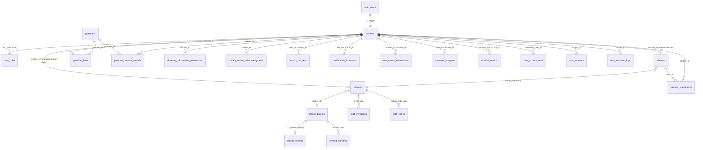

# 15 — Data Architecture, Security, Privacy & Multitenancy (TARGET DESIGN)

**Phase:** Planning (no implementation). **Repo:** fluentforge-app, branch `overhaul`, commit `7cbaadd9`.
**Role:** Data-architecture / security / privacy / multitenancy target-state design.
**Reads (discovery inputs):** `wip-15a-data-security-current-state.md` (data/RLS/tenancy/PII/minors), `wip-01a-product-inventory.md` (quota + schema-drift + edge-function auth), `wip-02-current-user-flows.md` (role/onboarding).
**Product context:** conversation-first A1→A2 curriculum. Market A = ESL in ~41 UI languages; Market B = Spanish for English speakers. Consumer **and** school/district. **Many learners are minors.** Supabase/Postgres + React today.

**Claim labels used throughout:** `[observed]` (seen in repo, cited) · `[documented]` (external, URL+date) · `[estimated]` · `[proposed]` (this design's target) · `[assumption]` · `[requires validation]`. Current vs. proposed behavior is distinguished at every point.

> **Legal disclaimer.** This document is an *engineering* design for FERPA/COPPA/GDPR-K-*conscious* architecture. It is **not legal advice** and does not assert compliance. "Technical readiness" (§6) and "legal compliance" are tracked as separate columns; shipping the technical controls here is necessary but **not sufficient** for a compliance claim — that requires counsel, signed DPAs, a COPPA-authorized VPC provider, and district contracts.

---

## 0. Executive framing — what the target must fix

The July 2026 hardening pass (`20260729061713`) was a real, competent effort: RLS-on-everything, SELECT-only student data with service-role writes, frozen privilege columns, hidden answer keys, fail-closed quota gate `[observed]` (wip-15a §2.1). **Preserve all of it.** The target design *extends* those primitives; it does not replace them.

Five structural gaps remain that no amount of feature work should precede:

1. **No real tenant isolation.** Student-data tables carry no `district_id`/`school_id`; access is pure row-ownership via `classes.teacher_id` + enrollment `[observed]` (wip-15a §3, ER note L137).
2. **Self-promoted teacher + enroll-any-student-by-email.** `20260730010000` lets any user flip `role` to `teacher` `[observed]`; `class-roster {add_by_email}` then enrolls any existing account, unlocking that minor's email/transcripts/metrics via `is_teacher_of_student` `[observed]` (`class-roster/index.ts:77-100`, wip-15a §7.2, G1).
3. **`safety_mode` is decorative.** No AI edge function reads `safety_mode`/`is_minor`; a 12-year-old in "strict" gets identical model behavior and unfiltered output as an adult `[observed]` (grep of `chat-with-tutor`, `premium-voice-realtime`, `custom-realtime-conversation` returns zero `safety_mode`/`is_minor` matches; wip-15a §7.3).
4. **Dropped COPPA/FERPA scaffolding.** The Feb 2026 reset deleted `parental_consent_records`, `privacy_notice_acknowledgments`, `directory_information_preferences`, `data_retention_logs`, `emergency_data_purge_logs`, `security_audit_log` `[observed]` (wip-15a §1.1). What remains is thin columns on `profiles` + one never-written audit table.
5. **Audit / retention / deletion / export are non-functional.** `educational_data_access_audit` has no writer; DSAR + account-deletion are UI-only `[observed]` (wip-15a §5, G3, G7).

Plus a schema-drift blocker: **the repo migrations cannot be trusted as ground truth** — quota functions reference columns/constraints the live table lacks `[observed]` (wip-01a F1.2, F1.3). **Dump the live schema before designing DDL** (§5.1). This is a hard precondition on every migration below.

---

## 1. Target domain model

### 1.1 Design decision — tenancy key strategy

Every student-data row must be attributable to exactly one tenant path: `district → school → class → learner`. Two ways to enforce it.

**Option A — Denormalized tenant keys on student-data tables.** Add `school_id` (and optionally `district_id`) columns to `lesson_progress`, `certification_attempts`, `assignment_submissions`, `transcript_analyses`, `student_metrics`, etc., stamped at write time by the service-role writer and referenced directly in RLS.

- **Pros:** RLS predicates are O(1) index lookups (`school_id = <caller's school>`); tenant boundary is explicit and greppable; enables clean per-tenant retention/deletion/export queries; a mis-scoped read fails closed on a single column; supports data-residency partitioning later.
- **Cons:** Requires backfill; `school_id` can go stale if a learner transfers schools (needs a defined transfer procedure — a learner's *history* should arguably stay with the school where it was produced, so treat `school_id` as write-time-immutable per row, not mutable per profile); more columns to keep consistent; consumer (non-school) users need a sentinel (`school_id IS NULL` = personal tenant).

**Option B — Join-path derivation (no tenant columns).** Keep deriving tenancy through `student_enrollments → classes → schools`, extending the current `is_teacher_of_student` pattern with a `same_tenant_as` helper.

- **Pros:** No new columns, no backfill; matches the existing `same_school_as`/`is_teacher_of_*` definer-helper model already hardened with `search_path=''` `[observed]` (wip-15a §2.1); single source of truth for "which class."
- **Cons:** Every RLS check becomes a multi-table `EXISTS` traversal (enrollment → class → school) — slower and harder to reason about; **a learner in *no* class has no derivable tenant**, so consumer users and not-yet-rostered students fall outside the model; retention/deletion/DSAR queries must re-run the join every time; a learner enrolled in two schools' classes has an *ambiguous* tenant — exactly the abuse vector in G1.

**RECOMMENDATION — Hybrid, Option A as the spine.** `[proposed]`

- Stamp an **immutable `school_id` (nullable) on every student-data table**, written by the service-role writer at row creation, never client-writable (extend the `protect_*` trigger family). `NULL` = consumer/personal tenant.
- Keep the **join-path helpers for *classroom* relationships** (teacher↔student within a class), because those are genuinely relational and already hardened.
- Add `district_id` **only on `schools`** (already present) and derive district scope via `school_id → schools.district_id` in a `SECURITY DEFINER` helper — districts change rarely and don't need denormalization onto every leaf row.

Rationale: tenant isolation is a *security boundary* and belongs on the row as an indexed, fail-closed predicate; classroom membership is a *relationship* and belongs in join helpers. This directly closes G1 (a cross-tenant enrollment now contradicts the row's stamped `school_id`) and G2/§3 (isolation is no longer "just row ownership"). `[requires validation]` confirm live row counts before choosing backfill vs. lazy-stamp (§5).

### 1.2 Role architecture — killing self-promotion and email-enrollment abuse

**Current `[observed]`:** `role` is a self-settable display value (`20260730010000`); teacher powers derive from class ownership; anyone can become a teacher and `add_by_email` any student (wip-15a §7.2, wip-02 §4). `class-roster` *does* verify `is_teacher_of_class` before adding `[observed]` (`class-roster/index.ts:58-64`) — but a self-promoted teacher owns the class, so the check passes.

**Target role model `[proposed]`:**

| Role | Granted by | Powers | Verification gate |
|---|---|---|---|
| `learner` (default) | signup trigger | own data only; join a class only via a **teacher-issued code** or **teacher-initiated invite** | none |
| `teacher` | **verified** onboarding (see below) — NOT self-set | own classes, roster within own school, enrolled-students' educational records | must clear one verified path; `role` frozen for self-write |
| `school_admin` | district_admin or domain-verified | manage teachers + classes within one `school_id` | invite/domain |
| `district_admin` | Palavox staff provisioning or signed contract | manage schools within one `district_id`, roster-sync config, consent policy | out-of-band contract + staff action |
| `platform_admin` | Palavox internal | everything; `has_role(admin)` today | internal only |

**Re-freeze `role` fully.** Revert the `20260730010000` allowance so `role` is admin/service-only again `[proposed]`. The current rationale ("powers come from class ownership so the display role is harmless") is the *enabler* of G1 — it is not harmless once tenant keys exist.

**Verified teacher onboarding — three paths (offer all; districts pick):** `[proposed]`

1. **School code / staff join code.** A `school_admin` or `district_admin` generates a rotating, rate-limited **staff code** (distinct namespace from student `CLS-` codes). Redeeming it sets `role=teacher` and stamps `school_id` server-side, via a `SECURITY DEFINER` function analogous to the existing `join_class_by_code` (`20260730020000`) `[observed]`. Best for small schools/pilots.
2. **Admin invite (email allow-list).** `school_admin` enters staff emails; server creates a pending `staff_invitations` row; the invitee's signup/first-login matches the invite and is promoted + tenant-stamped. Mirrors `bulk-create-students` but for staff and with `role=teacher` set server-side `[observed]` (`bulk-create-students/index.ts:110-119` already sets role server-side). Best for districts.
3. **Domain verification.** A district verifies ownership of `@district.org` (DNS TXT or a verified admin contact). Signups from a verified domain may request teacher status, auto-approved into that district's tenant. Best for large districts; **must not** auto-grant on free email domains (gmail/outlook/etc. → always manual).

For all three, **`class-roster {add_by_email}` gets a tenant guard:** the target email's account must resolve to the *same* `school_id` (or be a not-yet-tenant-stamped consumer learner who then gets stamped on enroll), and staff accounts remain non-enrollable (already blocked `[observed]` `class-roster/index.ts:91-93`). Cross-tenant `add_by_email` returns 403. `[proposed]`

**Consumer market:** consumer learners have `school_id IS NULL`, `role=learner`, and simply cannot be added to any school's class by email (no shared tenant). This cleanly separates the two markets at the data layer.

### 1.3 Guardian / consent / audit entities — restoring the scaffolding

Target tables that re-establish COPPA/FERPA-conscious primitives the reset dropped (wip-15a §1.1). All are **service-role-write**, self/authorized-read under RLS. `[proposed]`

| Table | Purpose | Key columns | Write path |
|---|---|---|---|
| `guardians` | parent/guardian identity distinct from learner | `id`, `email`, `display_name`, `verified_at`, `verification_method` | service role |
| `guardian_links` | guardian ↔ minor relationship | `guardian_id`, `learner_id`, `relationship`, `status` | service role |
| `parental_consent_records` | **verifiable** consent event log (restores dropped table) | `learner_id`, `guardian_id`, `consent_type` (coppa/ferpa-directory/data-processing), `method` (email-plus, credit-card-verify, district-signed, school-act-as-agent), `granted_at`, `revoked_at`, `evidence_ref`, `ip`, `policy_version` | service role only |
| `privacy_notice_acknowledgments` | which notice version each user/guardian saw | `subject_id`, `notice_version`, `acknowledged_at` | service role |
| `directory_information_preferences` | FERPA directory-info opt-out (restores dropped table) | `learner_id`, `field`, `disclosable` (bool), `set_by`, `set_at` | service role |
| `data_retention_logs` | append-only record of retention/purge actions (restores dropped table) | `subject_id`, `data_class`, `action` (retain/anonymize/purge), `reason`, `executed_at`, `job_id` | service role (retention job) |
| `data_access_audit` | who-viewed-whose-record (replaces never-written `educational_data_access_audit`) | `accessed_user_id`, `accessor_id`, `accessor_role`, `record_type`, `purpose`, `at`, `tenant_id` | service role at read boundaries (§4.3) |
| `dsar_requests` | export/deletion request lifecycle (replaces UI-only `data_export_requests`) | `subject_id`, `type` (export/delete), `status`, `requested_by`, `requested_at`, `fulfilled_at`, `artifact_ref` | service role processor |

**Consent gating is enforced, not decorative** `[proposed]`: `district_settings.require_parental_consent` / `min_age` / `consent_type` (already exist but world-readable and unenforced, wip-15a G2/§3.3) become the *policy input* to a server-side `consent_ok(learner_id)` check that AI/voice/roster entry points call. Today nothing reads them `[observed]` (wip-15a §13 `[requires validation]`).

### 1.4 Target ER (mermaid)

Key differences from current (wip-15a §1.3 ER): `school_id` is now a **tenant key on every student-data leaf** (was absent); guardian/consent/audit/retention entities **restored**; teacher creation flows through **verified paths** (`staff_invitations`/`staff_codes`/`verified_domains`) instead of self-set `role`.

---

## 2. Authorization architecture

### 2.1 RLS policy patterns by table family

Reuse the existing hardened definer helpers as tenancy primitives (`has_role`, `is_teacher_of_class`, `is_teacher_of_student`, `same_school_as`, all `SECURITY DEFINER SET search_path=''`) `[observed]` (wip-15a §2.1, §12). Add two: `same_tenant_as(a,b)` (compares stamped `school_id`) and `district_of(school_id)`. Patterns: `[proposed]`

| Table family | Members | SELECT policy | WRITE policy |
|---|---|---|---|
| **Learner-owned progress** | `lesson_progress`, `skill_mastery`, `exercise_attempts`, `vocab_card_state`, `xp_events`, `learner_streaks`, `student_metrics`, `usage_*` | `user_id=auth.uid()` OR `is_teacher_of_student(...)` AND `same_tenant_as` OR admin | **service-role only** (keep current SELECT-only-under-RLS model, wip-15a §2.1) |
| **Sensitive free-text (minors' content)** | `certification_transcripts`, `transcript_analyses`, `assignment_submissions.transcript` | self OR (teacher-of-student AND same_tenant AND **logged to `data_access_audit`** via the read boundary, §4.3) OR admin | service-role only |
| **Classroom relational** | `classes`, `student_enrollments`, `assignments`, `class_curriculum_assignments` | teacher-of-class OR enrolled student; **all scoped by `classes.school_id`** | teacher-of-class (tenant-checked) via edge fn |
| **Tenant/org config** | `school_districts`, `schools`, `district_settings`, `grade_levels`, `subjects`, `district_users` | **`same_tenant_as` / district membership — NOT `USING(true)`** (fixes G2) | admin/district_admin only |
| **Curriculum content** | `courses`,`units`,`skills`,`lessons`,`exercises`,`passages`,`vocabulary` | `status='operational'` OR admin (keep) | admin only |
| **Answer keys** | `exercise_options` | **admin-only** (keep — preserve, wip-15a §12) | admin only |
| **Consent/audit/retention** | `parental_consent_records`, `data_access_audit`, `data_retention_logs`, `directory_information_preferences`, `dsar_requests` | subject self OR authorized guardian OR admin | **service-role only** |
| **Guardian** | `guardians`, `guardian_links` | guardian self OR linked-learner OR admin | service-role only |

Global rules `[proposed]`: (a) no `USING(true)` on any table containing tenant or personal data (removes G2, G5, G6, G8); (b) every student-data INSERT stamps `school_id` in the service-role writer and the `protect_*` trigger family freezes it thereafter; (c) `recent_phrases` gets an owner column or is dropped (G5).

### 2.2 Service-role function audit protocol

**Current idiom sprawl `[observed]`:** three auth patterns — `guardPaidRequest`/`requireUser` (sound), inline `auth.getUser` (ok), and raw unverified base64 JWT decode in `check-streak` (unsound) (wip-01a F9.4, wip-15a §4). **Target: one guard library, one protocol.** `[proposed]`

Every function must declare, in a header block enforced by a lint/CI check:
1. **Identity source** — must be `guardPaidRequest` or `requireUser` (both verify JWT via `auth.getUser`, service client used *only* to validate the token) `[observed]` (`_shared/authGuard.ts:22-52`). **Ban** raw JWT decoding.
2. **Authorization gate** — explicit `has_role` / `is_teacher_of_*` / tenant check *in the function body*, never relying solely on gateway `verify_jwt` (which the public anon key satisfies — not a user identity, wip-01a F9.2 `[inferred]`).
3. **Scope** — service-role work must be filtered by the *verified* `userId`/tenant, never run unscoped.
4. **config.toml entry** — explicit `verify_jwt` value for all 37 functions (8 currently missing, wip-01a F9.2).
5. **Audit** — sensitive-record reads write a `data_access_audit` row (§4.3).

### 2.3 Under-authorized functions — required guards

`[observed]` from wip-15a §4.1-4.2 and wip-01a §9. **These are Phase-0 fixes (§6).**

| Function | Current state | Required guard `[proposed]` |
|---|---|---|
| `initialize-student-progression` | service role; only checks header *presence*; reads **all** students' `id,email,display_name` and writes progression `[observed]` (wip-15a F1) | Gate behind `has_role(admin)` OR make it a cron with a service identity + `x-cron-token`; never a user-callable full-table job |
| `verify-certification-code` | service role; **no in-body auth**; code-validity oracle over `access_codes` `[observed]` (wip-01a F5.6) | `requireUser` + `is_teacher`/admin; rate-limit; or delete if unused (no `src/` caller, wip-01a F5.6) |
| `record-certification-usage` | service role; no auth; decrements code uses `[observed]` | same as above; or delete |
| `seed-course-data` | `verify_jwt=true` but no admin check; writes curriculum with legacy columns that don't match schema `[observed]` (wip-01a F4.6) | **delete** (dead + drifted); if kept, `has_role(admin)` |
| `cleanup-voice-sessions` | service role; no auth; cron-intended but user-callable `[observed]` (wip-15a F4) | cron-only via `x-cron-token`; reject interactive callers |
| `check-streak` | **unverified base64 JWT decode**, trusts `sub` `[observed]` (`check-streak/index.ts:5-21`, wip-01a F9.4) | replace with `requireUser`; add config.toml entry |
| `seed-curriculum` | `verify_jwt=false`, SEED_TOKEN-or-admin (deliberate, correct) `[observed]` (wip-01a F4.7) | keep; add SEED_TOKEN rotation policy + ops-runbook note |

### 2.4 Secrets handling

`[observed]` (wip-15a §8): no live secret currently exposed; `.env` holds only anon key; edge secrets read from `Deno.env`, never hardcoded. **Preserve.** Target changes `[proposed]`:

- `git rm --cached .env`; verify history contains no service-role/provider key (`git log -p -- .env`) `[requires validation]` (wip-15a §13).
- Delete the client-side "encryption theater": `dataEncryption.ts` (btoa-as-encryption, hardcoded passphrase `'edu_platform_secure_2024'`), stubbed `secureSettings.ts`, and the hardcoded default passcode `'08132010'` in `initializeSecureSettings.ts:19` (reads like a DOB) `[observed]` (wip-15a §6, §8). These are not controls; remove so no future data is entrusted to them.
- Establish a secret-rotation cadence for `SUPABASE_SERVICE_ROLE_KEY`, `LOVABLE_API_KEY`, `OPENAI_API_KEY`, `AZURE_SPEECH_KEY`, `SEED_TOKEN` `[proposed]`.
- Tighten CORS: replace the `*.lovable.app`/`*.lovableproject.com` regex (effective trust = "any app on Lovable," a shared host) with the specific project origin(s) before production; drop `Access-Control-Allow-Credentials: true` since auth is Bearer-token, not cookie `[observed]` (wip-15a §4.4).
- Harden `process_access_code` / `generate_access_code` `search_path` from `public` to `''` for consistency (not currently exploitable — no dynamic SQL — but inconsistent, wip-15a §2.3).

---

## 3. safety_mode enforcement design (spec only)

**Current `[observed]`:** `safety_mode` is written by `verify-age`, read back for display, cached in `localStorage` — but **no AI function varies behavior by it**. The only server content control is a 3-term English regex on *user input only* in `chat-with-tutor/config.ts`; **AI output is never moderated**; prompt-injection "detection" only `console.warn`s and proceeds (wip-15a §7.3, wip-01a F7.1). Grep confirms zero `safety_mode`/`is_minor` references in `chat-with-tutor`, `premium-voice-realtime`, `custom-realtime-conversation` `[observed]`.

**Target — safety must reach *every* AI touchpoint** `[proposed]`. The AI surface: `chat-with-tutor`, `premium-voice-realtime`, `custom-realtime-conversation`, `learn-lesson`, `analyze-*`, `grade-*`, `generate-*`, `transcribe-audio`, `text-to-speech` (37-function inventory, wip-01a §9).

### 3.1 Policy resolution (server-side, per request)

A shared `_shared/safetyContext.ts` resolves, from the *verified* `userId`, a `SafetyContext { isMinor, safetyMode, consentOk, tenantPolicy }` by reading the profile + `district_settings` server-side. Every AI function calls it after the auth guard. `safety_mode` becomes **fail-closed**: unknown/unresolved → treat as `strict`. `[proposed]`

### 3.2 Policy injection into prompts

For `strict`/minor contexts, prepend a non-negotiable **system policy block** to the model system prompt (age-appropriate content, no personal-data solicitation, no external contact, topic boundaries, language kept at learner CEFR). Injected server-side so the client cannot strip it. For realtime voice (`gpt-realtime`, wip-01a), set the policy in the session-config system instructions at token-mint time. `[proposed]`

### 3.3 Output moderation — options + cost

| Option | Mechanism | Latency/cost `[estimated]` | Coverage | Notes |
|---|---|---|---|---|
| **A. Provider moderation endpoint** | run each AI output (and user input) through a moderation classifier before returning | ~+100-300ms; low per-call $ | text; multilingual varies | simplest; adds one dependency; verify moderation quality across the 41 languages `[requires validation]` |
| **B. Structured-output self-check** | ask the tutor model to emit a safety flag alongside content | +0 calls (same completion) | model-dependent; can be gamed | cheap but the model grading itself is weak for adversarial cases |
| **C. Second-pass judge model** | independent model reviews output | ~2x tokens for AI turns; +latency | strong | reuse the authoring-gauntlet judge pattern (`_shared/contentGauntlet.ts`, a real strength, wip-01a §preserve) |
| **D. Realtime voice** | streaming makes post-hoc filtering impossible | — | partial | rely on strong system policy (§3.2) + input moderation + post-session transcript review; **cannot** fully moderate live audio out |

**Recommendation `[proposed]`:** Layered — **A (input+output moderation) for all text AI**, escalating to **C (judge)** only when A flags or for `strict`-mode minors, and **strong system-policy + input moderation + session transcript review** for realtime voice (D's inherent limit). Cost scales with minor/strict traffic, not total traffic. `[requires validation]` moderation multilingual accuracy and per-1k-call cost before committing.

### 3.4 Crisis-escalation path

`[proposed]` If moderation detects self-harm / abuse / crisis signals in a learner's input or transcript: (a) return a supportive, non-clinical response with region-appropriate helpline info (localized); (b) write a `data_access_audit`-adjacent `safety_event` row (no raw transcript in logs — reference only); (c) for rostered minors, surface a privacy-preserving flag to the school's designated contact per the district's configured escalation policy (`district_settings`), **not** an unfiltered transcript dump; (d) never auto-contact external parties without a configured, consented path. This is a **spec requiring policy + legal sign-off before implementation** `[requires validation]`.

---

## 4. Data lifecycle

### 4.1 Retention schedules by data class

`[proposed]` — defaults; districts may tighten via `district_settings`. **Legal-hold and DPA terms override these** `[requires validation]`.

| Data class | Examples | Default retention | Deletion behavior |
|---|---|---|---|
| **Minors' free-text conversation** (highest sensitivity) | `certification_transcripts`, `transcript_analyses`, `assignment_submissions.transcript` | **shortest** — e.g. active school year + configurable window, then anonymize/purge | hard purge or anonymize; logged to `data_retention_logs` |
| Learner progress/mastery | `lesson_progress`, `skill_mastery`, `xp_events` | duration of account + grace window | purge on account deletion (CASCADE from `auth.users` exists `[observed]` wip-15a §5) |
| Certification records | `certification_attempts`, transcripts of record | per district contract (may be longer for transcripts of record) | retain per contract, then purge |
| Identity/PII | `profiles`, `guardians` | account lifetime | purge on verified deletion |
| Consent/audit | `parental_consent_records`, `data_access_audit`, `data_retention_logs` | **longest** — retain as compliance evidence beyond account deletion (anonymized subject where required) | append-only; never user-deletable |
| Usage/billing | `usage_*`, `api_calls_tracking` | billing-cycle + audit window | purge per schedule |
| Ephemeral/logs | edge/console logs | short; **scrub PII** (278 client `console.log`s + edge logs leak PII today, wip-15a §5, §10) | rolling purge |

**Current gap `[observed]`:** no retention job exists; retention/purge tables were dropped; minors' transcripts retained indefinitely (wip-15a §5, §10). Target: a scheduled retention job (service identity, `x-cron-token`) that reads schedules from `district_settings`, executes anonymize/purge, and writes `data_retention_logs`.

### 4.2 Deletion / DSAR export flows

**Current `[observed]`:** `data_export_requests` + account-deletion UI strings exist but **no edge function performs export or `auth.admin.deleteUser`**; a user can insert a request with arbitrary `export_file_url`/`status` (G7). DSAR is non-functional (wip-15a §5, G7).

**Target `[proposed]`:**
- `dsar_requests` table (§1.3) is service-role-write only (removes the G7 self-write hole).
- **Export processor** edge function (service identity, gated by subject-self or authorized-guardian/admin): assembles the subject's data across tables into a portable bundle, stores it with a short-lived signed URL, updates `dsar_requests.status`. Writes `data_access_audit`.
- **Deletion processor**: verifies requester authority, runs `auth.admin.deleteUser` (CASCADE handles child rows via existing `ON DELETE CASCADE`, wip-15a §5), writes an anonymized `data_retention_logs` row (retained as evidence). Deletion is **prohibited as a direct agent action** by policy — implemented as an authenticated, logged server flow the *user/guardian/admin* triggers, never an ad-hoc purge.
- **Guardian-initiated** deletion/export for minors, routed through `guardian_links` verification.

### 4.3 Audit-log write points

**Current `[observed]`:** `educational_data_access_audit` has **no writer**; `logDataAccess` is `console.log` (G3, wip-15a §5). The FERPA access log is empty.

**Target `[proposed]`:** `data_access_audit` gets a write at every **cross-subject sensitive read boundary**, centralized in the edge layer (never client-trusted):
- `class-roster {list}` — teacher views roster (email exposure) `[observed]` (`class-roster/index.ts:71`).
- any teacher/admin read of another user's transcripts, metrics, certification records.
- `generate-teacher-report`, benchmark/mastery cross-student views.
- DSAR export/deletion (§4.2).
Each row: accessor, subject, record type, purpose, tenant, timestamp. This makes "who viewed whose record" queryable — the FERPA-conscious property the empty table was meant to provide.

### 4.4 Backup / restore posture

`[requires validation]` — cannot be determined from repo; requires Supabase project inspection:
- Confirm PITR / automated backup tier and retention window on the live project.
- Confirm backup encryption at rest and access controls on backup storage.
- Define restore runbook + RTO/RPO targets for a classroom-hours incident.
- Confirm that a subject deletion also removes the subject from backups within a defined window (or documented as a known limitation with legal sign-off).
- Confirm region/data-residency of primary + backups against district DPA requirements.

---

## 5. Migration strategy

### 5.1 Drift resolution FIRST (hard precondition)

**The migration history is not ground truth `[observed]`:** the Feb 2026 baseline is a squashed RESET dropping ~21 tables (wip-15a §1.1); quota functions reference `academic_year` column + `(student_id, academic_year)` constraint the live table lacks (wip-01a F1.2); `seed-course-data` writes columns that don't exist (wip-01a F4.6); 8 functions have no config.toml entry (wip-01a F9.2). **No DDL in this plan may be written against the repo migrations.**

**Step 0 (blocking):** dump the **live** schema (`pg_dump --schema-only`, plus `pg_policies`, `pg_proc` for definer functions, and the deployed `verify_jwt` gateway config), diff against `types.ts` and the migration tree, and produce a reconciled ground-truth schema. `[requires validation]` items to resolve in the dump: quota reset behavior (wip-01a F1.1), the 8 unconfigured functions' effective `verify_jwt` (wip-01a F9.2, wip-15a §13), whether any cron invokes `cleanup-voice-sessions`/`initialize-student-progression` and with what identity (wip-15a §13), whether `district_settings.require_parental_consent` is read anywhere (wip-15a §13), and `.env` history (wip-15a §13).

### 5.2 Sequencing

`[proposed]` — each stage is independently deployable and reversible.

1. **Reconcile** (§5.1) — commit the ground-truth baseline migration that matches live; delete drifted/dead objects (`seed-course-data`, orphan cert functions if unused).
2. **Phase-0 security fixes** (§6) — re-freeze `role`; guard the under-authorized functions; fix `check-streak`; tenant-scope org config RLS (kill `USING(true)`, G2); tenant guard on `add_by_email`. No schema shape change to student data yet — pure authorization.
3. **Tenant keys** — add nullable `school_id` to student-data tables; backfill from enrollment join where unambiguous, leave `NULL` (consumer) otherwise; stamp-on-write in service-role writers; freeze via trigger; **then** flip RLS to use the column. (Two-migration pattern: add+backfill+dual-read, then enforce.)
4. **Consent/audit/guardian scaffolding** — create §1.3 tables + write points (§4.3); wire `consent_ok` into AI entry points.
5. **safety_mode enforcement** (§3) — `safetyContext` + policy injection + moderation.
6. **Lifecycle** — retention job, DSAR processors, audit writers (§4).

### 5.3 Rollback

Each migration ships with a tested down-migration. Additive stages (3-6 add columns/tables) roll back by dropping the new objects — low risk because old code paths still work during the dual-read window. Authorization stages (2) roll back by restoring the prior policy set (kept as a captured snapshot from the §5.1 dump). **Never** roll a stage forward without its down-migration reviewed.

### 5.4 Characterization tests to write BEFORE changes

`[proposed]` — capture *current* behavior so regressions are visible:
- **RLS matrix tests**: for each table family, assert current read/write outcomes for {self, teacher-of-student, same-school, cross-school, admin, anon} — establishes the baseline the target must preserve-or-tighten (never loosen).
- **Auth-guard tests** per edge function: assert current 401/403/200 behavior (documents the F1-F5 gaps as *failing-by-design* tests that flip to passing after Phase 0).
- **Self-promotion exploit test** (G1): reproduce "flip role → create class → add_by_email victim → read victim email/transcript" as a test that must go from *succeeding* (current) to *blocked* (target).
- **safety_mode test**: assert current identical-behavior-for-minor (documents §7.3) → flips to differentiated after §3.
- **Consent/quota tests**: capture current quota-reset and consent-enforcement behavior before touching them (drift-sensitive, wip-01a).
- **Migration idempotency / up-down round-trip** on a schema snapshot.

---

## 6. Ranked remediation backlog (Phase 0 / 1 candidates)

**Technical readiness ≠ legal compliance.** The "Legal" column marks items that additionally require counsel/DPA/contract — shipping the tech does not close them. Order = security severity first.

| # | Item | Phase | Severity | Depends on | Acceptance criteria (technical) | Legal? |
|---|---|---|---|---|---|---|
| R1 | **Kill self-promoted-teacher + cross-tenant enroll** (G1/§7.2). Re-freeze `role`; add verified teacher onboarding (§1.2); tenant-guard `add_by_email`. | **0** | Critical | live schema dump; role model | Exploit test (§5.4) blocked; `role` un-settable by non-admin (trigger test); `add_by_email` returns 403 cross-tenant; teacher status only via school-code/invite/domain | FERPA/COPPA-adjacent |
| R2 | **Enforce safety_mode at every AI touchpoint** (§3, §7.3). `safetyContext` + policy injection + input/output moderation + crisis path. | **0/1** | Critical | live schema; moderation-provider decision | No AI function returns without resolving `SafetyContext`; strict/minor gets policy-injected prompt + moderated I/O (test); realtime voice carries system policy; unresolved mode → fail-closed strict | COPPA/CIPA-adjacent |
| R3 | **Tenant isolation on student data** (§1.1, §3, G2). `school_id` tenant keys + tenant-scoped RLS; kill `USING(true)` on org config. | **1** | High | R1; schema dump; backfill plan | Cross-tenant read of another school's student data blocked (RLS matrix test); org-config tables no longer `USING(true)`; consumer users isolated as `school_id IS NULL` | FERPA-adjacent |
| R4 | **Lock under-authorized functions** (§2.3, F1-F5). Guard `initialize-student-progression`, cert functions, `seed-course-data`, `cleanup-voice-sessions`, `check-streak`; config.toml entries for all 8. | **0** | High | live gateway config validation | Each function has verified-JWT + in-body authz test; no user-callable full-table PII job; `check-streak` uses `requireUser`; all 37 functions have explicit `verify_jwt` | — |
| R5 | **Functional audit logging** (§4.3, G3). Write `data_access_audit` at every cross-subject read boundary. | **1** | High | R3 (tenant col); audit table | Every teacher/admin read of another subject's sensitive record produces an audit row (test); table is queryable, non-empty in an integration run | FERPA-adjacent |
| R6 | **Restore consent scaffolding + enforce** (§1.3, §7.1). Guardian/consent tables; `consent_ok` gates AI/roster for minors; enforce `require_parental_consent`. | **1** | High | R2, R3 | Under-min-age without recorded consent is blocked from AI features (test); consent events recorded in `parental_consent_records`; `district_settings` policy is read and enforced | **COPPA — needs verifiable-consent legal path** |
| R7 | **DSAR + deletion + retention** (§4.1, §4.2, G7). Service-role DSAR processors; retention job; kill self-write on request table. | **1** | Med-High | R5 | Export produces a subject bundle via signed URL; deletion runs `auth.admin.deleteUser` + logs; retention job purges/anonymizes per schedule + writes `data_retention_logs`; request table not self-writable | **FERPA/COPPA/GDPR — needs DSAR legal SLAs** |
| R8 | **Secrets/CORS hardening + remove security theater** (§2.4, §6). `git rm --cached .env`; tighten CORS; delete `dataEncryption`/`secureSettings`/hardcoded passcode; harden `process_access_code` search_path. | **0** | Med | — | `.env` untracked + history verified clean; CORS = specific origins, no credentialed wildcard; client "encryption" utils deleted; definer functions all `search_path=''` | — |
| R9 | **PII log scrubbing** (§5, §10). Remove/scrub PII from 278 client `console.log`s + edge logs. | **1** | Med | — | No email/profile/student-id in logs (grep/CI check); edge logs reference IDs only | FERPA/COPPA-adjacent |
| R10 | **Directory-info controls** (§1.3, G6, §11.7). `directory_information_preferences` + opt-out enforcement on `profile_public_data`. | **1/2** | Low-Med | R3 | Same-school directory exposure respects per-field opt-out (test) | FERPA directory-info |
| R11 | **Backup/restore validation** (§4.4). Confirm PITR, encryption, residency, deletion-in-backups. | **1** | Med | Supabase project access | PITR + retention confirmed; restore runbook + RTO/RPO documented; residency matches DPA | **needs DPA alignment** |

**Phase-0 (must precede ANY feature work):** R1, R2, R4, R8 — the critical/high items that are pure authorization/config and directly protect minors. **Phase-1:** R3, R5, R6, R7, R9, R11. **Preserve throughout (do not regress):** RLS-on-everything, SELECT-only student data + service-role writes, hardened definer helpers, server-side age determination + privilege-column freeze, server-side answer-key grading, fail-closed `guardPaidRequest` (wip-15a §12).

---

## 7. Open validation items (carry into systems-design phase)

`[requires validation]` — all blocking for the stages they touch:
1. Live schema dump vs. migrations/`types.ts` — resolve all drift before DDL (§5.1).
2. Deployed gateway `verify_jwt` default for the 8 unconfigured functions (wip-01a F9.2, wip-15a §13).
3. Cron identity for `cleanup-voice-sessions` / `initialize-student-progression` (wip-15a §13).
4. Whether `district_settings.require_parental_consent` is read by any current flow (wip-15a §13) — expected no.
5. `.env` git history for any ever-committed service-role/provider key (wip-15a §13).
6. Multilingual moderation accuracy + per-call cost across the 41 UI languages (§3.3).
7. Backup/PITR/residency posture on the live project (§4.4).
8. Legal: verifiable-parental-consent method, DSAR SLAs, DPA/data-residency, COPPA-authorized provider status — **counsel-owned, not engineering-closeable.**
