# WIP 11a — Voice Infrastructure: Current State

Discovery audit of Palavox's entire speech stack. Repo `/Users/calebjaworski/fluentforge-app`, branch `overhaul`, commit `7cbaadd9`. All claims labeled: **[observed]** (seen in repo), **[inferred]**, **[estimated]**, **[requires validation]**.

---

## 1. Executive summary

Palavox currently runs **three distinct voice paths** plus four LLM-based analysis functions:

1. **"GPT-4o Realtime" premium mode** — true realtime speech-to-speech over **WebRTC direct to OpenAI**, with a Supabase edge function minting ephemeral tokens (`premium-voice-realtime`). [observed]
2. **"Custom Realtime AI" premium mode** — a request/response pipeline (record → Gemini STT → Gemini chat → Azure TTS) that *simulates* realtime; latency is one full round trip per turn. [observed]
3. **Free voice chat** — browser/Gemini STT + `chat-with-tutor` text LLM + Azure TTS via the `text-to-speech` function, with browser `speechSynthesis` as fallback. [observed]

Pronunciation "analysis" is **an LLM guess over a text transcript** — there is no acoustic or phoneme-level signal anywhere in the stack. [observed]

The owner's history is **confirmed**: ElevenLabs (`@11labs/react` `useConversation`) powered spoken conversation through ~April 2025; the OpenAI Realtime implementation landed Oct 2025 (git evidence in §2). The ~5-concurrent-call ElevenLabs constraint is plausible (plan-based ElevenLabs concurrency caps) but has **no repo evidence** — [requires validation] with the owner/billing history.

The most consequential current defect: **the 15-min/month premium voice cap is checked against a counter that no live code path ever increments** (§10.2), so the only real cost control on OpenAI Realtime is a 30-requests/day rate limit on token minting.

---

## 2. Provider history: ElevenLabs → OpenAI (verified)

| Claim | Evidence | Label |
|---|---|---|
| ElevenLabs was used for realtime spoken conversation | `git show c2ed9d94:src/components/certificates/hooks/useConversationTest.tsx` line 2: `import { useConversation } from "@11labs/react"`; commits `bc8f5399` "Fix: Update ElevenLabs API key", `bc581588`/`c2ed9d94` "Fix: Use the correct ElevenLabs API key" (Apr 2025) | [observed] |
| The dependency is still declared but dead | `package.json:15` `"@11labs/react": "^0.1.4"`; `grep -rn "@11labs" src/ supabase/` → **zero call sites**; `package-lock.json:96` notes the package is deprecated | [observed] |
| ElevenLabs era used client-side API key + hosted agents | `git show 653168fd:src/providers/ElevenLabsProvider.tsx` — `apiKey={import.meta.env.VITE_ELEVEN_LABS_API_KEY}` (key bundled into the browser build); `git show 4f2ebda6:src/components/practice/hooks/useVoiceChat.ts:171` `agentId: selectedAgentId` (ElevenLabs Conversational AI agents) | [observed] |
| Marketing copy still promises ElevenLabs | `src/translations/english/premium-voice.ts:44` "…using ElevenLabs technology"; `src/translations/gujarati/premium-voice.ts:6,17`; `src/translations/korean/minimal.ts:154` — stale across multiple language packs | [observed] |
| OpenAI Realtime replaced it | `git log --follow supabase/functions/premium-voice-realtime/index.ts`: `65d6237b` 2025-10-11 "feat: Implement Premium Voice Practice", `6e62dd17` 2025-10-11 "feat: Implement WebRTC for premium voice chat", `ac14c1b2` 2025-10-12 "Update GPT model" | [observed] |
| Custom (STT→LLM→TTS) pipeline added days later as multilingual fallback | `custom-realtime-conversation` history: `7a4297e2` 2025-10-16 "Fix: Custom realtime AI not functional" … `147434b4` 2025-10-18 "Refactor: Implement GPT language tagging" | [observed] |
| ElevenLabs was capped at ~5 concurrent calls | Owner-provided; no repo artifact found (`git log -S concurrent` shows nothing ElevenLabs-related) | [requires validation] |

**Migration motive** [inferred]: commit sequence + the `PremiumVoicePractice.tsx:335-343` "GPT-optimal languages" list suggest the move was about concurrency/cost *and* multilingual coverage — the Custom pipeline exists specifically because GPT Realtime voices were judged weak for many of the platform's 41 interface languages.

---

## 3. Architecture diagram (current state)

```mermaid
flowchart TB
  subgraph Client["Browser client (React SPA)"]
    PVP["PremiumVoicePractice.tsx"]
    RAM["RealtimeAudioManager.ts<br/>(RealtimeChat: WebRTC)"]
    CRM["CustomRealtimeManager.ts<br/>(MediaRecorder + SpeechRecognition VAD)"]
    VC["VoiceChat.tsx (free tier)"]
    VSR["useVoiceSpeechRecognition<br/>(MediaRecorder or webkitSpeechRecognition)"]
    VTTS["useVoiceTTS → utils/tts/*<br/>(cache, retry, browser fallback)"]
    PRON["PronunciationPracticeContainer<br/>useRealTimeTranscription (browser STT only)"]
  end

  subgraph Edge["Supabase Edge Functions (Deno)"]
    PVR["premium-voice-realtime<br/>(ephemeral token mint)"]
    CRC["custom-realtime-conversation<br/>(orchestrator)"]
    TA["transcribe-audio"]
    TTS["text-to-speech"]
    CWT["chat-with-tutor"]
    AP["analyze-pronunciation"]
    AS["analyze-speaking"]
    ACQ["analyze-conversation-quality"]
    GPP["generate-pronunciation-phrase"]
    TU["track-usage"]
    TPVS["track-premium-voice-session"]
    CVS["cleanup-voice-sessions<br/>(no scheduler found)"]
  end

  subgraph Providers["External providers"]
    OAI["OpenAI Realtime API<br/>WebRTC + data channel"]
    LOV["Lovable AI Gateway<br/>google/gemini-2.5-flash"]
    AZ["Azure Speech TTS<br/>(regional REST, SSML)"]
    BSTT["Browser SpeechRecognition"]
    BTTS["Browser speechSynthesis"]
  end

  subgraph DB["Postgres"]
    UT["usage_tracking"]
    SUL["student_usage_limits"]
    UC["usage_counters (rate limits)"]
    SLM["student_language_metrics"]
  end

  PVP --> RAM
  PVP --> CRM
  RAM -- "POST (no body!)" --> PVR
  PVR -- "mint session gpt-realtime-2025-08-28" --> OAI
  RAM == "WebRTC audio + oai-events<br/>model=gpt-4o-realtime-preview-2024-12-17" ==> OAI
  CRM -- "base64 webm + history" --> CRC
  CRC --> TA
  CRC -- "speak_bilingual tool call" --> LOV
  CRC -- "multi-voice SSML" --> AZ
  TA -- "input_audio (labeled wav)" --> LOV
  VC --> VSR
  VC --> VTTS
  VSR -- "useWhisper=true" --> TA
  VSR -. "fallback" .-> BSTT
  VTTS --> TTS
  TTS --> AZ
  VTTS -. "limit/error fallback" .-> BTTS
  VC -- "text turn" --> CWT
  PRON --> BSTT
  PRON --> AP
  PRON --> GPP
  AP --> LOV
  AS --> LOV
  ACQ --> LOV
  GPP --> LOV
  PVP --> TPVS --> UT
  PVP --> TU --> UT
  TU --> SUL
  Edge --> UC
  ACQ --> SLM
```

[observed] for all edges; wire details cited in the sections below.

---

## 4. Path 1 — Premium realtime conversation (OpenAI, WebRTC)

### Server: `supabase/functions/premium-voice-realtime/index.ts`
- Auth: `guardPaidRequest(req, corsHeaders, 'premium-voice-realtime', 30)` → JWT verify + **30 mints/day** rate limit (`index.ts:11`; guard in `_shared/authGuard.ts:24-91`). [observed]
- Monthly cap check via RPC `can_start_premium_voice_session` (`index.ts:39-49`); returns 403 "Monthly limit reached" when disallowed. [observed]
- CEFR-adaptive system prompt: `LEVEL_BEHAVIOR` table maps A1→60% native-language ratio down to C2→2% (`index.ts:56-105`). Turn policy, barge-in etc. are **not** configured — only `model`, `voice`, `instructions` are sent (`index.ts:121-125`), so OpenAI's server-side VAD defaults apply. [observed] Turn detection behavior therefore = provider default [inferred].
- Mints an **ephemeral client secret** from `POST https://api.openai.com/v1/realtime/sessions` with `model: "gpt-realtime-2025-08-28"`, `voice: "sage"` (`index.ts:115-126`). API key stays server-side. [observed]
- Returns token + a server-generated `session_id`/`session_start` for tracking (`index.ts:138-147`) — but nothing persists this server-side at mint time. [observed]

### Client: `src/utils/RealtimeAudioManager.ts` (`RealtimeChat`)
- Fetches the token from a **hard-coded project URL** `https://dukpljcweixxmpkiblwo.functions.supabase.co/premium-voice-realtime` (`RealtimeAudioManager.ts:203-204`) — this does **not** match the repo's configured project (`supabase/config.toml:1` `project_id = "afswfqougbfiqbkchoqj"`, and `src/integrations/supabase/client.ts:5` uses `VITE_SUPABASE_URL`). Either the config or the hardcode points at the wrong environment. [observed mismatch; which one is live requires validation]
- **Sends no request body** (`RealtimeAudioManager.ts:203-212`), so the server's `cefrLevel/userLanguage/targetLanguage` parsing (`premium-voice-realtime/index.ts:52-53`) always falls back to `B1` / `'English'` / `'their native language'` — the CEFR-adaptive prompt machinery is effectively dead in this path. [observed]
- WebRTC: `RTCPeerConnection`, mic track at 24 kHz mono with echo cancellation/noise suppression (`:239-248`), data channel `"oai-events"` for JSON events (`:251-264`), SDP offer POSTed to `https://api.openai.com/v1/realtime?model=gpt-4o-realtime-preview-2024-12-17` (`:271-281`). **Model mismatch**: session minted for `gpt-realtime-2025-08-28`, SDP exchange requests `gpt-4o-realtime-preview-2024-12-17`. Which model actually serves the call is [requires validation].
- Speaking indicator from `response.audio.delta` / `response.audio.done` events (`:257-261`). Barge-in: nothing client-side; native OpenAI WebRTC VAD interruption applies [inferred].
- Disconnect closes the data channel and peer connection (`:305-309`). **No reconnection logic anywhere**; a dropped connection ends the session silently. [observed]

### Page: `src/pages/PremiumVoicePractice.tsx`
- Pre-start cap check `checkCanStartPremiumVoiceSession()` (`:88-97`); client timer; auto-end when computed `minutesRemaining <= 0` (`:327-332`). [observed]
- `handleMessage` listens for `time_warning` / `time_limit_reached` events (`:59-75`) — **no code emits these** (they are not OpenAI event types and the server relay that would send them does not exist); dead code from a prior WebSocket-relay design [observed / inferred].
- Usage tracking on end: client insert → edge-function fallback → `sendBeacon` fallback (`:249-301`). The "primary" client-side insert path (`useUsageLimits.ts:373-378`, direct insert into `usage_tracking`) now **always fails RLS** because client INSERT policy was dropped in the security pass (`supabase/migrations/20260729061713...sql:419-421`), so every session exercises the error path first. [observed]
- Also renders the "Custom" mode (below). A separate marketing page `src/pages/PremiumVoice.tsx` still says "Premium voice chat features coming soon..." with a "$4.02/month per student" price card (`PremiumVoice.tsx:95,134`). [observed]

## 5. Path 2 — "Custom Realtime AI" (STT → LLM → TTS pipeline)

### Server: `supabase/functions/custom-realtime-conversation/index.ts`
- Auth + **300 req/day** rate limit (`index.ts:25`). Each conversational *turn* consumes one unit. [observed]
- Step 1: forwards base64 audio to `transcribe-audio` (`:51-63`).
- Step 2: chat completion via **Lovable AI gateway**, `model: 'google/gemini-2.5-flash'`, forced tool call `speak_bilingual` returning `{lang, text}[]` segments; CEFR ratio table duplicated from Path 1 (`:67-77`, `:85-119`). [observed]
- Step 3: **Azure TTS** multi-voice SSML — one `<voice>` element per segment, 17-language voice map, `audio-16khz-128kbitrate-mono-mp3` (`:155-193`). Region `AZURE_REGION` default `eastus` (`:142`). [observed]
- Dead code: `:141` throws when `AZURE_SPEECH_KEY` missing, making the text-only fallback at `:144-153` unreachable. [observed]
- `btoa(String.fromCharCode(...new Uint8Array(audioBuffer)))` at `:193` spreads the whole audio buffer as arguments — risks `RangeError: Maximum call stack size exceeded` on long responses (the `text-to-speech` fn chunks correctly at `text-to-speech/index.ts:156-161`; this one doesn't). [observed; failure threshold requires validation]
- Segments are synthesized as **one combined MP3**; the client's `audioSegments` array branch (`CustomRealtimeManager.ts:302-303`) can never fire since the server never returns `audioSegments`. [observed]

### Client: `src/utils/CustomRealtimeManager.ts`
- State machine `idle → listening → processing → speaking` (`:23`, `:423-427`). MediaRecorder captures `audio/webm;codecs=opus` (`:109-111`).
- **VAD is a hack**: a parallel browser `SpeechRecognition` instance used only to detect words, hard-coded `lang = 'en-US'` (`:156-159`) even though this mode is *recommended for non-GPT-optimal languages* (`PremiumVoicePractice.tsx:335-343`). Silence for 3 s after last detected word ends the turn (`:45`, `:175-179`); 60 s max turn (`:46`); browsers without SpeechRecognition (Firefox) fall back to a blunt 15 s timer (`:144-153`). [observed]
- No barge-in: while `speaking`, the mic is off; the user cannot interrupt playback. Auto-relisten after playback (`:337-343`). [observed]
- Server response tracks `ttsMinutesUsed` on the client (`:290-299`) — but the server never returns that field, so this tracking is dead. [observed] Session minutes are instead recorded at end via `recordSessionUsage` (`PremiumVoicePractice.tsx:208-220`).
- **No cap check**: `startCustomSession` never calls `checkCanStartPremiumVoiceSession` (`PremiumVoicePractice.tsx:130-192`), unlike the GPT mode; the only limit is the 300/day turn rate limit. [observed]

## 6. Path 3 — Free voice chat (browser STT + text LLM + TTS)

- Page `src/pages/VoiceChat.tsx` wires `useVoiceSpeechRecognition` (STT) → `useVoiceConversation.sendMessage` → `chat-with-tutor` edge fn → `useVoiceTTS.speakWithAzureTTS` (`VoiceChat.tsx:132-145`). Level A1-C2 URL deep-linking maps to basic/intermediate/advanced (`:75-100`). [observed]
- `useVoiceSpeechRecognition` defaults `useWhisper = true` (`useVoiceSpeechRecognition.ts:20`): records via MediaRecorder and sends to `transcribe-audio`; on limit/error, **falls back to browser `webkitSpeechRecognition`** with 3 s silence auto-send (`:125-133`, `:245-254`, `:305-322`). So the free path is server-STT-first, browser-STT-fallback — not browser-only. [observed]
- Duration estimate for STT billing is `audioChunksRef.current.length` — the **number of chunks, not seconds** (`useVoiceSpeechRecognition.ts:225`); billing math is wrong at the source [observed].
- Session end: `useVoiceConversation` fires `navigator.sendBeacon` to `functions/v1/track-session-end` on `beforeunload` (`useVoiceConversation.ts:69-72`) — **that function does not exist** (`ls supabase/functions` — no `track-session-end`), so abandoned-tab tracking silently 404s. [observed]
- The session-end path also runs a conversation-quality analysis if ≥2 user messages (`useVoiceConversation.ts:136-164`). [observed]

## 7. TTS pipeline

### Server: `supabase/functions/text-to-speech/index.ts`
- **Azure Speech only.** Two voice maps: OpenAI-style voice names (`alloy`→`en-US-AriaNeural` etc., `:9-16` — an OpenAI-compat shim from an earlier OpenAI TTS era [inferred]) and 19 language→Azure-voice mappings (`:19-39`). Default voice param is `'alloy'` (`:53`), i.e., the "OpenAI" default is cosmetic; synthesis is Azure. [observed]
- SSML prosody rate buckets (x-slow…x-fast) from numeric `speechRate` (`:114-123`); output `audio-16khz-32kbitrate-mono-mp3`, returned as base64 JSON (`:140`, `:200-203`). **Text is interpolated into SSML unescaped** (`:126-130`) — `& < >` in text will break synthesis, and SSML injection is possible [observed; exploit impact requires validation].
- Limits: pre-checks `tts_tokens_used_current_month` vs limit and returns `{useFallback: true}` instead of audio (`:59-85`); post-tracks estimated tokens (`text.length / 4`) via `increment_tts_token_usage` and logs to `api_calls_tracking` (`:167-198`). **Both only when the client passes `userId` in the body** — the caller-supplied `userId` is trusted for quota accounting even though `guardPaidRequest` already authenticated the real user (`:44`, `:53`) — spoofable/omittable accounting [observed].
- Rate limit: 400/day (`:44`).

### Client: `src/utils/tts/`
- `supabaseTTS.ts:playTTS` — cache lookup → invoke `text-to-speech` with retry/backoff on 429/500 (`:11-42`, `:75-85`) → on `useFallback` or error, browser `speechSynthesis` fallback with toast (`:88-121`) → base64 `Audio` playback (`:177-211`). [observed]
- `cache.ts` — in-memory Map, **5-minute TTL** (`:8`), keyed `lang:rate:text` (`:25`). Per-tab only; no persistent or shared cache; every reload re-buys the same phrases from Azure. (`constants.ts:70` exports an unused 30-minute `TTL_DURATION` — two TTL definitions, only the 5-min one is live.) [observed]
- `tracking.ts:trackTTSUsage` estimates minutes at 150 chars/min and books them as `voice_practice` session usage via `track-usage` (`:33-39`); a second, inconsistent accounting scheme alongside the edge function's token counting. [observed]
- Legacy duplicate: `src/utils/ttsUtils.ts` is an older `playTTS` with a `useMetaMms` flag (Meta MMS experiment residue [inferred]) still imported by some components. [observed]
- `useDynamicTTS` / `WordByWordTTS.tsx` provide per-word click-to-hear — each word click is a **separate Azure TTS round trip** (`WordByWordTTS.tsx:23-30`). [observed]

## 8. STT — `supabase/functions/transcribe-audio/index.ts`

- **Not Whisper.** Transcription is a *prompt* to `google/gemini-2.5-flash` via the Lovable gateway with an `input_audio` part (`:66-99`): "You are a speech-to-text transcription system… Output ONLY the transcribed text". [observed] The DB columns, RPC names, and all user-facing copy still say "Whisper" (`student_usage_limits.whisper_stt_minutes_*`, migration `20260211195248...sql:151-152`; toasts in `useVoiceSpeechRecognition.ts:199-201`). [observed]
- Audio format declared `'wav'` (`:86`) while every caller records **webm/opus** (`CustomRealtimeManager.ts:110`, `useVoiceSpeechRecognition.ts:224`). Whether the gateway sniffs the real container or degrades accuracy is [requires validation].
- Limits: pre-check `whisper_stt_minutes_*` (`:32-56`, returns `useFallback`), post-track via `increment_stt_usage` — again only when the client volunteers `userId`/`durationSeconds` (`:112-127`). `custom-realtime-conversation` calls it with **neither** (`custom-realtime-conversation/index.ts:51-55`), so premium-pipeline STT minutes are never tracked. [observed]
- Callers: `useVoiceSpeechRecognition` (free voice chat), `pronunciationUtils.transcribeAudio` (exported; current pronunciation UI actually uses browser STT instead — §9), `custom-realtime-conversation`. [observed]
- Cost basis: Gemini 2.5 Flash audio-input tokens via Lovable gateway — unit economics not visible in repo. [requires validation]

## 9. Pronunciation & speaking analysis

- **Capture**: `useRealTimeTranscription.ts` uses browser `SpeechRecognition` only (`:53-76`) — no audio leaves the device in the pronunciation exercise; the "analysis" input is the browser's own transcript. [observed]
- **Analysis**: `analyze-pronunciation/index.ts` compares expected vs transcribed **text** with Gemini 2.5 Flash (`:73-123`): per-word `isCorrect` + suggestion + encouragement; accuracy = fraction of words the LLM marked correct (`:165-177`); fallback = literal word matching (`:181-193`). **There is no phoneme-level, prosody, or acoustic analysis anywhere** — the `phonemeAnalysis`/`intonationScore`/`fluencyScore` fields exist in the interface (`:14-26`) and the UI renders phoneme chips if present (`PronunciationFeedback.tsx:78-92`), but the prompt never asks for them, so they are permanently absent. [observed]
  - Deeper structural problem [inferred]: because the input is a browser ASR transcript, the pipeline mostly measures *whether the ASR understood the learner*, not pronunciation quality; ASR autocorrect masks phoneme errors and penalizes accents the ASR handles poorly. Any real pronunciation feature needs raw-audio scoring (e.g., Azure Pronunciation Assessment, which the platform's existing Azure Speech key may already cover — [requires validation]).
- **Phrase generation**: `generate-pronunciation-phrase/index.ts` — Gemini, randomized context/style, dedupe against last 15 `recent_phrases` (`:45-63`, `:65-92`); 200/day limit (`:26`). [observed]
- **Persistence**: accuracy scores go to `student_language_metrics.pronunciation_accuracy` (`usePronunciationExercise.ts:197-216`). [observed]
- `analyze-speaking/index.ts` — certification-oriented: fetches `certification_transcripts`, single Gemini call returns CEFR speaking/listening scores incl. a 1-10 "pronunciation" score **from text alone** (`:43-82`); hard-coded B1/60 fallback if JSON parse fails (`:74-81`) — failed analyses silently award B1. [observed]

## 10. Conversation quality, concurrency, limits, cost controls

### 10.1 `analyze-conversation-quality/index.ts`
Inputs `userId, classroomId, sessionId, messages(≥4)`; Gemini returns `{grammarAccuracy, conversationComplexity}` 0-100 (`:27-66`); clamped and inserted into `student_language_metrics` (`:83-101`). `sessionId` is accepted client-side without ownership verification of `userId` beyond the JWT gate. [observed]

### 10.2 The premium-minutes cap is not actually enforced
- Gate: `can_start_premium_voice_session` compares `premium_voice_minutes_used_current_month` to the 15-min limit (`20260211195248...sql:521-535`; limit default `:149`). [observed]
- **No live code path increments that column.** `track-usage` books *both* voice session types through `increment_voice_usage` — the ternary at `track-usage/index.ts:56` has identical branches (`"increment_voice_usage" : "increment_voice_usage"`), which updates `voice_minutes_used_current_month` only (`20260211195248...sql:544-549`). `track-premium-voice-session/index.ts:48-55` inserts a `usage_tracking` row and stops. The old aggregate-sync function `update_student_usage_aggregates` (`20251012033359...sql`) is absent from the consolidated baseline and referenced nowhere in current code — and even where the legacy trigger survives, `trigger_usage_aggregation` only fires for `('voice_practice','text_practice','certification')`, explicitly **excluding** `premium_voice_practice` (`20250729132946...sql:109-110`). Net effect: the monthly premium cap check always passes; real ceilings are 30 token-mints/day and the client-side timer. [observed; verify against production DB before relying on this — requires validation]
- **Concurrency**: nothing limits *simultaneous* sessions per user or platform-wide. One student can mint up to 30 ephemeral tokens/day; parallel WebRTC sessions are unconstrained by Palavox (OpenAI account-level realtime concurrency limits apply — [requires validation]). District-scale concurrency (a class of 30 starting simultaneously) has no admission control. [observed absence]

### 10.3 Rate limiting (strength)
`guardPaidRequest` (`_shared/authGuard.ts:24-91`) verifies the JWT with the service role and consumes one unit from `consume_rate_limit` — a `SECURITY DEFINER` upsert on service-role-only `usage_counters` (`20260729061713...sql:112-147`), **failing closed** on RPC error (`authGuard.ts:60-69`). Daily budgets [observed]: premium-voice-realtime 30, custom-realtime-conversation 300, transcribe-audio 300, text-to-speech 400, analyze-pronunciation 300, generate-pronunciation-phrase 200, analyze-conversation-quality 100, analyze-speaking 50. All voice functions require JWT at the gateway (`supabase/config.toml`). [observed]

### 10.4 Monthly quota plumbing
`student_usage_limits` defaults: 400 voice min, 15 premium min, 180 "whisper" min, 500k TTS tokens (`20260211195248...sql:144-163`). Security pass removed client INSERT/UPDATE on both `student_usage_limits` and `usage_tracking` (`20260729061713...sql:385-391, 418-426`) — good — but stale client code still attempts direct writes (§4; `useUsageLimits.ts:373-378`). UI copy advertises different tier numbers (540K/360K TTS tokens, 180/120 STT minutes, `PremiumVoice.tsx:75-89`) than the single DB defaults — tiering exists in copy, not schema: `initialize_student_usage_limits_with_tier(p_student_id, p_account_tier)` **ignores its tier argument** and inserts uniform defaults (`20260211195248...sql:471-476`), despite the client passing `p_account_tier` (`useUsageLimits.ts:84`). [observed]

### 10.5 Session cleanup
`cleanup-voice-sessions/index.ts` closes `usage_tracking` voice rows with `ended_at IS NULL` older than 15 min, billing ≤10 min, then recalculates metrics (`:13-15`, `:29-75`). Header comment admits it previously targeted a nonexistent table and did nothing (`:5-11`). **No scheduler exists**: no pg_cron in migrations, no cron config; the only caller is `scheduleVoiceSessionCleanup` (`src/utils/voiceChatUtils.ts:108-123`), which itself is never invoked. Dead unless run manually. [observed]

## 11. Reliability, mobile, degraded modes

- **Reconnection**: none in either realtime path. WebRTC `RTCPeerConnection` has no `onconnectionstatechange`/ICE-restart handling (`RealtimeAudioManager.ts:230-292`); CustomRealtimeManager restarts listening after errors but cannot recover a failed `getUserMedia`/AudioContext. [observed]
- **Safari/iOS**: no `webkitAudioContext` fallback, no user-gesture `AudioContext.resume()` handling, no Safari-specific code anywhere in the voice stack (grep: zero hits). `AudioContext({sampleRate: 24000})` + `ScriptProcessorNode` (deprecated) in `RealtimeAudioManager.ts:23-28`; MediaRecorder with `audio/webm;codecs=opus` (`CustomRealtimeManager.ts:110`) — Safari's MediaRecorder produces MP4/AAC, not webm [inferred from platform knowledge]; iOS behavior of all three paths is untested-in-code [requires validation].
- **Firefox**: no `SpeechRecognition` → Custom-mode VAD degrades to a 15 s fixed timer (`CustomRealtimeManager.ts:144-153`); free-path fallback STT unavailable (browser-recognition branch simply fails to init, `useVoiceSpeechRecognition.ts:76-84`). [observed]
- **Low bandwidth**: all non-WebRTC audio moves as base64 JSON (≈33% overhead), full-response buffering, no streaming TTS. 16 kHz/128 kbps MP3 for the custom path (`custom-realtime-conversation/index.ts:185`) vs 32 kbps for standard TTS (`text-to-speech/index.ts:140`) — the premium path ships 4× the bitrate for the same 16 kHz content. [observed]
- **Feedback-loop risk**: free path stops recognition before TTS playback (`useVoiceSpeechRecognition.ts:357-361` "prevent capturing TTS response"), but CustomRealtimeManager's auto-relisten starts immediately after playback with no cooldown; echo-cancellation is the only defense (`CustomRealtimeManager.ts:337-343`). [observed]
- **Error UX**: errors surface as toasts; states reset to listening/idle; there is no offline mode or queued retry beyond TTS backoff. [observed]

## 12. Provider touchpoint table

| Touchpoint (file) | Provider | Model / voice | Purpose | Cost basis |
|---|---|---|---|---|
| `premium-voice-realtime/index.ts:115-126` | OpenAI | `gpt-realtime-2025-08-28`, voice `sage` | Mint ephemeral realtime session | Realtime audio-token pricing [requires validation] |
| `RealtimeAudioManager.ts:271-281` | OpenAI | `gpt-4o-realtime-preview-2024-12-17` (SDP URL — conflicts with mint) | WebRTC speech-to-speech | same session [requires validation] |
| `custom-realtime-conversation/index.ts:85-119` | Lovable gateway → Google | `google/gemini-2.5-flash` (tool-forced) | Bilingual tutor reply | Gateway token pricing [requires validation] |
| `custom-realtime-conversation/index.ts:180-188` | Azure Speech | 17 `*Neural` voices, multi-voice SSML, 16 kHz/128 kbps MP3 | Premium-path TTS | Azure per-char [requires validation] |
| `transcribe-audio/index.ts:66-99` | Lovable gateway → Google | `google/gemini-2.5-flash` (audio input) | STT (branded "Whisper") | Audio-token pricing [requires validation] |
| `text-to-speech/index.ts:133-144` | Azure Speech | `languageToAzureVoiceMap` (19 langs) / OpenAI-name shim, 16 kHz/32 kbps MP3 | General TTS | Azure per-char; tracked at ~4 chars/token [estimated in code] |
| `analyze-pronunciation/index.ts:73-123` | Lovable → Google | `gemini-2.5-flash` | Word-level pronunciation feedback from transcript | token pricing [requires validation] |
| `analyze-speaking/index.ts:49-60` | Lovable → Google | `gemini-2.5-flash` | CEFR speaking/listening certification scores | token pricing [requires validation] |
| `analyze-conversation-quality/index.ts:38-66` | Lovable → Google | `gemini-2.5-flash` | Grammar/complexity 0-100 metrics | token pricing [requires validation] |
| `generate-pronunciation-phrase/index.ts:65-77` | Lovable → Google | `gemini-2.5-flash` | Practice phrase generation | token pricing [requires validation] |
| `browserTTS.ts:35-55` / `useRealTimeTranscription.ts:66-73` | Browser (free) | `speechSynthesis` / `SpeechRecognition` | Fallback TTS / pronunciation & VAD STT | $0 |
| `package.json:15` | ElevenLabs | `@11labs/react` 0.1.4 (deprecated) | **Dead dependency** — zero call sites | n/a [observed] |
| `chat-with-tutor/index.ts:14-15` (invoked `useVoiceConversation.ts:222`) | Lovable → Google | `google/gemini-2.5-flash`, fallback `google/gemini-2.5-flash-lite` at text-token limit | Text turns behind free voice chat | token pricing [requires validation] |

## 13. Strengths worth preserving

1. **Ephemeral-token pattern for realtime** — OpenAI key never reaches the browser; mint is JWT-gated and rate-limited (`premium-voice-realtime/index.ts:11,115-126`). [observed]
2. **Fail-closed, service-role-only rate limiting** on every paid endpoint (`authGuard.ts:60-69`; `20260729061713...sql:133-147`) — rare discipline for a codebase of this vintage; keep as the pattern for any new voice endpoints. [observed]
3. **CEFR-proportioned bilingual scaffolding** (native-language ratio tables in both realtime functions, `premium-voice-realtime/index.ts:56-105`, `custom-realtime-conversation/index.ts:67-77`) — pedagogically sound design worth carrying into the overhaul even though the client currently fails to feed it (§4). [observed / pedagogy]
4. **Multi-voice SSML bilingual synthesis** — one utterance switching Azure voices per language segment via the `speak_bilingual` tool schema (`custom-realtime-conversation/index.ts:93-119, 171-177`) — genuinely good mechanism for L1-supported teaching audio. [observed]
5. **Graceful degradation ladders**: server TTS → browser TTS with user notification (`supabaseTTS.ts:88-121`); server STT → browser STT (`useVoiceSpeechRecognition.ts:245-254`). Keeps the product usable at quota exhaustion — important for school budgets. [observed]
6. **Client TTS cache + exponential backoff** (`tts/cache.ts`, `supabaseTTS.ts:11-42`) — right idea, needs to become persistent/shared (§14-D6). [observed]
7. **Security pass already landed**: client writes to quota/usage tables revoked, SSML/text quota tables service-role-only, JWT enforced at gateway for all voice functions (`20260729061713...sql:385-426`, `config.toml`). [observed]
8. **Recent-phrase dedupe** in pronunciation generation (`generate-pronunciation-phrase/index.ts:45-63`) — small, but prevents drill repetition. [observed]

## 14. Defect / risk register

Severity: H/M/L. Concerns key: **S**=scalability, **P**=pedagogy, **D**=district/school, **Sec**=security/privacy, **M**=maintenance.

| # | Sev | Finding | Evidence | Concerns |
|---|---|---|---|---|
| D1 | H | Premium monthly minutes cap reads a counter nothing increments; `track-usage` ternary has identical branches so premium minutes book to the regular voice counter | `track-usage/index.ts:56`; `20260211195248...sql:521-535`; §10.2 | S, D (cost blowout at district scale), M |
| D2 | H | Hard-coded foreign project URL for the realtime token endpoint; conflicts with `config.toml`/`VITE_SUPABASE_URL` — realtime breaks (or leaks traffic) on any environment but one | `RealtimeAudioManager.ts:204` vs `config.toml:1` | M, Sec, D |
| D3 | H | Realtime model mismatch: mint `gpt-realtime-2025-08-28` vs SDP `gpt-4o-realtime-preview-2024-12-17`; behavior/cost ambiguous | `premium-voice-realtime/index.ts:122`; `RealtimeAudioManager.ts:272` | M, S |
| D4 | H | Client sends no body to `premium-voice-realtime`; CEFR/language personalization silently defaults to B1/English for every learner | `RealtimeAudioManager.ts:203-212`; fn `:52-69` | P (core value prop inert), D |
| D5 | H | Pronunciation scoring is an LLM judgment of a browser-ASR transcript; no audio ever reaches the scorer; phoneme/intonation/fluency fields permanently empty; ASR bias penalizes accented speakers | §9; `analyze-pronunciation/index.ts:84-123`; `useRealTimeTranscription.ts:53-76` | P (invalid feedback), D (equity), Sec (low—audio stays local) |
| D6 | M | No concurrency admission control at any layer; 30 mints/day/user; classroom-simultaneity unmodeled; per-user parallel sessions unlimited | §10.2; absence in `premium-voice-realtime` + schema | S, D |
| D7 | M | `sendBeacon` targets nonexistent `track-session-end`; abandoned free-voice sessions never close via that path, and the cleanup function has no scheduler | `useVoiceConversation.ts:69-72`; §10.5 | M, D (teacher-facing minutes wrong) |
| D8 | M | Quota accounting trusts client-supplied `userId`/`durationSeconds`; omission = free usage (custom pipeline already omits both for STT); STT duration estimate = chunk count, not seconds | `text-to-speech/index.ts:53,59-85`; `transcribe-audio/index.ts:112-127`; `useVoiceSpeechRecognition.ts:225` | Sec, S, D |
| D9 | M | Unescaped text interpolated into Azure SSML in both TTS functions (injection/breakage on `&`, `<`, learner-authored content) | `text-to-speech/index.ts:126-130`; `custom-realtime-conversation/index.ts:171-177` | Sec, M |
| D10 | M | "Whisper" branding throughout schema/UI while STT is Gemini prompt-transcription; audio labeled `wav` but recorded webm/opus; accuracy uncharacterized | §8 | P, M, D (procurement transparency) |
| D11 | M | Custom-mode VAD hardcodes `en-US` recognition and is the recommended mode for non-English-optimal languages; Firefox degrades to fixed 15 s timer; no barge-in | `CustomRealtimeManager.ts:156-159, 144-153`; §5 | P, D (accessibility) |
| D12 | M | No reconnection/ICE-restart, no Safari/iOS audio handling in any path; mobile behavior unvalidated | §11 | D (Chromebooks OK, iPads not), S |
| D13 | L | Dead/legacy surface: `@11labs/react` dep; `ttsUtils.ts` duplicate of `tts/` (with `useMetaMms` residue); dead `AudioRecorder`/`encodeAudioForAPI`/`playAudioData` exports from the WebSocket era (`RealtimeAudioManager.ts:3-175`, zero importers); `time_warning` handler with no emitter; unreachable text-only fallback; `audioSegments` branch never taken; `PremiumVoice.tsx` "coming soon" page with hardcoded $4.02 pricing; translation strings still advertising ElevenLabs (§2) | `package.json:15`; §§2, 4-7 | M |
| D14 | L | Custom pipeline base64-encodes audio via argument spread (stack-overflow risk on long replies); 128 kbps vs 32 kbps inconsistency | `custom-realtime-conversation/index.ts:185,193` | M, S |
| D15 | L | TTS cache is per-tab, 5-min TTL — near-zero hit rate across lessons; every classroom replays identical curriculum audio against Azure | `tts/cache.ts:8`; §7 | S, D (cost) |
| D16 | L | Voice sessions' transcripts/metrics stored per-student (`student_language_metrics`, `certification_transcripts`) — retention/FERPA posture for minors' voice-derived data is undocumented in repo | §§9-10; `analyze-conversation-quality/index.ts:96-101` | Sec/privacy, D [requires validation against policy docs] |

## 15. Measurements a benchmark would need

Latency & interactivity
1. Token-mint latency (`premium-voice-realtime` round trip) and WebRTC time-to-first-assistant-audio, per region/network tier.
2. Custom-pipeline per-turn latency decomposition: record-stop → transcribe → LLM → TTS → first audio sample (each hop is sequential, `custom-realtime-conversation/index.ts:51-193`).
3. Barge-in latency (GPT mode) and confirmation that Custom mode has none (expected: N/A).
4. VAD end-of-turn detection delay vs actual speech end (3 s / 2 s / 15 s timers in §§5-6, 9) across Chrome/Edge/Safari/Firefox, desktop + mobile.

Quality
5. STT WER of Gemini-prompt transcription per target language (esp. webm-labeled-as-wav input) vs a reference ASR; separately for accented ESL speech.
6. Pronunciation-score validity: correlation of `analyze-pronunciation` accuracy with expert ratings and with a phoneme-level system (e.g., Azure Pronunciation Assessment) on the same recordings.
7. TTS naturalness/intelligibility per language at 16 kHz/32 kbps vs higher formats; multi-voice SSML seam artifacts.
8. Realtime model verification: which model actually serves the call given the D3 mismatch, and its per-language speaking quality vs the "GPT-optimal" list (`PremiumVoicePractice.tsx:336`).

Cost & capacity
9. True cost/minute for each path (OpenAI realtime audio tokens; Gemini audio-in tokens; Azure chars), vs the in-code estimators (4 chars/token, 150 chars/min, chunk-count "seconds").
10. Account-level concurrency ceilings: OpenAI realtime simultaneous sessions, Azure TTS TPS, Lovable gateway rate limits — then classroom-of-30 simultaneity test.
11. TTS cache hit rate as-is vs with persistent/CDN caching of curriculum audio (D15).

Reliability & accounting
12. Session-minute accounting drift: client timer vs `usage_tracking` rows vs `student_usage_limits` counters (will surface D1/D7/D8 empirically).
13. Drop/reconnect behavior: forced network blips mid-session per path; abandoned-tab leakage with the cleanup function unscheduled.
14. Mobile Safari/iPad matrix: getUserMedia + AudioContext + MediaRecorder codec support for all three paths (D12).

---
*Prepared by the Voice Infrastructure discovery specialist, 2026-07-30. Read-only audit; no application files were modified.*
