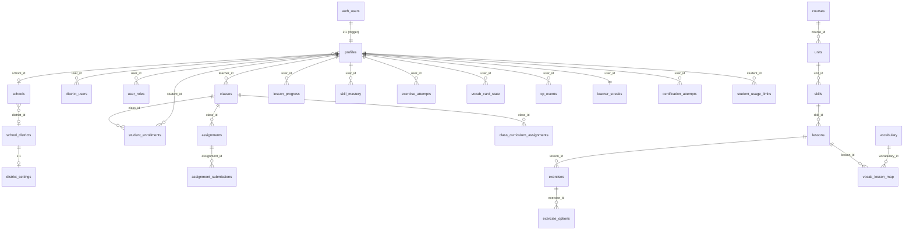

# WIP 15a — Data Architecture / Security / Privacy / Multitenancy: Current State

**Scope:** Palavox (fluentforge-app), branch `overhaul`, commit `7cbaadd9`.
**Auditor role:** Data model / RLS / tenancy / PII / minors-safety discovery specialist.
**Method:** Static read of `supabase/migrations/` (164 files), `supabase/functions/` (36 functions + `_shared/`), `supabase/config.toml`, generated `src/integrations/supabase/types.ts`, and `src/utils/{security,safety}`. Read-only. No DB or dev server touched.

**Claim labels:** `[observed]` = seen in repo with cite; `[inferred]` = reasoned from observed; `[estimated]` = rough; `[requires validation]` = needs runtime/DB check.

> **Framing note:** The Feb 2026 consolidated baseline `20260211195248` + the July 2026 security pass `20260729061713` represent a *large, genuine* security hardening effort. Many findings below are about what that pass did **not** finish, plus structural gaps (no tenant isolation, self-serve teacher role) it did not address. Strengths are called out explicitly.

---

## 1. Data Model — Entity Inventory

### 1.1 Important structural fact: the baseline is a RESET, not an increment

`20260211195248_*.sql` recreates core tables with bare `CREATE TABLE public.profiles (...)` (not `IF NOT EXISTS`) — a squashed/consolidated schema. `[observed]` (migration lines 10, 66, 86…).

Cross-checking the generated `src/integrations/supabase/types.ts` against the ~21 tables that pre-baseline migrations created shows **all of them are absent from the current schema** `[observed]` (verified each: `security_audit_log`, `rate_limits`, `time_restrictions`, `daily_quests`, `achievements`, `user_achievements`, `progress_milestones`, `class_members`, `teacher_assignments`, `student_learning_profiles`, `student_conversation_memory`, `emergency_data_purge_logs`, `educational_interest_access_logs`, `data_retention_logs`, `privacy_notice_acknowledgments`, `directory_information_preferences`, `parental_consent_records`, `email_captures`, `app_settings`, `user_skill_progress`, `user_wordbank` — none present in `types.ts`).

**Consequence `[inferred]`:** The consolidation **dropped the entire prior COPPA/FERPA data scaffolding** — dedicated `parental_consent_records`, `privacy_notice_acknowledgments`, `directory_information_preferences`, `data_retention_logs`, `emergency_data_purge_logs`, and `security_audit_log`. What replaced them is much thinner: a few columns on `profiles` (`is_minor`, `parental_consent_granted`, `safety_mode`) and one write-only-in-theory audit table. This is corroborated by live code that assumes the tables are gone: `src/utils/security/secureSettings.ts:5` (`app_settings table doesn't exist`) and `:18` (`security_audit_log table not available`). The docs in `docs/COMPLIANCE_ROADMAP.md` / `COMPLIANCE_VERIFICATION.md` predate the reset and now overstate coverage `[requires validation]`.

### 1.2 Current entity inventory (baseline + after), grouped by domain

RLS is **enabled on every table below** `[observed]`. "Owner col" = the column RLS ties ownership to. "Writes" summarizes whether end-users can write via RLS or only the service role.

#### Identity & access
| Table | Owner col | RLS reads | Writes |
|---|---|---|---|
| `profiles` | `id` | self / teacher-of-student / admin | self-update (privileged cols frozen by trigger) |
| `profile_public_data` | `user_id` | self / same-school / teacher / admin | self |
| `user_roles` | `user_id` | self; admin manages | admin only |
| `access_codes` | `created_by` | creator/admin | creator/admin |
| `access_code_attempts` | `user_id` | self/admin | self-insert |

#### Tenant / org
| Table | Owner col | RLS reads | Writes |
|---|---|---|---|
| `school_districts` | — | any authenticated (`USING true`) | admin (no policy → deny) |
| `district_settings` | `district_id` | any authenticated (`USING true`) | none |
| `schools` | — | any authenticated (`USING true`) | none |
| `grade_levels` | — | any authenticated | none |
| `subjects` | — | any authenticated | none |
| `district_users` | `user_id` | self/admin | *no write policy* (but see §3) |
| `roster_sync_connections` | — | admin only | admin |

#### Classroom
| Table | Owner col | RLS reads | Writes |
|---|---|---|---|
| `classes` | `teacher_id` | teacher (owner) / enrolled student | teacher |
| `student_enrollments` | `student_id`/`class_id` | student self / teacher of class | student self-insert **and** teacher-insert/update |
| `class_curriculum_assignments` | `class_id`→teacher | teacher of class / enrolled student | teacher of class/admin |
| `assignments` | `teacher_id` | teacher / enrolled student | teacher |
| `assignment_submissions` | `student_id` | student self / teacher of assignment | student self; scores frozen by trigger |
| `student_grades` | `student_id` | student / teacher-of-student / admin | **no write policy** (orphan, see §note) |

#### Curriculum content
| Table | RLS reads | Writes |
|---|---|---|
| `courses`,`units`,`skills`,`lessons`,`exercises`,`passages` | `status='operational'` OR admin | admin only |
| `exercise_options` (answer key) | **admin only** — students never read | admin only |
| `vocabulary`,`vocab_lesson_map`,`can_do_statements`,`content_can_do_map`,`assets` | any authenticated (`USING true`) | admin only |

#### Progress / mastery
| Table | Owner col | RLS reads | Writes |
|---|---|---|---|
| `lesson_progress`,`skill_mastery`,`exercise_attempts`,`vocab_card_state`,`vocab_review_log`,`xp_events`,`learner_streaks` | `user_id` | self / teacher-of-student / admin | **service-role only** (SELECT-only policies) |
| `user_progression` | `user_id` | self / teacher / admin | service-role only |
| `student_metrics`,`student_language_metrics`,`student_usage_metrics` | `student_id`/`user_id` | self / teacher / admin | service-role only |
| `personalized_flashcards` | `student_id` | self | self (FOR ALL) |
| `study_recommendations` | `user_id` | self | service-role |

#### Assessment / certification
| Table | Owner col | RLS reads | Writes |
|---|---|---|---|
| `certification_attempts`,`certification_transcripts` | `user_id` | self / teacher-of-student / admin | service-role |
| `transcript_analyses` | `user_id` | self / admin | service-role |
| `class_certification_stats` | `class_id` | teacher of class / admin | service-role |
| `school_certification_stats` | `school_id` | same-school members / admin | service-role |

#### Usage / billing
| Table | Owner col | RLS reads | Writes |
|---|---|---|---|
| `usage_tracking`,`api_calls_tracking`,`student_usage_limits`,`usage_counters` | `student_id`/`user_id` | self / (teacher) / admin | **service-role only** (quota cannot be self-raised) |
| `admin_override_logs` | — | admin | admin |

#### Compliance / privacy
| Table | Owner col | RLS reads | Writes |
|---|---|---|---|
| `educational_data_access_audit` | `accessed_user_id` | self (subject) / admin | *no insert policy for users* — see §5 |
| `compliance_status`,`data_breach_notifications` | — | admin | admin |
| `data_export_requests` | `user_id` | self / admin | self (FOR ALL) |

#### Misc
| Table | RLS reads | Notes |
|---|---|---|
| `recent_phrases` | any authenticated | shared cache, no owner |

**Note (`student_grades`)** `[observed]`: after the security pass it has a SELECT policy only (mig `20260211222712:214` dropped `FOR ALL`; `20260729061713:355` recreated SELECT). No server writer references it (`grep` finds only `src/utils/schoolUtils.ts:60` reading). It is effectively an **orphaned/never-populated table** `[inferred]`.

### 1.3 ER overview (current curriculum + progress + tenancy spine)

Note the **absence of any `district_id`/`school_id` foreign key on the student-data tables** (`lesson_progress`, `certification_attempts`, `assignment_submissions`, …). Tenancy is inferred only through `classes.teacher_id` + enrollment, never enforced at the district/school level (see §3).

---

## 2. RLS Audit

### 2.1 Strengths worth preserving `[observed]`
- **Every table has RLS enabled** and the July security pass (`20260729061713`) systematically removed the dangerous permissive policies: world-readable profiles (`Users can view all profiles USING(true)`), `Anyone can read active codes`, self-writable XP/quota, `USING(true)` progression. Baseline lines 24, 202, 330 → replaced.
- **Server-authoritative writes:** progress, XP, mastery, usage/quota tables are SELECT-only under RLS; all mutation runs through service-role edge functions. A student **cannot** self-raise `student_usage_limits` or self-award XP. (`20260729061713:385-438`.)
- **Answer keys hidden:** `exercise_options` is admin-only read (`20260729164446:213`); the grader reads the key server-side (`_shared/quizAnswerKey.ts:1` "Never expose this file to the browser"; `submit-exercise`). Good pedagogy-integrity design.
- **Definer helpers hardened:** `has_role`, `is_teacher_of_class`, `is_teacher_of_student`, `same_school_as` are `SECURITY DEFINER ... SET search_path = ''` and fully schema-qualify every reference (`20260211222712→20260729061713:5-22`, `20260729062633:9`). No injection surface found in these — args are UUID/enum typed, bodies are single `SELECT EXISTS`. **No injection surface** `[observed]`.
- **Privilege columns frozen by trigger:** `protect_profile_privileged_columns` prevents a non-admin from setting their own `role`/`account_tier`/`school_id`/`is_minor`/`parental_consent_granted`/`safety_mode` (`20260729061713:38-72`). `protect_submission_scores` prevents students writing their own `score`/`teacher_override_score` (`:77-107`). Legacy escalation RPCs `make_myself_admin/teacher`, `set_my_role` were dropped (`:152-154`).
- **Privileged RPCs revoked from the browser:** `increment_*`, `initialize_student_usage_limits`, `consume_rate_limit`, `generate_access_code`, etc. are `REVOKE ... FROM public, anon, authenticated; GRANT ... TO service_role` (`20260729062707`).

### 2.2 RLS gap table (ranked by severity)

| # | Table / object | Gap `[observed]` unless noted | Severity | Concern axes |
|---|---|---|---|---|
| G1 | `classes` + `student_enrollments` + `class-roster` | Any user can self-elect `teacher` (§7.2) then **enroll any student by email** and thereby unlock that student's `profiles` (incl. **email**), progress, metrics, transcripts via `is_teacher_of_student`. No school scoping, no student consent. | **Critical** | district/school, privacy, pedagogy |
| G2 | `school_districts`,`district_settings`,`schools`,`grade_levels`,`subjects` | `USING (true)` for all authenticated — any student can enumerate **every district, school, and district COPPA/consent config** platform-wide. | High | multitenancy, privacy |
| G3 | `educational_data_access_audit` | No server code inserts rows (grep). The "FERPA access log" is `console.log` only (`chat-with-tutor/index.ts:43`, `src/utils/safety/ferpaCompliance.ts:29`). Audit table is effectively **empty**. | High | compliance, district |
| G4 | `district_users` | No INSERT policy, yet `src/utils/districtPermissionsFixer.ts:48` inserts `role:'admin'` from the browser. Under RLS this now **fails** (deny) `[inferred]` — dead/broken privilege code, but signals intent to self-assign district admin. | Med | security, maintenance |
| G5 | `recent_phrases` | Shared table, any authenticated user reads all rows and inserts; no owner column. Low-value data (phrases) but is a cross-user write surface. | Low | privacy |
| G6 | `profile_public_data` | `same_school_as` scoping is good, but `display_name`+`avatar_url`+`role` of an entire school are enumerable by any same-school account (incl. self-promoted teachers). | Low-Med | privacy |
| G7 | `data_export_requests` | `FOR ALL USING (user_id=auth.uid())` lets a user insert a request with an arbitrary `export_file_url`/`status`; no server processor exists (grep only `DataExportManager.tsx`). DSAR path is **UI-only, non-functional**. | Med | compliance |
| G8 | `vocabulary`,`can_do_statements`,`assets`,`vocab_lesson_map` | `USING (true)` reads — fine for content, but `assets` includes `url`/`transcript` for *all* content regardless of course status; draft/retired audio leaks. | Low | maintenance |

### 2.3 Definer-function verification (requested list)
| Function | search_path | Injection surface | Verdict |
|---|---|---|---|
| `has_role` | `''` | none (typed args, `EXISTS`) | OK |
| `is_teacher_of_class` / `is_teacher_of_student` | `''` | none | OK |
| `same_school_as` | `''` | none | OK |
| `protect_profile_privileged_columns` | `''` | none; but note it **only freezes listed columns** — `placement_cefr`, `display_name`, etc. remain self-writable by design (`20260730030000`) | OK, by design |
| `protect_submission_scores` | `''` | none | OK |
| `process_access_code` | **`public`** (not `''`) | body is single `SELECT ... WHERE code=upper(trim(p_code))`, no dynamic SQL → no injection, but search_path is the weaker `public` not `''` (`20260211222712:368`) | Minor — harden to `''` |
| `join_class_by_code` | `''` | `regexp_replace` + parameterized; no dynamic SQL | OK |
| `generate_access_code` | `public` | no dynamic SQL | Minor |

**Finding:** `process_access_code` and `generate_access_code` still use `SET search_path = public` rather than the hardened `''`. Not exploitable as written (no dynamic SQL, fully qualified), but inconsistent with the rest of the hardening `[observed]`.

---

## 3. Tenant Hierarchy — Isolation Reality

`[observed]` The org tables exist (`school_districts` → `schools` → `grade_levels`; `district_settings`; `district_users`) but:

1. **No tenant boundary on student data.** Core records (`lesson_progress`, `certification_attempts`, `assignment_submissions`, `student_metrics`, `profiles`) carry no `district_id`. Access is decided by `teacher_id`/enrollment (row ownership), never by "same tenant."
2. **Cross-school reads are prevented only for `profile_public_data`** (via `same_school_as`, `20260729062633`). Everything else keys off enrollment. A teacher in District A who enrolls a District B student (by email, §G1) reads that student's records with no cross-district check. So **there is no real multitenant isolation — just row ownership** `[inferred]`.
3. **Org config is world-readable** to any authenticated user (G2), including `district_settings.require_parental_consent` / `min_age` / `consent_type`.
4. **`admin_override_logs`** — table + admin-only RLS exist, but **no code writes to it** (grep finds only the generated type). The override-audit trail is unpopulated `[observed]`.
5. **`roster_sync_connections`** (Clever/Google Classroom/OneRoster) exists as a stub table with admin RLS; no edge function implements sync `[observed]`.

**District/school concern:** A district buyer expecting isolation between schools (or between their district and others) does not get it. Any authenticated account can enumerate all tenants; teacher scoping is self-grantable.

---

## 4. Edge Function Auth

### 4.1 Guard coverage (cross-check of all 36 functions) `[observed]`
`_shared/authGuard.ts` provides `guardPaidRequest` (JWT verify via `auth.getUser` + `consume_rate_limit` daily quota, **fail-closed**) and `requireUser` (JWT verify only). Both use the service-role client purely to validate the token. Good.

| Guard pattern | Functions |
|---|---|
| `guardPaidRequest` (verify + quota) | analyze-conversation-quality, analyze-progress, analyze-pronunciation, analyze-speaking, analyze-transcript, author-content, chat-with-tutor, custom-realtime-conversation, generate-personalized-flashcards, generate-pronunciation-phrase, generate-study-recommendations, generate-teacher-report, grade-assignment, grade-writing, learn-lesson, premium-voice-realtime, submit-exercise, text-to-speech, transcribe-audio, vocab-review |
| `requireUser` | class-roster, grade-quiz, record-certification-attempt, seed-curriculum (admin/SEED_TOKEN), track-usage, verify-age |
| Inline `auth.getUser` (equivalent) | award-xp, get-leaderboard-data, track-premium-voice-session |
| **Header-presence only, then service role** | `initialize-student-progression` (`if(!authHeader)` only — no signature check in code), `check-streak` (decodes JWT **without verifying signature**) |
| **No auth check in code at all (service role)** | `record-certification-usage`, `verify-certification-code`, `cleanup-voice-sessions`, `seed-course-data` |
| No auth (intended public) | health-check |

### 4.2 config.toml gateway `verify_jwt` `[observed]`
Functions with an explicit entry set `verify_jwt=true` **except `seed-curriculum=false`** (it self-authorizes via SEED_TOKEN/admin — acceptable). **8 functions have no config entry** → they fall back to the Supabase platform default (`verify_jwt=true`) `[requires validation — depends on deployed gateway config]`: `check-streak`, `cleanup-voice-sessions`, `get-leaderboard-data`, `health-check`, `initialize-student-progression`, `record-certification-usage`, `track-premium-voice-session`, `verify-certification-code`.

**Findings:**
- **F1 (`initialize-student-progression`)** `[observed]`: uses **service role**, only checks that an `Authorization` header is *present*, then reads **every student profile incl. `email`** (`.from('profiles').select('id,email,display_name').eq('role','student')`) and writes progression for all. Any authenticated student can trigger a full-table job over all students' PII. It is not admin-gated. Severity Med-High (mass op / least-privilege violation; relies on gateway JWT for even minimal auth).
- **F2 (`verify-certification-code` / `record-certification-usage`)** `[observed]`: service role, **no in-code auth**, accept `{code}`, and `record-certification-usage` increments `access_codes.current_uses`. Assuming gateway JWT, **any authenticated user (a student) can validate and burn certification-code uses** for codes they guess/obtain. No `is_teacher`/admin check. Severity Med.
- **F3 (`seed-course-data`)** `[observed]`: `verify_jwt=true` but **no admin check in code**; writes to curriculum tables with the service role (bypassing admin-only RLS). Any authenticated user can invoke it. (It inserts legacy columns `name`/`cefr_min`/`idx` that don't match the current `courses`/`units` schema, so it likely errors before persisting `[inferred]` — but the authorization gap is real and would return once columns drift back.) Severity Med.
- **F4 (`cleanup-voice-sessions`)** `[observed]`: service role, no auth; intended as a cron but callable by any authenticated user. Low severity (only closes stale sessions).
- **F5 (`check-streak`)** `[observed]`: `getUserIdFromAuthHeader` **base64-decodes the JWT and trusts `sub` without verifying the signature** (`check-streak/index.ts:5-21`). It then uses the **anon** client with the caller's header (so RLS still applies), which limits blast radius, but the pattern is fragile and wrong; if ever repointed at a service client it becomes a full auth bypass. Severity Low-Med.

### 4.3 Service-role usage pattern
Most functions instantiate a service-role client and then **re-derive the user from the verified token** and filter by that `userId` — correct. Exceptions are F1–F4 above where the service role runs unscoped work without an equivalent in-code authorization gate.

### 4.4 CORS `[observed]`
`_shared/cors.ts` + `allowedOrigins.ts`: no wildcard; static allow-list (Lovable preview + localhost). **But** `isAllowedOrigin` also returns true for **any** `https://<anything>.lovable.app` and `https://<anything>.lovableproject.com` via regex, with `Access-Control-Allow-Credentials: true`. Since Palavox auth is Bearer-token (not cookie), the practical risk is limited, but the effective CORS trust boundary is "**any app hosted on Lovable**," a shared multi-tenant host. Severity Low-Med; tighten to the specific project origin(s) before production.

---

## 5. PII Flows

**PII inventory `[observed]`:** `profiles.email`, `profiles.display_name`, `birth_year`, `native/target_language`, `student_id` (SIS id), `graduation_year`; `auth.users` (email, `last_sign_in_at` via `get_user_last_sign_in` definer); certification/assignment **transcripts** (free-text conversation content by minors) in `certification_transcripts`, `transcript_analyses`, `assignment_submissions.transcript`; voice/usage metadata.

- **Email readability:** After hardening, `profiles` (incl. email) is readable by self / teacher-of-student / admin only (`20260729061713:298`). `profile_public_data` (no email) is same-school scoped. This is a real improvement. **However** the teacher path is self-grantable (§G1), so email is reachable by any self-promoted teacher who enrolls the target.
- **`class-roster` returns student email to teachers** (`class-roster/index.ts:71`) — legitimate for a real teacher, dangerous combined with G1.
- **console.log leakage `[observed]`:** 278 `console.log` calls in `src`. Several log PII: `useProfileData.ts:43` logs `user.email`; `schoolUtils.ts` logs full profile/school/district objects (`:133,:200`); `StudentProfile.tsx:37` logs student data; `RemoveStudentDialog.tsx:42` logs `studentId/studentName`. Edge functions log user ids and `chat-with-tutor:194` logs on "prompt injection detected." Browser console + edge logs are a PII sink; not catastrophic but a data-minimization/retention problem for a minors' product.
- **Audit table not written:** `educational_data_access_audit` (§G3) — the only "who-viewed-whose-record" trail. No INSERT anywhere; `logDataAccess` is `console.log`. So there is **no queryable FERPA access log** despite the table + UI (`DataAccessAuditLog.tsx`) existing.
- **Retention / deletion:** `data_retention_logs`, `emergency_data_purge_logs` were **dropped** by the baseline (§1.1). No retention job exists in the current tree. `data_export_requests` and account-deletion UI strings exist (translations `deleteAccount*`) but **no edge function performs account deletion or export** (grep: no `auth.admin.deleteUser`, no export processor). `ON DELETE CASCADE` from `auth.users` means a DB-level user delete would cascade child rows — but there is no user-facing or admin path that triggers it. **Right-to-deletion and data-export are non-functional** `[inferred]`.

---

## 6. Client-side "Security" — Honest Assessment `[observed]`

- **`src/utils/security/dataEncryption.ts`:**
  - `encryptData`/`decryptData` (the ones `secureStorage.setItem/getItem` actually call) are **`btoa(encodeURIComponent(...))`** — base64 obfuscation, **not encryption**. The doc-comment even says "Simple obfuscation."
  - `encryptDataSecure` uses real AES-GCM/PBKDF2 **but derives the key from a hardcoded passphrase `'edu_platform_secure_2024'` shipped in the client bundle** (`:82`). Anyone with the bundle can derive the key; the salt is stored alongside the ciphertext. This is **encryption theater** — it protects against nothing an attacker with the (public) JS bundle can't undo. On failure it silently falls back to `btoa`.
  - `secureStorage` writes to `localStorage` with a `_expires` sibling key; still fully readable by any script/XSS on the origin.
- **`src/utils/security/secureSettings.ts`:** entirely **stubbed** — `getSecureSetting`/`setSecureSetting` return null/false ("app_settings table not available"), `logSecurityEvent` is `console.log`, and its own `secureStorage` is `btoa`. `initializeSecureSettings.ts` tries to set a **default signup passcode `'08132010'` in code** (`:19`) against the non-existent settings store — dead code that also hardcodes what reads like a date-of-birth passcode.
- **`src/utils/safety/contentFilter.ts`:** a static English keyword blocklist with ad-hoc Spanish false-positive patching; client-side, trivially bypassed, and monolingual in a 41-language product.

**Verdict:** the `utils/security/*` layer is **security theater** — obfuscation branded as encryption, a hardcoded key, and stubs. It should not be counted as a control. The *real* controls are RLS + the service-role edge functions (§2.1), which are sound.

---

## 7. Minors' Safety

### 7.1 Age gate `[observed]` — genuinely server-side (strength)
`verify-age` decides `is_minor` from submitted `birthYear` **server-side** (`<13`), writes `is_minor`/`safety_mode`/`parental_consent_granted` with the service role, and the client **cannot** set those columns (frozen by `protect_profile_privileged_columns`). Under-13 without consent → `allowed:false, 403` (`verify-age/index.ts:56-78`). `AgeGate.tsx` mounts the dialog for un-verified signed-in users and notes the verdict is server-authoritative. This is the right architecture.

**Caveats:**
- **Self-attested birth year, no verifiable parental consent.** When a minor *claims* `parentalConsent:true`, the server sets `parental_consent_granted:true` with **no verification mechanism** (`verify-age:86`). COPPA "verifiable parental consent" is not met — it's a checkbox. There is no `parental_consent_records` table anymore (§1.1) to even record who/how.
- **Age gate is post-signup and dismissible-until-refresh at the UI layer**; enforcement depends on features checking `safety_mode`/`allowed`. See 7.3.

### 7.2 Self-serve teacher role interacts badly with minors `[observed]`
`20260730010000` intentionally lets any user flip `profiles.role` between `student` and `teacher` (rationale: powers come from class ownership). Combined with `class-roster add_by_email` (enroll any existing account by email) and `student_enrollments` teacher-insert policy (`20260729062707:68`), **an adult (or another student) can self-promote to teacher and pull any student they can name-by-email into their class, gaining read access to that minor's PII and educational records** with no school verification and no consent. This is the single most consequential safety/privacy structural issue (also G1).

### 7.3 `safety_mode` does not reach the AI `[observed]`
`grep` shows `safety_mode`/`safetyMode` is written by `verify-age`, read back for display, and stored in `localStorage` by client safety utils — but **no edge function varies model behavior by `safety_mode`.** `chat-with-tutor`, `premium-voice-realtime`, `custom-realtime-conversation` build their system prompts purely from CEFR level; none read the profile's `safety_mode` or `is_minor`. The only server content control is `chat-with-tutor/config.ts`: a **3-term regex** (`hack|crack|steal|illegal|bomb|terrorist|kill|murder`) applied to the *user's input only* — **AI output is never filtered server-side**, and the filter is English-only and trivially evaded. Prompt-injection "detection" only `console.warn`s and proceeds (`chat-with-tutor:194`). So a 12-year-old in "strict" mode gets **the same AI behavior and the same unfiltered AI output** as an adult. Major pedagogy/safety gap for a minors' product.

### 7.4 Trigger protections (strength)
`is_minor`, `parental_consent_granted`, `parental_consent_at`, `age_verified_at`, `safety_mode`, `birth_year` are all frozen for non-admin writes by the trigger (`20260729061713:59-64`; still frozen after the `20260730010000` role-selection edit). Students cannot self-clear their minor status. Good.

---

## 8. Secrets Posture `[observed]`

- **`.env` is committed to git** (`git ls-files --error-unmatch .env` succeeds; `git show HEAD:.env` returns content). `.gitignore` lists `.env` but it was tracked before being ignored, so the ignore rule is inert (`git check-ignore .env` → no match). Contents are only `VITE_SUPABASE_PROJECT_ID`, `VITE_SUPABASE_URL`, and the **anon/publishable key** (a public-by-design JWT, `role:anon`), so **no live secret is currently exposed** — but committing `.env` is a latent hazard: the day someone pastes a service-role key or provider key into it, it is versioned. Recommend `git rm --cached .env`.
- **Edge-function secrets** are read from `Deno.env` and never hardcoded: `SUPABASE_SERVICE_ROLE_KEY` (35 uses), `LOVABLE_API_KEY` (14), `OPENAI_API_KEY` (1, `premium-voice-realtime` — used to mint an **ephemeral** Realtime token, not shipped to client — good), `AZURE_SPEECH_KEY`/`AZURE_REGION` (2), `SEED_TOKEN` (1), `ALLOWED_ORIGINS` (1). No secret literals found in the functions tree.
- **`initializeSecureSettings.ts:19`** hardcodes a default signup passcode `'08132010'` — dead code (store is stubbed) but should be deleted; it reads like a real DOB and sets the wrong precedent.
- Client bundle correctly uses only `VITE_SUPABASE_PUBLISHABLE_KEY` (anon). No service key reachable from `src`.

---

## 9. Top Security Risks (ranked, with exploit sketch)

1. **Self-promoted teacher harvests minors' records (G1 / §7.2).** `[observed]` *Exploit:* user calls the profile update to set `role='teacher'` (allowed); creates a class; calls `class-roster {action:'add_by_email', email:'victim@school.org'}`; server (service role) enrolls the victim; attacker now satisfies `is_teacher_of_student` and reads victim's `profiles.email`, transcripts, metrics, progress. No school check, no consent. **District/privacy/COPPA-conscious critical.**
2. **`safety_mode` is decorative — minors get unfiltered AI in/out (§7.3).** `[observed]` *Exploit:* under-13 "strict" account chats via `chat-with-tutor`; only an 8-word English regex screens *input*; the model's output is returned verbatim; voice functions ignore safety entirely.
3. **Org/tenant enumeration + no isolation (G2 / §3).** `[observed]` *Exploit:* any student runs `select * from school_districts / schools / district_settings` and enumerates every customer tenant and their consent config; there is no district data boundary anywhere else either.
4. **No functional audit / retention / deletion / export (G3, G7, §5).** `[observed]` The FERPA access-audit table is never written; DSAR export and account deletion have UI but no backend; retention tables were dropped. A district audit or a deletion request cannot be honored from the product.
5. **Under-authorized service-role functions (F1–F4).** `[observed]` `initialize-student-progression` reads all student emails on any authenticated call; `verify-/record-certification-usage` let any user burn certification codes; `seed-course-data` writes curriculum with no admin gate.
6. **Unverified-JWT decode in `check-streak` (F5).** `[observed]` Currently mitigated by anon-client RLS, but a latent full bypass if the client is ever swapped to service role.
7. **Client "encryption" theater + hardcoded key (§6).** `[observed]` Anything stored via `secureStorage` (and the AES path's hardcoded passphrase) is recoverable from the public bundle; must not be relied on for any sensitive value.
8. **Over-broad Lovable CORS regex (§4.4)** and **`process_access_code`/`generate_access_code` weaker `search_path=public`** (§2.3) — lower severity hardening items.

---

## 10. Privacy / Data-Minimization Assessment `[observed]`/`[inferred]`

- **Minimization:** Reasonable at the column level (profiles hold only what the app uses). But **transcripts of minors' free-form conversations** are retained indefinitely (`certification_transcripts`, `assignment_submissions.transcript`, `transcript_analyses`) with **no retention policy and no deletion path** — the opposite of minimization for the most sensitive data class.
- **Purpose limitation:** Teacher access is broad (all enrolled students' transcripts/metrics) and, worse, the enrollment gate is self-grantable (§7.2).
- **Transparency/consent:** consent is a boolean checkbox with no verification and no record table; `district_settings.require_parental_consent` exists but nothing enforces it in any flow `[requires validation]`.
- **Logging discipline:** PII in 278 client `console.log`s + edge logs; no scrubbing.
- **Positive:** quota/usage data is server-write-only; answer keys and org-admin tables are locked down; email is no longer world-readable.

---

## 11. Technical (NOT legal) FERPA/COPPA-Consciousness Gap List

These are engineering gaps that a FERPA/COPPA-conscious build would close; not a legal opinion.

1. **No verifiable parental consent mechanism** — consent is a self-set boolean; the `parental_consent_records` table was dropped (§1.1, §7.1). *(COPPA-conscious)*
2. **`safety_mode`/`is_minor` never gate AI behavior or output filtering** (§7.3). *(COPPA/CIPA-conscious)*
3. **Educational-record access is not audited** — `educational_data_access_audit` is never written; access logging is `console.log` (§G3, §5). *(FERPA-conscious)*
4. **No data-retention or deletion job**; retention/purge tables removed; `ON DELETE CASCADE` exists but no trigger path (§5). *(FERPA/COPPA-conscious)*
5. **No functional data-export (DSAR)** — table + UI, no processor (§G7). *(FERPA-conscious)*
6. **Teacher↔student educational-record access is self-grantable and not school-scoped** (§7.2, §3). A legitimate-educational-interest boundary is not technically enforced. *(FERPA-conscious)*
7. **Directory-information controls dropped** — `directory_information_preferences` no longer exists; `profile_public_data` exposes name/avatar school-wide with no opt-out (§G6). *(FERPA directory-info-conscious)*
8. **Tenant/district config is world-readable** (§G2). *(FERPA-conscious)*
9. **PII in application logs** (§5). *(both)*
10. **Client-side "encryption"/"secure settings" give a false impression of protection** for minors' data (§6). *(both)*

---

## 12. What to Preserve in the Overhaul (do not regress)

- RLS-on-everything + the July hardening pass's model of **SELECT-only student data + service-role writes** (§2.1).
- The hardened definer helpers (`has_role`, `is_teacher_of_*`, `same_school_as`) with `search_path=''` — reuse them as the tenancy primitives.
- **Server-side age determination** in `verify-age` and the privileged-column freeze trigger — extend this pattern rather than replace it.
- Server-side answer-key grading (`exercise_options` admin-only + `submit-exercise`).
- The `guardPaidRequest` fail-closed quota gate for paid endpoints.

## 13. Validation TODO (for the systems-design phase)
- `[requires validation]` Confirm the deployed gateway `verify_jwt` default for the 8 unconfigured functions (§4.2).
- `[requires validation]` Confirm no service-role key or provider key was ever committed in `.env` history (`git log -p -- .env`).
- `[requires validation]` Confirm whether any deployed cron invokes `cleanup-voice-sessions`/`initialize-student-progression` and with what identity.
- `[requires validation]` Confirm `district_settings.require_parental_consent` is not silently ignored by any onboarding flow.
