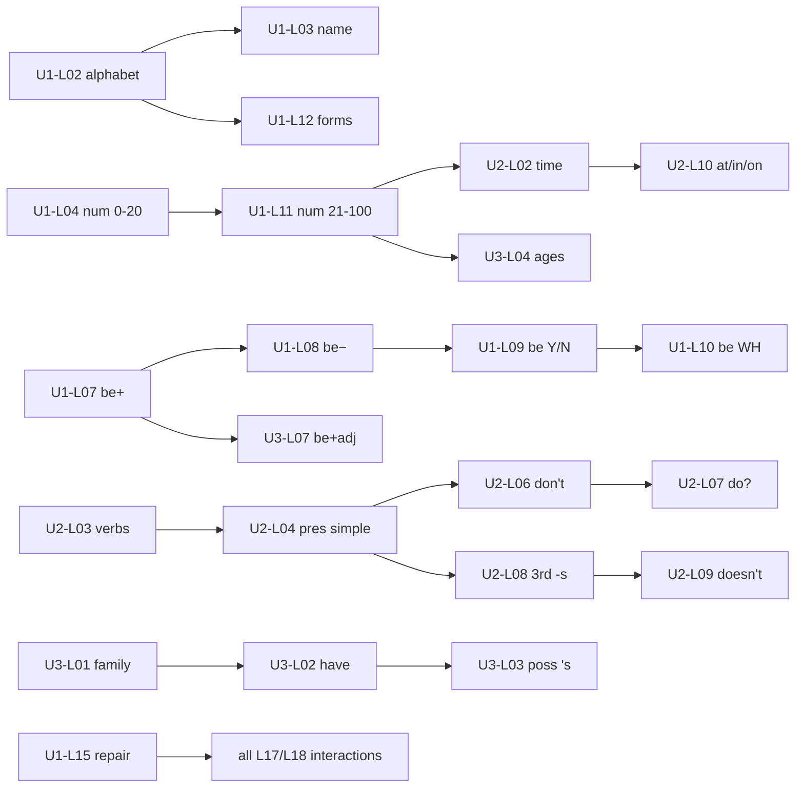

# Palavox Overhaul — ESL Early A1 Band Plan (Units 1–3)

**Direction:** English for multilingual learners (Direction A)
**Band:** Early A1 (Units 1–3 of the 12-unit skeleton)
**Instruction/UI language:** learner's L1 (any of ~41); all contrastive content is L1-parameterized
**Progressive-release ratios for this band:** 70–80% structured / 20–30% guided interaction / ~0% open conversation
**Status:** WIP planning document. No app code or DB changes are made or implied by this file.

Labels used throughout: **[proposed]** = a design decision offered for owner review · **[assumption]** = a premise this plan depends on · **[requires validation]** = must be checked against data, SME review, or pilot before build.

---

## 0. Band-level assumptions and framing

- **[assumption]** "Early A1" = Units 1–3 of the proposed 12-unit skeleton (U1 Introducing yourself, U2 My school day / daily routines, U3 People around me). Late A1 (U4–U5 + Checkpoint 1) belongs to a sibling band plan; this band therefore has **no formal Checkpoint**, but it does end with a **Band Gate** mini-assessment [proposed] (§12) so that placement into U4 is evidence-based, consistent with the owner rule that proficiency claims never come from XP/streaks/completion.
- **[assumption]** Global A1 target is 90–110 core lessons across U1–U5. This band takes **54 core lessons (18/unit)**, leaving 36–56 for U4–U5 — inside the owner's global range.
- **[assumption]** Absolute-beginner entry: no assumed English, but assumed L1 literacy in the learner's own script. Latin-script familiarity is **not** assumed (Arabic, Mandarin, Russian, Ukrainian, Farsi/Dari L1s); U1 contains explicit alphabet/decoding support that Latin-script L1s can test out of (§2, U1-L02).
- **[requires validation]** Per-lesson timing estimates (12–15 min core) and the band total (~22 h) must be validated in pilot telemetry; they are planning numbers, never a user-facing guarantee.
- **[proposed]** Interaction-minute accounting: "guided interaction" counts (a) the AI dialogue/speaking exercises embedded inside core lessons and (b) standalone AI interaction sessions and missions. This is how the 70–80/20–30/0 split is computed in §14.

---

## 1. Refined unit definitions

CEFR quotes below are from the CEFR Companion Volume (Council of Europe, 2020) descriptor scales; ACTFL alignment uses NCSSFL-ACTFL Can-Do Statements (2017) modes. Quotes are short excerpts used for alignment, with attribution.

### Unit 1 — Introducing Yourself (theme: identity, first contact)

- **can_do_statement (unit-level, learner-facing):** "I can greet people, introduce myself, spell my name, and ask and answer simple questions about my name, country, language, and job."
- **CEFR anchors:**
  - Global scale A1: learners "can introduce him/herself and others" and handle questions about personal details (CEFR 2001/CV 2020, Global Scale A1).
  - Conversation A1: "can make an introduction and use basic greeting and leave-taking expressions" (CV 2020).
  - Sociolinguistic appropriateness A1: basic social contact via "the simplest everyday polite forms" (CV 2020).
- **ACTFL modes covered:** Interpersonal (introductions Q&A — Novice Mid→High), Interpretive (recognize names, countries, numbers in slow speech and simple forms), Presentational (a 4–6 sentence spoken/written self-introduction).
- **key_language_use:** exchanging personal information; social formulas.
- **content_objective:** names/titles, countries and languages, numbers 0–100, jobs, classroom survival phrases.
- **language_objective:** *be* (all persons, +/−/?), subject pronouns, possessive *my/your*, *a/an*, WH-words *what/where/who*, alphabet and spelling aloud.

### Unit 2 — My Day: Routines and Schedules (theme: time, habits, school/work day)

*Rename [proposed]:* "My school day" → **"My Day: Routines and Schedules"** — Palavox's adult migrant/worker personas [assumption] need work-day and home-day framing, not only school; school register is kept as one lesson strand (U2-L12–13).
- **can_do_statement:** "I can say what I do every day and at what time, ask about another person's day, and understand a simple daily schedule."
- **CEFR anchors:**
  - Information exchange A1: "can ask and answer questions about themselves…", and A1 learners "can handle numbers, quantities, cost and time" (CV 2020).
  - Overall listening A1: follows "very slow and carefully articulated" speech with pauses (CV 2020).
- **ACTFL modes:** Interpersonal (guided Q&A about routines), Interpretive (read/hear a schedule, extract times), Presentational ("my typical day" — 5 connected sentences, spoken and written).
- **key_language_use:** describing habits and time; requesting schedule information.
- **content_objective:** days, clock time, routine verbs, frequency, school/work vocabulary, free-time basics.
- **language_objective:** present simple all persons (+/−/?), 3rd-person *-s*, *do/does* questions, frequency adverbs, prepositions of time *at/in/on*, *like* + noun/*-ing*.

### Unit 3 — People Around Me (theme: family, friends, describing people)

- **can_do_statement:** "I can name and describe my family and friends — who they are, their ages, what they look like, what they do, and what they can do — and ask about someone else's people."
- **CEFR anchors:**
  - Global scale A1: Q&A about "people he/she knows and things he/she has" (CV 2020).
  - Creative writing A1: "simple phrases and sentences about themselves and imaginary people" (CV 2020).
- **ACTFL modes:** Interpersonal (asking follow-up questions about family/friends), Interpretive (match people to descriptions), Presentational ("people in my life" show-and-tell with photo prompt).
- **key_language_use:** describing people and relationships; expressing possession and ability.
- **content_objective:** family/relationship terms, appearance and personality adjectives, jobs of others, ages.
- **language_objective:** *have/has*, possessive *'s* and full possessive-adjective set, regular/irregular plurals, adjective+noun order, *this/that/these/those*, *who/how old* questions, *can/can't* (ability).

**Interpretive/interpersonal/presentational coverage matrix [proposed]:** every unit ends with one presentational task (L16–17 zone), embeds interpersonal AI interaction in ≥6 lessons/unit, and carries interpretive listening/reading in every lesson via exercise mix. Verified per-lesson in §2 tags: (I)=interpretive, (P)=presentational, (X)=interpersonal.

---

## 2. Lessons per unit (core deliverable)

54 core lessons; IDs `EN-A1E-U{u}-L{nn}`. Each line: **ID — Title — one-line objective** (mode tags). "Lab" lessons are pronunciation/listening intensives; every lesson still mixes skills per the exercise-blend rule in §11.

### Unit 1 — Introducing Yourself (18 lessons)

1. **U1-L01 — Hello and Goodbye** — Greet and take leave with the right formula for the time of day and register (hi/hello/good morning/bye/see you). (I, X)
2. **U1-L02 — The Alphabet and Spelling** — Name English letters, decode simple words, and spell your own name aloud; Latin-script L1s may test out of the decoding half [proposed]. (I, P)
3. **U1-L03 — What's Your Name?** — Ask and answer *What's your name?* with *I'm… / My name is…*, using *Nice to meet you*. (X)
4. **U1-L04 — Numbers 0–20** — Say and understand numbers 0–20 in isolation and in short utterances. (I)
5. **U1-L05 — Where Are You From?** — Ask and answer about country of origin with *I'm from…* (fully specified sample lesson, §13a). (X, I)
6. **U1-L06 — Nationalities and Languages** — State nationality and language(s): *I'm…, I speak…*; ask *Do you speak…?* as a chunk. (X)
7. **U1-L07 — be: I am / You are / She is** — Build affirmative statements about self and others with correct copula (contrast slot: zero-copula L1s, §"L1 schema"). (P)
8. **U1-L08 — be: Negatives and Short Answers** — Say what is not true (*I'm not…*) and answer *Yes, I am / No, I'm not*. (X)
9. **U1-L09 — Are You…? Yes/No Questions with be** — Form and answer yes/no questions with inversion and rising intonation. (X)
10. **U1-L10 — What, Where, Who: WH-Questions with be** — Ask for personal information with falling intonation. (X)
11. **U1-L11 — Numbers 21–100 and Phone Numbers** — Say larger numbers and exchange phone numbers digit-by-digit with grouping pauses. (X, I)
12. **U1-L12 — Filling In a Form** — Read and complete a simple personal-information form (first name, last name, country, phone, email); capitalization of proper nouns. (I, P-written)
13. **U1-L13 — Jobs** — Say your job with *a/an* (*I'm a cook*), ask *What do you do?* as an unanalyzed chunk [proposed: chunk-first, grammar in U2]. (X)
14. **U1-L14 — This Is / That Is: Things Around You** — Identify classroom/everyday objects with *this/that* and *What's this?*. (I, X)
15. **U1-L15 — Survival Phrases: Please, Sorry, Can You Repeat That?** — Deploy politeness and breakdown-repair formulas (*please, thank you, excuse me, sorry?, Can you repeat that, please?, How do you spell that?*). (X)
16. **U1-L16 — Sound Lab 1: ship vs sheep, question melody** — Hear and produce /ɪ/ vs /iː/ and Y/N-rising vs WH-falling intonation. (I, P)
17. **U1-L17 — Meet a New Classmate (integration)** — Sustain a 6–8 turn scripted-then-flexed introduction dialogue combining U1 language. (X)
18. **U1-L18 — Unit 1 Review + Mission: "Three Introductions"** — Cumulative review set + spoken mission: introduce yourself to three AI characters of different formality. (X, P)

### Unit 2 — My Day: Routines and Schedules (18 lessons)

1. **U2-L01 — Days of the Week** — Say the days, ask *What day is it today/tomorrow?*. (I)
2. **U2-L02 — What Time Is It?** — Tell clock time (o'clock, 7:15/7:30/7:45 digital style [proposed: teach digital-first, "half past" receptive only]). (I, X)
3. **U2-L03 — Daily Routine Verbs** — Understand and say 12 core routine verbs/chunks (*get up, take a shower, go to work…*) in I-form. (I)
4. **U2-L04 — I Work, You Study: Present Simple (I/you/we/they)** — Make true statements about your habits. (P)
5. **U2-L05 — My Morning, Step by Step** — Sequence a routine with *first, then, after that* in speech and writing. (P)
6. **U2-L06 — I Don't…: Negatives with don't** — Say what you don't do (*I don't drink coffee*). (P, X)
7. **U2-L07 — Do You…? Questions and Short Answers** — Ask and answer yes/no habit questions (*Do you work on Saturdays?*). (X)
8. **U2-L08 — He Works, She Studies: Third-Person -s** — Describe another person's routine; produce final /s/ /z/ /ɪz/ intelligibly. (P)
9. **U2-L09 — Doesn't / Does She…?** — Negate and question 3rd-person habits. (X)
10. **U2-L10 — At 7:00 On Monday In the Morning** — Attach correct time prepositions to times, days, parts of day. (P)
11. **U2-L11 — Always, Sometimes, Never** — Position frequency adverbs and answer *How often…?* (receptive). (X, P)
12. **U2-L12 — School and Work Words** — Name subjects/classes and common workplace items; read a class/work schedule grid. (I)
13. **U2-L13 — What Time Does It Start?** — Ask about schedules (*What time…? When…? What days…?*) and extract answers from spoken replies. (X, I)
14. **U2-L14 — Free Time: I Like…** — Express likes with *like* + noun/*-ing* and ask *Do you like…?*. (X)
15. **U2-L15 — Sound Lab 2: "Whaddaya do?" — reduced speech** — Recognize reduced *do you* /dʒə/, *What do you* /wʌdəjə/, linking (*get‿up*), and weak *at/to*; production optional [proposed: receptive-only mastery bar]. (I)
16. **U2-L16 — Writing: My Day in Five Sentences** — Write 5 connected sentences about your day with *and/then* and time phrases. (P-written)
17. **U2-L17 — Schedule Gap (guided interaction)** — Obtain missing schedule information from the AI via an information-gap task, using repair phrases when needed. (X)
18. **U2-L18 — Unit 2 Review + Mission: "A Day in Your Life"** — Cumulative review + spoken mission: describe your typical day and answer 3 follow-up questions, incl. one unexpected-but-level-appropriate reply. (X, P)

### Unit 3 — People Around Me (18 lessons)

1. **U3-L01 — My Family** — Name core family members and state relationships (*This is my mother*). (I, P)
2. **U3-L02 — I Have Two Brothers: have/has** — State what family you have; ask *Do you have…?*. (X)
3. **U3-L03 — Maria's Brother: Possessive 's and our/their** — Mark possession with *'s* and complete the possessive-adjective set. (P)
4. **U3-L04 — How Old Is She?** — Ask and give ages; consolidate numbers under real use. (X)
5. **U3-L05 — One Child, Two Children: Plurals** — Form regular plurals (+ /s z ɪz/ pronunciation) and the top irregulars (*children, people, men, women*). (P)
6. **U3-L06 — Tall, Short, Long Hair: Appearance** — Understand and use 12 appearance adjectives/chunks. (I)
7. **U3-L07 — She's Tall / She Has Long Hair** — Choose *be*+adj vs *have*+noun frames; adjective-before-noun order (contrast slot: adjective-position L1s). (P)
8. **U3-L08 — Friendly, Funny, Quiet: Personality** — Describe personality with 8 high-frequency adjectives; softeners *a little/very*. (P, X)
9. **U3-L09 — My Mother Is a Nurse** — Say family members' jobs and workplaces (*works at/in*); recycle U1 jobs + U2 3rd-person -s. (P)
10. **U3-L10 — These and Those: People and Things in Groups** — Point to near/far singular/plural referents accurately. (I)
11. **U3-L11 — Who's That?** — Ask and answer *Who…?* questions about people in scenes and photos. (X)
12. **U3-L12 — She Can Drive: can/can't** — State abilities of self and others; unstressed *can* /kən/ vs stressed *can't*. (P, X)
13. **U3-L13 — My Best Friend** — Talk about a friend with chunks (*best friend, we play… together, we talk every day*). (P)
14. **U3-L14 — In This Photo…** — Present a photo of people: who they are, ages, appearance, one detail each. (P)
15. **U3-L15 — Sound Lab 3: this, that, three, mother** — Produce /θ/ and /ð/ intelligibly in high-frequency words; final clusters (*friends, works*). (I, P)
16. **U3-L16 — Writing: A Paragraph About My Family** — Write a connected 4–6 sentence family paragraph with *and/but*. (P-written)
17. **U3-L17 — Ask Me About My Family (guided interaction)** — Interview the AI about its (fictional) family, asking ≥5 questions with ≥2 follow-ups. (X)
18. **U3-L18 — Unit 3 Review + Mission: "People in My Life"** — Cumulative review + show-and-tell mission (§13d) with AI follow-up questions. (X, P)

**Band lesson count: 54 core + 3 unit-review lessons are embedded as L18s + 1 standalone Band Gate session (§12) = 55 scheduled sessions.** Deviation note: 18/unit sits mid-range of the owner's 16–22; chosen so early lessons stay short (12–15 min) for absolute beginners rather than fewer, denser lessons [proposed].

---

## 3. Prerequisite graph

Principle [proposed]: **hard gates** only where a lesson is unusable without the prerequisite; otherwise **soft ordering** (recommended sequence, FSRS interleaving assumes it). Test-out allowed only where marked.

**Hard gates (blocking):**

```text
U1-L02 (alphabet)        → U1-L03 (spelling name), U1-L12 (forms)   [test-out for Latin-script L1s]
U1-L04 (numbers 0–20)    → U1-L11 (21–100) → U2-L02 (time) → U3-L04 (ages)
U1-L07 (be affirm)       → U1-L08 (be neg) → U1-L09 (be Y/N) → U1-L10 (be WH)
U1-L07                   → U3-L07 (be+adj frames)
U2-L03 (routine verbs)   → U2-L04 (pres simple) → U2-L06 (don't) → U2-L07 (do?) 
U2-L04                   → U2-L08 (3rd -s) → U2-L09 (doesn't/does?)
U2-L01+L02 (days/time)   → U2-L10 (at/in/on) → U2-L13 (schedule Qs) → U2-L17 (gap task)
U3-L01 (family nouns)    → U3-L02 (have) → U3-L03 (possessive 's)
U3-L05 (plurals)         → U3-L10 (these/those)
U3-L06 (appearance)      → U3-L07 → U3-L14 (photo presentation)
U1-L15 (repair phrases)  → all L17/L18 interaction lessons in every unit
Unit N L18 review passed → Unit N+1 unlocked (soft-fail allowed once, see §11 remediation)
```

**Soft ordering (recommended, non-blocking):** Sound Labs (U1-L16, U2-L15, U3-L15) before their unit's L17–L18 interactions; U1-L13 (jobs) before U3-L09; U2-L11 (frequency) before U2-L16 writing.

**Skill-level gating [proposed]:** speaking exercises inside any lesson unlock only after that lesson's flashcard+cloze block scores ≥70% (keeps output attempts grounded in just-taught form).



---

## 4. Vocabulary and lexical-chunk targets

### Counts and principles

| Unit | New single-word items | Multiword chunks | Unit total | Cumulative |
|---|---|---|---|---|
| U1 | 82 | 28 | 110 | 110 |
| U2 | 92 | 33 | 125 | 235 |
| U3 | 97 | 28 | 125 | 360 |

**Band total: ~360 items** (≈6.7 new items/lesson) [proposed]. Against the global 1,800–2,200 target this front-loads modestly (~17–18% of vocabulary in 25% of a hypothetical 12-unit spread) — correct for early A1, where automatization matters more than breadth [assumption]; later bands accelerate. **[requires validation]** against pilot retention data (FSRS lapse rates >30% per lesson ⇒ cut load).

**Selection principles [proposed]:**
1. **Frequency-first with communicative override:** base list from high-frequency spoken-English bands (e.g., top-2000 of a spoken corpus) but survival items (*passport, appointment*) may outrank raw frequency; decorative low-utility items excluded even if "thematic" (no *aunt-in-law*, no exotic animals).
2. **Chunks as first-class items:** formulaic sequences (*Nice to meet you; Can you repeat that, please?*) are stored as vocabulary rows with `part_of_speech: chunk` [proposed schema use] and get FSRS cards like words.
3. **Immediate deployability:** every item must appear in ≥1 productive exercise within its lesson and ≥2 later lessons (recycling contract, enforced by `vocab_lesson_map` coverage checks).
4. **L1-parameterized translation:** `vocabulary.translation_l1` is single-column — a known limitation. Extension `vocabulary_translations(vocab_id, l1_code, translation, usage_note)` [proposed, §"schema extensions"] carries all ~41 L1s; authoring workflow fills priority L1s first, machine-translates the tail with human spot-check [requires validation].
5. **Cognate/false-friend flagging per L1** via `l1_contrast_notes` with `contrast_type: false_friend` (e.g., ES *embarrassed/embarazada*-class risks appear from A2; in this band ES *carpeta*≠carpet, PT *pasta*≠pasta noted where the item occurs).

### Sample list — Unit 1 (44 of 110 items; representative)

Format: `lemma | pos | translation_l1: <L1-parameterized — one row per L1 via vocabulary_translations> | note`. IPA and frequency_rank filled at authoring time.

| # | Item | POS | Note |
|---|---|---|---|
| 1 | hello | interj | neutral register |
| 2 | hi | interj | informal; register pair with 1 |
| 3 | good morning | chunk | time-bound greeting |
| 4 | goodbye / bye | interj | register pair |
| 5 | see you later | chunk | leave-taking, informal |
| 6 | Nice to meet you. | chunk | first-meeting formula |
| 7 | name | n | |
| 8 | My name is… | chunk | frame |
| 9 | I'm… | chunk | contraction taught as unit |
| 10 | What's your name? | chunk | question formula |
| 11 | Mr / Ms | n(title) | pragmatics: titles + last name |
| 12 | teacher | n | |
| 13 | student | n | |
| 14 | class | n | |
| 15 | country | n | |
| 16 | Where are you from? | chunk | question formula |
| 17 | I'm from… | chunk | frame |
| 18 | language | n | |
| 19 | English | n/adj | |
| 20 | I speak… | chunk | frame |
| 21 | Do you speak English? | chunk | unanalyzed until U2 |
| 22 | yes / no | adv | |
| 23 | please | adv | politeness, high frequency |
| 24 | thank you / thanks | chunk | register pair |
| 25 | Excuse me. | chunk | attention-getter vs *sorry* |
| 26 | Sorry? | chunk | repair: didn't hear |
| 27 | Can you repeat that, please? | chunk | repair formula |
| 28 | How do you spell that? | chunk | repair/spelling formula |
| 29 | I don't understand. | chunk | repair formula |
| 30 | number | n | |
| 31 | zero…twenty (set) | num | counted as 21 items in DB, 1 row here |
| 32 | phone number | n(comp) | |
| 33 | email address | n(comp) | |
| 34 | first name / last name | n(comp) | forms literacy |
| 35 | job | n | |
| 36 | What do you do? | chunk | unanalyzed formula |
| 37 | doctor | n | |
| 38 | cook | n | job sense; verb sense deferred |
| 39 | driver | n | |
| 40 | this / that | det/pron | |
| 41 | What's this? | chunk | |
| 42 | pen / book / phone / bag | n | classroom-object set (4 items) |
| 43 | new | adj | *new student, new phone* |
| 44 | from | prep | weak form /frəm/ flagged |

Full U1 list (110) additionally covers: remaining numbers, 10 more countries/nationalities keyed to the learner's likely region [proposed: country subset personalized by L1], 6 more jobs, 8 more classroom objects, *he/she/we/they, and, but, or, too*, *married, single* [requires validation: cultural sensitivity review for intake contexts].

---

## 5. Grammar progression across the band

Ordered; each point exists because a communicative task in §2 needs it. `grammar_points` rows [proposed schema extension] with `communicative_need` filled:

| # | Grammar point | First lesson | Communicative need |
|---|---|---|---|
| G1 | Subject pronouns I/you + *be* am/are (affirm.) | U1-L03/07 | say who you are |
| G2 | Possessive *my/your* | U1-L03 | *my name, your name* |
| G3 | *be* 3rd person is; he/she/it | U1-L07 | introduce others |
| G4 | *a/an* + noun (jobs, objects) | U1-L13/14 | state job, identify objects |
| G5 | *be* negatives + short answers | U1-L08 | correct wrong info about you |
| G6 | Y/N questions with *be* (inversion) | U1-L09 | check information |
| G7 | WH-questions with *be* (*what/where/who*) | U1-L10 | get personal info |
| G8 | *this/that* + *What's this?* | U1-L14 | point and ask |
| G9 | Present simple affirm. I/you/we/they | U2-L04 | describe habits |
| G10 | Sequencers *first/then/after that* | U2-L05 | order a routine |
| G11 | *don't* negatives | U2-L06 | state non-habits |
| G12 | *Do you…?* + short answers | U2-L07 | ask about habits |
| G13 | 3rd-person *-s* | U2-L08 | describe someone else's day |
| G14 | *doesn't / Does…?* | U2-L09 | negate/ask 3rd person |
| G15 | Prepositions of time *at/in/on* | U2-L10 | anchor events in time |
| G16 | Frequency adverbs + position | U2-L11 | say how often |
| G17 | *like* + noun/*-ing* | U2-L14 | express preferences |
| G18 | *have/has* (possession) | U3-L02 | family & possessions |
| G19 | Possessive *'s*; full poss.-adj set | U3-L03 | relate people to people |
| G20 | Plural nouns (reg. + top irregulars) | U3-L05 | talk about groups |
| G21 | Adjective+noun order; *be*+adj vs *have*+noun | U3-L07 | describe people |
| G22 | *these/those* | U3-L10 | groups near/far |
| G23 | *Who…? How old…?* | U3-L04/11 | identify people, ask ages |
| G24 | *can/can't* (ability) | U3-L12 | say what people can do |

Deliberate exclusions from this band [proposed]: present continuous, *there is/are*, articles beyond *a/an*, object pronouns (receptive only), imperatives beyond classroom commands (receptive) — deferred to late A1 (U4–U5) to protect automatization of *be* + present simple, the two highest-payoff systems [assumption].

### L1-parameterized contrast schema (authoring pattern)

**Schema slot [proposed]:** table `l1_contrast_notes` — `(id, scope_type: lesson|grammar_point|phoneme|vocab, scope_id, l1_code, contrast_type: absent_in_l1|present_but_different|false_friend|positive_transfer|phonological_interference, note_md, predicted_errors jsonb, remediation_exercise_refs jsonb)`. Rendered in the lesson's `intro_md` zone in the learner's UI language; also consumed by AI-interaction correction logic (§13 contracts) to pre-load likely errors.

**Filled examples — grammar point G1/G3 (copula *be*):**

| l1_code | contrast_type | note (rendered in L1) | predicted_errors |
|---|---|---|---|
| es | present_but_different + positive_transfer | Spanish has copulas (*ser/estar*) → concept transfers. But Spanish drops subject pronouns (*Soy médico*), so pronoun omission is likely; also *I have 30 years* for age (U3-L04). | "Is teacher." (pronoun drop); "*She have* 30 years" later |
| zh | absent_in_l1 | Mandarin uses 是 *shì* with nouns but **not** with adjectives (她很高 "she very tall") → *be* omitted before adjectives; no verb agreement anywhere. | "*She tall.*", "*He is go*" overuse later, no *-s* agreement |
| ar | absent_in_l1 | Arabic has **no present-tense copula** (هي معلمة "she teacher") → systematic omission of *am/is/are* in all U1 frames. | "*I from Syria.*", "*She teacher.*" |
| vi | absent_in_l1 (partial) | Vietnamese *là* links nouns but not adjectives; no inflection → same adjective-copula omission as zh, plus final-sound loss hides *'s* contractions. | "*She tall*", mishears *she's* as *she* |

**Filled examples — grammar point G13 (3rd-person -s):**

| l1_code | contrast_type | note | predicted_errors |
|---|---|---|---|
| es | present_but_different | Spanish verbs inflect heavily → concept of agreement transfers, but English's single visible *-s* seems trivially small and gets dropped under load. | "*She work* at a hospital." |
| zh | absent_in_l1 | No verbal agreement at all; plus final /s/ clusters phonologically hostile. Double-flag: grammar + pronunciation remediation. | omission in speech > writing |
| ar | present_but_different | Rich agreement exists; error source is phonological (final clusters) more than conceptual. | "*work-es*" epenthesis /wɜrkɪs/ |

**Filled examples — vocab/pragmatics (greetings, U1-L01):**

| l1_code | contrast_type | note |
|---|---|---|
| es | present_but_different | *Good morning* maps to *buenos días* cleanly; warn that *"How are you?"* is often a greeting, not a real question — a one-line pragmatics note. |
| zh | present_but_different | 你好 covers hi/hello but English time-of-day greetings are more obligatory in service contexts; 吃了吗-type greetings don't transfer. |
| ar | present_but_different | Rich greeting exchanges (سلام sequences) are longer than English ones; note that short English exchanges are not rude. |

Authoring rule [proposed]: every grammar_point ships with contrast rows for the 10 priority L1s minimum; remaining ~31 L1s inherit a typologically-nearest default (e.g., Dari inherits Farsi row) flagged `inherited: true` [requires validation by L1 informants].

---

## 6. Pronunciation progression

Priority = **intelligibility payoff × priority-L1 coverage** (functional-load reasoning; accent reduction is explicitly not the goal). Table maps to `pronunciation_targets` rows [proposed schema extension].

| Stage | Target | Unit | Why (intelligibility rationale) | Priority L1s most affected | Minimal pairs / practice set |
|---|---|---|---|---|---|
| P1 | Syllable count + word stress awareness | U1 | Wrong stress wrecks recognition more than wrong phonemes; sets foundation for all later targets | zh, vi (tone-for-stress), fr-lexified ht | ˈteacher, stuˈdent(✗)→ˈstudent, hoˈtel; clap-the-syllables tasks |
| P2 | /ɪ/ vs /iː/ | U1-L16 | High functional load in survival words | es, ar, vi, so, ht, pt | ship/sheep, live/leave, it/eat, six/seeks |
| P3 | Y/N rising vs WH falling intonation | U1-L16 | Question recognition with zero grammar cost; enables repair | all (esp. zh, vi tonal transfer) | "Are you…?↗" vs "Where are you from?↘" |
| P4 | Letter names vs sounds; spelling aloud | U1-L02 | Spelling your name is a survival act (forms, phones) | ar, zh, ru, uk, fa (script) | E/I, G/J, A/E confusions |
| P5 | Final -s: /s/ /z/ /ɪz/ | U2-L08 | Carries 3rd-person -s AND plurals AND possessive 's — one sound system, three grammar systems | vi, zh (final-C deletion), es (final-s weakening) | work/works, live/lives, watch/watches |
| P6 | Weak forms + reductions (receptive) | U2-L15 | Learners must *hear* /dʒə/, /wʌdəjə/, weak *at/to/from* or real speech is opaque; production not required | all | "Do you…"→/dʒə/; "What do you do?"; from /frəm/ |
| P7 | Consonant–vowel linking | U2-L15 | Word-boundary recognition in connected speech | zh, vi, ar | get‿up, wakes‿at, an‿apple |
| P8 | /æ/ vs /ʌ/ | U2 (woven) | Distinguishes *have/hub-class* items, *cat/cut, ran/run* in routine talk | es, pt, ru, uk, fa | have/hut-class sets, bag/bug, cap/cup |
| P9 | /θ/ /ð/ | U3-L15 | Densest in this band's own vocab (*this, that, these, those, three, thirty, mother, father, brother*); substitutions (/t d s z v f/) are L1-diagnostic | es, ru, uk, vi, zh, fa, so, ht, pt | three/tree, thin/tin/sin, they/day, mother/mudder |
| P10 | Final clusters | U3-L15 | *friends, parents, works, can't* — cluster deletion deletes grammar | vi, zh, pt(BR), so | friend/friends, work/works/worked(recept.), can/can't |
| P11 | *can* /kən/ vs *can't* stressed | U3-L12 | Classic meaning-inverting contrast | all | "I can go" vs "I CAN'T go" |

Delivery [proposed]: every lesson carries a 60–90-second pronunciation micro-slot (perception-before-production: discrimination task → shadowing → recorded production with ASR feedback); Sound Labs are the deep dives. ASR scoring thresholds per target [requires validation — must tune against accented-speech data, not native-speaker acoustic models].

---

## 7. Listening progression

| Dimension | Unit 1 | Unit 2 | Unit 3 |
|---|---|---|---|
| Text types | Isolated words; 2–4-turn formulaic exchanges (greetings, names, numbers) | 3–5-sentence routine monologues; simple service Q&A (schedule desk); classroom instructions | 5–7-sentence person descriptions; 2-speaker family conversations; short "voicemail"-style messages |
| Speed | 0.75× careful speech, long pauses ("very slow and carefully articulated" per CEFR A1 listening) | 0.85×; one replay at 1.0× after task success [proposed] | 0.9× first pass, 1.0× natural-pace second pass with reductions |
| Reduced forms | None produced; contractions (*I'm, what's*) heard from L03 | /dʒə/, /wʌdəjə/, weak *at/to*, linking — receptive tasks (U2-L15) | Reductions recycled in all inputs; *can/can't* discrimination |
| Voices/accents | 2 voices, one accent variety [proposed: General American primary] | +1 female/male pair | +1 additional English variety (receptive exposure only) [requires validation: which variety serves user base] |
| Task types | Point/pick the picture; listen-and-match; number dictation | T/F; order the events; complete the schedule grid; minimal-pair spotting | Match person↔description; note names/ages; "who says it?"; detect the repair move |
| Context settings | Classroom, first meetings | Home, school/work, service counter | Home, photos, small gatherings, workplace mention |

Classroom/service listening chunks (owner requirement) enter receptively from U1-L15: *Open your book. Listen and repeat. Next, please. Anything else?* — understood, not produced, this band.

---

## 8. Writing progression

| Stage | Lessons | Output | Mechanics focus |
|---|---|---|---|
| W1: Letters → words | U1-L02, L12 | Copy → write name, country, numbers; complete a form | Latin script formation (non-Latin L1s), capitals for names/*I*, basic keyboard entry [proposed: typing primary, handwriting optional] |
| W2: Phrases → sentences | U1-L12–L18 | 3–4 isolated sentences about self ("Can write simple isolated phrases and sentences" — CEFR A1 written production) | Capital letter + final period; word spacing (zh, ar scripts) |
| W3: Sentence chains | U2-L05, L16 | 5 connected sentences on routine with *and/then* + time phrases | Sentence boundaries vs run-ons; spelling of routine verbs |
| W4: Mini-paragraph | U3-L16 | 4–6 sentence family paragraph with *and/but*; message reply (written AI interaction) | Paragraph as visual unit; *'s* vs plural *s* in writing |

Every unit also embeds a **written AI interaction** (§9) so writing is interactive, not only compositional. Error taxonomy for writing feeds the same `saved error categories` store as speech (§13 contracts).

---

## 9. Speaking progression and embedded AI interaction (per the 70–80/20–30/~0 ratios)

**Progression spine [proposed]:** imitation → substitution → controlled dialogue completion → guided Q&A → information gap → scaffolded mission. **No open conversation in this band (~0%)**: every speaking task has a script, frame, or tight goal; "unexpected" turns are single, pre-authored, level-appropriate deviations (owner's "reacting to unexpected responses" type, introduced U2-L18).

Per-unit embedded interactions (every unit has ≥1 written AND ≥1 spoken, all with full contracts at authoring time; sample full contracts in §13):

| Unit | Written AI interaction | Spoken AI interaction(s) | Mission (spoken, scaffolded) |
|---|---|---|---|
| U1 | **Chat: new-classmate exchange** (controlled dialogue completion: AI writes greeting/question, learner completes from frames; L03, L17) | **Guided self-introduction Q&A** (AI asks the 6 personal-info questions; L09–L10, L17); spelling-aloud drill with ASR (L02, L11) | **"Three Introductions"** (L18): greet + introduce self to 3 AI characters (teacher/peer/office clerk) with register shifts |
| U2 | **Schedule information gap via chat** (learner types questions to fill a schedule grid; L17) | **Guided routine Q&A** (spoken; §13c contract; L18 pre-task at L07/L13) | **"A Day in Your Life"** (L18): 60–90s description + 3 AI follow-ups incl. 1 unexpected reply |
| U3 | **Message reply about family** (AI sends short message with 2 questions about learner's family; learner replies in 3–5 sentences from frames; L16) | **Interview the AI about its family** (learner asks; role reversal trains question formation; L17) | **"People in My Life"** (L18; §13d full contract): photo-prompted show-and-tell + follow-ups |

Ratio arithmetic — see §14; guided interaction lands at **~26%** of band minutes, inside 20–30%.

Repair-first design [proposed]: *Sorry? / Can you repeat that, please? / How do you spell that? / I don't understand* are taught in U1-L15 and are **always-permitted moves** in every AI interaction thereafter; using them is scored positively (repair is an A1 competence per CEFR interaction descriptors, not a failure).

---

## 10. Cultural and pragmatic content (woven, never standalone lectures)

| Where | Content |
|---|---|
| U1-L01 | Register pairs (*hi* vs *good morning*); smiling/greeting service workers; handshake norm note (L1-parameterized: contact norms differ) |
| U1-L03/11 | Names: first/last order (contrast: zh, vi, hu-style ordering), titles *Mr/Ms* + last name, teachers addressed by name not "Teacher" [note rendered in L1] |
| U1-L13 | *What do you do?* as small talk — not intrusive in Anglophone contexts |
| U1-L15 | *Please/thank you* density in English service culture; *Excuse me* (attention) vs *Sorry* (apology/repair); "How are you?" = greeting formula |
| U2-L07/13 | Punctuality framing for appointments/classes; interrupting politely with *Excuse me* |
| U2-L14 | Small-talk safe topics at A1 (free time, food) vs deferred topics (money, age of adults — receptive awareness note) |
| U3-L02/04 | Asking about family/age: fine among peers, cautious with strangers; L1-parameterized note (in some cultures these are default questions; in Anglophone contexts age is sensitive) |
| U3-L08 | Compliment + response mini-pragmatics (*I like your bag. — Thanks!*) |
| All missions | Turn-taking signal words (*uh-huh, OK*) receptive; gesture notes only where load-bearing (head-shake polarity note for relevant L1s) [requires validation] |

---

## 11. Review scheduling, cumulative review, remediation

**Layered review [proposed]:**
1. **FSRS vocab cards** (existing `vocab_card_state`): every vocab/chunk item becomes a card at first productive use; daily review queue capped at ~5 min for this band.
2. **In-lesson interleaving:** ≥20% of each lesson's exercise items sample from lessons ≥2 back (the "N−2 rule"), weighted by `skill_mastery` gaps — recycling contract from §4.
3. **Unit cumulative review (L18 first half):** mixed-skill set drawn from the whole unit + spot checks of prior units; generates a per-skill mastery snapshot.
4. **Weekly mixed session [proposed]:** auto-composed 8–10 min set from weakest `skill_mastery` rows + FSRS due-cards, replacing (not adding to) that day's queue to protect total time.
5. **Error-driven review:** `saved error categories` from AI interactions (§13) spawn targeted micro-drills that enter the interleaving pool within 48h.

**Remediation rules for the band [proposed]:**
- Trigger: `skill_mastery < 0.6` on any unit-review strand, OR ≥3 saved errors in one category within a unit, OR FSRS lapse-rate >40% on a lesson's vocab.
- Action: auto-inject a 6–10 min remediation micro-lesson (pre-authored per grammar point/phoneme, drawing on `l1_contrast_notes.remediation_exercise_refs` for the learner's L1) **before** the next unit unlocks. One soft-fail pass-through allowed per unit; two triggers on the same strand force the micro-lesson.
- Pronunciation remediation is perception-first: failed production targets re-enter as discrimination tasks before re-attempting production.
- Escalation: if the same strand fails after remediation twice, flag for human/AI-tutor session and do **not** keep looping identical drills [proposed].

---

## 12. Band Gate design (end of U3; NOT the owner's Checkpoint 1, which follows U5)

**Purpose [proposed]:** low-stakes evidence gate into U4; rehearses the Checkpoint-1 format so Checkpoint 1 measures language, not test-format shock.

**Required evidence (all four, performance-based only):**
1. **Vocabulary:** ≥80% of band items at FSRS stability above threshold (retrievability proxy) — measured from card state, not completion.
2. **Grammar/form:** 20-item adaptive set (cloze + transformation + error-spotting) over G1–G24; pass ≥70%, with *be* and present-simple sub-scores each ≥70% (they gate U4 hardest).
3. **Spoken performance:** 3–4 min guided AI interview (self, day, family — recycled mission format). Rubric (0–2 each): task completion; intelligibility (understood without undue strain, target-phoneme sample scored); interaction (answers + ≥1 follow-up + uses repair when planted breakdown occurs — the interview deliberately includes ONE planted mishearing). Pass ≥6/8 with no 0s [requires validation: rubric calibration against human raters].
4. **Written:** 4–6 sentence connected self-and-family text; rubric: task fulfillment, sentence boundaries, connector use. Pass ≥4/6.

**Pass logic → outcomes:**
- **pass** (all four met) → U4 unlocked.
- **pass_with_review** (≥3 met, none catastrophically low) → U4 unlocked + mandatory remediation queue for the weak strand woven into U4's first week.
- **remediate** (≤2 met) → targeted remediation cycle (max 2) rebuilding only failed strands, then partial re-test (failed strands only).
- No XP/streak/time input to any outcome; analytics record which evidence gated the decision.

---

## 13. Fully-specified samples

### 13a. Complete lesson — EN-A1E-U1-L05 "Where Are You From?"

Maps to existing schema (`lessons`, `exercises`, `exercise_options`, `vocab_lesson_map`) + proposed extensions (`l1_contrast_notes`, `ai_interaction_specs`). Timing: **13 min** core (est.).

```yaml
lesson:
  id: EN-A1E-U1-L05
  unit: U1
  skill_types: [vocab, listening, speaking, grammar]
  intro_md: |            # rendered in learner's L1 (UI language)
    [L1: In this lesson you learn to ask and answer "Where are you from?"
    You will learn country names and the pattern "I'm from ___."]
    {{l1_contrast_note: copula_be}}   # slot — resolves per learner L1, e.g. for ar:
    # "Arabic has no word for 'am/is/are' in the present. English ALWAYS needs it:
    #  say 'I AM from Syria', not 'I from Syria'."
  vocab_map: [country, Where are you from?, I'm from…, Mexico, Brazil, China,
              Vietnam, Haiti, Ukraine]   # country subset personalized by L1 region [proposed]
  prerequisites: [EN-A1E-U1-L03, EN-A1E-U1-L04]
  timing_estimate_min: 13
  status: draft

exercises:
  - seq: 1
    type: flashcard
    prompt: "country · Where are you from? · I'm from… · + 6 country names"
    items: 9              # one card per vocab_map row; audio on front, L1 translation via vocabulary_translations
    difficulty: 1
    receptive_productive: receptive_to_productive   # FSRS flips card direction on 2nd exposure
    timing_s: 180
    rationale: "Establish form-meaning link with audio before any production."

  - seq: 2
    type: listening_mc
    prompt: "[audio, 0.75x] 'She's from Mexico.' — [L1: Where is she from?]"
    difficulty: 1
    receptive_productive: receptive
    timing_s: 40
    options:
      - {label: "Mexico",  is_correct: true,  rationale: "Heard after 'from'."}
      - {label: "Brazil",  is_correct: false, rationale: "Distractor: also taught this lesson; forces listening, not guessing."}
      - {label: "She's",   is_correct: false, rationale: "Catches learners matching first word heard, not meaning."}

  - seq: 3
    type: matching
    prompt: "[L1: Match the question to the answer.]"
    difficulty: 1
    receptive_productive: receptive
    timing_s: 60
    pairs:
      - {left: "What's your name?",     right: "I'm Ana."}
      - {left: "Where are you from?",   right: "I'm from Brazil."}
      - {left: "Nice to meet you.",     right: "Nice to meet you, too."}
    rationale: "Discriminates the two U1 question chunks; recycles L03 (N-2 rule)."

  - seq: 4
    type: cloze
    prompt: "A: Where ___ you from?  B: I'm ___ Brazil."
    keys: ["are", "from"]
    difficulty: 2
    receptive_productive: productive
    timing_s: 60
    distractor_bank: ["is", "am", "in", "of"]
    rationale: "Targets copula agreement (are) and the preposition; 'in/of' catch L1 preposition transfer (es: 'de', zh: '从')."

  - seq: 5
    type: ordering
    prompt: "from / where / you / are / ?"
    key: "Where are you from?"
    difficulty: 2
    receptive_productive: productive
    timing_s: 45
    rationale: "Inversion practice; predicted error for zh/vi L1s is SVO order 'Where you are from?' — order feedback names the moved word."

  - seq: 6
    type: dictation
    prompt: "[audio, 2 plays: 0.75x then 1.0x] 'I'm from China.'"
    key: "I'm from China."
    scoring: "case-insensitive; apostrophe required; 'Im' → targeted feedback on contraction"
    difficulty: 2
    receptive_productive: productive
    timing_s: 60
    rationale: "Sound→spelling for the contraction I'm; weak-form 'from' /frəm/ exposure."

  - seq: 7
    type: listening_mc
    prompt: "[audio, natural speed] 'Where're you from?' — [L1: What did you hear?]"
    difficulty: 3
    receptive_productive: receptive
    timing_s: 40
    options:
      - {label: "Where are you from?", is_correct: true,  rationale: "'Where're' is the reduced form of 'Where are'."}
      - {label: "Where you from?",     is_correct: false, rationale: "The 're is quiet but present — trains hearing reductions (P6 preview)."}
    rationale: "First planned exposure to reduction; receptive only per §6 P6."

  - seq: 8
    type: speaking
    prompt: "[audio] 'Where are you from?' → [L1: Answer with your real country.]"
    expected_pattern: "I'm from {country}."
    asr_focus: ["presence of 'm in I'm (copula, ar/zh/vi contrast)", "from produced (weak form accepted)"]
    difficulty: 2
    receptive_productive: productive
    timing_s: 60
    rationale: "Personalized production; ASR checks copula presence — the #1 predicted error for zero-copula L1s."

  - seq: 9
    type: dialogue        # controlled dialogue completion with AI, spoken
    prompt: "4-turn exchange: AI greets → asks name → asks origin → closes"
    learner_turns_scaffold: ["Hi! I'm ___.", "I'm from ___.", "Nice to meet you, too!"]
    difficulty: 3
    receptive_productive: productive
    timing_s: 120
    rationale: "Integrates L01+L03+L05 chunks in real time; counts toward guided-interaction minutes."
    ai_interaction_ref: EN-A1E-U1-L05-DLG   # short-form contract inherits unit defaults; full contracts in 13b/13c
```

**Timing sum:** 180+40+60+60+45+60+40+60+120 = 665 s ≈ 11 min + intro/trans%20 buffer ≈ **13 min**. Guided-interaction share of this lesson: 120 s ≈ 15%.

### 13b. Written AI interaction spec (full contract) — EN-A1E-U2-L17-WGAP "Schedule Gap Chat"

```yaml
ai_interaction:
  id: EN-A1E-U2-L17-WGAP
  mode: written
  interaction_type: information_gap
  communicative_objective: >
    Learner obtains 4 missing pieces of schedule information (class name, day,
    start time, room) by typing questions to the AI "office assistant," and
    fills a schedule grid; uses a repair line if a reply is unclear.
  curriculum_context:
    unit: U2, lesson: L17
    prior: days (L01), time (L02), present simple Qs (L07/L09), at/in/on (L10),
           schedule vocab (L12), question chunks (L13), repair chunks (U1-L15)
  assumed_vocabulary: [class, schedule, room, start, day, time, Monday–Sunday,
    clock times, "What time…?", "What day…?", "Where is…?", "Can you repeat that, please?"]
  target_grammar: [G12 do-questions, G15 at/in/on, G7 WH+be for room location]
  target_pronunciation: n/a (written) — orthographic targets instead:
    question mark on questions; capitalized day names; time format "7:30"
  permitted_unfamiliar_language:
    ai_output: max 1 unknown content word per reply, always glossable by tapping
      (e.g., "cafeteria"); no unknown grammar above G17
    learner_input: any attempt accepted; off-list words not penalized
  scaffolding_rules:
    - turn 1 offers 3 tappable question frames; frames fade after 2 successful turns
    - stuck >45s or 2 malformed turns → frame bank reappears (never blocks typing)
    - grid highlights the next missing cell to focus the questioning
  expected_ai_behavior: >
    Answers in ≤12 words, A1 grammar only, one fact per turn; never volunteers
    unrequested info (preserves the gap); if learner question is ambiguous,
    asks ONE simple clarifying question; friendly-neutral service register;
    exactly one planned "typo-garbled" reply mid-task to elicit learner repair.
  correction_rules:
    priority: [1 understanding-blocking (unparseable question), 2 lesson target
      (do-support, at/in/on), 3 repeated high-value errors from saved store,
      4 n/a-pron]
    in_flight: concise recast in AI's natural reply ("You want to know what time
      it STARTS AT? It starts at 7:30.") — max 1 recast per learner turn
    post_task: feedback card lists ≤3 error patterns with correct forms + 1 thing done well
  success_criteria:
    task: all 4 grid cells correct
    language: ≥3 of learner's questions well-formed (do-support or correct WH+be);
      ≥1 use of a repair line at the planted breakdown
  mastery_effects:
    skill_mastery: writing+grammar strands for G12/G15 updated from turn-level scoring
    vocab: successful productive use ticks FSRS cards for question chunks
  saved_error_categories: [missing do-support, at/in/on substitution,
    question-mark omission, day-name capitalization]
  review_behavior: errors spawn micro-drills entering interleaving pool ≤48h;
    failed task variant re-offered after next lesson with new gap content
  analytics: [turns_to_completion, frames_used_count, repair_used_bool,
    malformed_turn_rate, time_on_task, recast_uptake_rate]
  failure_handling:
    - no task completion in 8 min → AI completes grid collaboratively
      ("Let's do the last one together"), task marked incomplete-supported,
      remediation micro-lesson queued; never an error screen, never open-ended retry loop
  cost_expectations: "short turns, ≤14 total; small-model eligible [proposed];
    est. <3k tokens/session [requires validation]"
```

### 13c. Spoken AI interaction spec (full contract) — EN-A1E-U2-L18-SPK "A Day in Your Life (guided Q&A)"

```yaml
ai_interaction:
  id: EN-A1E-U2-L18-SPK
  mode: spoken
  interaction_type: guided_qa_with_one_unexpected_turn
  communicative_objective: >
    Learner describes their typical day (4+ utterances) and answers 3 AI
    follow-up questions about it, including one unexpected-but-level-appropriate
    turn, using repair if they don't understand.
  curriculum_context: {unit: U2, lesson: L18 (mission precursor), prior: all U2 + U1 repair chunks}
  assumed_vocabulary: [U2 routine verbs + time phrases + frequency adverbs;
    sequencers first/then/after that; repair chunks]
  target_grammar: [G9 present simple, G10 sequencers, G15 time prepositions,
    G16 frequency adverbs (recognition in AI questions, production optional)]
  target_pronunciation: [P5 final -s where learner mentions another person,
    P7 linking get‿up wakes‿at, P3 falling intonation on statements]
  permitted_unfamiliar_language:
    ai_output: A1 grammar ceiling; ≤1 new content word, chosen from U3 preview
      list (e.g., "family") so surprise turns seed the next unit [proposed]
    learner_output: anything; L1 code-switching triggers gentle English prompt, not penalty
  scaffolding_rules:
    - visual timeline (morning/afternoon/evening icons) on screen as memory scaffold
    - if silence >6s: AI offers a sentence starter aloud ("In the morning, I…")
    - after 2 assisted turns, scaffolds stop fading and stay (this band never
      removes all support — 0% open conversation rule)
  expected_ai_behavior: >
    Speaks at 0.85x careful pace, ≤12-word turns, waits full learner pauses
    (no barge-in); asks exactly 3 follow-ups: (1) time detail, (2) frequency,
    (3) UNEXPECTED: "Me too! I get up at 5:00. Is that early or late?" —
    pre-authored deviation testing real-time comprehension; warm peer register.
  correction_rules:
    priority: [1 understanding-blocking, 2 lesson targets (present simple form,
      time prepositions), 3 repeated saved errors (e.g., copula omission for
      ar/zh/vi learners per l1_contrast_notes preload), 4 intelligibility-affecting
      pronunciation (final -s deletion changing meaning)]
    in_flight: concise recast embedded in reaction ("You GET UP at 6? That's early!");
      never interrupts mid-utterance; max 1 recast per learner turn
    post_task: feedback screen: ≤3 patterns with audio model to shadow, +1 strength;
      pronunciation feedback only for P5/P7 targets, ignore accent features
  success_criteria:
    task: ≥4 self-initiated utterances about routine + 3 follow-ups answered
      relevantly (unexpected turn answered with ANY comprehensible response = pass)
    language: ≥70% of utterances contain a correctly formed present-simple verb;
      intelligible to ASR without human-rater flag
  mastery_effects: {skill_mastery: speaking+grammar G9/G15; listening strand
    from follow-up comprehension; vocab FSRS ticks for produced items}
  saved_error_categories: [copula/aux omission, verb-form (base for 3rd),
    time-preposition substitution, final-s deletion, silence-timeout pattern]
  review_behavior: unexpected-turn failure → L15 reduced-speech drills resurface;
    grammar errors → micro-drills; task retriable once/day with varied AI persona
  analytics: [utterance_count, mean_utterance_length_words, silence_assist_count,
    repair_used_bool, unexpected_turn_pass_bool, asr_confidence_dist,
    recast_uptake_rate, session_seconds]
  failure_handling:
    - ASR confidence critically low 3 turns running → switch to hybrid mode
      (learner taps/reads response options aloud), flag pronunciation remediation;
      session still completes; no dead ends
    - learner distress signals (repeated "I don't understand") → AI simplifies to
      U2-L07 question forms, completes short version, marks supported-completion
  cost_expectations: "≈10 AI turns TTS + ASR streaming; est. 4–6k tokens + audio
    [requires validation]; latency budget <1.5s response start [proposed]"
```

### 13d. Conversation mission (full contract) — EN-A1E-U3-M01 "People in My Life"

```yaml
mission:
  id: EN-A1E-U3-M01
  unit: U3 (L18)
  mode: spoken (photo-supported presentational + interpersonal follow-up)
  interaction_type: real_world_mission_scaffolded   # early-A1 variant: heavy scaffold, zero open conversation
  communicative_objective: >
    Learner presents 2 people from their life (real or from provided photo cards)
    — name, relation, age, one appearance detail, job or one ability — then
    answers the AI "new friend's" follow-up questions, using repair at a planted
    mishearing.
  curriculum_context: {unit: U3 capstone; integrates G18–G24 + U1 identity + U2 3rd-person}
  assumed_vocabulary: [family/relationship terms, appearance/personality adjectives,
    jobs (U1+U3), can/can't, numbers/ages, "This is…", "In this photo…"]
  target_grammar: [G18 have/has, G19 possessive 's, G21 be+adj vs have+noun, G23 who/how old, G24 can]
  target_pronunciation: [P9 /θ ð/ in this/that/three/mother, P10 final clusters
    (friends, works), P11 can/can't]
  permitted_unfamiliar_language: AI may use ≤2 new words total, both guessable
    from photo context; grammar ceiling A1
  scaffolding_rules:
    - preparation phase (2 min): learner assembles sentence plan from tappable
      frames per person; plan stays visible during delivery [this band: always]
    - privacy option: provided fictional photo cards fully substitute for real
      family — no pressure to disclose [proposed; requires validation with
      refugee/newcomer advisory review]
    - delivery phase: per-person icon checklist (name/relation/age/looks/does)
      ticks live as ASR detects each element
  expected_ai_behavior: >
    Listens through each presentation without interrupting; reacts with one warm
    A1 reaction ("Oh, nice!"); asks 2 follow-ups per person from the trained set
    (Who…? How old…? What does she do? Can he…?); plants ONE deliberate
    mishearing ("Sorry — your brother is 15 or 50?") to elicit learner repair;
    peer register, high warmth, 0.85–0.9x pace.
  correction_rules:
    priority: [1 understanding-blocking, 2 unit targets (has/'s, adj order),
      3 repeated saved errors (L1-preloaded), 4 intelligibility pronunciation
      (θ→t/s only when it collides: three/tree in ages)]
    in_flight: recasts only inside natural reactions, max 1 per learner turn;
      never during presentation flow, only at turn boundaries
    post_task: mission debrief card — task result, 2 language patterns to fix
      (with audio models), 1 explicit strength, 1 "next time try" pragmatic tip
  success_criteria:
    task: both people presented with ≥4 of 5 checklist elements each; ≥3 of 4
      follow-ups answered relevantly; planted mishearing repaired (any taught
      repair move OR self-correction counts)
    language: possessive/have frames ≥60% accurate; ages intelligible (θ-numbers)
  mastery_effects:
    skill_mastery: speaking, grammar G18/G19/G21/G23/G24 strands; feeds Band Gate
      spoken-evidence stream directly [proposed: mission doubles as gate rehearsal]
    can_do_statements: marks learner-facing "I can describe my family and friends"
      as evidenced (never from completion alone — element checklist is the evidence)
  saved_error_categories: [has/have agreement, possessive-'s omission,
    adjective-after-noun order, θ-substitution in numbers, can/can't confusion]
  review_behavior: failed elements → targeted micro-drills; mission variant B
    (different photos, different follow-ups) available after 24h; passing scores
    freeze this mission out of rotation (finite course — no grind loop)
  analytics: [elements_detected_per_person, followup_relevance_scores,
    repair_success_bool, prep_time_s, delivery_time_s, retry_count,
    frame_dependency_ratio (how much learner read vs produced)]
  failure_handling:
    - element detection <2 per person → AI shifts to guided Q&A ("Tell me — what
      is her name?") extracting elements interrogatively; supported-completion
    - full stall → mission pauses, offers L13/L14 replay, resumable within 7 days
  cost_expectations: "≈8 min session, ~14 AI turns, TTS+ASR streaming; est.
    6–8k tokens+audio/attempt [requires validation]; max 2 attempts/day cap [proposed]"
```

---

## 14. Band totals and time accounting

| Category (owner's required buckets) | Sessions × min | Minutes | Type |
|---|---|---|---|
| Core lessons (structured portion) | 54 × ~10.5 | 567 | structured |
| Core lessons (embedded AI dialogue/speaking portion) | 54 × ~2.5 | 135 | guided |
| Unit cumulative reviews (in L18s, review half) | 3 × 15 | 45 | structured |
| Spaced FSRS review | ~36 active days × 5 | 180 | structured |
| Guided speaking sessions (L17/L18 spoken interactions) | 6 × 13 | 78 | guided |
| Written AI interactions | 3 × 10 | 30 | guided |
| Missions (incl. retries, avg) | 3 × 12 | 36 | guided |
| Extensive listening sets | 18 × 4 | 72 | structured |
| Writing tasks (standalone portions) | 6 × 8 | 48 | structured |
| Remediation (median learner) [assumption] | — | 60 | structured |
| Band Gate | 1 × 30 | 30 | structured (assessment) |
| Open conversation | — | 0 | open |
| **Total** | | **~1,281 min ≈ 21.4 h** | |

**Ratio check:** structured ≈ 1,002 min (78%) · guided ≈ 279 min (22%) · open = 0% → inside 70–80 / 20–30 / ~0. Guided share rises across the band by design (U1 ≈ 18% → U3 ≈ 26%) [proposed].

**Headline band numbers:** 3 units · **54 core lessons** (+3 embedded unit reviews, +1 Band Gate = 55 sessions) · **~360 new vocabulary items/chunks** · **~21.4 hours** median active engagement [requires validation] · 24 grammar points · 11 pronunciation targets · 9 embedded AI interactions + 3 missions.

**Proposed schema extensions referenced (all additive, nothing modified):** `vocabulary_translations`, `l1_contrast_notes`, `pronunciation_targets`, `grammar_points` + `lesson_grammar_map`, `ai_interaction_specs` (contract jsonb per owner field list). All [proposed]; DDL belongs to the schema workstream, not this document.

---

## 15. Machine-readable band map

```yaml
band:
  id: en-early-a1
  direction: english-for-multilingual-learners
  cefr: A1-early
  actfl_range: NM-to-NH
  ratios: {structured: 0.78, guided: 0.22, open: 0.0}
  totals: {units: 3, core_lessons: 54, sessions: 55, new_vocab: 360,
           grammar_points: 24, pron_targets: 11, est_hours: 21.4,
           ai_interactions_written: 3, ai_interactions_spoken: 6, missions: 3}
  gate: {type: band_gate, after: U3, outcomes: [pass, pass_with_review, remediate]}
units:
  - id: U1
    name: Introducing Yourself
    can_do: "Greet, introduce self, spell name, exchange basic personal information."
    vocab_count: 110
    grammar: [G1,G2,G3,G4,G5,G6,G7,G8]
    pron: [P1,P2,P3,P4]
    mission: {id: EN-A1E-U1-M01, name: Three Introductions, type: roleplay_register_shift}
    ai_written: {lesson: L03/L17, type: controlled_dialogue_completion}
    ai_spoken: {lesson: L09/L17, type: guided_qa}
    lessons:
      - {id: L01, obj: "greet and take leave by register/time", vocab: 8}
      - {id: L02, obj: "alphabet, decoding, spell own name", vocab: 4, test_out: latin_script_l1}
      - {id: L03, obj: "ask/answer What's your name?", vocab: 6}
      - {id: L04, obj: "numbers 0-20", vocab: 21}
      - {id: L05, obj: "ask/answer Where are you from?", vocab: 9, sample: full_spec}
      - {id: L06, obj: "nationality and languages", vocab: 8}
      - {id: L07, obj: "be affirmative all persons", vocab: 4, grammar: [G1,G3]}
      - {id: L08, obj: "be negatives and short answers", grammar: [G5]}
      - {id: L09, obj: "yes/no questions with be", grammar: [G6]}
      - {id: L10, obj: "WH-questions with be", grammar: [G7]}
      - {id: L11, obj: "numbers 21-100, phone numbers", vocab: 12}
      - {id: L12, obj: "read and complete a personal form", vocab: 6}
      - {id: L13, obj: "state job with a/an", vocab: 10, grammar: [G4]}
      - {id: L14, obj: "this/that + classroom objects", vocab: 10, grammar: [G8]}
      - {id: L15, obj: "politeness + repair chunks", vocab: 8}
      - {id: L16, obj: "sound lab: /ɪ-iː/, question intonation", pron: [P2,P3]}
      - {id: L17, obj: "integrated new-classmate dialogue", type: interaction}
      - {id: L18, obj: "unit review + Three Introductions mission", type: review_mission}
  - id: U2
    name: "My Day: Routines and Schedules"
    can_do: "Describe daily routine with times, ask about others' days, read a schedule."
    vocab_count: 125
    grammar: [G9,G10,G11,G12,G13,G14,G15,G16,G17]
    pron: [P5,P6,P7,P8]
    mission: {id: EN-A1E-U2-M01, name: A Day in Your Life, type: describe_plus_followups}
    ai_written: {lesson: L17, type: information_gap, sample: full_spec}
    ai_spoken: {lesson: L18, type: guided_qa_unexpected_turn, sample: full_spec}
    lessons:
      - {id: L01, obj: "days of the week", vocab: 9}
      - {id: L02, obj: "tell clock time", vocab: 10}
      - {id: L03, obj: "12 core routine verbs/chunks", vocab: 14}
      - {id: L04, obj: "present simple I/you/we/they", grammar: [G9]}
      - {id: L05, obj: "sequence a routine: first/then/after that", grammar: [G10]}
      - {id: L06, obj: "negatives with don't", grammar: [G11]}
      - {id: L07, obj: "Do you...? + short answers", grammar: [G12]}
      - {id: L08, obj: "3rd person -s + /s z ɪz/", grammar: [G13], pron: [P5]}
      - {id: L09, obj: "doesn't / Does...?", grammar: [G14]}
      - {id: L10, obj: "at/in/on with times and days", grammar: [G15]}
      - {id: L11, obj: "frequency adverbs", grammar: [G16], vocab: 7}
      - {id: L12, obj: "school/work words, read schedule grid", vocab: 14}
      - {id: L13, obj: "ask about schedules: What time/When", vocab: 6}
      - {id: L14, obj: "likes with like + noun/-ing", grammar: [G17], vocab: 10}
      - {id: L15, obj: "sound lab: reductions and linking (receptive)", pron: [P6,P7]}
      - {id: L16, obj: "write 5 connected sentences about my day", type: writing}
      - {id: L17, obj: "schedule information gap with AI (written)", type: interaction}
      - {id: L18, obj: "unit review + A Day in Your Life mission", type: review_mission}
  - id: U3
    name: People Around Me
    can_do: "Name and describe family/friends: relation, age, appearance, job, ability."
    vocab_count: 125
    grammar: [G18,G19,G20,G21,G22,G23,G24]
    pron: [P9,P10,P11]
    mission: {id: EN-A1E-U3-M01, name: People in My Life, type: photo_showtell_followups, sample: full_spec}
    ai_written: {lesson: L16, type: message_reply}
    ai_spoken: {lesson: L17, type: learner_interviews_ai}
    lessons:
      - {id: L01, obj: "core family members", vocab: 12}
      - {id: L02, obj: "have/has for family", grammar: [G18]}
      - {id: L03, obj: "possessive 's + our/their", grammar: [G19]}
      - {id: L04, obj: "ask/give ages", grammar: [G23]}
      - {id: L05, obj: "plurals regular + irregular", grammar: [G20], vocab: 6}
      - {id: L06, obj: "appearance adjectives", vocab: 12}
      - {id: L07, obj: "be+adj vs have+noun; adj order", grammar: [G21]}
      - {id: L08, obj: "personality adjectives + very/a little", vocab: 10}
      - {id: L09, obj: "family members' jobs and workplaces", vocab: 10}
      - {id: L10, obj: "these/those", grammar: [G22]}
      - {id: L11, obj: "Who...? about people in scenes", grammar: [G23]}
      - {id: L12, obj: "can/can't for ability", grammar: [G24], pron: [P11]}
      - {id: L13, obj: "talk about a friend with chunks", vocab: 8}
      - {id: L14, obj: "present a photo of people", type: presentational}
      - {id: L15, obj: "sound lab: /θ ð/ + final clusters", pron: [P9,P10]}
      - {id: L16, obj: "write family paragraph + reply to AI message", type: writing_interaction}
      - {id: L17, obj: "interview the AI about its family", type: interaction}
      - {id: L18, obj: "unit review + People in My Life mission", type: review_mission}
band_gate:
  after: U3
  evidence: [fsrs_vocab_stability_80pct, grammar_adaptive_70pct,
             spoken_interview_rubric_6of8, written_paragraph_rubric_4of6]
  outcomes: {pass: unlock_U4, pass_with_review: unlock_U4_plus_remediation,
             remediate: targeted_cycle_max2_then_partial_retest}
```
