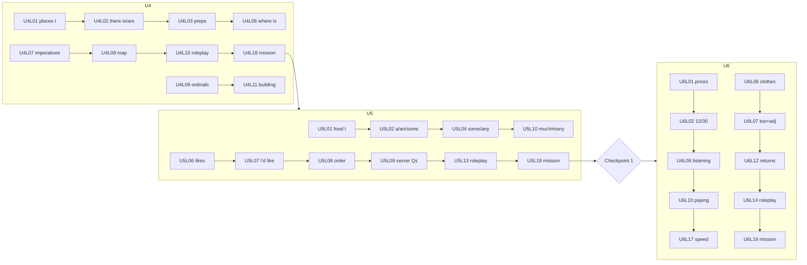

# Palavox Overhaul — ESL Curriculum Plan: Late A1 Band (Units 4–6 + Checkpoint 1)

**Direction:** English for multilingual learners (instruction/UI in learner L1, ~41 L1s)
**Band:** Late A1 — Unit 4 (Places & directions), Unit 5 (Food & eating), **Checkpoint 1**, Unit 6 (Shopping & money)
**Status:** draft (WIP) · **Author:** late-A1 band planner subagent · **Date:** 2026-07-30
**Progressive-release ratios for this band (owner guidance):** 55–65% structured / 30–40% guided interaction / 5–10% open conversation

**Band headline numbers [proposed]:**
- 55 core lessons (U4: 18, U5: 18, U6: 19) + Checkpoint 1 (not counted as a core lesson)
- 445 new lexical items incl. 130 multiword chunks (U4: 140, U5: 155, U6: 150)
- ~28 hours total active engagement (≈1,680 min), split ≈60/32/8 across structured / guided / open
- 6 embedded AI-interaction specs per unit minimum (≥3 spoken, ≥2 written, 1 exit mission each)

Labels used throughout: **[proposed]** = design decision open to revision; **[assumption]** = dependency on another band/team; **[requires validation]** = needs SME/data check before gating to `operational`.

---

## 0. Position in the course and interfaces with adjacent bands

- **[assumption]** Early A1 band (U1–U3) delivers: be/have, subject pronouns, possessives, present simple (affirm/neg/questions), adverbs of frequency, numbers 1–100, telling time, family/school/routine vocabulary (~400–450 items), alphabet/spelling aloud, basic greetings and leave-takings. Every prerequisite listed in §3 that points into U1–U3 depends on this assumption.
- **[assumption]** Early A2 band (U7–U8) picks up: past simple (regular then irregular), more comparatives/superlatives, present continuous for future arrangements. U6 introduces *bridge* previews only (basic comparatives, present continuous for current activity) and must not fully own those points.
- Checkpoint 1 sits **after U5** per the owner skeleton; U6 is post-checkpoint but still in this band. CP1 therefore certifies U1–U5 content only; U6 evidence rolls into Checkpoint 2. **[proposed]**
- The sibling early-A1 plan (`wip-curriculum-en-early-a1.md`) landed at **54 core lessons** (18/unit, U1–U3). Counting all 55 lessons of this band as A1, A1 totals **109** — inside the owner's ≈90–110. If U6 is instead accounted to the A2 bridge (defensible: it is labeled late-A1/A2-bridge in §1), A1 totals 90 and U6's 19 lessons seed the A2 count. Either accounting stays in range; trim candidates in §2 remain available if global rebalancing needs them. Sibling conventions adopted here: hard-gate-vs-soft-ordering prerequisite style, "chunks as first-class vocabulary rows", `vocabulary_translations` extension for multilingual L1s, and the rule that speaking blocks unlock at ≥70% on the lesson's flashcard+cloze block.

---

## 1. Refined unit definitions

### Unit 4 — Places & directions ("Getting where you need to go")

- **Theme:** the learner's neighborhood and city: naming places, saying where things are, asking for/understanding/giving simple directions, reading everyday signs.
- **Key language use:** transactional + interpersonal survival exchanges with strangers in public space.
- **Content objective:** learner can navigate to a named destination using spoken directions and a simple map, and can describe their own neighborhood.
- **Language objective:** there is/are, prepositions of place, imperatives, ordinals, can/can't; place lexicon; polite attention-getting ("Excuse me…").

**CEFR anchors (Companion Volume 2020 descriptor language; exact scale placement [requires validation] against the published tables):**
- Listening to announcements & instructions, A2: understands simple directions on how to get from X to Y on foot or by public transport. U4 targets this receptively at slow-clear pace (late-A1 on-ramp to the A2 descriptor).
- Information exchange, A1: handles numbers, quantities, cost and time; A2: asks for and gives directions referring to a map or plan (productive target of U4, achieved with support).
- Overall oral interaction, A1: interacts in a simple way when the interlocutor speaks slowly and clearly and is prepared to help — this is the assumed interlocutor profile for all U4 AI speech.

**ACTFL/NCSSFL modes coverage:**
- Interpretive: Novice High — identify topic and isolated facts in short simple texts (signs, notices, map labels); follow short oral directions.
- Interpersonal: Novice High — request and provide directions using practiced/memorized chunks and simple sentences; ask for repetition.
- Presentational: Novice Mid→High — present basic information about one's neighborhood using memorized/practiced language (short recorded "my street" talk, short written message with directions).

### Unit 5 — Food & eating ("Feed yourself")

- **Theme:** everyday food, meals, likes/dislikes, ordering in a café/fast-casual restaurant, dietary needs, invitations to eat.
- **Key language use:** obtaining goods and services (ordering); interpersonal exchange about preferences.
- **Content objective:** learner can order a simple meal start-to-finish, state preferences and dietary restrictions, and understand a server's routine questions.
- **Language objective:** countability, a/an/some/any, like vs *would like*, much/many/a lot of; food lexicon; service-encounter chunks.

**CEFR anchors:**
- Obtaining goods and services, A2: can order a meal; can ask for and provide everyday goods and services. U5's exit task is precisely "order a meal" with a supportive interlocutor.
- Overall spoken interaction, A2 (on-ramp): communicates in simple, routine tasks requiring direct exchange of information on familiar matters (food, prices).
- Reading for orientation, A1–A2: finds specific, predictable information in simple everyday material (menus, labels, prices).

**ACTFL modes:** Interpretive (menus, server speech), Interpersonal (ordering dialogue, invitation exchange), Presentational (short written invitation/reply; recorded "what I eat in a day").

### Unit 6 — Shopping & money ("Buy it, return it")

- **Theme:** stores, prices, clothes and sizes, paying, simple problems and returns, secondhand-marketplace messages.
- **Key language use:** transactional; first structured exposure to *problem resolution* (misfit, wrong price, return) — seeds the U12 "Repair & survive" strand. **[proposed]**
- **Content objective:** learner can make a simple purchase, ask about price/size/availability, pay, and resolve one routine problem (exchange/return).
- **Language objective:** demonstratives, Do you have…?/I'm looking for…, too + adjective, present continuous (current activity, preview), basic comparatives (preview); prices and numbers under pressure.

**CEFR anchors:**
- Obtaining goods and services, A2: makes simple purchases by stating what is wanted and asking the price; asks about things and makes simple transactions in shops.
- Information exchange, A1→A2: handles numbers, quantities, cost and time (now at natural pace with reductions).
- Interaction repair (CV mediation/interaction strategies, A2 on-ramp): indicates non-understanding and asks for repetition/slower speech — explicitly drilled and scored in U6.

**ACTFL modes:** Interpretive (price tags, ads, announcements, checkout speech), Interpersonal (store roleplays with a complication), Presentational (marketplace inquiry message; short recorded "review" of a purchase).

**Placement note [proposed]:** U6 is labeled late-A1/A2-bridge. Its two "preview" grammar points (comparatives, present continuous) are receptive-plus-formulaic only; full productive treatment belongs to U7–U8. Deviation from a strict A1 ceiling is justified by communicative need: shopping cannot be done honestly without "cheaper" and "I'm just looking."

---

## 2. Lesson lists (core deliverable)

Lesson types: `V` vocab, `G` grammar, `P` pronunciation, `L` listening, `R` reading, `S` speaking, `W` writing, `X` integrated/review/exit. Each lesson = 10–16 min core + its embedded interaction. Trim candidates for global rebalancing are marked ⊖.

### Unit 4 — Places & directions (18 lessons)

| # | ID | Type | Title | One-line objective |
|---|----|------|-------|--------------------|
| 1 | U4L01 | V | Places in town I | Name 16 core places (bank, supermarket, pharmacy, park…) and recognize them in speech and on signs. |
| 2 | U4L02 | G | There is / There are | Describe what exists in a neighborhood with there is/are (+ negatives, questions, short answers). |
| 3 | U4L03 | G | Where exactly? Prepositions of place | Locate places with next to, between, across from, behind, on the corner of. |
| 4 | U4L04 | V | Places in town II + "Is there a … near here?" | Name 14 more places (clinic, library, bus stop, laundromat…) and ask about existence nearby. |
| 5 | U4L05 | P | Hearing the difference: /ɪ/ vs /iː/; compound stress | Distinguish and produce live/leave-type pairs and front-stressed compounds (BUS stop, POST office). |
| 6 | U4L06 | S | Excuse me, where is…? | Get a stranger's attention politely and ask where something is (controlled → guided AI dialogue). |
| 7 | U4L07 | G | Turn left, go straight: imperatives | Give and follow 2–4-step directions using imperative chunks. |
| 8 | U4L08 | L | Follow the map | Trace routes on a map from slow-clear spoken directions; confirm with "Left? OK." |
| 9 | U4L09 | G | Ordinals & addresses | Use first–tenth and read street addresses aloud (stress on numerals; "twenty-THIRD street"). |
| 10 | U4L10 | S | Directions roleplay (spoken AI) | Ask for, confirm, and act on directions in a live map-based roleplay with one unexpected turn. |
| 11 | U4L11 | V/G | Inside the building | Navigate floors/rooms/elevator language: "It's on the third floor, next to the elevator." |
| 12 | U4L12 | G | Can / can't for possibility + polite requests | Ask "Can I walk there?", "Can you help me?", answer with can/can't + reason chunk. |
| 13 | U4L13 | R | Signs & notices | Extract meaning from EXIT, OPEN/CLOSED, NO PARKING, PUSH/PULL and 12 more high-stakes signs. |
| 14 | U4L14 | W | Text me the directions (written AI) | Write a 3–4-sentence message directing a friend from a landmark to your home; revise after AI feedback. |
| 15 | U4L15 | L | Real speed: reductions in directions | Catch "gonna", "wanna", "ya", and linking (turn‿left, next‿to) in natural-pace direction-giving. |
| 16 | U4L16 | X | Culture & pragmatics: strangers in public | Choose the right opener (Excuse me vs Sorry vs Hi), volume, distance; thank and close the exchange. |
| 17 | U4L17 | X | Unit 4 review | Cumulative spaced review of U4 vocab/grammar + error-bank items from U4 interactions. |
| 18 | U4L18 | X/S | Exit task: Get me there (mission) | Complete a spoken information-gap mission: reach a destination via AI-given directions, repairing one breakdown. |

### Unit 5 — Food & eating (18 lessons)

| # | ID | Type | Title | One-line objective |
|---|----|------|-------|--------------------|
| 1 | U5L01 | V | Everyday food I | Name 18 staple foods (fruit, vegetables, bread, rice, eggs…) with correct singular/plural forms. |
| 2 | U5L02 | G | Count it or not: a/an/some | Use a/an with countables, some with uncountables/plurals; first pass at the count/mass distinction. |
| 3 | U5L03 | V | Everyday food II: drinks, snacks, meals | Name drinks/snacks and the meals of the day; say what you eat for breakfast/lunch/dinner. |
| 4 | U5L04 | G | some / any | Ask and answer about availability: "Do we have any milk?" "There isn't any bread." |
| 5 | U5L05 | P | chip vs cheap; final -s | Produce /ɪ–iː/ minimal pairs in food words and the three plural -s sounds (/s/, /z/, /ɪz/). |
| 6 | U5L06 | G | Likes & dislikes | State and ask about preferences with like/love/don't like/hate + noun and + -ing. |
| 7 | U5L07 | G | "I like" vs "I'd like" | Order politely with I'd like / Can I have… please, and hear the difference from stating a preference. |
| 8 | U5L08 | R/S | At the café: menu + first order | Read a realistic menu, choose, and place a basic order in a controlled dialogue. |
| 9 | U5L09 | L | Understanding your server | Respond to routine server questions: "For here or to go?", "Anything else?", "What size?" |
| 10 | U5L10 | G | much / many / a lot of; How much/How many | Ask and answer about quantity and price: "How much water?", "How many apples?", "How much is it?" |
| 11 | U5L11 | V/G | What I eat: meals & routines | Describe eating routines recycling frequency adverbs (U2) with food vocabulary. ⊖ |
| 12 | U5L12 | R | Menus, labels, prices | Find prices, ingredients, and allergy warnings in menus and simple food labels. |
| 13 | U5L13 | S | Café roleplay with a twist (spoken AI) | Order a full meal and handle one unexpected but level-appropriate server turn ("We're out of that"). |
| 14 | U5L14 | W | Let's eat: invite & reply (written AI) | Write and answer a short invitation message proposing food, place, and time. |
| 15 | U5L15 | X | Food culture & pragmatics | Handle tipping basics [US context — [requires validation] for market], please/thanks norms, and state allergies clearly ("I can't eat…"). |
| 16 | U5L16 | L | Fast counter speech | Understand natural-pace counter service with reductions ("D'you want…", "That's gonna be…"). |
| 17 | U5L17 | X | Unit 5 review | Cumulative spaced review of U5 + interleaved U4 items + personal error bank. |
| 18 | U5L18 | X/S | Exit task: The full café mission | Order start-to-finish, ask one question, resolve one problem, and close politely — unassisted. |

### ▶ Checkpoint 1 (after U5) — see §12 for full design.

### Unit 6 — Shopping & money (19 lessons)

| # | ID | Type | Title | One-line objective |
|---|----|------|-------|--------------------|
| 1 | U6L01 | V/G | Money talks: prices & numbers | Say and understand prices ($3.99 = "three ninety-nine"), coins/bills, totals. |
| 2 | U6L02 | P | thirteen vs thirty | Use word stress and /θ/ to distinguish -teen/-ty numbers — the highest-stakes price skill. |
| 3 | U6L03 | V | Stores & things to buy | Name store types/sections and 16 common purchase items incl. basic clothes. |
| 4 | U6L04 | G | this / that / these / those | Point and ask: "How much is this? How much are those?" with correct number agreement. |
| 5 | U6L05 | S | "Do you have…?" / "I'm looking for…" | Open a store interaction, state what you want, and understand "Right over there" answers. |
| 6 | U6L06 | V/G | Clothes, colors, sizes (+ "I'm just looking") | Ask to try things on; use present-continuous formulas for current activity (preview only). |
| 7 | U6L07 | G | too + adjective | Explain misfit problems: "It's too big / too small / too expensive." |
| 8 | U6L08 | L | Prices, totals, announcements | Catch prices and totals at natural pace; understand simple store announcements. |
| 9 | U6L09 | G | Cheaper, bigger, better (bridge preview) | Recognize and use 6 formulaic comparatives to compare two items (full paradigm deferred to A2). |
| 10 | U6L10 | S | Paying: cash or card | Complete payment dialogues: "Can I pay by card?", PIN/receipt/change language. |
| 11 | U6L11 | R | Tags, ads, and the fine print | Read price tags, discount ads ("30% off"), and a simple return policy. |
| 12 | U6L12 | G/S | Problems & returns | State a problem and request a fix: "It doesn't work. Can I return it / exchange it?" |
| 13 | U6L13 | P | Final clusters: asked, costs, receipts | Keep final consonant clusters intelligible (no deletion/epenthesis) in past and plural forms. |
| 14 | U6L14 | S | Clothing store roleplay (spoken AI) | Buy a clothing item with a size problem: ask, try, reject, resolve. |
| 15 | U6L15 | W | Marketplace messages (written AI) | Write a secondhand-marketplace inquiry ("Is it still available?") and negotiate pickup politely. |
| 16 | U6L16 | X | Culture & pragmatics: shopping norms | Fixed prices vs bargaining [market-dependent — [requires validation]], returns culture, checkout small talk. ⊖ |
| 17 | U6L17 | L | Checkout at full speed | Understand rapid checkout speech: "That'll be…", "Here's your change", "Wanna bag?" |
| 18 | U6L18 | X | Unit 6 + band cumulative review | Interleaved review across U4–U6 + error bank; readiness signal for Checkpoint 2 strand. |
| 19 | U6L19 | X/S | Exit task: Buy it, return it (mission) | Two-scene mission: purchase an item, then return/exchange it next day citing the problem. |

**Band lesson count: 55.** Owner range 16–22/unit: U4=18 ✓, U5=18 ✓, U6=19 ✓. If A1-wide totals overflow, merge U5L11 into U5L03 and U6L16 into U6L10/U6L15 → 53. **[proposed]**

---

## 3. Prerequisite graph

Principle (adopted from sibling band): **hard gates** only where a lesson is unusable without the prerequisite; otherwise **soft ordering**. Speaking blocks inside any lesson unlock only after that lesson's flashcard+cloze block scores ≥70% [proposed, matches sibling].

**Band entry gate:** Early A1 Band Gate passed, or placement instrument routes learner directly into U4 **[assumption]** (placement design owned by assessment workstream, see `wip-12a-assessment-current-state.md`).

**Cross-band inherited gates (early A1 → this band):**

```text
U1-L11 (numbers 21–100)   → U4L09 (ordinals/addresses), U6L01 (prices)
U1-L15 (repair phrases)   → every S/X interaction lesson in U4–U6 (inherited blanket gate)
U2-L10 (at/in/on)         → U4L03 (prepositions of place)          [soft]
U3-L10 (these/those intro)→ U6L04 (demonstratives, full paradigm)
U3-L12 (can/can't ability)→ U4L12 (can: possibility + requests)
U2-L14 (like + N/-ing)    → U5L06 (likes & dislikes)
```

**In-band hard gates:**

```text
U4L01 (places I)      → U4L02 (there is/are) → U4L03 (preps of place) → U4L06 (where is…?)
U4L01                 → U4L04 (places II)
U4L07 (imperatives)   → U4L08 (follow the map) → U4L10 (directions roleplay) → U4L18 (mission)
U4L09 (ordinals)      → U4L11 (inside the building)
U4L17 review ≥70%     → U4L18 attempt;  U4L18 attempted → U5 unlock (one soft-fail allowed)

U5L01 (food I)        → U5L02 (a/an/some) → U5L04 (some/any) → U5L10 (much/many/how much)
U5L03 (food II)       → U5L06 (likes) → U5L07 (I'd like) → U5L08 (first order) → U5L09 (server Qs)
U5L09                 → U5L13 (café roleplay) → U5L18 (mission)
U5L17 review ≥70%     → U5L18 attempt;  U5L18 attempted + U4L18 attempted → Checkpoint 1 eligibility

CP1 outcome ∈ {passed, passed_with_review} → U6 unlock
U6L01 (prices)        → U6L02 (thirteen/thirty) → U6L08 (prices listening) → U6L10 (paying) → U6L17 (checkout speed)
U6L03 (stores/items)  → U6L05 (do you have…?) ;  U6L04 (this/that/these/those) → U6L05
U6L06 (clothes/sizes) → U6L07 (too + adj) → U6L12 (problems & returns) → U6L14 (store roleplay) → U6L19 (mission)
U6L18 review ≥70%     → U6L19 attempt
```

**Soft ordering (recommended, non-blocking):** U4L05 (sound lab) before U4L06; U5L05 before U5L08; U6L02 before any price-listening item; U4L13 (signs) before U6L11 (tags/ads); U5L12 (menus/labels) before U5L13; U6L09 (comparatives preview) after U6L03; U6L13 (final clusters) before U6L14; culture lessons (U4L16/U5L15/U6L16) before the unit mission.

**Skill-level gating [proposed]:** the mission lessons (U4L18, U5L18, U6L19) additionally require `skill_mastery ≥ 0.7` on the unit's two designated core grammar skills (U4: existential-there, imperatives; U5: countability/some-any, would-like; U6: demonstratives, too+adj), computed from exercise history, never from XP/completion.



---

## 4. Vocabulary and lexical-chunk targets

### 4.1 Counts

| Unit | Single-word items | Multiword chunks | Unit total | Course cumulative |
|---|---|---|---|---|
| U4 | 100 | 40 | **140** | 500 |
| U5 | 107 | 48 | **155** | 655 |
| U6 | 108 | 42 | **150** | 805 |

**Band total: 445 items (130 chunks)** ≈ 8.1 new items/lesson — a deliberate step up from early A1's ≈6.7 [proposed]. Justification: a growing share is *recognition-tier* lexicon (signs, menu items, labels, announcements) with lower per-item learning cost, and service chunks amortize across many exchanges. **[requires validation]** in pilot: if FSRS lapse rate on any lesson's cohort exceeds 30%, cut that lesson's load before gating to `operational`.

**Global pace check:** 805 items by end of U6 (6 of 12 units) against the owner's 1,800–2,200 target leaves ~1,000–1,400 for U7–U12 (≈165–235/unit) — steep but plausible at A2, where morphology unlocks families cheaply. Verdict on the global target: **keep 1,800–2,200 but treat ~1,900 as the working number** [proposed]; count *productive-mastery* items separately from recognition-tier items so the headline number is honest (recognition-only items ≈15% of this band).

### 4.2 Selection principles (band-specific, extending sibling's §4)

1. **Survival-first override:** items that gate a transaction (*receipt, allergic, exchange, out of*) outrank raw frequency; thematically cute but low-utility items excluded (no *aubergine*, no *haberdashery*).
2. **Service chunks as first-class rows:** `part_of_speech: chunk`, FSRS cards like words; receptive-only chunks flagged (`receptive_productive: receptive`) and excluded from productive-mastery counts (e.g., *"For here or to go?"* is understood, never produced by the learner).
3. **Sight-vocabulary tier [proposed schema use]:** sign/label lexicon (EXIT, NO PARKING, 30% OFF) tagged `register: sign` — drilled receptively, tested by photo-realistic renders, never spoken-scored.
4. **Number language is a skill, not vocabulary:** prices/quantities are drilled under time pressure via dedicated exercise mechanics; no vocab rows for numerals beyond early A1's.
5. **Recycling contract:** every item appears productively in its origin lesson and in ≥2 later lessons (lint via `vocab_lesson_map` coverage report); band-crossing recycling planned into U7–U8 briefs **[assumption]**.
6. **L1 translations** via proposed `vocabulary_translations(vocab_id, l1_code, translation, usage_note)` extension; single-column `translation_l1` retained as the fallback/default-L1 column for backward compatibility. Priority-L1 rows human-authored; long-tail machine-translated with human spot-check **[requires validation]**.
7. **False-friend flags per L1** in `l1_contrast_notes`: e.g., sign **EXIT** vs ES *éxito* ("success") in U4L13; **PUSH** vs PT *puxe* ("pull!" — inverse trap) in U4L13; ES *carpeta* ≠ carpet (U6); *sopa*/soup positive cognate (U5); ZH loan 沙拉 ↔ salad positive transfer.

### 4.3 Sample list — Unit 5, Food & eating (44 of 155 items; representative) [proposed]

Format: `item | POS | receptive/productive | note`. `translation_l1` is filled per-L1 via `vocabulary_translations` (one row per L1 code); IPA + `frequency_rank` filled at authoring time.

| # | Item | POS | R/P | Note |
|---|------|-----|-----|------|
| 1 | food | n | P | uncountable in core use |
| 2 | breakfast | n | P | + chunk *have breakfast* (no article — contrast slot: ES/PT *el desayuno*) |
| 3 | lunch | n | P | |
| 4 | dinner | n | P | dialect note: *dinner/supper* receptive only |
| 5 | water | n | P | mass-noun anchor item |
| 6 | milk | n | P | mass |
| 7 | coffee | n | P | mass↔count ("a coffee" = order) — taught explicitly in U5L07 |
| 8 | tea | n | P | as above |
| 9 | juice | n | P | |
| 10 | bread | n | P | mass; ES/AR L1 plural trap ("breads") |
| 11 | rice | n | P | mass; ZH positive transfer (米饭 unmarked) |
| 12 | egg | n | P | count anchor |
| 13 | cheese | n | P | mass |
| 14 | chicken | n | P | count(animal)/mass(food) — flagged, receptive nuance |
| 15 | fish | n | P | zero plural |
| 16 | meat | n | P | mass |
| 17 | apple | n | P | /æ/ carrier word (§6) |
| 18 | banana | n | P | stress carrier: ba-NA-na |
| 19 | orange | n | P | |
| 20 | vegetable | n | P | 3-syllable reduction /ˈvedʒtəbəl/ |
| 21 | fruit | n | P | mass in core use |
| 22 | salad | n | P | ZH/ES positive cognate |
| 23 | soup | n | P | ES *sopa* positive cognate |
| 24 | sandwich | n | P | /æ/ carrier; final cluster /-tʃ/ |
| 25 | sugar | n | P | mass; sight-spelling exception /ʃ/ |
| 26 | salt | n | P | |
| 27 | menu | n | P | |
| 28 | hungry | adj | P | chunk *I'm hungry* (contrast slot: ES *tengo hambre* → "I have hungry" error) |
| 29 | thirsty | adj | P | /θ/ carrier |
| 30 | delicious | adj | P | reaction token |
| 31 | spicy | adj | P | dietary-needs language |
| 32 | eat | v | P | /iː/ carrier (it/eat pair) |
| 33 | drink | v/n | P | |
| 34 | cook | v | P | |
| 35 | order | v/n | P | |
| 36 | a cup of coffee | chunk | P | partitive frame *a __ of __* |
| 37 | a bottle of water | chunk | P | as above |
| 38 | I'd like…, please. | chunk | P | the unit's spine chunk (U5L07) |
| 39 | Can I have…, please? | chunk | P | alternate order frame |
| 40 | For here or to go? | chunk | R | server script; answer forms *For here / To go* are P |
| 41 | Anything else? | chunk | R | server script; answers *That's all, thanks / Yes, can I also have…* are P |
| 42 | How much is it? | chunk | P | fed forward from U5L10 into U6 prices |
| 43 | I'm allergic to… | chunk | P | high-stakes; paired with *I can't eat…* |
| 44 | We're out of… | chunk | R | the "unexpected turn" trigger in U5L13/U5L18 |

---

## 5. Grammar progression across the band

Ordered; every point exists because a transaction fails without it. "Bar" = productive expectation at unit exit.

| # | Point | Lesson | Communicative need | Productive bar |
|---|-------|--------|--------------------|----------------|
| 1 | *there is / there are* (+ neg, ?, short answers) | U4L02 | describe what exists nearby; ask *Is there a…?* | forms with number agreement in rehearsed contexts |
| 2 | prepositions of place (*next to, between, across from, behind, on the corner of*) | U4L03 | locate places/objects | 5 core preps accurate in guided speech |
| 3 | imperatives ± *please* (*turn left, go straight, take the second right*) | U4L07 | give/follow directions | 2–4-step direction strings |
| 4 | ordinals + address syntax | U4L09 | addresses, floors, "second right" | first–tenth productive |
| 5 | *can/can't*: possibility + polite request (*Can I walk there? Can you help me?*) | U4L12 | ask for help/feasibility | request frame automatic |
| 6 | countability; *a/an* vs *some* | U5L02 | talk about food/possessions without L1 article transfer errors | correct with 20 anchor nouns |
| 7 | *some/any* (assertive/non-assertive) | U5L04 | availability Q&A | *any* in ?/neg in rehearsed frames |
| 8 | *like* (recycled) **vs *would like*** | U5L06–07 | preference vs polite order — the band's highest-value pragmatic grammar | *I'd like… / Can I have…* automatic under mild time pressure |
| 9 | *much/many/a lot of*; *How much/How many* + *How much is it?* | U5L10 | quantities and price questions | *How much/many* questions well-formed |
| 10 | demonstratives, full paradigm | U6L04 | deixis in shops (*How much are those?*) | number agreement in point-and-ask |
| 11 | *too* + adjective | U6L07 | state a problem (*too big/small/expensive*) | problem statement + request-for-fix pairing |
| 12 | present continuous — **formulaic preview only** | U6L06 | *I'm just looking / I'm looking for…* | 2 formulas; paradigm deferred to U7–U8 |
| 13 | comparatives — **formulaic preview only** | U6L09 | *cheaper / bigger / smaller / better* to compare two items | 6 frozen forms; paradigm deferred |

**Explicitly NOT in band [proposed]:** past simple (U9 per skeleton — CP1 and all missions are present-time framed), *going to* future, object pronoun drills beyond incidental use, conditionals. Deviation risk: learners will want past tense for "I bought it yesterday" in U6L19 returns — solved with the frozen chunk *I bought this here* taught as vocabulary, not grammar **[proposed]**.

### 5.1 L1-parameterized contrast schema slot

Proposed table (extends existing schema; nothing modified):

```sql
l1_contrast_notes(
  id, scope ENUM('grammar_point','lesson','vocab_item'),
  ref_id,                      -- grammar point / lesson / vocab row
  l1_code,                     -- one of ~41 UI languages
  contrast_type ENUM('absent_in_l1','present_but_different','false_friend',
                     'positive_transfer','phonological'),
  severity SMALLINT,           -- 1 low … 3 high (drives how prominently the note renders)
  note_l1_md TEXT,             -- the explanation, WRITTEN IN THE L1 (renders in lesson intro_md slot)
  predicted_errors TEXT[],     -- feeds distractor generation + error-bank matching
  recast_example TEXT          -- model recast for the AI tutor, L1-annotated
)
```

Rendering rule [proposed]: each lesson `intro_md` contains a `{{l1_contrast}}` slot; the runtime injects the row matching (ref, learner L1); if no row exists, a neutral English-only note renders. Authoring priority: 10 priority L1s first, others fall back to neutral note.

### 5.2 Filled examples (authoring pattern) — grammar point `there_is_are` (U4L02)

```yaml
- scope: grammar_point
  ref_id: G-LA1-existential-there
  l1_code: es
  contrast_type: present_but_different
  severity: 2
  note_l1_md: >
    En español usamos "hay" para singular y plural: "hay un banco", "hay dos bancos".
    En inglés la forma cambia con el número: "there is a bank" (uno) pero
    "there are two banks" (dos o más). En preguntas se invierte: "Is there a bank near here?"
  predicted_errors: ["There is two banks near here.", "Is there banks near here?"]
  recast_example: "Mm, there ARE two banks — 'are' porque son dos. ¿Y hay un parque?"

- scope: grammar_point
  ref_id: G-LA1-existential-there
  l1_code: zh
  contrast_type: absent_in_l1
  severity: 3
  note_l1_md: >
    中文用"有"表示存在（"附近有银行"），句子里没有 "there" 这样的形式主语。
    英语必须说 "There is a bank near here"，不能说 "Near here has a bank"。
    单数用 there is，复数用 there are。
  predicted_errors: ["Near my home has a bank.", "Here have two banks."]
  recast_example: "Right — THERE IS a bank near your home. In English we start with 'there is'."

- scope: grammar_point
  ref_id: G-LA1-existential-there
  l1_code: ar
  contrast_type: present_but_different
  severity: 2
  note_l1_md: >
    في العربية نقول "يوجد بنك" أو "فيه بنك" بدون فاعل شكلي، وغالباً بلا تمييز في العدد.
    في الإنجليزية نستخدم "there is" للمفرد و"there are" للجمع، ولا يمكن حذفها:
    "There is a bank" / "There are two banks".
  predicted_errors: ["Is bank near here.", "There is two banks."]
  recast_example: "Yes — there ARE two banks. 'Are' with two or more."
```

**Second pattern — grammar point `articles_a_an_some` (U5L02), condensed rows [proposed]:**

| l1 | type | sev | Core note (rendered in L1) | Predicted error |
|----|------|-----|---------------------------|-----------------|
| zh | absent_in_l1 | 3 | No articles in Mandarin; classifiers (一个/一杯) map to *a/a cup of*; bare noun → article omission | "I want apple." |
| ar | present_but_different | 2 | Arabic has definite ال but no indefinite article; *a/an* has no equivalent → omission | "She is teacher." (recycled note), "I eat egg." |
| es | positive_transfer | 1 | *un/una* maps well to *a/an*; watch *some* with mass nouns (ES often uses bare noun) | "I want bread" (fine) vs missing *some* where required |
| vi | absent_in_l1 | 3 | Vietnamese uses classifiers (cái, ly); article system absent; heavy omission expected | "Can I have coffee, please?" (acceptable!) vs "I buy shirt." |

**Third pattern — `too_plus_adj` (U6L07):** es: *too ≠ muy* — learners overuse "too" as intensifier ("This shirt is too beautiful!") because *demasiado/muy* boundary differs; sev 2. zh: 太…了 maps almost exactly to *too* — positive_transfer, sev 1, note celebrates the match. ar: كثير/جداً both intensify; *too*'s negative entailment needs explicit teaching; sev 2. **Pattern rule for authors:** every grammar point in §5 ships with ≥ the 10 priority-L1 rows before its lesson leaves `draft` [proposed].

---

## 6. Pronunciation progression

Policy: **intelligibility over accent**. Production is scored only where a confusion has transactional cost; everything else is receptive awareness. ASR scoring thresholds [requires validation] per phoneme against pilot data.

Ranked band targets (payoff rationale × priority-L1 pain):

| Rank | Target | Lessons | Why it pays | L1s most affected |
|------|--------|---------|-------------|-------------------|
| 1 | **-teen vs -ty word stress (+ /θ/)** | U6L02, U6L08 | price errors are money errors; stress is the primary cue, /θ/ secondary (accepted substitution: /t̪/ or /s/ if stress correct [proposed]) | all 10 priority L1s |
| 2 | **/ɪ/ vs /iː/** | U4L05, U5L05 | *live/leave, chip/cheap, fill/feel* — high functional load in this band's lexicon | es, ar, ru/uk, vi, so |
| 3 | **Final consonant clusters** | U6L13 | deletion (vi, zh, ht) or epenthesis (es, pt, ar, fa) wrecks *asked, costs, receipts* and past/plural morphology | vi, zh, ht, es, pt, ar |
| 4 | **/æ/ vs /e/ vs /ʌ/** | U5L05 (extended) | *man/men, cash, snack, apple, sandwich* — menu/checkout lexicon is /æ/-dense | es, ru/uk, ar, fa, so |
| 5 | **Compound & phrase stress** | U4L05 | *BUS stop, POST office, credit CARD* — wrong stress defeats listener repair | zh, vi (tone-L1 transfer), all |
| 6 | **-s allomorphs /s z ɪz/ maintenance** | woven (U5L05) | plural/quantity talk (*two coffees, apples*) | carried from early A1 |
| 7 | **can /kən/ vs can't** | U4L12 | request comprehension; carried from U3-L12 into new frames | all |

**Minimal-pair inventory (band) [proposed]:**

| Set | Pairs | Carrier lessons |
|-----|-------|-----------------|
| /ɪ–iː/ | live–leave, it–eat, chip–cheap, fill–feel, this–these, sit–seat | U4L05, U5L05 |
| -teen/-ty | thirteen–thirty … nineteen–ninety (all 7) | U6L02 |
| /æ–e/ | man–men, pan–pen, bag–beg, sat–set | U5L05 |
| /æ–ʌ/ | cap–cup, cat–cut, bag–bug | U5L05 |
| clusters | ask–asked, cost–costs, card–cards, want–wants, test–tests | U6L13 |
| stress | BUS stop vs bus STOP*, POST office; ba-NA-na, ve-ge-ta-ble | U4L05 (*contrast rendered receptively) |

Exercise mechanics: discrimination (listening_mc, two renders one word), forced-choice under 2-second timer for prices, ASR shadow-and-score for production, dictation for clusters. Per-learner pronunciation flags persist in the error bank; 3 consecutive lessons with the same flag inject a remedial minimal-pair set (§11).

---

## 7. Listening progression

Delivery axis: slow-clear (~0.8× natural, full forms, generous pauses) → natural-slow → natural with reductions. Accent axis [proposed]: from U5 on, ~30% of items voiced by intelligible non-native speakers (owner requirement: understand intelligible accented speech) **[requires validation]** with TTS-vendor capability.

| Stage | Text types | Delivery | Reduction load | Task types |
|-------|-----------|----------|----------------|-----------|
| U4 early (L08) | 2–4-step direction exchanges, floor/room info | slow-clear | none | trace route on map; L/R discrimination; confirm-echo ("Left? OK.") |
| U4 late (L15) | natural direction-giving, street noise bed [proposed] | natural | *gonna, wanna, ya*, linking (turn‿left) | catch the turn sequence; spot the changed detail |
| U5 mid (L09) | server scripts: choice Qs, upsells | natural-slow | *D'you want…* | choose the correct reply within 3s; order-slip completion |
| U5 late (L16) | fast counter service | natural | *That's gonna be…, whaddya* | extract total + items; detect what's unavailable |
| U6 mid (L08) | prices, totals, store announcements | natural | weak *of/for/and* | write the total (digit entry); -teen/-ty forced choice |
| U6 late (L17) | full checkout: *That'll be…, Here's your change, Wanna bag?* | natural, fast | full | respond-in-role; detect the error in the change/total |

Classroom/service context coverage per owner spec: directions from a stranger (U4), counter service (U5), retail checkout + announcements (U6); school-office register appears in CP1 listening set as a cold item [proposed].

---

## 8. Writing progression

All writing is *messages with a real recipient* — no essays at this level. Length bands 20–60 words; rubric axes: task completion, comprehensibility, target-form use, register.

| Unit | Task (lesson) | New conventions | Target forms |
|------|---------------|-----------------|--------------|
| U4 | Text a friend directions to your home (U4L14, written AI) | message opener/closer (*Hi Ana, … See you!*), sequencing *then* | imperatives, preps of place, ordinals |
| U5 | Invitation + reply — accept or decline politely with counter-proposal (U5L14, written AI) | question marks in offers; softeners (*Sorry, I can't… How about…?*) | would like, some/any, time phrases (recycled) |
| U6 | Marketplace inquiry + pickup negotiation (U6L15, written AI) | polite openers to strangers (*Hi, is the … still available?*), closing a deal in writing | demonstratives, too+adj, How much…?, *I can come at…* |

Mechanics thread (woven, not standalone): capitalization + terminal punctuation (carried), contractions allowed and expected in messages, spelling of spine chunks via dictation exercises. *because* moves receptive→productive at U6L15 (giving a reason for the return/offer) [proposed]. Form-filling recycles from U1-L12 once: delivery address form in U6L11.

---

## 9. Speaking progression and embedded AI interactions

Ladder for the band: **controlled** (repeat/complete with fixed language) → **guided** (real information moves inside a frame: info gap, guided Q&A, roleplay with one free variable) → **spontaneous** (open chat, unscored except error harvesting). Band ratios honored at 55–65 / 30–40 / 5–10 (accounting in §14).

Every unit embeds **both written and spoken** AI interaction using that unit's language (owner rule). Full contracts follow the §13 templates; inventory:

### Unit 4 (7 interactions)
| Lesson | Modality | Type (owner taxonomy) | One-line objective |
|--------|----------|----------------------|--------------------|
| U4L02 | written | controlled dialogue completion | complete a chat describing your street with *there is/are* (3 turns) |
| U4L06 | spoken | guided Q&A | stop a stranger politely and ask where 3 places are; AI answers slow-clear |
| U4L08 | spoken | controlled (confirm-echo) | backchannel/confirm each direction step ("Left? OK.") while tracing |
| U4L10 | spoken | information gap + roleplay | reach a map destination from AI directions incl. one unexpected turn |
| U4L14 | written | describing + revision cycle | text directions to your home; revise after AI feedback pass |
| U4L18 | spoken | real-world mission | exit mission "Get me there" (breakdown repair required) |
| post-U4L16 | spoken | **open conversation** (5 min, optional, unscored) | free chat: "your neighborhood here vs before" |

### Unit 5 (7 interactions)
| Lesson | Modality | Type | One-line objective |
|--------|----------|------|--------------------|
| U5L06 | written | guided Q&A | likes/dislikes chat with follow-ups (*Why? Me too / Really?*) |
| U5L08 | spoken | controlled dialogue completion | place a scripted first order from a real menu |
| U5L09 | spoken | reacting to routine turns | answer randomized server questions within 3s each |
| U5L13 | spoken | roleplay + unexpected turn | order a meal; handle *We're out of that* |
| U5L14 | written | requests + obtaining service | invitation exchange: propose, decline politely, counter-propose, confirm |
| U5L18 | spoken | real-world mission | full café mission start-to-finish, unassisted |
| post-U5L15 | spoken | **open conversation** (5 min) | free chat: "food from your country" |

### Unit 6 (8 interactions)
| Lesson | Modality | Type | One-line objective |
|--------|----------|------|--------------------|
| U6L05 | spoken | guided Q&A | open store interactions: *Do you have…? / I'm looking for…* + parse the answer |
| U6L10 | spoken | controlled dialogue completion | payment sequence: card/cash, PIN, receipt, change |
| U6L12 | spoken | breakdown repair drill | state a problem + request a fix; AI misunderstands once on purpose |
| U6L14 | spoken | roleplay + complication | buy clothing with a size problem: ask, try, reject, resolve |
| U6L15 | written | obtaining goods/services | marketplace inquiry + negotiation (full contract in §13b) |
| U6L19 | spoken | real-world mission (two scenes) | "Buy it, return it" (full contract in §13d) |
| post-U6L16 | spoken | **open conversation** (6 min) | free chat: "a thing you bought and why" |
| post-U6L18 | spoken | **open conversation** (6 min) | free chat: learner's choice from band topics |

Open-conversation design [proposed]: unscored for proficiency; AI keeps vocabulary inside band + 5% stretch; errors harvested silently to the error bank; transcript visible to learner afterward with 2 (max) highlighted takeaways — keeps affective cost low at first exposure to spontaneity.

---

## 10. Cultural / pragmatic content

Woven into the three culture lessons (U4L16, U5L15, U6L16) and enforced inside interaction contracts (AI personas model the norms):

| Target | Where | Note |
|--------|-------|------|
| *Excuse me* (attention) vs *Sorry* (apology/mishear) vs *Hi* (service counter) | U4L06, U4L16 | highest-frequency pragmatic triage in the band |
| Volume, distance, eye contact with strangers in public | U4L16 | descriptive, never prescriptive about the learner's own norms [proposed] |
| Thanking + closing (*Thanks so much — have a good one!*) | U4L16, U6L10 | exchanges end with closings; AI withholds closure until learner closes |
| *please* position and softening (*Can I… please?*) | U5L07 |请/por favor/من فضلك mapping in L1 notes |
| Tipping basics | U5L15 | **[requires validation — US-market assumption]**; parameterize by market |
| Stating allergies directly is expected, not rude | U5L15 | safety-critical directness |
| *How are you?* at checkout = greeting, not a question | U6L10, U6L17 | scripted response *Good, thanks* |
| *I'm just looking* as polite refusal of help | U6L06 | refusal without offense |
| Fixed prices in retail vs negotiation in marketplaces | U6L16 | contrast slot per L1 (bargaining norms differ sharply) |
| Queueing and personal space at checkout | U6L16 | brief, illustrated |
| Gesture notes: pointing etiquette, ZH hand-number signs differ from Western finger counts | U4L16, U6L01 | receptive awareness only [proposed] |

---

## 11. Review scheduling and remediation

**Spaced review (FSRS):** daily queue, 4–6 min target; new-card cap 12/day, dropping to 8 in the 5 days before CP1 [proposed]. Post-lesson touchpoints ride FSRS defaults (~+1d/+3d/+7d initially, then card-state-driven).

**Structural touchpoints:**
- Unit reviews: U4L17, U5L17 (unit + interleaved previous unit), U6L18 (band cumulative U4–U6).
- Pre-CP1 consolidation session auto-assembled from weakest 20 cards + weakest 2 skills [proposed].
- Cross-band recycling: U4–U6 items are planted into U7–U8 lesson briefs (handoff note to early-A2 planner) **[assumption]**.

**Error bank (from AI interactions):** saved error categories (§13 contracts) become review items — the learner's own error is regenerated as a cloze/distractor or a re-record prompt [proposed]. Categories: article/count-mass, existential-there agreement, would-like vs like, number stress, cluster deletion, register misfire, repair-move missing.

**Remediation rules for the band:**
1. Gate skill <70% twice → auto micro-remediation set (8–10 items rebuilt from the learner's failures + 1 guided retry) before the gated lesson unlocks.
2. Mission fail → structured debrief (transcript + 3 highlighted moments) + retry with heavier scaffold; second fail → mission variant B (same objectives, new surface content) after a 2-lesson remedial branch.
3. Same pronunciation flag 3 lessons running → inject targeted minimal-pair set into the daily queue.
4. FSRS lapse rate >30% on a lesson's cohort → flag lesson for content review (authoring-side remediation) **[requires validation]**.

---

## 12. Checkpoint 1 design (after U5; certifies U1–U5)

Purpose: evidence-based gate into U6; proficiency claims from **performance only** (never XP/streaks/completion/time — owner rule). Total learner time ≈ 25–35 min, splittable across 2 sittings [proposed].

**Evidence strands:**

| Strand | Instrument | Pass bar |
|--------|-----------|----------|
| A. Knowledge probe | 24-item adaptive quiz sampling U1–U5 vocab/grammar, FSRS-weighted toward weak items | ≥70% |
| B. Listening | 8 tasks: directions trace (slow-natural) + café exchange (natural-slow, ≥2 reductions) + 1 cold school-office item | ≥6/8 |
| C. Writing | one 25–40-word message: invite a friend to eat AND tell them how to get there (integrates U4+U5) | rubric ≥ "meets" on task + comprehensibility |
| D. Spoken scenario | AI-proctored, 7–9 min, two linked scenes: (1) ask + confirm directions to a café, (2) order a meal with 1 complication | both scenes completed; intelligibility ≥ threshold **[requires validation]** |
| E. Repair evidence | within D: ≥2 distinct unprompted repair moves (*Sorry? / Can you repeat that? / reformulation*) | observed |

**Pass logic [proposed]:**
- All strands pass → `checkpoint_passed` → U6 unlocks.
- Exactly one strand *borderline* (within 10% of bar) → `passed_with_review`: U6 unlocks + targeted review plan attached.
- Any strand fail → `remediation`: auto plan (2–5 sessions rebuilt from the failed strand's evidence); **strand-level retake only** (passed strands are banked). Strand D fail additionally routes through scaffolded scene replays before retake.
- Retakes: unlimited, 24 h cooldown [proposed]. No composite numeric score is shown; learners see strand-level can-do feedback.

**Artifacts stored:** audio, transcript, rubric JSON, per-strand outcome → extensions of `lesson_progress`/`skill_mastery` [proposed schema use]; feeds graduation analytics. CP1 content lifecycle: `draft` → `gated` (SME review + pilot n≥30 **[requires validation]**) → `operational`.

---

## 13. Fully-specified samples (pipeline-test ready)

### 13a. Complete lesson — U5L07 "I like" vs "I'd like"

**Metadata:** unit U5 · skill type: grammar (+speaking blend) · status: draft · est. core time **13.5 min** + embedded guided interaction 3 min · prerequisite: U5L06 · unlocks: U5L08.

**intro_md (L1-parameterized; `{{l1_contrast}}` slot renders the learner-L1 row):**

> *I like coffee* = always true (preference). *I'd like a coffee* = I want it **now** — the polite way to order. "I'd" = "I would", but learn it as one word of the chunk. In a café, *I like a coffee* is wrong and confusing.
> `{{l1_contrast: G-LA1-would-like}}`

`l1_contrast_notes` rows for this lesson (pattern per §5.1):
- **es** (present_but_different, sev 2): *I like* = "me gusta"; *I'd like* = "quisiera / me gustaría". Error trap: pedir con "I like a coffee". Recast: "In a café we say I'D like — quisiera."
- **zh** (present_but_different, sev 2): 我喜欢 (xǐhuān) = *I like*; 我想要 (xiǎng yào) = *I'd like*. Clean mapping; the risk is not hearing the /d/. Recast: "I'D like — 想要, ordering now."
- **ar** (present_but_different, sev 2): أحب (uḥibb) = *I like*; أريد (urīd) = *I'd like*. Note that أريد alone can sound abrupt in English — add *please*.

**Exercises (14 items · D = difficulty 1–5 · R/P = receptive/productive):**

| # | Type | D | R/P | Item |
|---|------|---|-----|------|
| 1 | listening_mc | 1 | R | Audio: "I'd like a coffee, please." Q: *Is the speaker ordering now, or talking about what they always like?* — **Ordering now** ✓ (rationale: *'d like + please = request now*); "Talking about always" ✗ (rationale: *that would be 'I like coffee' — no 'd, no please*) |
| 2 | flashcard | 1 | R→P | **I'd like…, please.** ↔ `translation_l1` (vocab #38) |
| 3 | flashcard | 1 | R→P | **Can I have…, please?** ↔ `translation_l1` (vocab #39) |
| 4 | flashcard | 2 | R | **Here you go.** ↔ `translation_l1` (server hands you the item — receptive) |
| 5 | matching | 2 | R | Match situation→sentence: *at the counter, ordering* → "I'd like a tea, please." · *telling a friend your taste* → "I like tea." · *asking for the menu* → "Can I have the menu, please?" · *server gives you the cup* → "Here you go." (rationales attached per pair) |
| 6 | cloze | 2 | P | "___ like a tea, please." → **I'd** ✓ (*ordering now*); "I" ✗ (*'I like a tea' = preference, wrong in an order*) |
| 7 | cloze | 2 | P | "I ___ coffee, but I don't drink it at night." → **like** ✓; "'d like" ✗ (*this is a general preference, not an order*) |
| 8 | cloze | 3 | P | "___ I have a cheese sandwich, please?" → **Can** ✓; "Do" ✗ (*request frame is 'Can I have'*); "Would" ✗ (*'Would I have' is not a request*) |
| 9 | listening_mc | 3 | R | Minimal contrast audio A/B: "I like tea." vs "I'd like tea." Q: *Which one is an order?* — B ✓ (rationale: *listen for the /d/ — 'I'd'*) ; repeated with new voice at natural pace |
| 10 | ordering | 2 | P | Unscramble: *like / I'd / a bottle of / please / water / , / .* → "I'd like a bottle of water, please." |
| 11 | ordering | 3 | P | Sequence the café dialogue (5 turns): greeting → "What can I get you?" → order → "Anything else?" → "That's all, thanks." |
| 12 | dictation | 3 | P | Audio → type: "I'd like a cheese sandwich, please." (scores cluster *-'d l-* and spelling of chunk words) |
| 13 | dialogue | 3 | P | Controlled completion, 6 turns: AI server speaks (audio+text), learner selects/produces each customer turn from constrained options; branch: server offers a size choice |
| 14 | speaking ×2 | 3–4 | P | (i) ASR shadow: produce the pair "I like tea." / "I'd like a tea, please." — scored on /d/ presence + *please*; (ii) **embedded guided interaction:** order 2 items from a 6-item mini-menu; AI server replies slow-natural, asks *Anything else?*; success = both items ordered with *I'd like/Can I have* + closure |

**Vocab mapping (`vocab_lesson_map`):** introduces #38, #39, *Here you go*, *That's all, thanks*; recycles #7, #8, #24, #36, #37, menu (#27). **Timing:** items 1–5 ≈ 3 min · 6–12 ≈ 5 min · 13 ≈ 2.5 min · 14 ≈ 3 min + 3 min guided. **Mastery effects:** contributes to skill `G-would-like` (weight .6) and `S-service-encounter` (.4); chunk cards #38/#39 enter FSRS. **Failure handling:** <70% on items 1–12 blocks item 13–14; two blocked attempts → micro-remediation per §11.

### 13b. Written AI interaction spec — U6L15 "Marketplace messages"

| Contract field | Specification |
|---|---|
| Communicative objective | Write a secondhand-marketplace inquiry and negotiate pickup: confirm availability, ask one detail question, agree time/place, close politely |
| Curriculum context | U6 post-L11 (tags/ads read), post-L05 (*I'm looking for*); feeds U6L19 mission |
| Assumed vocabulary | U6 sets 1–11 incl. *available, pick up, cash, price, size*; chunks *Is it still available? / How much…? / I can come at…* |
| Target grammar | demonstratives; *too + adj* (price pushback: "Sorry, that's too expensive for me — can you do $15?"); *How much…?*; *because* (first productive use) |
| Target pronunciation | n/a (written); orthographic targets: message opener/closer, question marks, contraction spelling (*I'm, that's*) |
| Permitted unfamiliar language | AI may use ≤2 unglossed items/message from a whitelist (*porch, firm* [as in "price is firm"]); anything else must be self-glossed in-line |
| Scaffolding rules | Turn 1 offers a sentence-starter tray (3 openers); tray disappears turn 3+; learner may tap "help" twice for an L1 hint (logged) |
| Expected AI behavior | Plays the seller; friendly-brief register; answers only what is asked (forces follow-up questions); introduces exactly ONE complication (item pending another buyer, OR pickup time conflict) per session |
| Correction rules | Priority per owner: 1 understanding-blocking → immediate in-flight recast in reply ("You mean *Saturday at 3*? Sure."); 2 lesson targets (too+adj, because) → recast max 2×; 3 repeated high-value → end feedback; 4 n/a written. Fuller feedback: post-session card, max 3 items, L1 explanations |
| Success criteria | availability confirmed + ≥1 detail question + time/place agreed + polite close; ≤1 understanding-blocking error unrepaired |
| Mastery effects | `S-transactional-writing` +, `G-too-adj` evidence; counts toward CP2 written-interaction evidence **[assumption: CP2 owned by early-A2 band]** |
| Saved error categories | article/count-mass; question formation; register misfire (too abrupt/too formal); missing closure |
| Review behavior | errors → error bank as cloze rebuilds; chunk *Is it still available?* FSRS-boosted if misused |
| Analytics | turns, latency/turn, help-taps, tray usage, complication resolved (bool), error counts by category |
| Failure handling | no agreement in 12 turns → AI proposes explicitly and asks yes/no; still failing → session ends warmly, debrief card, retry variant (different item) unlocked |
| Cost expectations | text-only, small model tier; est. 8–12 turns × 300–600 tok ≈ $0.01/session **[requires validation]** |

### 13c. Spoken AI interaction spec — U4L10 "Directions roleplay"

| Contract field | Specification |
|---|---|
| Communicative objective | Ask for, confirm, and act on walking directions to a named destination on an on-screen map, including one unexpected turn |
| Curriculum context | U4 core; requires U4L06–L08; feeds U4L18 mission |
| Assumed vocabulary | U4 sets 1–2 (30 places), direction chunks (*turn left/right, go straight, on the corner*), ordinals, *Excuse me / Sorry?* |
| Target grammar | imperatives (receptive), *Is there a … near here?*, preps of place, confirm-echo ("Left at the bank?") |
| Target pronunciation | compound stress (*BUS stop*), /ɪ–iː/ in street/place names, audible *left* vs *right* final consonants |
| Permitted unfamiliar language | AI directions may include ≤1 unknown landmark name per route (proper noun, shown on map); no unknown grammar |
| Scaffolding rules | Attempt 1: map + route preview flash (2 s); attempt 2+: map only. "Say it for me" model audio available 2× (logged). AI speaks 0.85× natural, full forms; drops to 0.75× after 2 consecutive non-understandings |
| Expected AI behavior | Plays a friendly stranger; gives 3-step directions; MIDWAY inserts the unexpected turn ("Oh wait — the pharmacy moved, it's actually across from the park now"); waits ≥3 s before rescuing; answers repair requests by rephrasing, not repeating verbatim [proposed] |
| Correction rules | 1 understanding-blocking (wrong destination heading) → immediate check-question; 2 lesson targets (echo-confirmation missing) → prompt once ("You can check: 'Left at the bank?'"); 3 repeated high-value → debrief; 4 pronunciation → debrief only unless it caused the misrouting |
| Success criteria | learner reaches correct map destination; ≥2 confirm-echoes produced; ≥1 repair move on the unexpected turn; completed ≤6 min |
| Mastery effects | `S-directions` mastery evidence; gates U4L18; intelligibility sub-scores logged per §6 targets |
| Saved error categories | left/right confusion, preposition choice, missing confirmation, /ɪ–iː/ flags, compound-stress flags |
| Review behavior | misheard direction chunks re-enter FSRS as listening cards; learner's own wrong-turn route replayed in U4L17 review [proposed] |
| Analytics | task success, time, rescue count, ASR confidence distribution, repair-move count, speech-rate adaptation events |
| Failure handling | destination missed twice → AI walks learner through with map highlighting (scaffolded success), session marked incomplete-supported, retry required for gate |
| Cost expectations | ASR + TTS + small LLM; 4–6 min ≈ $0.04–0.08/session **[requires validation]**; latency budget ≤1.2 s/turn |

### 13d. Conversation mission — U6L19 "Buy it, return it" (two scenes)

| Contract field | Specification |
|---|---|
| Communicative objective | Scene 1: purchase a clothing item (ask availability, size, price; pay). Scene 2 ("next day"): return/exchange it, stating the problem and negotiating the resolution |
| Curriculum context | U6 exit mission; requires U6L18 review ≥70% + skills `G-demonstratives`, `G-too-adj` ≥0.7 |
| Assumed vocabulary | U6 full set; frozen chunk *I bought this here* (taught as vocabulary, §5); recycled U5 politeness spine |
| Target grammar | demonstratives, too+adj, *Do you have…?*, payment sequence, *Can I return/exchange it?* |
| Target pronunciation | -teen/-ty under pressure (price + change verification), final clusters (*costs, asked*) |
| Permitted unfamiliar language | one complication line may contain 1 unknown content word, always inferable from context (e.g., *"final sale"* with sign shown) |
| Scaffolding rules | NONE in-flight (mission = unassisted); pre-mission 60-s "phrase warm-up" optional; L1 help disabled [proposed] |
| Expected AI behavior | Scene 1 clerk: natural-slow, one choice question, states total. Scene 2 clerk: different voice; asks for receipt; offers the WRONG resolution first (refund when learner wants exchange, or vice versa) — learner must notice and push back politely; accepts on clear restatement |
| Correction rules | in-flight: only priority-1 (understanding-blocking) via clarification questions in-role ("Sorry — return it, or exchange it?"); ALL other feedback post-mission debrief (max 4 items, L1) |
| Success criteria | Scene 1: correct item + size obtained, total verified aloud; Scene 2: problem stated with *too+adj* or *doesn't work*, wrong resolution caught and corrected, transaction closed politely; both scenes ≤5 min each |
| Mastery effects | unit exit evidence; contributes to CP2 spoken-interaction evidence bank; `S-problem-resolution` skill opened (seeds U12 repair strand) |
| Saved error categories | price mishearing (-teen/-ty), resolution-type confusion, missing politeness close, cluster deletion flags |
| Review behavior | failed sub-goals regenerate as targeted drills in the learner's queue within 24 h |
| Analytics | per-scene success, pushback detected (bool), price-verification accuracy, total time, retry count |
| Failure handling | Scene-level retry (pass one, retry the other); second full fail → 2-lesson remedial branch (U6L07/U6L12 rebuilds) then mission variant B (electronics item, *doesn't work* complication) |
| Cost expectations | 2 scenes × 4–5 min speech ≈ $0.08–0.12/mission **[requires validation]** |

---

## 14. Band totals and time accounting

All numbers are planning estimates, never user-facing guarantees [owner rule].

**Lessons:** 55 core (U4 18 · U5 18 · U6 19) + Checkpoint 1 (1 session, 25–35 min) + 4 open-conversation slots + FSRS daily reviews.
**New vocabulary:** 445 items (315 single words, 130 chunks); ≈15% recognition-tier.

**Minutes by activity type (owner-mandated separate accounting) [proposed]:**

| Activity type | Est. minutes | Release class |
|---|---|---|
| Core-lesson structured blocks (55 × ~9.5 avg) | 525 | structured |
| Spaced review (FSRS daily, ~4.5 min × ~55 active days) | 240 | structured |
| Dedicated listening practice (L/R-type lessons' extended sets) | 130 | structured |
| Writing drills (non-AI: dictation, sentence work) | 60 | structured |
| Embedded guided interaction inside lessons | 190 | guided |
| Standalone guided speaking (roleplays, drills, CP1 scene practice) | 180 | guided |
| Written AI interactions (3 majors + micro-chats) | 90 | guided |
| Missions (U4L18, U5L18, U6L19) + CP1 spoken scenario | 90 | guided |
| Open conversation (4 slots) | 105 | open |
| Remediation buffer (median learner) | 70 | (outside ratio calc) |
| **Total** | **1,680 ≈ 28 h** | |

**Ratio check (on 1,610 non-remediation minutes):** structured 955 = **59.3%** · guided 550 = **34.2%** · open 105 = **6.5%** → inside the band mandate 55–65 / 30–40 / 5–10. ✓

**Cumulative course position after U6 [assumption re sibling]:** ≈50 h total engagement, 805 vocabulary items, 109 lessons — on pace for the owner's 100–165 h / 1,800–2,200-item global envelope.

---

## 15. Machine-readable band map (YAML)

```yaml
band: EN-A1L
band_name: "Late A1 (ESL)"
direction: english_for_multilingual_learners
ui_language: learner_l1   # ~41 codes; contrastive notes via l1_contrast_notes
release_ratios: {structured: [55,65], guided: [30,40], open: [5,10]}
totals: {lessons: 55, vocab_new: 445, chunks: 130, est_minutes: 1680}
checkpoint: CP1   # after U5
units:
  - id: U4
    title: "Places & directions"
    cefr: "A1+"
    can_do: "I can ask for, understand, and give simple directions, describe my neighborhood, and read everyday signs."
    vocab_new: 140
    grammar: [existential_there, prepositions_place, imperatives, ordinals, can_requests]
    pronunciation: [i_vs_ii, compound_stress]
    missions: [U4L18_get_me_there]
    ai_interactions: {spoken: [U4L06, U4L08, U4L10, U4L18], written: [U4L02, U4L14], open: [post_U4L16]}
    lessons:
      - {id: U4L01, type: vocab,   vocab_new: 20, objective: "Name 16 core town places; recognize in speech and signs"}
      - {id: U4L02, type: grammar, vocab_new: 6,  objective: "Describe a neighborhood with there is/are (+neg, ?, short answers)"}
      - {id: U4L03, type: grammar, vocab_new: 10, objective: "Locate places with 5 core prepositions of place"}
      - {id: U4L04, type: vocab,   vocab_new: 18, objective: "14 more places; ask Is there a … near here?"}
      - {id: U4L05, type: pron,    vocab_new: 2,  objective: "Distinguish/produce /I/ vs /i:/; front-stress compounds"}
      - {id: U4L06, type: speaking, vocab_new: 6, objective: "Politely stop a stranger and ask where something is"}
      - {id: U4L07, type: grammar, vocab_new: 10, objective: "Give and follow 2–4-step imperative directions"}
      - {id: U4L08, type: listening, vocab_new: 4, objective: "Trace map routes from slow-clear directions; confirm-echo"}
      - {id: U4L09, type: grammar, vocab_new: 12, objective: "Ordinals first–tenth; read street addresses aloud"}
      - {id: U4L10, type: speaking, vocab_new: 2, objective: "Live map roleplay with one unexpected turn"}
      - {id: U4L11, type: vocab_grammar, vocab_new: 12, objective: "Navigate floors/rooms/elevator language"}
      - {id: U4L12, type: grammar, vocab_new: 6,  objective: "can/can't for possibility; Can you help me? requests"}
      - {id: U4L13, type: reading, vocab_new: 18, objective: "Extract meaning from 16 high-stakes signs (sight tier)"}
      - {id: U4L14, type: writing, vocab_new: 4,  objective: "Text a friend 3–4-sentence directions; revise on AI feedback"}
      - {id: U4L15, type: listening, vocab_new: 4, objective: "Catch gonna/wanna/ya + linking in natural directions"}
      - {id: U4L16, type: culture, vocab_new: 6,  objective: "Excuse me vs Sorry vs Hi; volume, distance, closing"}
      - {id: U4L17, type: review,  vocab_new: 0,  objective: "Cumulative U4 review + error bank"}
      - {id: U4L18, type: mission, vocab_new: 0,  objective: "Mission: reach a destination, repairing one breakdown"}
  - id: U5
    title: "Food & eating"
    cefr: "A1+/A2-onramp"
    can_do: "I can order a simple meal, state preferences and dietary needs, and understand a server's routine questions."
    vocab_new: 155
    grammar: [countability_a_an_some, some_any, like_vs_would_like, much_many_how_much]
    pronunciation: [chip_cheap, ae_e_uh, plural_s_allomorphs]
    missions: [U5L18_full_cafe]
    ai_interactions: {spoken: [U5L08, U5L09, U5L13, U5L18], written: [U5L06, U5L14], open: [post_U5L15]}
    lessons:
      - {id: U5L01, type: vocab,   vocab_new: 22, objective: "18 staple foods with correct singular/plural"}
      - {id: U5L02, type: grammar, vocab_new: 6,  objective: "a/an with countables, some with mass/plurals"}
      - {id: U5L03, type: vocab,   vocab_new: 22, objective: "Drinks, snacks, meals; what I eat for each meal"}
      - {id: U5L04, type: grammar, vocab_new: 5,  objective: "some/any in questions and negatives"}
      - {id: U5L05, type: pron,    vocab_new: 3,  objective: "chip/cheap; man/men; plural -s /s z Iz/"}
      - {id: U5L06, type: grammar, vocab_new: 10, objective: "like/love/don't like/hate + noun and -ing"}
      - {id: U5L07, type: grammar, vocab_new: 8,  objective: "I like vs I'd like; order politely (SAMPLE LESSON 13a)"}
      - {id: U5L08, type: reading_speaking, vocab_new: 10, objective: "Read a menu, choose, place a first order"}
      - {id: U5L09, type: listening, vocab_new: 10, objective: "Answer routine server questions within 3s"}
      - {id: U5L10, type: grammar, vocab_new: 8,  objective: "much/many/a lot of; How much is it?"}
      - {id: U5L11, type: vocab_grammar, vocab_new: 8, objective: "Eating routines recycling frequency adverbs"}
      - {id: U5L12, type: reading, vocab_new: 14, objective: "Find prices, ingredients, allergy warnings"}
      - {id: U5L13, type: speaking, vocab_new: 3, objective: "Café roleplay handling We're-out-of-that"}
      - {id: U5L14, type: writing, vocab_new: 8,  objective: "Write and answer a food invitation message"}
      - {id: U5L15, type: culture, vocab_new: 12, objective: "Tipping [validate], please/thanks norms, allergy directness"}
      - {id: U5L16, type: listening, vocab_new: 6, objective: "Natural-pace counter speech with reductions"}
      - {id: U5L17, type: review,  vocab_new: 0,  objective: "U5 + interleaved U4 review + error bank"}
      - {id: U5L18, type: mission, vocab_new: 0,  objective: "Mission: full café order with problem + polite close"}
  - id: CP1
    title: "Checkpoint 1 (certifies U1–U5)"
    strands: [knowledge_probe, listening, writing, spoken_scenario, repair_evidence]
    outcomes: [checkpoint_passed, passed_with_review, remediation]
    retake: strand_level_only
  - id: U6
    title: "Shopping & money"
    cefr: "A1+/A2-bridge"
    can_do: "I can make a simple purchase, ask about price/size/availability, pay, and resolve one routine problem."
    vocab_new: 150
    grammar: [demonstratives_full, too_adj, present_continuous_preview, comparatives_preview]
    pronunciation: [teen_ty_stress_theta, final_clusters]
    missions: [U6L19_buy_it_return_it]
    ai_interactions: {spoken: [U6L05, U6L10, U6L12, U6L14, U6L19], written: [U6L15], open: [post_U6L16, post_U6L18]}
    lessons:
      - {id: U6L01, type: vocab_grammar, vocab_new: 14, objective: "Say/understand prices, coins/bills, totals"}
      - {id: U6L02, type: pron,    vocab_new: 2,  objective: "thirteen vs thirty: stress + /theta/ under pressure"}
      - {id: U6L03, type: vocab,   vocab_new: 22, objective: "Store types/sections + 16 purchase items"}
      - {id: U6L04, type: grammar, vocab_new: 4,  objective: "this/that/these/those with number agreement"}
      - {id: U6L05, type: speaking, vocab_new: 8, objective: "Open store interactions; parse Right-over-there answers"}
      - {id: U6L06, type: vocab_grammar, vocab_new: 18, objective: "Clothes/colors/sizes; I'm just looking (preview)"}
      - {id: U6L07, type: grammar, vocab_new: 5,  objective: "too + adjective for misfit problems"}
      - {id: U6L08, type: listening, vocab_new: 6, objective: "Catch prices/totals at natural pace; announcements"}
      - {id: U6L09, type: grammar, vocab_new: 8,  objective: "6 formulaic comparatives (paradigm deferred to A2)"}
      - {id: U6L10, type: speaking, vocab_new: 10, objective: "Payment dialogues: card/cash, PIN, receipt, change"}
      - {id: U6L11, type: reading, vocab_new: 15, objective: "Price tags, discount ads, a simple return policy"}
      - {id: U6L12, type: grammar_speaking, vocab_new: 10, objective: "State a problem; request return/exchange"}
      - {id: U6L13, type: pron,    vocab_new: 2,  objective: "Final clusters intact: asked, costs, receipts"}
      - {id: U6L14, type: speaking, vocab_new: 2, objective: "Clothing-store roleplay with size problem"}
      - {id: U6L15, type: writing, vocab_new: 10, objective: "Marketplace inquiry + negotiation (SAMPLE 13b)"}
      - {id: U6L16, type: culture, vocab_new: 8,  objective: "Fixed prices vs bargaining [validate]; checkout small talk"}
      - {id: U6L17, type: listening, vocab_new: 6, objective: "Rapid checkout speech: That'll-be, Wanna-bag?"}
      - {id: U6L18, type: review,  vocab_new: 0,  objective: "Band cumulative U4–U6 review + error bank"}
      - {id: U6L19, type: mission, vocab_new: 0,  objective: "Two-scene mission: buy it, then return/exchange it (SAMPLE 13d)"}
```

---

## Appendix: open questions for owner / adjacent bands

1. Market parameterization (tipping, bargaining, currency symbol) — single US default vs per-market variants **[requires validation]**.
2. CP2 evidence contract: U6 rolls evidence forward — early-A2 planner must consume `S-problem-resolution` and written-interaction evidence **[assumption]**.
3. Accented-speaker audio sourcing (30% of listening from U5 on) — TTS vendor capability check (see `wip-11a-voice-current-state.md`) **[requires validation]**.
4. Global vocabulary accounting: adopt productive-vs-recognition split course-wide (§4.1) so the 1,800–2,200 headline stays honest **[proposed]**.

