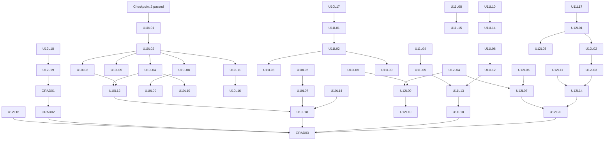

# Palavox Overhaul — ESL Late A2 Band Plan (Units 10–12 + Graduation)

**Direction:** English for multilingual learners (Direction A)
**Band:** Late A2 (Units 10–12 of the 12-unit skeleton) + Graduation
**Instruction/UI language:** learner's L1 (any of ~41); all contrastive content is L1-parameterized
**Progressive-release ratios for this band:** 25–35% structured / 35–45% guided interaction / 25–35% open conversation (+ communicative missions)
**Status:** WIP planning document. No app code or DB changes are made or implied by this file.

Labels used throughout: **[proposed]** = a design decision offered for owner review · **[assumption]** = a premise this plan depends on · **[requires validation]** = must be checked against data, SME review, or pilot before build.

---

## 0. Band-level assumptions and framing

- **[assumption]** Consistent with the sibling late-A1 plan (which absorbed U6 Shopping & money into its band, ending with Checkpoint 1), the early-A2 sibling band covers U7 Getting around, U8 Health & needs, U9 Past experiences + Checkpoint 2. This band therefore owns **U10 Plans & future, U11 Work & study, U12 Repair & survive, and Graduation**.
- **[assumption]** Inbound state at U10 entry (delivered by U1–U9 + Checkpoint 2 passed): *be*/*have*, present simple and continuous, past simple (regular + high-frequency irregulars, +/−/?), *can/can't*, imperatives, countable/uncountable + *some/any*, comparatives (introduced), prepositions of place/time, question formation across known tenses; ~1,400–1,500 vocabulary items/chunks [requires validation against the actual U1–U9 build]; core phoneme work begun on /θ ð/, /ɪ–iː/, /æ/, word-final consonants; learner can handle short transactional exchanges (shop, transport, clinic) with support.
- **[assumption]** Global lesson budget: A2 ≈120–150 core lessons across U6–U12. Late A1 took U6 (19). Early A2 (U7–U9) is assumed at ~54–57. This band takes **56 core lessons (U10: 18, U11: 18, U12: 20)** → A2 total ≈129–132, inside range. Graduation-sequence sessions (3) are **not** counted as core lessons, mirroring how siblings treat checkpoints.
- **[proposed]** U12 gets 20 lessons (top of the 16–22 range) because repair/survival competence is the single highest-leverage skill for post-course independence and is also the muscle Graduation explicitly tests; the extra 2 lessons are both cumulative-review sessions, not new content.
- **[requires validation]** All timing figures (per-lesson minutes, band ~38 h) are planning estimates pending pilot telemetry; never user-facing guarantees.
- **[proposed]** Ratio accounting: the 25–35/35–45/25–35 split is computed over interactive engagement (structured teaching + controlled exercises + independent listening/writing tasks | guided AI interaction, written and spoken | open conversation + missions + graduation). Spaced review and remediation are accounted separately per the owner rule (§14).

---

## 1. Refined unit definitions

CEFR excerpts below are short attributed quotes from the CEFR Companion Volume (Council of Europe, 2020) descriptor scales; ACTFL alignment uses NCSSFL-ACTFL Can-Do Statements (2017). Late A2 deliberately targets the **A2/A2+ seam**: learners exit able to operate at strong A2 with emerging A2+ interaction behaviors, which is the owner's graduation definition.

### Unit 10 — Plans & Future (theme: arrangements, invitations, intentions, goals)

- **can_do_statement (learner-facing):** "I can talk about my plans — tonight, this weekend, next year — invite people, accept or refuse politely, agree a time and place, and change a plan when something comes up."
- **CEFR anchors:**
  - Sustained monologue A2: can "describe plans and arrangements" (CV 2020).
  - Conversation/discussion A2: can "make and respond to suggestions" and "discuss what to do in the evening/at the weekend" (CV 2020, informal discussion).
  - Goal-oriented co-operation A2: can indicate agreement/disagreement and follow simple task talk.
- **ACTFL modes:** Interpersonal (Intermediate Low: "participate in conversations on familiar topics using simple sentences" — invitations, scheduling); Interpretive (voicemails, forecasts, arrangement dialogues at near-natural speed); Presentational ("my next year" spoken + written plan with reasons).
- **key_language_use:** planning and negotiating future action; inviting and responding; expressing intention and desire.
- **content_objective:** future time expressions, social activities/events, invitations, weather-and-plans, life goals.
- **language_objective:** *be going to*; present continuous for arrangements; *will* for decisions/offers/predictions; *would like to*; *let's / how about + -ing*; time clauses (*when/before/after* + present).

### Unit 11 — Work & Study (theme: jobs, workplace English, job search, classes and training)

- **can_do_statement:** "I can describe my job, skills and experience, understand simple instructions at work, handle a basic job or program interview, compare options, and write a short workplace email."
- **CEFR anchors:**
  - Information exchange A2: can ask/answer about "habits and routines" and "pastimes and past activities" (CV 2020) — extended here to work histories.
  - Overall spoken interaction A2+: "can interact with reasonable ease in structured situations and short conversations," given a helpful interlocutor (CV 2020).
  - Written interaction A2: "can write short, simple formulaic notes relating to matters in areas of immediate need" (CV 2020).
- **ACTFL modes:** Interpersonal (interview Q&A, requests to a supervisor); Interpretive (multi-step spoken instructions, interview questions with reductions); Presentational (short "my skills and experience" statement; application-form + availability note).
- **key_language_use:** self-presentation for work/study; obligation and permission; comparing options; register shift up (boss/teacher) and down (coworker).
- **content_objective:** jobs/workplaces, skills, applications and interviews, school/training enrollment, workplace small talk.
- **language_objective:** *have to / don't have to*; polite permission (*can/could I…?*); present perfect for experience (*Have you ever…? / I've worked…*) [proposed: productive-formulaic, receptive-flexible — see §5]; comparatives/superlatives extension; *like/enjoy + -ing* vs *would like to*.

### Unit 12 — Repair & Survive (theme: fixing communication, phones, problems, the unexpected)

- **can_do_statement:** "When I don't understand, I can get the other person to repeat, slow down, spell, or explain; I can say things another way, make phone calls, report problems, and finish a real-world task even when something goes wrong."
- **CEFR anchors:**
  - Asking for clarification A2: "can ask very simply for repetition when he/she does not understand" and can use "stock phrases" to ask for clarification of key words (CV 2020).
  - Compensating A2: can use an inadequate word plus gesture to clarify meaning (CV 2020).
  - Using telecommunications A2: can handle simple calls/messages on predictable matters (CV 2020) [receptive menus + short productive calls at this level].
- **ACTFL modes:** Interpersonal (repair sequences, phone calls, complaints); Interpretive (announcements, phone menus, fast/reduced/accented speech on familiar topics); Presentational (connected 60–80-word written message; problem report).
- **key_language_use:** breakdown repair; circumlocution; polite requests and complaints; confirming/checking; urgent needs.
- **content_objective:** repair phrase kit, phone survival, problems & solutions, emergencies-lite, culture of politeness/directness.
- **language_objective:** polite request frames (*Could you…? Would you…?* + softeners); checking/confirming (echo questions, *So you mean…?*, receptive question tags); indefinite pronouns (*something/anyone…*); *too/enough*; cross-tense integration (past ↔ present ↔ future switching in one conversation).

**Mode coverage matrix [proposed]:** every unit ends with one presentational task (L16 zone), embeds interpersonal AI interaction in **every lesson** (micro) with ≥6 major interactions/unit (§9), and carries interpretive work in every lesson via the exercise blend. Tags in §2: (I) interpretive, (X) interpersonal, (P) presentational.

---

## 2. Lessons per unit (core deliverable)

56 core lessons; short IDs `U{u}L{nn}`, full IDs `EN-A2L-U{u}-L{nn}`. Lesson types: `V` vocab, `G` grammar, `Pr` pronunciation lab, `L` listening lab, `S` speaking, `W` writing lab, `X` integrated/pragmatics/review/mission. Each lesson = ~9 min structured core + embedded AI interaction (written and/or spoken) using that lesson's language. Trim candidates for global rebalancing marked ⊖.

### Unit 10 — Plans & Future (18 lessons)

| # | ID | Type | Title | One-line objective |
|---|----|------|-------|--------------------|
| 1 | U10L01 | V | Time to plan | Use future time expressions (*tonight, tomorrow, next week, in two days, soon*) and calendar talk to place events in the future. (I) |
| 2 | U10L02 | G | *be going to* for plans | Form and use *be going to* (+/−/?) for decided plans; full sample lesson §13a. (X, I) |
| 3 | U10L03 | S | What are you going to do? | Exchange weekend plans in guided Q&A and ask one follow-up question per answer. (X) |
| 4 | U10L04 | G | Arrangements: present continuous | Use present continuous with time/place for fixed arrangements (*I'm meeting Ana at 6*); light contrast with *going to*. (X) |
| 5 | U10L05 | Pr | Sound lab: *gonna* & *wanna* | Recognize reduced *going to / want to* in fast speech; choose careful vs reduced forms in own speech. (I) |
| 6 | U10L06 | V | Out and about | Name common social activities and events (*get together, barbecue, day off, concert*) to build invitation content. (I) |
| 7 | U10L07 | S/X | Inviting and responding | Make, accept, and politely refuse invitations (*Would you like to…? / I'd love to / Sorry, I can't — I'm working*). (X) |
| 8 | U10L08 | G | *will*: decisions, offers, promises | Use *will* for on-the-spot decisions, offers, and simple predictions; contrast with planned *going to*. (X) |
| 9 | U10L09 | L | Weather and plans | Understand simple forecasts and adjust plan talk (*It's going to rain, so…*). (I) |
| 10 | U10L10 | W | Writing lab: confirm the plan | Write short messages confirming or changing an arrangement (time, place, who); written AI interaction §13b. (X, P) |
| 11 | U10L11 | G | Time clauses: *when/before/after* | Sequence future actions with present-tense time clauses (*When I get home, I'm going to…*). (P) |
| 12 | U10L12 | S | Scheduling with a busy person | Solve a calendar information gap: find a common free slot and lock it. (X) |
| 13 | U10L13 | V/X | Goals and dreams ⊖ | Talk about life goals with chunks (*save money, take a class, get a better job, my goal is…*). (X, P) |
| 14 | U10L14 | L | Listening lab: fast plans | Catch who/what/when/where in natural-speed arrangement dialogues with reductions and linking. (I) |
| 15 | U10L15 | Pr | Sound lab: stress to fix it | Use contrastive sentence stress to correct and confirm (*FRIday, not SUNday*); -teen/-ty rescue. (X) |
| 16 | U10L16 | W/S | My next year | Present spoken + written plans with reasons (*because/so*), 6–8 connected sentences. (P) |
| 17 | U10L17 | X | Unit 10 review | Cumulative spaced review of U10 + interleaved U7–U9 + error-bank items from U10 interactions. |
| 18 | U10L18 | X | Mission: Make a real plan | Negotiate a concrete plan with an AI stranger persona and survive one complication (mission). (X) |

### Unit 11 — Work & Study (18 lessons)

| # | ID | Type | Title | One-line objective |
|---|----|------|-------|--------------------|
| 1 | U11L01 | V | Jobs and workplaces | Extend job/workplace vocabulary (*shift, schedule, boss, coworker, customer, pay, break*). (I) |
| 2 | U11L02 | G | *have to / don't have to* | Express obligation and its absence at work/school; contrast with *can/can't*. (X) |
| 3 | U11L03 | S | Talking about your job | Describe job, duties, and schedule in guided Q&A; answer two follow-ups. (X) |
| 4 | U11L04 | V | Skills I have | State skills and abilities (*drive, use a computer, take care of, fix*) with *I'm good at + -ing*. (P) |
| 5 | U11L05 | G | Have you ever…? | Use formulaic present perfect for work/life experience (*I've worked in… / I've never…*), switching to past simple for details. (X) |
| 6 | U11L06 | L | Instructions at work | Follow multi-step spoken instructions using sequence words (*first, then, after that*). (I) |
| 7 | U11L07 | Pr | Sound lab: word stress at work | Place stress correctly in job vocabulary (*ˈinterview, appliˈcation, exˈperience, ˈsupervisor*). (P) |
| 8 | U11L08 | W | Writing lab: the application | Complete application-style forms and write a short availability note. (P) |
| 9 | U11L09 | S/X | Asking the boss | Make polite high-stakes requests (*Could I…? / Would it be possible to…?*) for time off or a shift swap. (X) |
| 10 | U11L10 | G | Better, worse, the best | Compare jobs, schedules, and classes with comparatives/superlatives to explain a choice. (X) |
| 11 | U11L11 | V | School and training ⊖ | Handle enrollment vocabulary (*register, course, certificate, level, deadline*). (I) |
| 12 | U11L12 | L | Listening lab: the interview | Understand common interview questions at near-natural pace incl. reduced forms (*Whaddaya do? / Can ya start Monday?*). (I) |
| 13 | U11L13 | S | Mini job interview | Answer six core interview questions about self, experience, and availability; spoken AI interaction §13c. (X, P) |
| 14 | U11L14 | G | Like it or want it? | Distinguish *like/enjoy + -ing* (preference) from *would like to* (desire) when discussing work/study options. (X) |
| 15 | U11L15 | W | Writing lab: email your boss or teacher | Write a short register-appropriate email (absence apology, question, thanks) with correct opening/closing. (P) |
| 16 | U11L16 | X | Workplace small talk | Open, sustain, and exit small talk on safe topics (weekend, weather, food); topic taboos. (X) |
| 17 | U11L17 | X | Unit 11 review | Cumulative spaced review of U11 + interleave U10, U7–U9 + error-bank items. |
| 18 | U11L18 | X | Mission: The interview | Complete a simulated job/program interview with one unexpected question; self-advocate (mission). (X) |

### Unit 12 — Repair & Survive (20 lessons)

| # | ID | Type | Title | One-line objective |
|---|----|------|-------|--------------------|
| 1 | U12L01 | V/X | When you don't understand | Deploy the core repair kit (*Sorry? Could you repeat that? Could you speak more slowly? What does X mean? How do you spell it?*). (X) |
| 2 | U12L02 | Pr | Sound lab: hearing fast English | Decode linking and reductions (*didja, gotta, lemme*) in survival contexts; recognize trigger phrases. (I) |
| 3 | U12L03 | S | Repair in action | Repair planted breakdowns in guided dialogues within two turns. (X) |
| 4 | U12L04 | G | Polite requests: *could/would* | Soften requests with *Could you…? / Would you…? / please*; *I'd like* vs *I want* register. (X) |
| 5 | U12L05 | X | Say it another way | Paraphrase around missing words (*it's a thing for… / it's like…*) to keep a conversation alive. (X) |
| 6 | U12L06 | L | Phone survival I: listening | Understand phone openings, hold language, transfers, and voicemail menus (*Press 1 for…*). (I) |
| 7 | U12L07 | S | Phone survival II: speaking | Make a simple call: book/change an appointment, ask one question, leave a short voicemail. (X) |
| 8 | U12L08 | V | Problems and solutions | Report problems with core vocabulary (*broken, lost, wrong, late, missing, doesn't work*) + fix-it chunks. (I) |
| 9 | U12L09 | S/X | Complaining politely | Return/exchange an item and escalate politely; recycle U6 receipt/price language. (X) |
| 10 | U12L10 | W | Writing lab: report a problem | Write a short written problem report (landlord, school, support chat) with what/when/what-you-want. (P) |
| 11 | U12L11 | G | Checking and confirming | Confirm understanding with echo questions, *So you mean…?*, and read-backs of numbers/spellings. (X) |
| 12 | U12L12 | L | Announcements and changes | Extract key facts from delay/change announcements at natural speed (recycle U7 transport). (I) |
| 13 | U12L13 | X | Urgent needs | Ask for urgent help clearly (emergency-lite scripts; 911 basics [US-centric — requires validation for deployment locales]); recycle U8 health. (X) |
| 14 | U12L14 | S | When plans go wrong | Handle a cancellation/complication conversation, switching past ↔ present ↔ future accurately. (X) |
| 15 | U12L15 | Pr | Sound lab: your top three | Drill the learner's personal top-3 intelligibility targets chosen from analytics (clusters, /θ ð/, /ɪ–iː/, stress). (P) |
| 16 | U12L16 | W | Writing lab: the connected message | Write a 60–80-word connected message combining a past event, current situation, and future plan with connectors. (P) |
| 17 | U12L17 | X | Culture lab: soft no's and small talk | Apply politeness norms: indirect refusals, softeners, personal space/gesture notes, tipping-lite, punctuality. (X) |
| 18 | U12L18 | X | Unit 12 review | Cumulative spaced review of U12 + full-course interleaved review, wave 1. |
| 19 | U12L19 | X | Graduation Gauntlet | Adaptive full-course review: weakest FSRS items, error-bank clearance, mixed-tense speed round. |
| 20 | U12L20 | X | Mission: Survive the switchboard | Complete a multi-step real-world task chain (call → wrong info → repair → reschedule → written confirmation); mission §13d. (X, P) |

**Band lesson count: 56.** Owner range 16–22/unit: U10=18 ✓, U11=18 ✓, U12=20 ✓. If A2-wide totals overflow 150, merge U10L13 into U10L16 and U11L11 into U11L08 → 54. **[proposed]**

### Graduation sequence (post-U12; not core lessons)

| ID | Session | Purpose |
|----|---------|---------|
| GRAD-01 | Mock graduation conversation (~12 min) | Formative dry run of the adaptive conversation; produces a gap report; no gate. |
| GRAD-02 | Targeted tune-up (conditional, ~15 min) | Auto-assembled remediation from GRAD-01 gaps; skipped if no red flags. |
| GRAD-03 | Graduation: conversation (~15 min) + writing task (~10 min) | Summative performance assessment; gates and outcomes in §12. |

---

## 3. Prerequisite graph

**Gating rules [proposed]:** a lesson is `gated` until its listed prerequisites reach skill_mastery ≥ 0.65; unit reviews (L17/L18-zone) require all non-⊖ lessons attempted; missions require the unit's S-type lessons completed; GRAD-03 requires all three missions at ≥ "functional" rating (§12).



Cross-band inbound edges (assumed delivered by U1–U9): past simple (U9) → U11L05, U12L14; transport/announcements (U7) → U12L12; health (U8) → U12L13; shopping/prices (U6) → U12L09; present continuous (early A2 [assumption]) → U10L04. **[requires validation]** against the early-A2 sibling's final lesson map.

---

## 4. Vocabulary and lexical-chunk targets

### Counts and principles

| Unit | New single-word items | Multiword chunks | Total new |
|------|----------------------|------------------|-----------|
| U10 Plans & Future | 100 | 45 | 145 |
| U11 Work & Study | 120 | 45 | 165 |
| U12 Repair & Survive | 85 | 55 | 140 |
| **Band total** | **305** | **145** | **450** |

- Cumulative course total at graduation: ~1,450 inbound [assumption] + 450 = **~1,900**, inside the owner's 1,800–2,200 window. The band deliberately skews toward **chunks** (32% vs ~20% in earlier bands) because late-A2 fluency gains come from retrieved formulas, not new nouns. **[proposed]**
- Selection principles: (1) frequency — prioritize items in the top ~3,000 of general spoken English [requires validation against a corpus, e.g., COCA/NGSL]; (2) communicative payoff for survival contexts (work, phone, service, repair) over topical completeness; (3) chunk-first for anything the learner needs under time pressure (repair phrases, polite requests, interview answers); (4) productive/receptive split tagged per item — reduced forms (*gonna*) are receptive-only targets; (5) every item carries the `translation_l1` slot — **the current single-column `vocabulary.translation_l1` cannot serve 41 L1s; propose extension table `vocabulary_translations(vocab_id, l1_code, translation, l1_contrast_note nullable)` [proposed — schema extension, not modification]**.

### Sample list — Unit 11 Work & Study (44 of 165 items; representative)

Format: lemma/chunk · POS · CEFR · example · (translation_l1 slot rendered per learner L1; ⚑ = has L1 contrast note slot for priority L1s).

| # | Item | POS | CEFR | Example | Notes |
|---|------|-----|------|---------|-------|
| 1 | apply | v | A2 | I want to apply for this job. | ⚑ apply *for* (preposition contrast) |
| 2 | application | n | A2 | Please fill out the application. | stress: appliˈcation |
| 3 | interview | n/v | A2 | My interview is on Monday. | stress: ˈinterview |
| 4 | resume | n | A2 | Send your resume by email. | AmE; BrE *CV* noted |
| 5 | schedule | n/v | A2 | My schedule changes every week. | recycled from U2, extended |
| 6 | shift | n | A2 | I work the night shift. | |
| 7 | full-time | adj | A2 | It's a full-time job. | |
| 8 | part-time | adj | A2 | She works part-time. | |
| 9 | boss | n | A2 | My boss is very busy. | register vs *manager* |
| 10 | manager | n | A2 | Ask the manager, please. | |
| 11 | coworker | n | A2 | My coworkers are friendly. | |
| 12 | customer | n | A2 | The customer has a question. | recycled from U6 |
| 13 | employee | n | A2 | Every employee gets a break. | stress: emˈployee ~ employˈee variants noted |
| 14 | pay | n/v | A2 | The pay is $18 an hour. | |
| 15 | paycheck | n | A2 | I get my paycheck on Friday. | |
| 16 | overtime | n | A2 | I worked overtime last week. | |
| 17 | break | n | A2 | Lunch break is at noon. | polysemy flag (vs *broken*, U12) |
| 18 | day off | chunk | A2 | Tuesday is my day off. | |
| 19 | experience | n | A2 | Do you have experience? | ⚑ uncountable here; stress: exˈperience |
| 20 | skill | n | A2 | Cooking is a useful skill. | |
| 21 | training | n | A2 | The training is two weeks. | |
| 22 | certificate | n | A2 | You get a certificate at the end. | |
| 23 | course | n | A2 | I'm taking an English course. | |
| 24 | register (for) | v | A2 | Register for the class online. | |
| 25 | deadline | n | A2 | The deadline is Friday. | |
| 26 | available | adj | A2 | I'm available on weekends. | |
| 27 | availability | n | A2 | Write your availability here. | |
| 28 | duty | n | A2 | Cleaning is one of my duties. | |
| 29 | uniform | n | A2 | You have to wear a uniform. | |
| 30 | safety | n | A2 | Safety is important here. | |
| 31 | form | n | A2 | Sign the form at the bottom. | recycled, extended |
| 32 | signature | n | A2 | Put your signature here. | |
| 33 | hire | v | A2 | They want to hire two people. | |
| 34 | quit | v | A2 | He quit his job last month. | irregular past = quit |
| 35 | meeting | n | A2 | The meeting starts at nine. | |
| 36 | on time | chunk | A2 | Please be on time. | vs *in time* (receptive note) |
| 37 | be good at + -ing | chunk | A2 | I'm good at fixing things. | ⚑ gerund after preposition |
| 38 | work as | chunk | A2 | I worked as a cook. | ⚑ article: *a* cook |
| 39 | look for a job | chunk | A2 | I'm looking for a job now. | |
| 40 | fill out (a form) | chunk | A2 | Fill out this form, please. | separable phrasal (receptive-flexible) |
| 41 | call in sick | chunk | A2 | I have to call in sick today. | |
| 42 | take a break | chunk | A2 | Let's take a break at ten. | |
| 43 | Could I ask you something? | chunk | A2 | Could I ask you something? | request opener, register-up |
| 44 | Have you ever worked in…? | chunk | A2 | Have you ever worked in a kitchen? | formulaic present perfect frame |

Every item ships with `frequency_rank`, `ipa`, `example_sentence`, per-L1 `translation` + optional `l1_contrast_note` (via proposed extension table), and `receptive_productive` tag. [proposed]

---

## 5. Grammar progression across the band

Ordered; each point exists because a communicative task in §2 needs it. All points get the L1 contrast schema below.

1. **Future time expressions + calendar frames** (U10L01) — placing any plan in time; zero new morphology, high payoff.
2. ***be going to* +/−/?** (U10L02) — the workhorse future for decided plans; needed for all planning talk.
3. **Present continuous for arrangements** (U10L04) — diary-fixed plans (*I'm meeting Ana at 6*); distinguishes "decided" vs "arranged" only lightly at A2.
4. ***will* for decisions/offers/predictions** (U10L08) — spontaneous decisions in service contexts (*I'll take it*), offers (*I'll help you*).
5. ***would like to* / *let's* / *how about + -ing*** (U10L07) — invitation-making and responding.
6. **Time clauses *when/before/after* + present** (U10L11) — sequencing future actions; blocks the classic **will* in time clauses* error.
7. ***have to / don't have to*** (U11L02) — workplace obligation; contrast with *can/can't* (permission/ability).
8. **Present perfect for experience — formulaic** (U11L05) — *Have you ever…? / I've worked… / I've never…* as fixed interview frames, switching to past simple for details (*I worked there in 2024*). **[proposed]** Full present-perfect paradigm (unfinished time, *for/since*) is deferred to post-course B1 tools; teaching it formulaically here matches A2+ descriptors without opening the tense-aspect can of worms. **[requires validation with SME]**
9. **Comparatives/superlatives extension** (U11L10) — choosing between jobs/classes; *better/worse/the best* + *than*.
10. ***like/enjoy + -ing* vs *would like to*** (U11L14) — preference vs desire; classic A2 confusion with real interview stakes.
11. **Polite request frames** (U12L04) — *Could/Would you…?*, *Could I…?*, *I'd like* vs *I want*; register-critical.
12. **Checking/confirming structures** (U12L11) — echo questions, *So you mean…?*, read-backs; receptive question tags (*…, right?*).
13. **Indefinite pronouns + *too/enough*** (U12L05/L08 support) — circumlocution fuel (*something for cutting; it's too small*).
14. **Cross-tense integration** (U12L14, U12L19) — no new forms; drills switching past/present/future inside one conversation, the single strongest predictor of graduation-conversation success. **[assumption — validate with pilot analytics]**

### L1-parameterized contrast schema (authoring pattern)

Per grammar point (and per pronunciation target, §6), authors fill one row per priority L1 (all 41 L1s get machine-translated `contrast_md` seeded from the closest typological neighbor, flagged for human review [proposed]):

```yaml
l1_contrast_note:
  target_id: gram.be_going_to        # or pron.final_clusters
  l1_code: es | zh | ar | vi | ht | pt | ru | uk | fa | so | ...
  transfer_type: positive | negative | mixed
  contrast_md: >-                    # shown to the learner in their L1
    L1-language explanation of how the L1 does this and what to watch for.
  interference_examples:             # predicted learner errors, used by correction engine
    - "I going to eat"
  severity: 1-3                      # 3 = blocks understanding
  remediation_hint: drill-id or micro-lesson template
```

**Filled examples — `gram.be_going_to` (U10L02):**

| L1 | transfer_type | Contrast note (rendered in L1; English gloss here) | Interference examples | Sev. |
|----|---------------|-----------------------------------------------------|----------------------|------|
| Spanish (es) | positive/mixed | Spanish *ir a + infinitive* (*voy a comer*) maps almost one-to-one onto *be going to* — lean on it. Watch two habits: dropping the subject pronoun (*Is going to rain* → *It's going to rain*) and using present simple for future (*I go tomorrow*), which Spanish allows. | "Going to rain today." · "I go to the doctor tomorrow." | 2 |
| Mandarin (zh) | negative | Mandarin marks future with 要/会/打算 + time words and never changes the verb; there is no *be*. Learners drop *be* and *to* and rely on time adverbs. The frame is fixed: **am/is/are + going to + verb** — all three pieces are required even when a time word is present. | "I going to see doctor." · "Tomorrow I go store." · "She going to working." | 3 |
| Arabic (ar) | negative/mixed | Arabic marks future with the prefix سـ / سوف on the verb and has no present-tense *be*. Learners omit *am/is/are* and may prefer *will* everywhere. Anchor: no *be* → the sentence is broken; use *going to* for plans already decided, *will* for right-now decisions. | "I going to travel." · "He will going to work." | 3 |

The same three-row pattern is required for `gram.have_to` (es: *tener que* positive transfer; zh: 得/必须 no verb change; ar: يجب أن + subjunctive), `gram.present_perfect_experience`, and `gram.polite_requests` (directness norms differ sharply — see §10). Authors must fill priority-10 L1s before an item leaves `draft`. **[proposed]**

---

## 6. Pronunciation progression

Late-A2 principle: **intelligibility payoff per drilled minute**, prioritized by (a) functional load in this band's vocabulary and (b) the priority-L1 error matrix. Accent erasure is explicitly a non-goal.

Ordered band targets:

1. **Word stress in multisyllabic vocabulary** (U11L07, maintained throughout) — misplaced stress destroys word recognition for listeners more than any single segment [assumption backed by intelligibility literature — requires citation check]. Targets: *ˈinterview, appliˈcation, exˈperience, ˈsupervisor, availaˈbility, ˈschedule*. Affects all L1s; especially syllable-timed L1s (es, zh, vi, fr-based ht).
2. **Contrastive sentence stress** (U10L15, U12L11) — the repair/confirmation tool: *FRIday, not SUNday; fifTEEN or FIFty?* Directly feeds Graduation's repair rubric line.
3. **Final consonant clusters + grammatical endings** (U12L15; seeded in U10L02 with *plans*, U11L05 with *worked*) — cluster deletion erases tense/plural morphology (*work* vs *worked*, *plan* vs *plans*). Highest severity for vi, zh, so; high for pt (epenthesis), es (epenthesis/deletion).
4. **/ɪ/ vs /iː/** (maintenance; live/leave drills recontextualized: *I live here* vs *I leave here*) — es, ar, so, ru/uk lack the contrast; high functional load in this band (*live, leave, fill, feel, sick, seek*).
5. **/θ ð/** (maintenance in chunks: *I think, thanks, this Thursday*) — near-universal difficulty; moderate functional load; drilled inside chunks, not isolation.
6. **/æ/ vs /ʌ/** (light maintenance: *staff/stuff, cash/cush-*, *plan/plun-*) — moderate payoff; keep to minimal-pair spot checks.
7. **Reduced forms and linking — receptive** (U10L05, U11L12, U12L02) — *gonna, wanna, gotta, didja, lemme*, linking (*What are you → Whaddaya*). Production optional; recognition mandatory (owner's "understand paced speech" outcome).
8. **Intonation contours** (woven) — rising echo for clarification (*Sorry, FIFty?*), falling wh-, polite-request rise-fall (*Could you ˈhelp me↘*).

**Minimal-pair inventory (band core) [proposed]:**

| Contrast | Pairs | Unit anchor | Priority L1s |
|----------|-------|-------------|--------------|
| /ɪ–iː/ | live–leave · sick–seek · fill–feel · it–eat | U12L15 | es ar so ru uk fa |
| final cluster (-t/-d) | work–worked · plan–planned · miss–missed | U10L02, U11L05 | vi zh so |
| final -s/-z cluster | plan–plans · work–works · boss–bosses | U10L02 | vi zh |
| /θ–s/, /θ–t/ | think–sink · three–tree · thanks–tanks | U12L01 | vi zh ru pt ht |
| /ð–d/ | they–day · then–den | U12L01 | vi zh ht so |
| /æ–ʌ/ | staff–stuff · cap–cup · ran–run | U11L01 | es pt ru fa |
| stress pairs | ˈrecord–reˈcord (recept.) · THIRteen–THIRty | U10L15 | all |
| /b–p/ final (receptive) | cab–cap · rib–rip | U12L02 | ar vi |

Per-target `l1_contrast_note` rows (schema §5) required for the priority 10 L1s; e.g., `pron.final_clusters` for Vietnamese explains (in Vietnamese) that Vietnamese syllables end in a small set of unreleased consonants, so English *-ed/-s* tails vanish, and that dropping them deletes grammar, not just accent. **[proposed]**

---

## 7. Listening progression

| Stage | Text types | Speed/quality | Task types |
|-------|-----------|---------------|------------|
| U10 | arrangement dialogues, voicemails, weather forecasts, invitations | 0.9×→1.0× natural; reductions introduced deliberately (*gonna/wanna*) | gist → who/what/when extraction → reduced-form transcription (dictation of *going to* heard as *gonna*) |
| U11 | multi-step workplace instructions, interview Q&A, schedule announcements | 1.0× natural; mild background noise [proposed] | sequence ordering; note-taking into forms; predict-the-question; catch numbers/times under pressure |
| U12 | phone menus, hold messages, service calls, delay/change announcements, accented interlocutors | 1.0× incl. degraded/phone-band audio and 2–3 non-native accents [proposed — matches owner's "intelligible accented speech" outcome] | key-fact extraction; inference-lite ("is the caller angry?"); interactive listening inside AI conversations (respond, don't just answer MCQs); repair-trigger detection (notice when you did NOT understand) |
| Grad | adaptive conversation | natural, supportive interlocutor | fully interactive |

Standing rules [proposed]: every listening lab reuses ≥70% known vocabulary; unfamiliar items are guessable proper nouns/numbers; every unit includes ≥1 "listen and DO" task (fill the form, mark the calendar) rather than answer-the-question only; transcripts unlock only after two attempts.

---

## 8. Writing progression

CEFR anchor: A2 overall written interaction — short, simple formulaic notes on immediate needs; A2 correspondence — very simple personal messages of thanks/apology (CV 2020).

1. **U10L10** — 2–3 sentence arrangement messages (confirm/change time & place); message-thread etiquette (reply to the thread, answer the question asked).
2. **U10L16** — 6–8 connected sentences of future plans with *because/so* (presentational).
3. **U11L08** — application-style forms: transfer of personal data into field conventions (LAST name, MM/DD/YYYY [US-centric — requires validation], availability grids).
4. **U11L15** — short email with register: greeting/closing pairs (*Dear Ms. Lopez / Hi Sam*), one-purpose-per-email rule, apology + reason + request pattern.
5. **U12L10** — problem report: what happened, when, what you want done; neutral tone under frustration.
6. **U12L16** — the band capstone: 60–80-word connected message spanning past event + present situation + future plan with connectors (*but, because, so, then, after that*). This is the direct rehearsal for the Graduation writing task.
7. **GRAD-03 writing task** — ~80 words, new prompt from the same family (§12).

All writing labs embed a **written AI interaction** (the AI is the recipient and replies in-thread, requiring one follow-up exchange), never write-into-the-void. Spelling/punctuation feedback follows the correction-priority ladder (§9 contracts) with "understanding-blocking" reinterpreted as "reader-blocking." **[proposed]**

---

## 9. Speaking progression and embedded AI interaction (25–35 / 35–45 / 25–35)

**Band-level arc:** controlled (repeat/read-aloud/substitution, mostly inside Pr and G lessons) → guided (information gaps, scripted-frame roleplays, guided Q&A with follow-ups) → spontaneous (free-topic talks, missions, graduation). By U12, controlled speaking survives only inside pronunciation labs.

**Ratio accounting (minutes, median learner) [proposed, validate in pilot]:**

| Bucket | Components | Min | Share of ratio base |
|--------|-----------|-----|---------------------|
| Structured | core-lesson teaching + controlled exercises (56×9=504) + independent listening tasks (96) + independent writing tasks (80) | 680 | **34.3%** |
| Guided interaction | embedded spoken AI (56×6=336) + embedded written AI (56×3.5=196) + standalone guided speaking incl. info-gaps (170) | 702 | **35.4%** |
| Open conversation | free-conversation sessions (18×~14=250) + open-topic extensions (180) + 3 missions (75) + graduation sequence (95) | 600 | **30.3%** |
| **Ratio base** | | **1,982** | 100% |

Spaced review (~210 min) and remediation (~90 min, median) are excluded from the ratio base and accounted in §14, per owner rule.

**Every lesson** embeds at least one AI micro-interaction (written or spoken) using that lesson's language. Major interactions per unit:

**Unit 10:** W: `U10L10-WAI` plan-change group chat (§13b) · `U10L12-WAI` calendar info-gap (written phase). S: `U10L03-SAI` weekend-plans guided Q&A · `U10L07-SAI` invitation roleplay (accept AND refuse branches) · `U10L12-SAI` scheduling negotiation (spoken phase) · `U10L15-SAI` contrastive-stress repair drills (spoken). Open: `U10-OPEN-1` free talk "your next month" · Mission `U10L18-M01`.

**Unit 11:** W: `U11L08-WAI` application form with AI clarification questions · `U11L15-WAI` email thread with boss persona (reply arrives, learner must respond). S: `U11L03-SAI` job-description guided Q&A · `U11L09-SAI` time-off request roleplay (register-up) · `U11L13-SAI` mini interview (§13c) · `U11L16-SAI` small-talk opener/exit practice. Open: `U11-OPEN-1` free talk "work you'd like someday" · Mission `U11L18-M02`.

**Unit 12:** W: `U12L10-WAI` problem-report thread with landlord persona · `U12L16-WAI` connected-message with AI reader questions. S: `U12L03-SAI` planted-breakdown repair dialogues · `U12L07-SAI` phone call simulation (audio-degraded channel [proposed]) · `U12L09-SAI` polite complaint escalation · `U12L14-SAI` plans-gone-wrong tense-switching. Open: `U12-OPEN-1` and `U12-OPEN-2` free talks (topic wheel from all 12 units) · Mission `U12L20-M03` (§13d).

Every interaction ships the full 16-field contract (owner spec); §13b–d are the reference implementations.

---

## 10. Cultural and pragmatic content (woven, never standalone lectures)

- **Register up/down** (U11L09, U11L15, U11L16): *Could I…?* to a boss vs *Can I…?* to a coworker; email greeting/closing pairs; first names vs titles [US-workplace default — requires validation per deployment locale].
- **Invitations and soft refusals** (U10L07, U12L17): refusing with reason + alternative (*Sorry, I can't Friday — how about Saturday?*); a bare "no" reads as cold. L1-parameterized note: directness norms differ (e.g., ru/uk learners may under-soften by English norms; zh/vi learners may decline indirectly enough that the AI probes for a clear answer). ⚑ contrast slots on `prag.refusals`.
- **Small talk** (U11L16): safe topics (weekend, weather, food, sports) vs risky (salary, age, weight, religion, politics, immigration status); exit formulas (*Anyway, I should get back…*).
- **Complaining politely** (U12L09): problem-first not person-first; *I think there's a mistake* > *You made a mistake*.
- **Phone etiquette** (U12L06–07): identify yourself first; *May I ask who's calling?*; voicemail = name + number + reason, slowly, number twice.
- **Punctuality & scheduling** (U10L12): "on time" norms for work vs social events; cancel early, don't no-show.
- **Gestures/body language notes** (U12L17, in L1): eye contact expectations, personal-space distance, head-nod = yes [with L1-specific contrast where relevant, e.g., gesture differences — flagged per L1, requires cultural review].
- **Tipping-lite** (U12L17): where it applies [US-centric — requires validation].

Pragmatics items are testable: they appear as dialogue exercises with `rationale` fields explaining the social cost of the wrong option, and misfires are saved as `prag.*` error categories feeding review. **[proposed]**

---

## 11. Review scheduling, cumulative review, remediation

- **FSRS continues untouched** for vocab (`vocab_card_state`); band adds ~450 new cards; daily review cap 20 min [proposed].
- **Per-lesson warm-up** (2 min): 6–8 due FSRS items biased toward today's lesson's assumed vocabulary.
- **Unit reviews** (U10L17, U11L17, U12L18): cumulative within unit + interleave one earlier unit per session (U10L17 pulls U7–U9; U11L17 pulls U10 + U7–U9; U12L18 pulls the whole course, wave 1).
- **Graduation Gauntlet** (U12L19): adaptive session built from (a) weakest FSRS items, (b) open error-bank entries, (c) mixed-tense speed round; exit report feeds GRAD-01.
- **Error bank:** every AI interaction saves categorized errors (`gram.*`, `vocab.*`, `pron.*`, `prag.*`, `listen.*`); each category carries severity and count. Errors are review objects: they resurface as targeted micro-drills in warm-ups until cleared (2 consecutive correct productions in interaction, not in drills). **[proposed]**
- **Remediation rules (band):**
  1. Gating-skill mastery < 0.65 at a gate → auto-inject a 5–8 min remediation micro-lesson before the gated lesson unlocks.
  2. Same error category ≥3 times across interactions in a unit → scheduled targeted drill within 48 h + that category is force-included in the next mission's success criteria.
  3. Mission rated below "functional" → mission debrief + one remediation micro-lesson → mission retry (variant scenario, not verbatim).
  4. Pronunciation: any `pron.*` category flagged "intelligibility-affecting" twice by the spoken-AI scorer → added to the learner's U12L15 personal top-3 set.
- Proficiency claims never derive from XP/streaks/completion/time (owner rule); mastery moves only on performance evidence (exercise keys, interaction success criteria, rubric scores).

---

## 12. Graduation design (this band owns it)

**Purpose:** certify the owner's communicative definition of done — sustain a simple ~15-min conversation with a supportive interlocutor across familiar topics, past + future, transactional needs, follow-ups, repair, plus a short connected written text.

### Required evidence (all three classes)

1. **Mastery evidence (prerequisite to attempt):** all band gating skills ≥ 0.65; all three missions (M01–M03) completed at ≥ "functional"; U12L16 writing submitted.
2. **Performance evidence — GRAD-03 conversation (~15 min, adaptive, spoken):**
   - Phase 1 Warm-up (2 min): introductions, self/family/work — settles nerves; scored lightly.
   - Phase 2 Familiar topics (5 min): past experience + future plans threads with follow-up questions both directions (learner must ask ≥2).
   - Phase 3 Transaction (4 min): roleplay drawn from U6–U8/U10–U11 pool with one **planted breakdown** (mumbled price, wrong assumption) the learner must repair.
   - Phase 4 The unexpected (4 min): one level-appropriate surprise turn (change of topic, mild complication) + wind-down.
   - **Adaptivity:** interlocutor eases (slower, more scaffolds) after 2 consecutive communication failures; stretches (natural speed, one unfamiliar-but-guessable item) after sustained success. Ease/stretch state is logged and feeds scoring context. **[proposed]**
3. **Performance evidence — writing (10 min):** ~80-word connected message (new prompt from the U12L16 family: past event + current situation + future plan + one request).

### Rubrics and pass logic [proposed — requires SME calibration]

Conversation rubric, 7 dimensions × 0–4 (0 breakdown / 2 functional-with-effort / 4 comfortable): task completion · interaction & follow-ups · range · accuracy · fluency · intelligibility · **repair**. Writing rubric, 4 dimensions × 0–4: task completion · connectedness · accuracy · intelligibility-to-reader.

| Gate | Threshold |
|------|-----------|
| Conversation total | ≥ 18/28 |
| Every conversation dimension | ≥ 2, and **repair ≥ 2 is non-waivable** |
| Writing total | ≥ 9/16, no dimension 0 |

**Outcome mapping:**

| Condition | Outcome |
|-----------|---------|
| All gates pass, ≤1 dimension at exactly 2, error bank clear | **graduated** |
| All gates pass, but ≥2 dimensions at 2 or open error-bank debt | **graduated_with_review** → graduation stands; a 2-week post-course review plan is auto-scheduled (§13e loop) |
| Conversation fails on range/accuracy/intelligibility with localized gaps | **remediation** → targeted loop (§13e), then re-attempt only the failed phase(s) after ≥3 days |
| Conversation fails on task completion/interaction/repair | **repeat_missions** → redo relevant mission(s) in new variants, then full re-attempt |

Scoring: AI rubric scoring with confidence bands; low-confidence or borderline (±1 of any gate) sessions queue for human review sampling [requires validation — QA capacity]. All audio + transcript retained as evidence per privacy policy [requires validation — retention rules]. Certificates state the evidence basis (CEFR-linked performance), never XP/time.

---

## 13. Fully-specified samples

### 13a. Complete lesson — EN-A2L-U10-L02 "be going to for plans"

- **Skill:** grammar (with vocab + speaking blend) · **Status flow:** draft→gated→operational
- **Assumed vocabulary:** U10L01 time expressions; U1–U9 core (visit, cook, buy, work, movie, dinner…)
- **New vocab (vocab_lesson_map):** plan (n/v), free (=available), busy (recycled, new sense tag), stay home, go out, chunk "What are you going to do?", chunk "I'm going to + verb" → 6 mapped items
- **Target grammar:** be going to +/−/? · **Target pronunciation:** *going to* full form vs *gonna* (receptive); final /z/ in *plans*
- **L1 contrast slot:** `gram.be_going_to` rows (§5) rendered in learner's L1 inside intro_md
- **Timing estimate:** 14 min core + 5 min embedded dialogue = 19 min

**intro_md (L1-rendered; English gloss):** "To talk about a plan you have already decided, English uses *be going to* + verb: *I'm going to visit my sister.* Three pieces, always: **am/is/are + going to + base verb**. {l1_contrast_note.gram.be_going_to}. In fast speech you will hear *gonna* — understand it; you may say the careful form."

| # | Type | R/P | Diff | Item |
|---|------|-----|------|------|
| E1 | flashcard ×6 | R→P | 1 | New vocab above; each card: lemma, ipa, example, translation_l1, audio. |
| E2 | listening_mc | R | 2 | Audio: "I'm going to visit my sister on Saturday." Prompt: *When is she going to visit her sister?* Options: **A. Saturday ✓** (stated day) · B. Sunday (rationale: distractor — similar-sounding day; tests /æ–ʌ/ + attention) · C. Tomorrow (rationale: plausible but unstated) · D. She isn't (rationale: tests polarity attention). |
| E3 | cloze | P | 2 | "She ___ going to work tomorrow." Key: **is**. Rationale: 3rd-person *be*; distract-set (is/are/do) offered on tap; *do* rationale: *do* never pairs with *going to*. |
| E4 | cloze | P | 2 | "I'm going ___ cook dinner tonight." Key: **to**. Rationale: infinitive marker is obligatory; targeted at zh/ar interference (*I'm going cook*). |
| E5 | matching | R | 2 | Match Q↔A: "What are you going to do tonight?"↔"Stay home and cook." · "Are you free on Saturday?"↔"No, I'm busy — I'm going to work." · "Who's going to come?"↔"My coworkers." Rationales attached per pair (question word ↔ answer type). |
| E6 | ordering | P | 3 | Tiles: *are / going / What / you / to / do / this weekend / ?* Key: "What are you going to do this weekend?" Rationale: wh + aux inversion; the #1 malformed question in this band [assumption]. |
| E7 | dictation | R→P | 3 | Audio (careful speech): "We're going to see a movie tonight." Scoring tolerant of punctuation; *going to* must be full form. |
| E8 | listening_mc | R | 3 | Audio (natural speech): "I'm gonna call you tomorrow, OK?" Prompt: *What did the speaker say?* Options: **A. going to call ✓** · B. go and call (rationale: mishears reduction) · C. want to call (rationale: *wanna/gonna* confusion — the taught contrast) · D. called (rationale: tense attention). |
| E9 | translation | P | 3 | L1→EN: learner's-L1 sentence meaning "I'm going to buy food tomorrow." Key pattern: `I am|I'm going to buy food tomorrow`. Rationale: checks all three pieces present (be + going to + base). |
| E10 | speaking | P | 3 | Controlled: repeat "What are you going to do this weekend?" (stress: *WHAT are you GOing to DO this WEEKend*); then answer the question about own real plan in 1–2 sentences. Scored: presence of *be going to* frame + final /z/ if *plans* used; recasts on miss. |
| E11 | dialogue | P | 3–4 | Embedded written AI micro-chat (4–6 turns): AI: "Hi! Are you free on Saturday?" → learner responds → AI proposes an activity → learner accepts/refuses with a plan reason → AI confirms. Success: ≥2 correct *going to* productions; one follow-up question asked. Full contract inherits §13b template with lesson-local values. |

Exit condition: ≥80% of E2–E9 correct + E10/E11 success criteria → `skill_mastery(gram.be_going_to)` +evidence; failures write `gram.be_going_to.missing_be` / `.missing_to` / `.wrong_form` to the error bank.

### 13b. Written AI interaction spec (full contract) — EN-A2L-U10-L10-WAI "Change of plans — group chat"

| Field | Value |
|-------|-------|
| communicative_objective | Renegotiate an existing arrangement in writing: state you can't make it, give a reason, propose an alternative, confirm the final plan. |
| curriculum_context | U10 after L04/L08/L10 core; recycles U10L01 time expressions, U10L07 refusal softeners. |
| assumed_vocabulary | U10 vocab list items 1–60; refusal chunks (*Sorry, I can't… / How about…? / Works for me*). |
| target_grammar | *be going to*, present continuous arrangements, *will* for on-the-spot decisions (*I'll bring the food*). |
| target_pronunciation | n/a (written); mechanics targets instead: capitalization of days, apostrophes in *I'm/can't*. |
| permitted_unfamiliar_language | AI may use ≤2 unknown items per session if guessable from context (e.g., *potluck* with food-list context); must gloss on learner request. |
| scaffolding_rules | Turn 1 includes a model reply skeleton (collapsible); skeleton disappears turn 3+; if learner stalls >60 s, offer 3 sentence-starter chips; max 2 chip-assists count toward "with support" flag. |
| expected_AI_behavior | Friendly peer persona ("Sam"); 1–2 sentences per turn at A2 vocabulary; always ends turn with a question or decision point; introduces exactly one complication (venue closed) mid-chat; never writes paragraphs. |
| correction_rules | Priority: (1) understanding-blocking (unparseable time/place) → immediate clarification request in-chat; (2) current target (*going to* frame, arrangement continuous) → inline recast in AI's natural reply (bold the recast); (3) repeated high-value errors from learner's error bank → recast max 1/turn; (4) mechanics → end-of-session feedback only. Fuller feedback card after session: max 3 items, each linked to a drill. |
| success_criteria | Final plan is concrete (day+time+place all present); ≥1 refusal-with-alternative; ≥2 target-grammar productions; learner asked ≥1 question; completed in ≤12 learner turns. |
| mastery_effects | Success → +evidence `gram.be_going_to`, `gram.pres_cont_future`, `prag.refusals`; "with support" flag halves evidence weight. |
| saved_error_categories | `gram.be_going_to.*`, `gram.will_vs_going_to`, `prag.refusals.too_blunt`, `mech.apostrophe`, `vocab.time_expressions`. |
| review_behavior | Errors → error bank (§11); recast items enter next two lesson warm-ups; success chunk (*How about…?*) FSRS-boosted. |
| analytics | turns_to_complete, assist_count, target_production_count, error_categories+severity, time_on_task, complication_recovery (bool), abandonment point if any. |
| failure_handling | If no concrete plan by turn 12: AI closes warmly with a summary of what WAS agreed; session marked incomplete-supportive; auto-suggest replay variant after the linked micro-drill; never a "fail" label to the learner. |
| cost_expectations | Text-only; est. 25–35 model turns incl. scoring pass; target ≤ $0.03/session at current pricing [requires validation]. |

### 13c. Spoken AI interaction spec (full contract) — EN-A2L-U11-L13-SAI "Mini job interview"

| Field | Value |
|-------|-------|
| communicative_objective | Answer six core interview questions (about self, experience, skills, availability) intelligibly and ask one question back. |
| curriculum_context | U11 after L03/L05/L07/L12; rehearses Mission M02; feeds Graduation Phase 3 pool. |
| assumed_vocabulary | U11 sample list (§4); *Have you ever…?* frame; availability language. |
| target_grammar | present perfect formulaic (*I've worked…*) with past-simple detail switch; *have to*; *would like to*. |
| target_pronunciation | word stress (*exˈperience, appliˈcation*); final -ed in *worked*; /ɪ–iː/ in *live/leave* (commute answers). |
| permitted_unfamiliar_language | AI may ask 1 slightly-unfamiliar interview question (from a published pool) to rehearse repair; must rephrase simply if learner uses a repair phrase. |
| scaffolding_rules | Pre-session 60-s prep card (the 6 questions visible, L1 hints collapsible); during session no text support by default; "help" button = AI rephrases slower (logged as assist); ease-mode after 2 failed turns switches to yes/no sub-questions. |
| expected_AI_behavior | Polite interviewer persona ("Ms. Reyes"); speaks at 0.95× natural with clear articulation; one question at a time; 2 follow-ups max per topic; thanks + realistic soft close (*We'll be in touch*); supportive but does not feed answers. |
| correction_rules | Priority per owner spec: (1) understanding-blocking → immediate simple clarification (*Sorry — when can you start?*); (2) current targets (perfect frame, stress, -ed) → concise recast in-flight (*"Oh, you've WORKED in a kitchen — great"*), never meta-language mid-interview; (3) repeated error-bank items → 1 recast max; (4) intelligibility-affecting pronunciation → recast + slot into post-session feedback. Fuller feedback after: max 3 items with audio replay of learner's own clip vs model. |
| success_criteria | ≥5 of 6 questions answered on-topic and intelligibly (ASR+scorer); ≥1 *I've + past participle* production; ≥1 question asked back; ≥1 successful repair if breakdown occurred; total learner speaking time ≥ 2.5 min. |
| mastery_effects | +evidence `gram.pres_perf_experience`, `pron.word_stress`, `speak.interview`; unlocks Mission M02. |
| saved_error_categories | `gram.pres_perf_experience.form`, `gram.tense_switch`, `pron.final_ed`, `pron.word_stress.<lemma>`, `listen.question_misparse`, `prag.register.too_casual`. |
| review_behavior | Pron errors → U12L15 personal-set candidates; grammar errors → warm-up drills; a strong answer is saved as the learner's own model for pre-Mission review [proposed]. |
| analytics | speaking_seconds, WPM band, assist/ease-mode usage, per-question success, ASR confidence distribution, repair events (initiated-by, resolved), pron target hit-rates. |
| failure_handling | <3 questions answered → warm close, session marked incomplete-supportive; auto-assign U11L03 replay + targeted drill; retry after ≥1 day with variant question order; 2nd incomplete → human-reviewable flag [requires validation]. |
| cost_expectations | ~8 min audio: STT+TTS+model ≈ $0.12–0.20/session [requires validation against current provider pricing]; degraded-audio variant adds no cost (client-side filter). |

### 13d. Conversation mission (full contract) — EN-A2L-U12-L20-M03 "Survive the switchboard"

| Field | Value |
|-------|-------|
| communicative_objective | Complete a real-world task chain by phone + writing: call a clinic to reschedule an appointment, survive a menu + a transfer + one piece of wrong information, repair, agree a new time, then confirm in a short written message. |
| curriculum_context | U12 capstone; requires U12L06/L07/L11/L14; final mission before Graduation; integrates U8 (appointments), U10 (scheduling), U12 (repair). |
| assumed_vocabulary | repair kit (U12L01), phone chunks (U12L06–07), problem vocab (U12L08), scheduling (U10). |
| target_grammar | polite requests; checking/confirming read-backs; cross-tense switching (why you're calling = past; what you need = present/future). |
| target_pronunciation | contrastive stress for corrections (*the FIFTH, not the FIFteenth*); clear digits; final clusters in *changed/moved*. |
| permitted_unfamiliar_language | Menu may contain 1–2 unknown options (realism); the "wrong department" speaker uses slightly faster speech; all repairable with taught phrases. |
| scaffolding_rules | Difficulty tiers: T1 (menu = 3 options, patient staff), T2 (default: 5 options, one transfer, one wrong-info event), T3 (background noise, brisker staff) — tier chosen from mastery profile; mid-mission "breathe" button pauses sim (logged, allowed 2×); no text scaffolds during call phase. |
| expected_AI_behavior | Multi-persona: IVR menu voice → receptionist (neutral-busy) → scheduler (supportive). Scheduler gives ONE wrong detail (echoes wrong date) that the learner must catch and correct — if uncaught, the confirmation step surfaces the mismatch as a natural consequence, and the AI reopens the slot question once. |
| correction_rules | In-flight: only understanding-blocking issues get clarification requests (realism preserved); no teaching recasts mid-call. Post-mission debrief: full feedback, max 4 items, each tied to replayable audio moments; priority ladder per owner spec. |
| success_criteria | (a) new appointment agreed with correct date/time read back; (b) wrong-info event caught and corrected (or recovered at confirmation step); (c) ≥2 distinct repair phrases used appropriately; (d) written confirmation message contains date, time, reason — reader-parseable; (e) ≤2 "breathe" pauses. Rating: exceeded / functional / developing / incomplete. |
| mastery_effects | ≥functional → +evidence `speak.transaction_phone`, `repair.initiation`, `repair.resolution`, `write.confirmation`; satisfies M03 gate for GRAD-03. |
| saved_error_categories | `repair.missed_trigger`, `listen.number_misparse`, `gram.tense_switch`, `pron.digit_clarity`, `prag.abruptness`, `write.missing_key_fact`. |
| review_behavior | Missed-trigger moments become personalized listening drills (the actual audio clip, slowed) in next 3 warm-ups; caught-and-corrected moments saved as positive models. |
| analytics | stage completion map, time per stage, repair events (trigger→initiation latency), read-back accuracy, tier, pause usage, debrief item acceptance. |
| failure_handling | developing/incomplete → debrief + 1 targeted micro-lesson → retry as a NEW scenario (dentist→DMV-lite→school office rotation), max 1 retry/day; 3 incompletes → route to U12L03/L07 remediation path + flag for human review [requires validation]. |
| cost_expectations | ~10–12 min mixed audio+text ≈ $0.18–0.28/session [requires validation]; scenario variants are template-generated, no per-variant authoring cost. |

### 13e. Post-course remediation loop example (graduated_with_review learner)

Learner: Vietnamese L1, outcome **graduated_with_review** (conversation 19/28 but intelligibility=2, accuracy=2; error bank open: `pron.final_cluster`, `gram.past_-ed_omission`).

1. **Conversation (evidence):** GRAD-03 Phase 2 — learner says /wɜː/ for *worked*, /muːv/ for *moved*; interlocutor twice misparses tense ("Oh, you work there now?").
2. **Weakness extraction:** scorer links both to one root: final-cluster deletion erasing -ed → categories merged into remediation target `pron.final_cluster::past_-ed` with the actual audio clips attached.
3. **Micro-lesson (auto-assembled, 8 min):** L1-rendered contrast note (Vietnamese finals are unreleased/limited → English -ed tails vanish AND delete tense); 3 minimal-pair listen-discriminate sets (*work–worked, plan–planned, miss–missed*); articulation tip (link -ed to a following vowel: *worked in* → "work-tin").
4. **Practice:** 10 controlled productions (ASR-scored) → 1 guided micro-dialogue where every answer needs a past-tense verb (*What did you do at your last job?*).
5. **Review:** items enter FSRS + error-bank clearance rule (2 consecutive correct productions in interaction); warm-ups for the next 5 sessions include one -ed listening trap.
6. **Conversation (verification):** 6-min follow-up conversation mission "Catching up" (past-weekend talk); scorer specifically monitors -ed realization; ≥80% realized → categories closed, review plan ends; else loop repeats with variant micro-lesson (max 2 loops before human-review flag).

This loop template is the same machine used for `remediation` outcomes pre-graduation — only the entry/exit points differ. **[proposed]**

---

## 14. Band totals and time accounting

| Metric | Value |
|--------|-------|
| Units | 3 (+ Graduation sequence) |
| Core lessons | 56 (U10: 18, U11: 18, U12: 20) |
| Graduation sessions | 3 (mock, conditional tune-up, graduation) |
| Conversation missions | 3 |
| Major AI interactions | 20 (8 written, 12 spoken) + micro-interaction in every lesson |
| New vocabulary | ~450 (305 single-word, 145 chunks) → course cumulative ~1,900 |
| Grammar points | 14 (§5) |
| Pronunciation targets | 8 families, ~28 minimal pairs (§6) |

**Time (median learner, minutes) [proposed, requires validation]:**

| Category (owner buckets) | Min |
|--------------------------|-----|
| Core lessons (structured teaching + controlled exercises) | 504 |
| Listening (independent labs/tasks) | 96 |
| Writing (independent tasks) | 80 |
| Guided speaking (embedded + standalone) | 506 |
| Guided written interaction | 196 |
| Open conversation | 430 |
| Missions | 75 |
| Graduation sequence | 95 |
| Spaced review (FSRS + cumulative) | 210 |
| Remediation (median) | 90 |
| **Band total** | **2,282 ≈ 38 h** (range 33–45 h) |

Progressive-release check (ratio base = 1,982 min, excludes review/remediation): **structured 34.3% · guided 35.4% · open 30.3%** — inside 25–35 / 35–45 / 25–35. Course-cumulative estimate with sibling bands (~22 h + ~28 h + assumed ~32 h early A2): **~120 h total**, inside the owner's 100–165 h envelope. [assumption]

---

## 15. Machine-readable band map

```yaml
band: late_a2
direction: en_for_multilingual
units:
  - id: U10
    name: "Plans & Future"
    cefr: "A2/A2+"
    can_do: "Talk about plans, invite/respond, agree time & place, change a plan."
    vocab_new: 145
    grammar: [future_time_expressions, be_going_to, pres_cont_arrangements, will_decisions_offers, would_like_lets, time_clauses_when_before_after]
    pronunciation: [gonna_wanna_receptive, contrastive_sentence_stress, final_z_plans]
    missions: [U10L18-M01]
    major_interactions: {written: [U10L10-WAI, U10L12-WAI], spoken: [U10L03-SAI, U10L07-SAI, U10L12-SAI, U10L15-SAI], open: [U10-OPEN-1]}
    lessons:
      - {id: U10L01, type: V,  title: "Time to plan", obj: "Future time expressions and calendar talk"}
      - {id: U10L02, type: G,  title: "be going to for plans", obj: "Form/use be going to +/-/?", sample: full_lesson}
      - {id: U10L03, type: S,  title: "What are you going to do?", obj: "Guided Q&A weekend plans + follow-ups"}
      - {id: U10L04, type: G,  title: "Arrangements: present continuous", obj: "Fixed arrangements with time/place"}
      - {id: U10L05, type: Pr, title: "Sound lab: gonna & wanna", obj: "Recognize reduced future forms"}
      - {id: U10L06, type: V,  title: "Out and about", obj: "Social activities & events vocabulary"}
      - {id: U10L07, type: SX, title: "Inviting and responding", obj: "Make/accept/refuse invitations politely"}
      - {id: U10L08, type: G,  title: "will: decisions, offers, promises", obj: "Spontaneous decisions, offers, predictions"}
      - {id: U10L09, type: L,  title: "Weather and plans", obj: "Forecasts and plan adjustment"}
      - {id: U10L10, type: W,  title: "Writing lab: confirm the plan", obj: "Confirm/change arrangements in writing", sample: written_ai}
      - {id: U10L11, type: G,  title: "Time clauses: when/before/after", obj: "Sequence future actions, present in time clause"}
      - {id: U10L12, type: S,  title: "Scheduling with a busy person", obj: "Calendar info-gap negotiation"}
      - {id: U10L13, type: VX, title: "Goals and dreams", obj: "Life-goal chunks", trim_candidate: true}
      - {id: U10L14, type: L,  title: "Listening lab: fast plans", obj: "Natural-speed arrangements with reductions"}
      - {id: U10L15, type: Pr, title: "Sound lab: stress to fix it", obj: "Contrastive stress for correction/confirmation"}
      - {id: U10L16, type: WS, title: "My next year", obj: "Presentational plans with because/so"}
      - {id: U10L17, type: X,  title: "Unit 10 review", obj: "Cumulative + interleaved U7-U9 + error bank"}
      - {id: U10L18, type: X,  title: "Mission: Make a real plan", obj: "Negotiate a plan; survive one complication"}
  - id: U11
    name: "Work & Study"
    cefr: "A2/A2+"
    can_do: "Describe job/skills/experience, handle a basic interview, request politely, write a short workplace email."
    vocab_new: 165
    grammar: [have_to_dont_have_to, polite_permission, pres_perf_experience_formulaic, comparatives_superlatives_ext, like_ing_vs_would_like]
    pronunciation: [word_stress_job_vocab, final_ed_worked, interview_reductions_receptive]
    missions: [U11L18-M02]
    major_interactions: {written: [U11L08-WAI, U11L15-WAI], spoken: [U11L03-SAI, U11L09-SAI, U11L13-SAI, U11L16-SAI], open: [U11-OPEN-1]}
    lessons:
      - {id: U11L01, type: V,  title: "Jobs and workplaces", obj: "Job/workplace vocabulary extension"}
      - {id: U11L02, type: G,  title: "have to / don't have to", obj: "Obligation and its absence"}
      - {id: U11L03, type: S,  title: "Talking about your job", obj: "Guided Q&A job/duties/schedule"}
      - {id: U11L04, type: V,  title: "Skills I have", obj: "Skills vocab + good at + -ing"}
      - {id: U11L05, type: G,  title: "Have you ever...?", obj: "Formulaic present perfect for experience"}
      - {id: U11L06, type: L,  title: "Instructions at work", obj: "Multi-step spoken instructions"}
      - {id: U11L07, type: Pr, title: "Sound lab: word stress at work", obj: "Stress in multisyllabic job vocab"}
      - {id: U11L08, type: W,  title: "Writing lab: the application", obj: "Forms + availability note"}
      - {id: U11L09, type: SX, title: "Asking the boss", obj: "Polite high-stakes requests, register up"}
      - {id: U11L10, type: G,  title: "Better, worse, the best", obj: "Compare options to explain a choice"}
      - {id: U11L11, type: V,  title: "School and training", obj: "Enrollment vocabulary", trim_candidate: true}
      - {id: U11L12, type: L,  title: "Listening lab: the interview", obj: "Interview questions incl. reductions"}
      - {id: U11L13, type: S,  title: "Mini job interview", obj: "Six core interview questions + ask one back", sample: spoken_ai}
      - {id: U11L14, type: G,  title: "Like it or want it?", obj: "like/enjoy+-ing vs would like to"}
      - {id: U11L15, type: W,  title: "Writing lab: email your boss or teacher", obj: "Register-appropriate short email"}
      - {id: U11L16, type: X,  title: "Workplace small talk", obj: "Open/sustain/exit small talk; topic safety"}
      - {id: U11L17, type: X,  title: "Unit 11 review", obj: "Cumulative + interleave + error bank"}
      - {id: U11L18, type: X,  title: "Mission: The interview", obj: "Simulated interview with unexpected question"}
  - id: U12
    name: "Repair & Survive"
    cefr: "A2+"
    can_do: "Repair breakdowns, phone tasks, report problems, finish real-world tasks when things go wrong."
    vocab_new: 140
    grammar: [polite_requests_could_would, checking_confirming, indefinite_pronouns_too_enough, cross_tense_integration]
    pronunciation: [reductions_linking_receptive, contrastive_stress_repair, personal_top3_intelligibility, final_clusters]
    missions: [U12L20-M03]
    major_interactions: {written: [U12L10-WAI, U12L16-WAI], spoken: [U12L03-SAI, U12L07-SAI, U12L09-SAI, U12L14-SAI], open: [U12-OPEN-1, U12-OPEN-2]}
    lessons:
      - {id: U12L01, type: VX, title: "When you don't understand", obj: "Core repair phrase kit"}
      - {id: U12L02, type: Pr, title: "Sound lab: hearing fast English", obj: "Decode linking/reductions in survival contexts"}
      - {id: U12L03, type: S,  title: "Repair in action", obj: "Repair planted breakdowns within two turns"}
      - {id: U12L04, type: G,  title: "Polite requests: could/would", obj: "Softened requests; I'd like vs I want"}
      - {id: U12L05, type: X,  title: "Say it another way", obj: "Circumlocution around missing words"}
      - {id: U12L06, type: L,  title: "Phone survival I: listening", obj: "Openings, hold, transfers, voicemail menus"}
      - {id: U12L07, type: S,  title: "Phone survival II: speaking", obj: "Make a simple call; leave a voicemail"}
      - {id: U12L08, type: V,  title: "Problems and solutions", obj: "Problem vocab + reporting chunks"}
      - {id: U12L09, type: SX, title: "Complaining politely", obj: "Return/exchange; polite escalation"}
      - {id: U12L10, type: W,  title: "Writing lab: report a problem", obj: "Written problem report structure"}
      - {id: U12L11, type: G,  title: "Checking and confirming", obj: "Echo questions, read-backs, receptive tags"}
      - {id: U12L12, type: L,  title: "Announcements and changes", obj: "Delay/change announcements at speed"}
      - {id: U12L13, type: X,  title: "Urgent needs", obj: "Emergency-lite scripts; urgent help"}
      - {id: U12L14, type: S,  title: "When plans go wrong", obj: "Cancellation talk switching tenses"}
      - {id: U12L15, type: Pr, title: "Sound lab: your top three", obj: "Personalized intelligibility targets"}
      - {id: U12L16, type: W,  title: "Writing lab: the connected message", obj: "60-80 word past+present+future message"}
      - {id: U12L17, type: X,  title: "Culture lab: soft no's and small talk", obj: "Politeness norms, gestures, tipping-lite"}
      - {id: U12L18, type: X,  title: "Unit 12 review", obj: "Cumulative + full-course wave 1"}
      - {id: U12L19, type: X,  title: "Graduation Gauntlet", obj: "Adaptive full-course review + error clearance"}
      - {id: U12L20, type: X,  title: "Mission: Survive the switchboard", obj: "Phone task chain with repair + written confirm", sample: mission}
graduation:
  sessions: [GRAD-01_mock, GRAD-02_conditional_tuneup, GRAD-03_final]
  conversation_minutes: 15
  rubric: {dimensions: 7, scale: 0-4, pass_total: 18, dimension_floor: 2, repair_floor_non_waivable: true}
  writing: {words: ~80, rubric_dimensions: 4, pass_total: 9}
  outcomes: [graduated, graduated_with_review, remediation, repeat_missions]
totals:
  core_lessons: 56
  vocab_new: 450
  chunks_included: 145
  est_minutes_total: 2282
  est_hours: 38
  ratio_split_structured_guided_open: [34.3, 35.4, 30.3]
```
