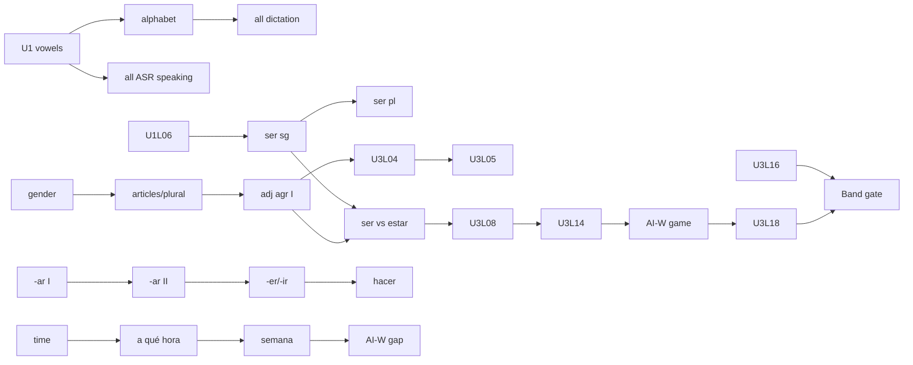

# Palavox Overhaul — Spanish for English Speakers, Early A1 Band Plan (Units 1–3)

Status: WIP planning document. No app code or DB changes proposed for execution here; schema
notes are extension proposals only.

Direction: **Spanish for English speakers (ES-for-EN)** — designed for anglophone learners from
zero. This is NOT the ESL course mirrored; sequencing, contrastive notes, and pronunciation work
are built around what English speakers specifically find hard in Spanish.

Band: **Early A1 (Units 1–3)** · Progressive-release ratio for this band: **70–80% structured /
20–30% guided interaction / ~0% open conversation**.

Lesson ID convention: `ES-A1E-U{unit}-L{nn}` (band code A1E = A1-early).

---

## 0. Band-level assumptions and framing

- [assumption] Learner is literate in English, using the app on a phone, sessions of 10–20 min,
  most likely US/Canada-based with Latin American Spanish as the dominant real-world contact
  variety. This motivates the regional policy below.
- **Regional policy (owner-set, operationalized here):** teach a coherent, broadly useful Latin
  American standard: seseo (casa/caza homophones — taught as one sound, never as an error),
  `ustedes` as the only *productive* plural "you," `vosotros` introduced **receptively only** in
  U2-L15 with an explicit "Spain" label. Major lexical variants flagged inline, max ~1 per
  lesson, never tested productively in this band: carro/coche, computadora/ordenador,
  celular/móvil. [proposed]
- **Cognate leverage is a first-class design principle.** English speakers start with thousands
  of near-free Spanish words (posible, importante, restaurante, familia). The band explicitly
  teaches cognate-reading as a survival skill (U1-L13, U2-L16) AND inoculates against false
  friends early (embarazada, éxito, simpático, sensible). [proposed]
- **English-contrastive backbone for this band:** noun gender + agreement; subject-drop; ser vs
  estar (first contrast in U3); verb conjugation density (English speakers have almost no
  inflection habit — conjugation is drip-fed, chunk-first); adjective position (after noun);
  question formation without do-support, with intonation + ¿ ¡; pure vowels (the #1
  intelligibility issue for anglophones is diphthongization and schwa-reduction); tapped/trilled
  r; b=v; silent h; j/g; accent-mark literacy from Unit 1.
- ~0% open conversation in this band means: **no unscripted free chat**. All AI interaction is
  controlled dialogue completion, guided Q&A, or tightly-scaffolded roleplay/info-gap. The one
  "mission" in this band (U3) is a guided mission, counted under guided interaction.
- Proficiency/mastery claims in this band come only from performance evidence (exercise accuracy,
  ASR-scored speaking, rubric-scored writing, gate tasks) — never XP/streaks/time (owner rule).
- [assumption] Average core lesson = ~14 min active engagement (range 10–18); interaction lessons
  = ~15–18 min.

---

## 1. Refined unit definitions

All CEFR citations are from the CEFR (Council of Europe, 2001) and CEFR Companion Volume (2020)
descriptor scales; ACTFL references are to the ACTFL Proficiency Guidelines 2012/2024 and
NCSSFL-ACTFL Can-Do Statements. Descriptor language quoted in condensed form with attribution.

### Unit 1 — ¡Mucho gusto! Introducing Yourself
- **theme:** identity, first contact, courtesy
- **cefr_level:** A1 (entry, targeting ACTFL Novice Mid by unit end)
- **key_language_use:** exchanging personal information in first encounters
- **content_objective:** handle a first meeting in Spanish: greet, introduce self, give/ask name,
  origin, age, phone number; spell one's name; choose tú vs usted appropriately.
- **language_objective:** ser (singular + plural), noun gender + articles, tener for age
  (chunk), question words with accents, numbers 0–31, the Spanish vowel system, alphabet, ¿ ¡
  punctuation, subject-drop.
- **Can-do outcomes:**
  - Interpersonal/spoken interaction (CEFR A1): "Can introduce him/herself and others and can ask
    and answer questions about personal details" (CEFR global scale A1). "Can ask and answer
    simple questions in areas of immediate need" (A1 spoken interaction).
  - Interpretive/listening (CEFR A1): "Can follow speech that is very slow and carefully
    articulated, with long pauses" (A1 listening).
  - Presentational/spoken production (CEFR A1): "Can produce simple, mainly isolated phrases
    about people and places" (A1 overall oral production) — here: a 4-line self-introduction.
  - Written production (CEFR A1): "Can write simple isolated phrases and sentences" — here: a
    filled profile form + 3-sentence self-description.
  - ACTFL/NCSSFL alignment: Novice Mid interpersonal — communicates using "highly practiced and
    memorized" words, phrases, and questions; Can-Do: "I can introduce myself and provide basic
    personal information."
- **Refinement vs owner skeleton:** unchanged in theme; front-loads the sound system (vowels,
  alphabet) because anglophone pronunciation habits fossilize fast and everything downstream
  (dictation, ASR scoring, spelling) depends on sound-letter mapping. [proposed]

### Unit 2 — Mi día: Routines and Time
- **theme:** daily routines, time, weekly schedule
- **cefr_level:** A1
- **key_language_use:** describing habitual actions and schedules; asking about others' routines
- **content_objective:** tell time, describe a typical day morning-to-night, say when/how often
  you do things, state simple wants/obligations, ask a peer about their day.
- **language_objective:** full regular present tense (-ar/-er/-ir), routine reflexive chunks,
  time expressions (a las..., de la mañana), frequency adverbs, ir a + place (al/del), quiero /
  tengo que + infinitive, me gusta(n), hacer (yo hago), word-stress rules + written accents.
- **Can-do outcomes:**
  - Interpersonal (CEFR A1, condensed): can ask and answer simple questions about daily life and
    routines with a cooperative partner; can handle numbers, times, and days.
  - Interpretive: can understand a short, slow, clear monologue about someone's day; can extract
    times and days from short announcements (A1 listening + "understanding announcements" A1).
  - Presentational: can describe own daily routine in 5–7 connected simple sentences (spoken and
    written) — stretch toward CEFR A2 "series of phrases... in simple lists" [proposed as
    stretch, assessed at A1 tolerance].
  - ACTFL: Novice Mid→Novice High interpersonal ("creates with language" beginning to appear in
    formulaic questions about routines).
- **Refinement vs owner skeleton:** owner's "My school day" broadened to school OR work day —
  adult anglophone learners are mostly workers; lexical sets cover both (la escuela / el
  trabajo). [proposed]

### Unit 3 — La gente a mi alrededor: People Around Me
- **theme:** family, friends, describing people
- **cefr_level:** A1
- **key_language_use:** describing people (appearance, personality, feelings), stating
  possession/relationships
- **content_objective:** present your family/friends: who they are, ages, jobs, what they look
  like, what they're like, how they feel today; understand others' family descriptions.
- **language_objective:** possessives (incl. de-possession, no 's), tener full paradigm,
  adjective agreement + post-nominal position, **ser vs estar first explicit contrast** (traits
  vs states), zero article with professions, gustar with le/nos, connectors (y, pero, porque,
  también/tampoco), numbers 32–100.
- **Can-do outcomes:**
  - Interpersonal (CEFR A1): "can ask and answer questions about... people he/she knows and
    things he/she has" (global A1); can react simply to what a partner says about their family.
  - Interpretive: can match short spoken/written descriptions of people to pictures; can follow
    a slow 80–100-word family description.
  - Presentational: can give a short prepared description of family/friends ("simple, mainly
    isolated phrases," pushed into connected sentences with y/pero/porque).
  - Written interaction/production: can write a connected 4–6 sentence description of a person.
  - ACTFL: Novice High interpersonal target by band end — can ask formulaic follow-up questions
    and produce strings of sentences on this highly familiar topic.
- **Refinement vs owner skeleton:** unchanged theme; deliberately hosts the first ser/estar
  contrast because describing people creates a genuine communicative need for both (es alto vs
  está cansado) rather than teaching the contrast abstractly in U1. [proposed]

---

## 2. Lessons per unit (core deliverable)

55 lessons total (19 + 18 + 18). Owner range for the band: ~16–22/unit; global early-A1 share of
~90–110 A1 lessons — three of six A1 units at 55 lessons keeps A1 on track for ~108. [proposed]

Legend: (P)=pronunciation-led, (G)=grammar-led, (V)=vocab-led, (I)=integrated skills,
(AI-W)/(AI-S)=embedded written/spoken AI interaction lesson.

### Unit 1 — ¡Mucho gusto! (19 lessons)

| # | ID | Title | One-line objective |
|---|----|-------|--------------------|
| 1 | U1-L01 (P) | The five pure vowels | Produce a-e-i-o-u as short pure vowels, resisting English gliding/schwa (no "oh-oo" in *no*). |
| 2 | U1-L02 (V) | Hola y adiós | Greet and take leave appropriately by time of day; read/write ¿ ¡ punctuation. |
| 3 | U1-L03 (V) | ¿Cómo te llamas? | Ask/give names with me llamo / se llama chunks; first pass at tú vs usted. |
| 4 | U1-L04 (P) | El alfabeto | Spell your name aloud; letter names; silent h; ñ as its own letter-sound. |
| 5 | U1-L05 (V) | ¿Cómo estás? | Exchange wellbeing formulas (estoy bien, ¿y tú?) with courtesy words (gracias, por favor). |
| 6 | U1-L06 (I) | ¿De dónde eres? | Ask/state origin with soy de + country; nationality words preview gender (-o/-a). |
| 7 | U1-L07 (G) | Ser I: soy, eres, es | Use singular ser for identity/origin; drop subject pronouns like a native (soy, not yo soy always). |
| 8 | U1-L08 (G) | El o la: nouns have gender | Assign el/la using -o/-a patterns; recognize common exceptions (el día, la mano) receptively. |
| 9 | U1-L09 (V) | Números 0–15 | Say/understand 0–15; give and take down phone numbers digit-by-digit. |
| 10 | U1-L10 (G) | Números 16–31 y la edad | Count 16–31; state/ask age with tengo/tienes ... años (NOT "am ... years"). |
| 11 | U1-L11 (G) | Preguntas con acento | Form questions with qué/cómo/dónde/cuál/quién; accent-mark literacy I (sí/si, tú/tu, él/el). |
| 12 | U1-L12 (G) | Ser II: somos, son | Use plural ser; ustedes as the plural "you" (vosotros flagged, receptive, Spain label). |
| 13 | U1-L13 (V) | Amigos falsos y verdaderos | Exploit cognates to read beyond your level; detect top false friends (embarazada, éxito). |
| 14 | U1-L14 (V) | Días, meses, cumpleaños | Say days/months; ask/answer ¿Cuándo es tu cumpleaños?; dates day-before-month. |
| 15 | U1-L15 (G) | Un, una y los plurales | Use un/una and form plurals (-s/-es) with article agreement (los/las/unos/unas). |
| 16 | U1-L16 (V) | ¿Tú o usted? | Choose register in realistic first encounters; deploy mucho gusto / encantado(a) correctly. |
| 17 | U1-L17 (I) | Encuentros: leer y escuchar | Integrate U1 language in reading + listening first-meeting dialogues; form-filling writing task. |
| 18 | U1-L18 (AI-W) | Chat de bienvenida | Written guided Q&A with AI: exchange name/origin/age/phone in a chat, with repair phrase no entiendo. |
| 19 | U1-L19 (AI-S) | Mucho gusto (roleplay) + review | Spoken controlled roleplay of a first meeting; cumulative U1 review set. |

### Unit 2 — Mi día (18 lessons)

| # | ID | Title | One-line objective |
|---|----|-------|--------------------|
| 1 | U2-L01 (V) | ¿Qué hora es? | Tell time on the hour/half/quarter (es la una, son las dos y media). |
| 2 | U2-L02 (G) | Verbos -ar I: yo y tú | Conjugate high-frequency -ar verbs in yo/tú; grasp that the ending IS the subject. |
| 3 | U2-L03 (G) | Verbos -ar II: todos | Complete the -ar present paradigm incl. ustedes; talk about what others do. |
| 4 | U2-L04 (V) | Mi rutina: me levanto | Narrate morning-to-night routine using reflexive chunks (me levanto, me ducho, me acuesto) as fixed phrases. |
| 5 | U2-L05 (G) | Verbos -er/-ir | Extend the present to comer/leer/vivir/escribir; contrast the three ending families. |
| 6 | U2-L06 (P) | El acento: hablo vs habló | Apply stress rules (vowel/n/s → penult); hear and write the meaning-changing written accent. |
| 7 | U2-L07 (G) | ¿A qué hora...? | Say when things happen with a la(s) + de la mañana/tarde/noche; read simple schedules. |
| 8 | U2-L08 (G) | Siempre, a veces, nunca | State frequency with correctly-placed adverbs; nunca without do-support ("I never..." ≠ double negative rules yet). |
| 9 | U2-L09 (G) | Voy a la escuela | Use ir (full present) + a + place with al/del contraction for movement and destinations. |
| 10 | U2-L10 (P) | Pero vs perro: r y rr | Produce the tap [ɾ] and approximate the trill [r]; hear the difference (caro/carro). |
| 11 | U2-L11 (G) | Quiero y tengo que | Express wants/obligations with quiero + inf. and tengo que + inf. as chunks (no stem-change theory yet). |
| 12 | U2-L12 (G) | ¿Qué haces? | Ask/answer about activities with hacer (yo hago); survive the irregular-yo concept. |
| 13 | U2-L13 (I) | Mi semana | Combine days + times + routines (los lunes = on Mondays); build a weekly schedule. |
| 14 | U2-L14 (G) | Me gusta, me gustan | Express likes about activities/things with gustar I; grasp the "it pleases me" flip. |
| 15 | U2-L15 (I) | Un día en Ciudad de México | Interpret a 90-word routine text + audio; receptive vosotros sample labeled "Spain." |
| 16 | U2-L16 (P/V) | Cognados II; b, v, h | Read -ción/-dad/-mente cognates aloud; b=v one sound; h always silent (hola, ahora). |
| 17 | U2-L17 (AI-W) | Horarios cruzados | Written info-gap with AI: fill a missing-schedule grid by asking ¿A qué hora...? questions. |
| 18 | U2-L18 (AI-S) | Mi día (guided Q&A) + review | Spoken guided Q&A about your real day; cumulative U2 review set. |

### Unit 3 — La gente a mi alrededor (18 lessons)

| # | ID | Title | One-line objective |
|---|----|-------|--------------------|
| 1 | U3-L01 (V) | Mi familia | Name core family members with mi/tu/su; note su ≠ his-vs-her marking (English contrast). |
| 2 | U3-L02 (G) | Tener: la familia que tengo | Use full tener paradigm; ask/answer ¿Cuántos hermanos tienes? |
| 3 | U3-L03 (G) | Alto, alta: concordancia I | Agree -o/-a adjectives in gender/number; place adjectives AFTER the noun. |
| 4 | U3-L04 (G) | Inteligente, joven: concordancia II | Handle -e/consonant adjectives (number-only agreement); consolidate position. |
| 5 | U3-L05 (V) | ¿Cómo es físicamente? | Describe appearance: tiene el pelo negro, es alto, lleva gafas [variant: lentes/gafas flagged]. |
| 6 | U3-L06 (V) | Números 32–100 | Count to 100; give family ages and quantities. |
| 7 | U3-L07 (G) | Ser vs estar I | Choose ser for traits/identity vs estar for states/feelings (es simpática / está cansada). |
| 8 | U3-L08 (G) | ¿Cómo está? Emociones | Express/ask about feelings with estar + emotion adjectives (contento, triste, ocupado). |
| 9 | U3-L09 (G) | Nuestro perro, el carro de Ana | Use full possessive set incl. nuestro(-a/-os/-as); express possession with de (NO apostrophe-s). |
| 10 | U3-L10 (P) | La jota, la eñe, la elle | Produce /x/ (jota, gente), ñ (año vs ano warning via peña/pena), ll/y yeísmo. |
| 11 | U3-L11 (V/G) | ¿En qué trabaja? | Name common professions; zero article (es médico, not *es un médico). |
| 12 | U3-L12 (G) | Le gusta, nos gusta | Extend gustar to third parties with le/les/nos + clarifying a-phrases (a mi mamá le gusta...). |
| 13 | U3-L13 (G) | Y, pero, porque | Connect simple sentences; agree/disagree with también/tampoco. |
| 14 | U3-L14 (V) | ¿Cómo es su personalidad? | Describe personality with cognate adjectives; disarm false friends (simpático, sensible). |
| 15 | U3-L15 (I) | Fotos de familia | Interpret spoken/written family-photo descriptions; carro/coche variant flag; family-tree fill task. |
| 16 | U3-L16 (I) | Taller de escritura: mi persona favorita | Write a connected 4–6 sentence person description using y/pero/porque; typing accents. |
| 17 | U3-L17 (AI-W) | ¿Quién es quién? | Written guessing-game info-gap: describe/identify people from a picture set via AI chat. |
| 18 | U3-L18 (AI-S) | Te presento a mi familia + band gate prep | Spoken scaffolded roleplay presenting 2 family members; cumulative band review; gate rehearsal. |

---

## 3. Prerequisite graph

Within-unit flow is mostly linear; the edges below are the *hard* gates (a lesson cannot unlock
until its prerequisites reach "practiced" status: attempted with ≥60% exercise accuracy).
Everything else is soft-ordered (recommended sequence, not enforced). [proposed]

**Cross-band entry gates**
- U1-L01 (vowels) gates ALL lessons containing ASR speaking items (every AI-S lesson, all (P) lessons).
- U1-L04 (alphabet) gates all dictation exercise types band-wide.

**Unit 1**
- L01 → L04 (letters presuppose sounds)
- L02, L03 → L05 (wellbeing exchange builds on greeting + name exchange)
- L06 → L07 (soy de chunks motivate ser paradigm); L07 → L12 (singular before plural ser)
- L08 → L15 (gender before article/plural agreement)
- L09 → L10 (numbers 0–15 before 16–31); L10 requires L07 (tener chunk after ser to avoid to-be/to-have interference — sequenced, taught contrastively)
- L03, L16 ← L11 (question words feed register lesson's realistic tasks)
- L17 requires L02–L16 practiced; L18 requires L17; L19 requires L18

**Unit 2** (unit entry gate: U1-L07, U1-L11, U1-L17 practiced)
- L02 → L03 → L05 (conjugation drip: -ar partial → full → -er/-ir)
- L01 → L07 (clock before "at what time")
- L03 → L04 (paradigm awareness before routine chunks, so chunks aren't misparsed)
- L05 → L12 (regular present before irregular-yo hacer)
- L09 requires L03 (ir paradigm leans on person-ending mapping)
- L06 gates L18 speaking scoring of stress; L10 gates L18 (r/rr targeted)
- L13 requires L01, L07, L08; L15 requires L13; L17 requires L07+L13; L18 requires L17

**Unit 3** (unit entry gate: U2-L03, U2-L05, U2-L18 attempted)
- L01 → L02 (family words before tener counts)
- L03 → L04 → L05 (agreement I → II → applied description)
- U1-L07 + L03 → L07 (ser paradigm + adjectives before ser/estar contrast); L07 → L08
- L01 → L09 (basic possessives before full set/de-possession)
- L02 → L06 (tener before big-number ages usage)
- L07, L08 → L14 → L17 (trait/state language before personality game)
- L05, L09, L12, L13 → L16 (writing workshop integrates all)
- L15 requires L05+L09; L17 requires L14+L15; L18 requires L16+L17
- **Band gate** requires U3-L18 + all three units' review sets attempted.



---

## 4. Vocabulary and lexical-chunk targets

### Counts and principles

| Unit | New single lemmas | Multiword chunks | Total | Cumulative |
|------|------------------:|-----------------:|------:|-----------:|
| U1 | 82 | 28 | 110 | 110 |
| U2 | 86 | 26 | 112 | 222 |
| U3 | 92 | 21 | 113 | 335 |

- Band total **335** targets ≈ 1/6 of a ~2,000-item course inventory front-weighted slightly low
  (early lessons carry heavy sound/orthography load). On track for owner's 1,800–2,200.
  [proposed]
- **Selection principles:** (1) frequency — cross-checked against a Spanish frequency corpus
  such as Davies' *Corpus del Español* top-2k [requires validation against the actual list at
  authoring time]; (2) communicative usefulness for the unit's can-dos beats raw frequency
  (cumpleaños is not top-2k but is non-negotiable for U1); (3) chunks are first-class items with
  their own FSRS cards (me llamo, tengo que, ¿a qué hora?); (4) cognates get a `cognate_status`
  flag (transparent / semi / false-friend) — **proposed schema extension** to `vocabulary`;
  (5) regional variants stored with a `variant_note` field, primary LatAm form is the card front
  [proposed extension]; (6) every item ships with example_sentence drawn from its intro lesson,
  ipa, frequency_rank, cefr_level per existing schema.
- **translation_l1 single-column limitation:** harmless in this direction — L1 is always English,
  so `translation_l1` = English gloss. No blocker for ES-for-EN; the multilingual pain is on the
  ESL side. [assumption noted for the schema team]

### Sample list — Unit 1 (46 of 110 items; representative)

`translation_l1` column shown as EN gloss (the single-column schema slot). C = cognate status
(T transparent / S semi / F false-friend / – none).

| # | Item | Type/POS | translation_l1 (EN) | IPA (LatAm) | C | Notes | Lesson |
|---|------|----------|---------------------|-------------|---|-------|--------|
| 1 | hola | interj | hello | /ˈo.la/ | – | silent h flagged | L02 |
| 2 | buenos días | chunk | good morning | /ˈbwe.nos ˈdi.as/ | – | until ~noon | L02 |
| 3 | buenas tardes | chunk | good afternoon | /ˈbwe.nas ˈtaɾ.ðes/ | – | noon–sunset | L02 |
| 4 | buenas noches | chunk | good evening/night | /ˈbwe.nas ˈno.tʃes/ | – | greeting AND farewell | L02 |
| 5 | adiós | interj | goodbye | /aˈðjos/ | T | accent mark | L02 |
| 6 | hasta luego | chunk | see you later | /ˈas.ta ˈlwe.ɣo/ | – | silent h | L02 |
| 7 | hasta mañana | chunk | see you tomorrow | /ˈas.ta maˈɲa.na/ | – | ñ | L02 |
| 8 | por favor | chunk | please | /poɾ faˈβoɾ/ | S | favor cognate | L05 |
| 9 | gracias | interj | thank you | /ˈɡɾa.sjas/ | – | seseo model | L05 |
| 10 | de nada | chunk | you're welcome | /de ˈna.ða/ | – | | L05 |
| 11 | sí | adv | yes | /ˈsi/ | – | accent vs si "if" | L11 |
| 12 | no | adv | no/not | /ˈno/ | T | pure [o], no glide | L01 |
| 13 | perdón | interj | sorry/excuse me | /peɾˈðon/ | S | pardon | L05 |
| 14 | me llamo... | chunk | my name is... | /me ˈʝa.mo/ | – | ll = /ʝ/ | L03 |
| 15 | ¿cómo te llamas? | chunk | what's your name? (inf.) | /ˈko.mo te ˈʝa.mas/ | – | | L03 |
| 16 | ¿cómo se llama usted? | chunk | what's your name? (form.) | | – | register pair | L03 |
| 17 | mucho gusto | chunk | nice to meet you | /ˈmu.tʃo ˈɡus.to/ | – | | L03 |
| 18 | encantado/encantada | adj | pleased to meet you | /eŋ.kanˈta.ðo/ | S | agrees with speaker | L16 |
| 19 | ¿cómo estás? | chunk | how are you? (inf.) | /ˈko.mo esˈtas/ | – | estar preview | L05 |
| 20 | estoy bien | chunk | I'm fine | /esˈtoj ˈbjen/ | – | | L05 |
| 21 | ¿y tú? | chunk | and you? | /i ˈtu/ | – | accent tú | L05 |
| 22 | ser | v | to be (identity) | /ˈseɾ/ | – | vs estar later | L07 |
| 23 | soy | v-form | I am | /ˈsoj/ | – | subject-drop model | L07 |
| 24 | eres | v-form | you are (inf.) | /ˈe.ɾes/ | – | tap r | L07 |
| 25 | es | v-form | he/she/it is; you are (form.) | /ˈes/ | – | usted takes es | L07 |
| 26 | tener | v | to have | /teˈneɾ/ | – | age idiom | L10 |
| 27 | tengo ... años | chunk | I am ... years old | /ˈteŋ.ɡo ˈa.ɲos/ | – | NOT with ser | L10 |
| 28 | ¿de dónde eres? | chunk | where are you from? | /de ˈðon.de ˈe.ɾes/ | – | | L06 |
| 29 | soy de... | chunk | I'm from... | /ˈsoj ðe/ | – | | L06 |
| 30 | país | n (m) | country | /paˈis/ | – | accent breaks diphthong | L06 |
| 31 | ciudad | n (f) | city | /sjuˈðað/ | S | -dad ≈ -ty | L06 |
| 32 | Estados Unidos | n | United States | | T | los EE. UU. receptive | L06 |
| 33 | estadounidense | adj | American (US) | | S | gender-invariant | L06 |
| 34 | mexicano/mexicana | adj | Mexican | /me.xiˈka.no/ | T | x = /x/ here | L06 |
| 35 | hablar | v | to speak | /aˈβlaɾ/ | – | silent h | L06 |
| 36 | hablo un poco de español | chunk | I speak a little Spanish | | – | survival | L06 |
| 37 | inglés | n (m)/adj | English | /iŋˈɡles/ | T | accent | L06 |
| 38 | español | n (m)/adj | Spanish | /es.paˈɲol/ | T | ñ | L06 |
| 39 | número | n (m) | number | /ˈnu.me.ɾo/ | T | esdrújula accent | L09 |
| 40 | teléfono | n (m) | phone | /teˈle.fo.no/ | T | celular/móvil flagged | L09 |
| 41 | cumpleaños | n (m) | birthday | /kum.pleˈa.ɲos/ | – | invariable plural form | L14 |
| 42 | señor / señora | n | Mr. / Mrs., sir / ma'am | /seˈɲoɾ/ | – | register | L16 |
| 43 | amigo/amiga | n | friend | /aˈmi.ɣo/ | – | gender pair model | L13 |
| 44 | no entiendo | chunk | I don't understand | /no enˈtjen.do/ | – | repair kit | L18 |
| 45 | más despacio, por favor | chunk | slower, please | /ˈmas ðesˈpa.sjo/ | – | repair kit | L18 |
| 46 | ¿cómo se escribe? | chunk | how do you spell it? | /ˈko.mo se esˈkɾi.βe/ | – | repair kit | L04 |

Remaining U1 items (not listed): numbers 0–31, days ×7, months ×12, question words ×6, courtesy
extras, un/una/el/la/los/las as taught forms, hombre/mujer, bien/mal/regular, etc. Full list at
authoring time. [proposed]

---

## 5. Grammar progression across the band

Ordered; each point names the communicative need that motivates it and the English-contrastive
trap it defuses. Conjugation density is managed by a **chunk-first, paradigm-second** policy:
learners use forms communicatively before the table is named. [proposed]

| # | Point | Lesson(s) | Communicative need | EN-contrastive note |
|---|-------|-----------|--------------------|---------------------|
| 1 | Question/exclamation marks ¿ ¡; question intonation | U1-L02, L11 | recognize and ask questions | no do-support; rising intonation alone makes a question (¿Eres de aquí?) |
| 2 | me llamo / se llama (lexical chunks) | U1-L03 | exchange names | literal "I call myself" — taught as chunk, reflexive theory deferred |
| 3 | ser singular + subject-drop | U1-L07 | identity, origin | endings carry the subject; "yo soy" only for emphasis — English speakers over-insert pronouns |
| 4 | Noun gender + el/la | U1-L08 | name things correctly | arbitrary grammatical gender doesn't exist in English; -o/-a heuristic + exception flagging |
| 5 | tener for age (chunk) | U1-L10 | say your age | *I HAVE 20 years* — direct collision with "I am 20" |
| 6 | Interrogatives with written accent | U1-L11 | ask wh-questions | accent-mark literacy: qué vs que is meaning-bearing |
| 7 | ser plural; ustedes | U1-L12 | talk about "we/they/you all" | ustedes+3pl verb = "you all"; vosotros receptive only (Spain label) |
| 8 | un/una; plural -s/-es; article agreement | U1-L15 | counting, listing | four-way article system vs English the/a |
| 9 | tú/usted register selection | U1-L03, L16 | politeness | English lost thou/you; register is grammaticalized in Spanish |
| 10 | Regular -ar present (drip: yo/tú → full) | U2-L02–03 | describe habits | conjugation density: 6 forms/verb; endings-as-subject insight |
| 11 | Reflexive routine chunks (me levanto...) | U2-L04 | narrate routine | chunks only; paradigm formally taught in late A1 [proposed hand-off] |
| 12 | -er/-ir present | U2-L05 | wider verb coverage | three ending families, one system |
| 13 | Time expressions: es la/son las; a la(s) | U2-L01, L07 | schedules | singular/plural with 1 o'clock; "at" = a |
| 14 | Frequency adverbs + placement | U2-L08 | habits | nunca before verb without auxiliary |
| 15 | ir (full) + a + place; al/del | U2-L09 | destinations | obligatory contraction al/del — no English analogue |
| 16 | quiero / tengo que + infinitive (chunks) | U2-L11 | wants/obligations | stem-change (querer→quiero) deferred; used not analyzed |
| 17 | hacer, irregular yo (hago) | U2-L12 | "what do you do?" | first irregular-yo; sets pattern for salgo/pongo later |
| 18 | gustar I: me gusta(n) + inf/noun | U2-L14 | likes | "it pleases me" argument flip; singular/plural agreement with the THING |
| 19 | Possessives mi(s)/tu(s)/su(s) | U3-L01 | family talk | su = his/her/your/their — ambiguity managed with de-phrases |
| 20 | tener full paradigm | U3-L02 | possession, family counts | consolidates drip from U1-L10 |
| 21 | Adjective agreement + post-nominal position | U3-L03–04 | describe people/things | double collision: agreement doesn't exist in EN; position is flipped (el pelo negro) |
| 22 | **ser vs estar I** (traits vs states) | U3-L07–08 | describe vs report condition | THE anglophone grammar trap; introduced only when the descriptive need makes both necessary; scope limited to traits/feelings — location-estar deferred to U4 [proposed hand-off] |
| 23 | Full possessive set + de-possession | U3-L09 | family relations | *el carro de Ana* — no apostrophe-s in Spanish |
| 24 | Zero article with professions | U3-L11 | jobs | es médico, not *es un médico |
| 25 | gustar II: le/les/nos + clarifier a-phrase | U3-L12 | others' likes | le gusta ambiguity resolved with a mi papá... |
| 26 | Connectors y/pero/porque; también/tampoco | U3-L13 | connected description | y→e before i- flagged receptively; tampoco vs "either" |

Out of scope for this band (explicit hand-offs to late A1): stem-changing verb system, full
reflexive paradigm, present progressive, ser/estar with location, direct object pronouns,
personal a. [proposed]

---

## 6. Pronunciation progression

Intelligibility-first: targets are ordered by how much each error damages comprehension of the
learner by sympathetic native listeners, not by "accent purity." ASR scoring thresholds are
lenient early, tightening per target after its dedicated lesson. [proposed]

| Order | Target | Lesson | Minimal pairs / diagnostics | Intelligibility rationale |
|-------|--------|--------|------------------------------|---------------------------|
| 1 | Five pure vowels; no gliding, no schwa reduction | U1-L01 | no vs "know", de vs "day"; peso/paso/piso; unstressed finals: casa ≠ "cass-uh" | Vowel gliding + reduction is the single biggest anglophone intelligibility drain; Spanish vowels carry heavy functional load (habla/hable/hablo) |
| 2 | Letter-sound mapping; silent h; ñ; letter names | U1-L04 | hola, hasta, ahora (h silent); pena/peña, campana/campaña | Pronounced h and n-for-ñ produce nonwords or wrong words; spelling names aloud is a survival task |
| 3 | Question intonation (final rise) vs statement | U1-L11 | ¿Eres de México? vs Eres de México. | Without do-support, intonation is often the ONLY question cue |
| 4 | Word stress rules + written accent as stress signpost | U2-L06 | hablo/habló, papa/papá, esta/está | Misplaced stress changes tense/word; accent literacy is receptive+productive |
| 5 | Tap [ɾ] (intervocalic r) | U2-L10 | caro/carro prep; pero, para, eres | English retroflex r is a strong accent marker; tap is achievable via "budder/ladder" flap bridge |
| 6 | Trill [r] (rr, initial r) — approximation accepted | U2-L10 | pero/perro, caro/carro, coro/corro | Merging tap/trill collapses word pairs; band standard: consistent contrast attempt, full trill not gated [proposed] |
| 7 | b=v single phoneme; soft [β] | U2-L16 | vaca=baca (same!); beber, vivir | English /v/ is understood but marks accent; zero comprehension risk — low gate weight |
| 8 | que/qui, gue/gui = /k/, /g/ (no w-glide) | U2-L16 | queso ≠ "kweso", guitarra | Mispronunciation produces nonwords |
| 9 | j/g = /x/ | U3-L10 | jota, ojo, gente, trabajo; General ≠ English g | /h/-substitution is acceptable LatAm-adjacent; English /dʒ/ is not (gente) |
| 10 | ll/y yeísmo | U3-L10 | me llamo, yo, ella | Teach single /ʝ/ per LatAm standard; note regional [ʃ/ʒ] (Río de la Plata) receptively only |
| 11 | Seseo policy statement | woven | casa=caza, cien, gracias | s-sound everywhere; Spain θ flagged receptively in U2-L15 audio |

Each (P) lesson = perception-before-production: discrimination task (minimal-pair listening_mc)
→ shadowing → ASR-scored production → sabotage round (spot the English-accented version).
[proposed exercise pattern]

---

## 7. Listening progression

| Stage | Text types | Speed/delivery | Tasks |
|-------|-----------|----------------|-------|
| U1 (L01–L17) | isolated words, spelled names, phone numbers, 2–4-turn greeting/intro exchanges (2 speakers) | ~0.75× natural, hyper-articulated, generous pauses; single neutral-LatAm (Mexican) voice | picture choice, number/name dictation, listening_mc on formulas, tú/usted discrimination (heard "¿cómo se llama?" — formal or informal?) |
| U2 | 4–6-turn schedule dialogues; 60–90-word first-person routine monologue; short PA-style announcements (class times) | 0.8–0.85×, natural rhythm with pauses at clause edges; 2nd voice added (Colombian) [proposed] | schedule-grid completion, true/false, selective listening (catch the times), stress discrimination (hablo/habló), one Spain-labeled clip w/ vosotros for exposure only |
| U3 | 80–100-word family descriptions; 3-speaker mini-scene (introductions at a gathering); descriptive matching | 0.85–0.9×, one clip at natural speed as "reach" exposure (no gate) | match description→photo, family-tree fill, emotion identification (¿cómo está?), gist + 2-detail questions |

Principles: (1) every listening text reuses ≥90% known vocabulary — unknowns are cognates or
glossed [proposed]; (2) re-listening is free and logged (analytics: replay count as difficulty
signal); (3) all clips downloadable to `passages(listening)` with `audio_asset`; (4) accented
intelligible speech (non-native Spanish) is NOT modeled at this band — native-model input only
until A2. [proposed]

---

## 8. Writing progression

| Stage | Focus | Tasks |
|-------|-------|-------|
| U1 | mechanics: ¿ ¡, accent typing (mobile long-press taught explicitly in U1-L11), copying, form-filling | copy-with-accents drills; fill a profile form (nombre, país, edad, teléfono); unscramble+write sentences; 3-sentence self-intro from frames (Me llamo... Soy de... Tengo...) |
| U2 | sentence formation; question writing | write 4–5 routine sentences from a picture schedule; turn statements into questions (punctuation both ends); dictation upgraded to short sentences |
| U3 | connected text | link sentences with y/pero/porque; 4–6-sentence description of a person (U3-L16 workshop with model text, checklist: agreement endings, accents, ¿?); peer-style chat register (AI-W interactions count as interactive writing) |

Assessment: rubric axes = task completion / intelligibility / target-form accuracy (agreement,
accents). Accents wrong = flagged, never fails a task alone at this band. [proposed]

---

## 9. Speaking progression and embedded AI interaction (70–80 / 20–30 / ~0)

**Progression within the band:**
1. **Imitative** (U1-L01→): shadow + ASR minimal pairs. 2. **Formulaic exchange** (U1-L03→):
respond to recorded prompts with memorized chunks, ASR-checked. 3. **Controlled dialogue
completion** (U1-L17→): fill your side of a scripted dialogue, closed options → open slots.
4. **Guided Q&A** (U2-L18): AI asks from a known question bank; learner answers about real life.
5. **Info-gap / guessing game** (U2-L17, U3-L17 written; spoken variant in U3-L18): genuine
information exchange inside tight lexical rails. 6. **Scaffolded roleplay + guided mission**
(U1-L19, U3-L18, U3-M01): personas and goals, but every needed line has been drilled.
**No open conversation in this band** — first open-ish conversation appears in late A1 per
owner ratios.

**Ratio accounting (by minutes, band totals — see §14):** structured ≈ 76%, guided ≈ 24%, open
0%. Guided minutes = AI-W/AI-S lessons + guided halves of (I) lessons + mission. [proposed]

**Embedded AI interactions per unit (every unit has BOTH written and spoken):**

| Unit | Written AI | Spoken AI | Micro-interactions |
|------|-----------|-----------|--------------------|
| U1 | L18 "Chat de bienvenida" — guided Q&A chat: exchange name/origin/age; deploy no entiendo / ¿cómo se escribe? | L19 "Mucho gusto" — controlled first-meeting roleplay, 6–8 turns, formal AND informal round | ASR chunk checks in L03/L05/L06/L10; dialogue-completion turns in L17 |
| U2 | L17 "Horarios cruzados" — info gap: fill Marco's missing schedule cells by asking ¿A qué hora...? (full spec §13b) | L18 "Mi día" — guided Q&A about learner's real day (8 questions from known bank + 2 follow-ups) | time dictations; -ar/-er/-ir rapid oral cloze; r/rr ASR drill in L10 |
| U3 | L17 "¿Quién es quién?" — describing/guessing game over a 6-person picture set | L18 "Te presento a mi familia" — scaffolded roleplay (full spec §13c) | emotion check-ins (¿cómo estás hoy? daily opener from L08 on); agreement oral drills |
| U3 mission | — | M01 "Un nuevo amigo" guided mission (full spec §13d) | — |

Every interaction runs under the owner's correction-priority stack (understanding-blocking →
current target → repeated high-value → intelligibility pronunciation), concise recasts
in-flight, fuller feedback after. Specs in §13 are the templates.

---

## 10. Cultural and pragmatic content (woven, never standalone)

- **tú/usted** as a living social system, not a grammar table: age, service encounters, first
  names vs señor/señora + surname (U1-L03, L16). Note: LatAm default runs more usted-heavy than
  Spain; when unsure, usted is the safe move — taught as explicit strategy. [proposed]
- **Greeting scripts:** mucho gusto + name exchange; handshake default in formal contexts;
  cheek-kiss greeting exists and varies by country/gender — described receptively (U1-L16), never
  drilled. [proposed]
- **Two surnames:** why "García Márquez" isn't a hyphenated first name; form-filling implications
  (U1-L17 reading).
- **Time and dates:** day-before-month (14/7); 24h clock on schedules/tickets vs 12h in speech
  (U2-L07); "media hora" politeness around lateness treated lightly, without stereotype framing
  (U2-L13 dialogue flavor). [proposed]
- **Courtesy density:** gracias/por favor/perdón used at higher frequency than English small talk
  expects; disculpe as attention-getter (U1-L05, recycled in mission).
- **también/tampoco as agreement etiquette** (U3-L13): matching a conversation partner.
- **Register in writing:** chat Spanish (hola vs Hola, emoji norms) shown in AI-W transcripts as
  authentic model (U2-L17, U3-L17). [proposed]
- **Gestures** (receptive culture cards only): height gesture (palm-down = objects/animals,
  palm-side = people, in Mexico/Central America), "no" finger wag — 2 cards max in band. [proposed]

---

## 11. Review scheduling, cumulative review, remediation

**Touchpoints (uses existing FSRS `vocab_card_state` + `skill_mastery`):**
1. **Intra-lesson:** last 2 exercises of every lesson recycle 2+ items from ≥2 lessons back.
2. **Daily review queue:** FSRS-due vocab/chunk cards, capped at 20/day in this band; new-card
   introduction throttled the day after an AI-S lesson (cognitive-load smoothing). [proposed]
3. **Unit cumulative reviews:** U1-L19 / U2-L18 / U3-L18 each embed a 12-item mixed cumulative
   set drawing ≥40% from earlier units (from U2 on).
4. **Spiral by design:** U2 dialogues re-consume U1 formulas; U3 descriptions re-consume U2
   verbs + gustar; the mission (U3-M01) requires U1+U2+U3 language by construction.
5. **Grammar re-tests:** each grammar point gets a delayed micro-quiz 4–7 days after its lesson
   (5 items, mixed with review queue). [proposed — needs a `grammar_review_state` table or reuse
   of skill_mastery decay; schema extension proposal]

**Remediation rules for the band:**
- Lesson exercise accuracy <60% → lesson marked `needs_remediation`; auto-insert a 5–8-min
  remediation micro-lesson (same objective, new items, more receptive scaffolding) before the
  next hard-gated lesson unlocks.
- FSRS lapse count ≥3 on an item → re-teach card: new example sentence + one contextual exercise,
  not just re-drill.
- ASR intelligibility flag on a §6 target (2+ failures post-lesson) → targeted pronunciation
  drill injected into daily queue.
- Saved error categories from AI interactions (see §13 contracts) with count ≥4 in a category →
  "clinic" micro-lesson for that category (e.g., gender agreement clinic).
- Two consecutive remediation failures on the same objective → flag for sequence review +
  learner-facing "let's slow down" path: prerequisite lesson replay at reduced difficulty.
  [proposed]

---

## 12. Band gate design (end of U3)

The owner's Checkpoint 1 sits after U5 (outside this band). This band ends with a lighter **Band
Gate** whose purposes are (a) evidence-based progression, (b) rehearsal of the checkpoint format
so Checkpoint 1 isn't format-shocked. [proposed]

**Required evidence (all four, collected across U3-L16→gate):**
1. **Vocabulary:** ≥80% of band core items (curated 220-item core subset of the 335) at FSRS
   stability ≥ 4 days [proposed threshold, requires validation against real retention data].
2. **Grammar/forms:** ≥70% on a 24-item mixed cumulative set (ser forms, -ar/-er/-ir, agreement,
   tener, gustar, possessives; ≥1/3 productive items).
3. **Spoken gate task (4–5 min, AI):** guided conversation "Conóceme" — AI asks 8 questions
   spanning U1–U3 topics; learner must (a) answer ≥6 comprehensibly (ASR + LLM judge),
   (b) ask ≥2 questions back, (c) deploy ≥1 repair phrase when the AI injects one planned
   too-fast turn. Scored on task completion + intelligibility, NOT accent.
4. **Writing:** the U3-L16 description, rubric ≥2/3 on each axis (task / intelligibility /
   target-form accuracy).

**Pass logic → outcomes:**
- All four met → **pass**: U4 unlocks.
- Evidence 1 or 2 missed by ≤10 points, 3+4 met → **pass_with_review**: U4 unlocks + boosted
  review queue (cap raised to 30/day) + weak-category clinics scheduled.
- Evidence 3 or 4 failed, or ≥2 criteria missed → **remediate**: targeted remediation path
  (max 3 micro-lessons matched to failed evidence) then re-take gate (only failed components).
- Second gate failure → repeat U3 interaction lessons (L17–L18) with new content variants; no
  hard lockout, but U4 stays gated. [proposed]
- All claims logged as performance evidence; gate result never influenced by XP/streak/time.

---

## 13. Fully-specified samples (schema-complete, pipeline-testable)

Difficulty scale 1–5. `receptive_productive` per existing exercise schema. All exercises map to
`exercises` + `exercise_options`; vocab links via `vocab_lesson_map`. Status lifecycle for all
samples: author as `draft` → `gated` → `operational`.

### 13a. Complete lesson — ES-A1E-U1-L06 «¿De dónde eres?»

**skill:** vocab (integrated) · **est. total time:** ~14 min · **position:** after U1-L05, gates U1-L07

**intro_md (learner-facing, EN):**
> Where are you from? In this lesson you'll ask and answer the question every first conversation
> reaches in the first minute: **¿De dónde eres?** You'll meet your first pattern of Spanish
> gender (mexicano / mexican**a**) and a survival line worth memorizing today: *Hablo un poco de
> español.* One sound goal: keep every final vowel pure — *poco* ends in a clean [o], never "-oh-oo."

**Vocabulary introduced (→ vocab_lesson_map):** ¿de dónde eres? · ¿de dónde es usted? · soy de...
· país · ciudad · México · Estados Unidos · Colombia · mexicano/mexicana · colombiano/colombiana
· estadounidense · inglés · español · hablo un poco de español · vivo en... [chunk now; vivir
paradigm in U2-L05]

**Exercises:**

| # | type | R/P | diff | est. |
|---|------|-----|------|------|
| E1 | flashcard ×4 | receptive | 1 | 90s |

- E1 prompts (front → back = translation_l1): ¿De dónde eres? → "Where are you from? (informal)";
  Soy de... → "I'm from..."; país → "country"; ciudad → "city". Audio on front, IPA shown on back.

**E2 · listening_mc · receptive · diff 1 · 40s**
- prompt: (audio) «Soy de México.» — Where is the speaker from?
- options: `México` [correct — heard after *soy de*] · `Estados Unidos` [distractor: tests
  whether learner catches the country, not just recognizes one] · `Colombia` [same-category
  distractor; rationale: forces listening, not elimination]

**E3 · matching · receptive · diff 2 · 60s**
- prompt: Match country ↔ nationality.
- pairs: México–mexicano · Colombia–colombiana · Estados Unidos–estadounidense
- rationale per pair shown on completion: -o/-a endings mark gender; *estadounidense* never
  changes (gender-invariant -e adjective — preview of U3-L04).

**E4 · cloze · productive · diff 2 · 50s**
- prompt: —¿De dónde ___ (tú)? —___ de Estados Unidos.
- word bank: eres · soy · es
- keys: `eres`, `Soy` · rationale: tú question → *eres*; the answer is about yourself → *soy*
  (capitalized: sentence-initial). Distractor *es* = he/she/usted form; picking it flags a
  person-mapping error (saved category: `verb-person`).

**E5 · listening_mc · receptive · diff 2 · 40s**
- prompt: (audio) «¿De dónde es usted?» — Is the speaker being formal or informal?
- options: `Formal (usted)` [correct — *es usted* signals formal register] · `Informal (tú)`
  [rationale: learner confusing *es* with *eres* — feeds register + verb-person analytics]

**E6 · ordering · productive · diff 2 · 45s**
- prompt: Build the formal question: [ ¿ | de | dónde | es | usted | ? ]
- key: ¿De dónde es usted? · rationale: opening ¿ is part of the sentence; *dónde* keeps its
  accent in questions.

**E7 · cloze · productive · diff 2 · 45s**
- prompt: Ana es mexican___. Diego es mexican___. (complete the endings)
- keys: `a`, `o` · rationale: nationality adjectives agree with the person; -a for Ana, -o for
  Diego. Error saved to category `gender-agreement`.

**E8 · dictation · productive · diff 3 · 50s**
- prompt: (audio, 0.8×, two plays free) «Soy de Colombia.»
- key: `Soy de Colombia.` (accent-insensitive scoring OFF here — no accents present; punctuation
  tolerant) · rationale on error: b/v and pure-vowel spellings are the expected traps.

**E9 · speaking (ASR) · productive · diff 3 · 60s**
- prompt: Say: «Soy de Estados Unidos. Hablo un poco de español.»
- scoring: pass = intelligible rendering, specifically (a) final vowels pure (*poco*, *de*),
  (b) silent h in *hablo*, (c) ñ in *español*. Tap-r NOT scored yet (pre-U2-L10). 2 attempts,
  best kept; fail routes a vowel micro-drill into tomorrow's queue.

**E10 · dialogue (controlled completion) · productive · diff 3 · 120s**
- turns: AI: «¡Hola! ¿Cómo te llamas?» → learner: open slot (model: *Me llamo ___*) · AI:
  «Mucho gusto. ¿De dónde eres?» → learner: choose + personalize: `Soy de ___.` [correct frame]
  / `Es de ___.` [distractor; rationale: wrong person — you're talking about yourself] · AI:
  «¡Qué bien! ¿Hablas español?» → learner: `Hablo un poco de español.` [correct] / `Hablo un
  poco de inglés.` [distractor; rationale: says English, not Spanish — meaning check]
- personalization slots accept any country string; LLM-judge validates plausibility, never
  penalizes real answers. [proposed]

**E11 · translation · productive · diff 3 · 40s**
- prompt: Translate (formal): "Where are you from?"
- key: `¿De dónde es usted?` · accepted variant: `¿De dónde es?` · rationale: formal = usted +
  *es*; both ¿ and accent on *dónde* required for full credit, missing accents → soft warning
  (category `accent-marks`).

**E12 · flashcard ×4 (productive flip) · productive · diff 2 · 60s**
- prompts: EN gloss front → learner types/says Spanish: "I'm from..." → soy de...; "I speak a
  little Spanish" → hablo un poco de español; "country" → país (accent required, soft-fail);
  "Where are you from? (informal)" → ¿de dónde eres?

**Timing:** intro 90s + exercises ≈ 700s + transitions ≈ 60s → **~14 min.** Exit rule: ≥60%
first-try accuracy → practiced; else remediation micro-lesson queued (§11).

### 13b. Written AI interaction spec — ES-A1E-U2-L17-WAI «Horarios cruzados» (info gap)

| Contract field | Specification |
|---|---|
| communicative objective | Obtain missing schedule information by asking time questions in writing, and answer the partner's mirror questions — a true two-way info gap. |
| curriculum context | U2-L17; requires U2-L01/03/07/13 practiced. Rehearses ¿A qué hora...? + a la(s) + days before spoken use in U2-L18. |
| assumed vocabulary | time expressions, days, 12 routine verbs (trabajar, estudiar, comer, llegar...), la escuela / el trabajo, chunks de la mañana/tarde/noche. Full whitelist attached at authoring: U1 core + U2-L01→L14 items. |
| target grammar | 3rd-person -ar/-er/-ir forms (Marco trabaja...), a la(s) + time, los + day for habituals. |
| target orthography (written-mode analogue of pronunciation) | ¿ ... ?, accent on *qué/dónde*, á in *está* — accents in question words are corrected; elsewhere soft-flagged. |
| permitted unfamiliar language | AI may use: por la mañana, luego, ¿y tú? extensions + up to 2 transparent cognates per exchange; anything else is out of contract. |
| scaffolding rules | Learner sees Marco's half-filled grid + a sentence-starter tray (¿A qué hora...? / Marco, ¿qué haces los...?). Tray collapses after 3 successful questions (fade-out scaffold). Hint button: reveals question frame, logs `hint_used`. |
| expected AI behavior | Persona "Marco," friendly peer, A1-graded output ≤12 words/turn, one idea per turn, answers truthfully from a hidden schedule, asks its own gap questions every 2nd turn, never volunteers more than asked, tolerates fragments ("¿trabajar... hora?") by recasting. |
| correction rules | Owner priority stack: (1) understanding-blocking (wrong day/time conveyed) → immediate clarification request in-character («¿A las 8 de la mañana o de la noche?»); (2) current target (missing *a la(s)*, wrong 3rd-person ending) → concise recast in AI's next turn, bolded form; (3) repeated high-value (article/gender slips 3+×) → noted, not interrupted; (4) n/a spoken pron. Fuller feedback: post-session recap of ≤3 patterns with examples from the learner's own lines. |
| success criteria | Grid 100% filled with correct times (task); ≥4 well-formed questions (≥3 with a la(s) correct); answered ≥3 of Marco's questions comprehensibly; ≤1 understanding-blocking breakdown unresolved. |
| mastery effects | Success ticks skill_mastery for `time-expressions` and `present-3sg`; items used correctly get FSRS "review" credit (counts as a rep); no XP-based proficiency claims. |
| saved error categories | verb-person · time-expression-form · accent-marks · gender-agreement · question-formation |
| review behavior | Errored items re-enter daily queue at reduced stability; error categories ≥4 trigger clinic (§11); transcript snippets become personalized cloze items [proposed]. |
| analytics | turns, learner tokens, question count, hint_used count, scaffold-fade point, breakdown count + repair success, per-category error counts, completion time. |
| failure handling | Grid incomplete after 12 learner turns or 10 min → AI closes gracefully in-character, session marked `incomplete`, half-credit mastery, retry unlocked immediately with a NEW schedule variant (content rotation prevents memorizing answers). 3 incompletes → remediation on U2-L07. |
| cost expectations | Text-only, ~20–30 short turns; graded-output system prompt + whitelist ≈ 2–3k prompt tokens, ≤1.5k completion tokens/session. Judge pass on transcript at end (1 call). Estimated ≈ $0.01–0.03/session at current mid-tier model pricing [assumption — price at implementation]. |

### 13c. Spoken AI interaction spec — ES-A1E-U3-L18-SAI «Te presento a mi familia» (scaffolded roleplay)

| Contract field | Specification |
|---|---|
| communicative objective | Present two real (or invented) family members/friends to a sympathetic new acquaintance: name, relationship, age, job, one trait, one current state; answer two follow-ups; ask one question back. |
| curriculum context | U3-L18 (band capstone interaction); requires U3-L16 + L17. Directly rehearses band-gate spoken task and U3 can-dos. |
| assumed vocabulary | family terms, professions (top 12), personality/appearance adjectives (U3-L03–05, L14), emotion adjectives (L08), numbers to 100, gustar phrases, connectors y/pero/porque. |
| target grammar | ser vs estar (trait vs state), adjective agreement, possessives incl. *mi/su*, tener paradigm, zero-article professions, le gusta. |
| target pronunciation | pure vowels (standing), tap r (*pero, quiere*), /x/ in *trabaja/hijo*, ñ (*años, niño*), stress on *está* vs *esta*. ASR scores these five only; other deviations ignored if intelligible. |
| permitted unfamiliar language | AI may use: ¡qué + adj! reactions (¡qué interesante!), ¿de verdad?, claro — reaction formulas are comprehensible input seeds for late A1. Max 1 unknown content word per session, always cognate. |
| scaffolding rules | Pre-task 60s planning screen: learner picks 2 people, sees a slot map (nombre–relación–edad–trabajo–cómo es–cómo está). During task: slot map stays visible (collapsible); "help" button whispers a frame in ES (logged). No English from AI unless learner says "English please" (logged, allowed 1× before session marks `assist_heavy`). |
| expected AI behavior | Persona "Lucía," warm new neighbor. ≤10-word turns, one question at a time, 0.85× TTS rate [proposed voice config], waits 5s before gentle re-prompt, reacts to content genuinely (reference what learner actually said), injects exactly ONE planned unexpected-but-level-appropriate turn (e.g., «¿Y tu hermano está casado?» with an unknown-but-guessable word) to elicit repair. |
| correction rules | Priority stack per owner: (1) understanding-blocking (agreement/verb error that misidentifies who/what) → in-character clarification («¿Tu hermanA o tu hermanO?»); (2) current target (ser/estar swap: *mi mamá está simpática*) → concise recast next turn («Ah, tu mamá ES simpática») — max 2 recasts per error type per session; (3) repeated high-value → logged; (4) intelligibility pron (ASR flags a §6 target 2×) → one explicit echo-model moment max. Fuller feedback after: 3-item recap card w/ replayable learner-audio vs model-audio pairs. |
| success criteria | Both people presented with ≥4 of 6 slots each, comprehensible (LLM-judge + ASR); ≥1 correct ser-trait AND ≥1 correct estar-state used; both follow-ups answered; ≥1 question asked back; repair attempt on the planned curveball (any strategy: ¿cómo?, no entiendo, reformulation). |
| mastery effects | Ticks skill_mastery `ser-estar-1`, `adjective-agreement`, `family-lexis` speaking dimension; FSRS reps for used items; contributes required evidence toward band gate criterion 3 rehearsal (not the gate itself). |
| saved error categories | ser-estar-swap · gender-agreement · verb-person · possessive-form · pron-vowel · pron-r · pron-jota |
| review behavior | ser/estar errors generate contrast micro-cards (es___/está___ cloze from learner's own sentences); pron flags route the §6 drill; recap card enters review queue as a replay task in 48h. |
| analytics | speech minutes, words/turn, turns, silence re-prompts, help/English-button usage, recast uptake rate (did learner reuse corrected form within session — key signal), per-category counts, ASR confidence distribution, curveball-repair outcome. |
| failure handling | <4 slots conveyed after 10 min, or 3 unresolved breakdowns → Lucía wraps warmly; session `incomplete`; auto-schedule: agreement/ser-estar clinic if grammar-caused, pron drill if ASR-caused, then retry with NEW persona (Lucía's cousin — new family questions). Mic/ASR hardware failure → fall back to written variant, flagged `modality_fallback`, does not count toward gate rehearsal. |
| cost expectations | ~8–12 min audio session: STT + TTS + LLM turns (~25) + end-of-session judge. Estimated ≈ $0.10–0.25/session depending on stack [assumption — the voice-infra doc wip-11a should price this; requires validation]. Budget guard: hard cap 15 min. |

### 13d. Conversation mission — ES-A1E-U3-M01 «Un nuevo amigo» (guided mission)

| Contract field | Specification |
|---|---|
| mission type | Guided real-world-simulation mission (counts as *guided interaction* — this band has ~0% open conversation; every scene has drilled language + visible goal card). |
| communicative objective | Survive a full first-social-encounter arc: greet appropriately → exchange names/origins/ages → small-talk about family and routine likes → close politely and arrange nothing (no future tense yet) beyond «hasta luego». |
| scenario | New person (persona "Andrés," Colombian, uses usted first — learner may negotiate to tú with «¿Nos tuteamos?» offered on the goal card as a culture beat [proposed]) joins the learner's gym/class/workplace lobby. 4 scenes, ~3 min each, spoken; scene 2 has a written side-channel (exchanging phone numbers by chat) so the mission itself embeds written AND spoken interaction. |
| curriculum context | Post U3-L18, pre band gate. Cumulative by construction: U1 greetings/origin/numbers, U2 routines/gustar, U3 family/descriptions. |
| assumed vocabulary | Whole-band core list (220 items); goal card shows only scene goals, not scripts. |
| target grammar | Cross-band consolidation; graded: register consistency (usted → tú after negotiation), tener/ser/estar selection, question formation. |
| target pronunciation | Intelligibility-only scoring; §6 targets 1, 4, 5 sampled. |
| permitted unfamiliar language | Andrés uses 2 planned unknowns, both recoverable (¿en serio?, bienvenido) + one planned too-fast sentence in scene 3 to force «más despacio, por favor». |
| scaffolding rules | Goal cards per scene (icons + EN one-liners, no Spanish scripts); "lifeline" ×2 per mission reveals a model line (logged, reduces mission score one band, never blocks completion). |
| expected AI behavior | As 13c behavioral spec, plus: maintains usted until learner negotiates or scene 3 (then Andrés proposes tuteo himself — ensures the register beat happens either way); references earlier scenes' facts later (continuity check that learner's info was understood). |
| correction rules | In-flight recasts ONLY for understanding-blocking issues (mission = fluency frame); everything else deferred to post-mission debrief: max 5 items, each tied to replayable moment, each generating a review card. |
| success criteria | Scene goals: (1) greeting + name/origin exchange completed in register; (2) phone number conveyed correctly in writing (digit-accurate); (3) ≥2 family facts given + 1 follow-up asked + repair phrase used on the fast turn; (4) polite close with 2 courtesy formulas. Mission pass = 3 of 4 scenes' goals met including scene 3. |
| mastery effects | Pass registers band-level interpersonal evidence (feeds gate criterion 3 as supporting, not substituting); per-item FSRS reps; skill_mastery speaking dimensions across band skills. |
| saved error categories | full band set (13b ∪ 13c categories) + `register-consistency`. |
| review behavior | Debrief items → review queue; failed scene → that scene (only) replayable with variant content next day. |
| analytics | per-scene completion, lifelines, register-negotiation path taken, repair success on planned breakdown, continuity-check pass (did learner's later answers match earlier facts), total speech time. |
| failure handling | <3 scenes passed → `repeat_missions` state for the band: scene-level retry queue + targeted clinic; mission never hard-blocks the band gate (gate has its own task), but pass is recorded as gate-supporting evidence. |
| cost expectations | ~12–15 min mixed audio+text ≈ 1.5× the 13c session cost ≈ $0.15–0.35 [assumption; requires validation with voice-infra pricing]. |

---

## 14. Band totals and time accounting

Owner requires activity-type accounting, separate from lesson count. All figures are planning
estimates for a median learner, never a guarantee (owner rule). [proposed]

| Bucket | Quantity | Est. minutes | Notes |
|---|---|---:|---|
| Core structured lessons | 48 lessons × ~13.5 min | ~650 | (V)/(G)/(P)/(I) lessons minus their guided components |
| Guided components inside core lessons | dialogues, ASR turns, dialogue-completion | ~130 | counted out of the 650+130=780 core total |
| Embedded AI interaction lessons | 6 (AI-W ×3, AI-S ×3) × ~16 min | ~96 | U1-L18/19, U2-L17/18, U3-L17/18 |
| Conversation mission | 1 (U3-M01) | ~15 | guided; retry buffer excluded |
| Spaced review (FSRS queues) | ~5 min/day × ~55 active days [assumption] | ~240 | cap 20 cards/day |
| Dedicated extra listening | passages beyond in-lesson audio | ~45 | U2-L15 / U3-L15 extensions |
| Dedicated extra writing | beyond in-lesson tasks | ~40 | U3-L16 redraft + typing drills |
| Remediation (median) | rule-driven (§11) | ~60 | range 0–150 |
| Band gate | 1 sitting | ~25 | 4 evidence components |
| **Band total** | | **~1,300 min ≈ 21.7 h** | plausible range 18–24 h |

**Ratio check (over instructional minutes, review excluded: ~1,060):** structured ≈ 800 (75%),
guided ≈ 260 (25%), open 0% → inside the owner's 70–80 / 20–30 / ~0 envelope. [proposed]

**Headline band numbers:** 3 units · **55 lessons** + 1 guided mission + 1 band gate ·
**335 new vocab items/chunks** (110/112/113) · 26 grammar points · 11 pronunciation targets ·
**~21.7 h** median active engagement.

Owner-range fit: 55 lessons ≈ early-A1 share of ~90–110 A1 lessons (3 of 6 A1 units, slightly
above half because entry units run shorter minutes each); 335 items tracks the 1,800–2,200
course inventory with A1 front-loading kept moderate. Deviation to justify: none material.

---

## 15. Machine-readable band map

```yaml
band:
  id: ES-A1E
  direction: es-for-en
  cefr: A1-early
  units: 3
  lessons: 55
  missions: 1
  gate: band_gate_u3
  new_vocab_total: 335
  est_hours_median: 21.7
  release_ratios: {structured: 0.75, guided: 0.25, open: 0.0}
  regional_policy: {standard: latam, seseo: true, plural_you: ustedes, vosotros: receptive_only}
units:
  - id: U1
    title: "¡Mucho gusto! Introducing Yourself"
    cefr: A1
    can_do_frameworks: [CEFR, NCSSFL-ACTFL]
    vocab_new: 110
    lessons:
      - {id: ES-A1E-U1-L01, t: "Five pure vowels", obj: "produce a-e-i-o-u pure, no glide/schwa", type: pron, gram: [], pron: [vowels]}
      - {id: ES-A1E-U1-L02, t: "Hola y adiós", obj: "greet/take leave by time of day; read-write inverted marks", type: vocab, gram: [punctuation-marks], pron: []}
      - {id: ES-A1E-U1-L03, t: "¿Cómo te llamas?", obj: "exchange names; first tu-usted pass", type: vocab, gram: [llamarse-chunk, register-1], pron: [ll-y]}
      - {id: ES-A1E-U1-L04, t: "El alfabeto", obj: "spell name aloud; silent h; enye", type: pron, gram: [], pron: [letter-names, silent-h, enye]}
      - {id: ES-A1E-U1-L05, t: "¿Cómo estás?", obj: "wellbeing formulas + courtesy words", type: vocab, gram: [estar-chunk], pron: []}
      - {id: ES-A1E-U1-L06, t: "¿De dónde eres?", obj: "ask/state origin; nationality gender preview", type: integrated, gram: [ser-chunks, gender-preview], pron: [vowel-final]}
      - {id: ES-A1E-U1-L07, t: "Ser I", obj: "singular ser + subject-drop", type: grammar, gram: [ser-sg, subject-drop], pron: []}
      - {id: ES-A1E-U1-L08, t: "El o la", obj: "assign noun gender via -o/-a; exceptions receptive", type: grammar, gram: [gender, def-articles], pron: []}
      - {id: ES-A1E-U1-L09, t: "Números 0-15", obj: "count 0-15; phone numbers", type: vocab, gram: [], pron: []}
      - {id: ES-A1E-U1-L10, t: "Números 16-31 y la edad", obj: "count 16-31; age with tener chunk", type: grammar, gram: [tener-age], pron: []}
      - {id: ES-A1E-U1-L11, t: "Preguntas con acento", obj: "wh-questions; accent literacy I", type: grammar, gram: [interrogatives, accent-literacy], pron: [question-intonation]}
      - {id: ES-A1E-U1-L12, t: "Ser II", obj: "plural ser; ustedes productive, vosotros receptive", type: grammar, gram: [ser-pl, ustedes], pron: []}
      - {id: ES-A1E-U1-L13, t: "Amigos falsos y verdaderos", obj: "cognate reading; top false friends", type: vocab, gram: [], pron: []}
      - {id: ES-A1E-U1-L14, t: "Días, meses, cumpleaños", obj: "days/months; birthday dates day-first", type: vocab, gram: [dates], pron: []}
      - {id: ES-A1E-U1-L15, t: "Un, una y plurales", obj: "indefinite articles; plural formation + agreement", type: grammar, gram: [indef-articles, plurals], pron: []}
      - {id: ES-A1E-U1-L16, t: "¿Tú o usted?", obj: "register choice in realistic encounters", type: vocab, gram: [register-2], pron: []}
      - {id: ES-A1E-U1-L17, t: "Encuentros", obj: "integrated reading+listening first meetings; form filling", type: integrated, gram: [], pron: []}
      - {id: ES-A1E-U1-L18, t: "Chat de bienvenida", obj: "written guided Q&A profile exchange with AI", type: ai_written, gram: [cumulative], pron: []}
      - {id: ES-A1E-U1-L19, t: "Mucho gusto roleplay", obj: "spoken controlled first-meeting roleplay + U1 review", type: ai_spoken, gram: [cumulative], pron: [vowels, question-intonation]}
  - id: U2
    title: "Mi día: Routines and Time"
    cefr: A1
    vocab_new: 112
    lessons:
      - {id: ES-A1E-U2-L01, t: "¿Qué hora es?", obj: "tell time hour/half/quarter", type: vocab, gram: [time-es-son], pron: []}
      - {id: ES-A1E-U2-L02, t: "Verbos -ar I", obj: "yo/tu of -ar verbs; ending-as-subject insight", type: grammar, gram: [present-ar-partial], pron: []}
      - {id: ES-A1E-U2-L03, t: "Verbos -ar II", obj: "full -ar present incl. ustedes", type: grammar, gram: [present-ar-full], pron: []}
      - {id: ES-A1E-U2-L04, t: "Mi rutina", obj: "routine reflexive chunks morning-to-night", type: vocab, gram: [reflexive-chunks], pron: []}
      - {id: ES-A1E-U2-L05, t: "Verbos -er/-ir", obj: "extend present to -er/-ir families", type: grammar, gram: [present-er-ir], pron: []}
      - {id: ES-A1E-U2-L06, t: "El acento", obj: "stress rules; hablo vs habló", type: pron, gram: [accent-literacy-2], pron: [stress]}
      - {id: ES-A1E-U2-L07, t: "¿A qué hora?", obj: "schedule times with a la(s) + day parts", type: grammar, gram: [time-at], pron: []}
      - {id: ES-A1E-U2-L08, t: "Siempre, a veces, nunca", obj: "frequency adverbs + placement", type: grammar, gram: [frequency-adverbs], pron: []}
      - {id: ES-A1E-U2-L09, t: "Voy a la escuela", obj: "ir + a + place; al/del contraction", type: grammar, gram: [ir-present, al-del], pron: []}
      - {id: ES-A1E-U2-L10, t: "Pero vs perro", obj: "tap r; trill approximation; hear the contrast", type: pron, gram: [], pron: [tap-r, trill-r]}
      - {id: ES-A1E-U2-L11, t: "Quiero y tengo que", obj: "wants/obligations via infinitive chunks", type: grammar, gram: [querer-chunk, tener-que], pron: []}
      - {id: ES-A1E-U2-L12, t: "¿Qué haces?", obj: "hacer with irregular yo; activity Q&A", type: grammar, gram: [hacer-irregular-yo], pron: []}
      - {id: ES-A1E-U2-L13, t: "Mi semana", obj: "weekly schedule; los + day habituals", type: integrated, gram: [los-day], pron: []}
      - {id: ES-A1E-U2-L14, t: "Me gusta(n)", obj: "likes with gustar flip; sg/pl agreement", type: grammar, gram: [gustar-1], pron: []}
      - {id: ES-A1E-U2-L15, t: "Un día en CDMX", obj: "interpret routine text+audio; Spain/vosotros receptive", type: integrated, gram: [], pron: [seseo-note]}
      - {id: ES-A1E-U2-L16, t: "Cognados II; b, v, h", obj: "suffix cognates aloud; b=v; silent h", type: pron, gram: [], pron: [b-v, silent-h, que-gui]}
      - {id: ES-A1E-U2-L17, t: "Horarios cruzados", obj: "written AI info gap: fill missing schedule", type: ai_written, gram: [time-at, present-3sg], pron: []}
      - {id: ES-A1E-U2-L18, t: "Mi día (guided Q&A)", obj: "spoken guided Q&A about real day + U2 review", type: ai_spoken, gram: [cumulative], pron: [stress, tap-r]}
  - id: U3
    title: "La gente a mi alrededor: People Around Me"
    cefr: A1
    vocab_new: 113
    lessons:
      - {id: ES-A1E-U3-L01, t: "Mi familia", obj: "family words with mi/tu/su", type: vocab, gram: [possessives-1], pron: []}
      - {id: ES-A1E-U3-L02, t: "Tener: la familia", obj: "full tener; how-many questions", type: grammar, gram: [tener-full, cuantos], pron: []}
      - {id: ES-A1E-U3-L03, t: "Concordancia I", obj: "-o/-a adjective agreement; post-nominal position", type: grammar, gram: [adj-agreement-1, adj-position], pron: []}
      - {id: ES-A1E-U3-L04, t: "Concordancia II", obj: "-e/consonant adjectives, number-only agreement", type: grammar, gram: [adj-agreement-2], pron: []}
      - {id: ES-A1E-U3-L05, t: "¿Cómo es físicamente?", obj: "appearance with tener/ser/llevar", type: vocab, gram: [description-frames], pron: []}
      - {id: ES-A1E-U3-L06, t: "Números 32-100", obj: "count to 100; family ages", type: vocab, gram: [], pron: []}
      - {id: ES-A1E-U3-L07, t: "Ser vs estar I", obj: "traits vs states first contrast", type: grammar, gram: [ser-estar-1], pron: []}
      - {id: ES-A1E-U3-L08, t: "Emociones", obj: "feelings with estar + emotion adjectives", type: grammar, gram: [estar-emotions], pron: []}
      - {id: ES-A1E-U3-L09, t: "Nuestro; el carro de Ana", obj: "full possessives; de-possession no apostrophe", type: grammar, gram: [possessives-full, de-possession], pron: []}
      - {id: ES-A1E-U3-L10, t: "Jota, eñe, elle", obj: "produce /x/, enye, ll-y yeismo", type: pron, gram: [], pron: [jota, enye, ll-y]}
      - {id: ES-A1E-U3-L11, t: "¿En qué trabaja?", obj: "professions; zero article es médico", type: vocab, gram: [zero-article-profession], pron: []}
      - {id: ES-A1E-U3-L12, t: "Le gusta, nos gusta", obj: "others' likes; clarifying a-phrases", type: grammar, gram: [gustar-2], pron: []}
      - {id: ES-A1E-U3-L13, t: "Y, pero, porque", obj: "connect sentences; agree with también/tampoco", type: grammar, gram: [connectors], pron: []}
      - {id: ES-A1E-U3-L14, t: "Personalidad", obj: "personality cognates; simpático/sensible false friends", type: vocab, gram: [], pron: []}
      - {id: ES-A1E-U3-L15, t: "Fotos de familia", obj: "interpret family descriptions; carro/coche flag", type: integrated, gram: [], pron: []}
      - {id: ES-A1E-U3-L16, t: "Taller: mi persona favorita", obj: "write connected 4-6 sentence description", type: integrated, gram: [cumulative], pron: []}
      - {id: ES-A1E-U3-L17, t: "¿Quién es quién?", obj: "written AI describing/guessing info gap", type: ai_written, gram: [adj-agreement-1, ser-estar-1], pron: []}
      - {id: ES-A1E-U3-L18, t: "Te presento a mi familia", obj: "spoken scaffolded family roleplay + band review", type: ai_spoken, gram: [cumulative], pron: [vowels, tap-r, jota, enye]}
missions:
  - {id: ES-A1E-U3-M01, t: "Un nuevo amigo", unit: U3, mode: guided, scenes: 4, spoken: true, written_side_channel: true, after: ES-A1E-U3-L18}
gate:
  id: band_gate_u3
  after: [ES-A1E-U3-L18]
  evidence: [vocab_fsrs_80pct_core220, grammar_cumulative_70pct, spoken_guided_task, writing_rubric]
  outcomes: [pass, pass_with_review, remediate]
  retake: failed_components_only
```

---
*End of Early A1 (U1–U3) band plan — ES for English speakers. Hand-offs flagged for late-A1
planner: reflexive paradigm, stem-changing verbs, ser/estar location, object pronouns, personal
a, vosotros policy continuity.*


