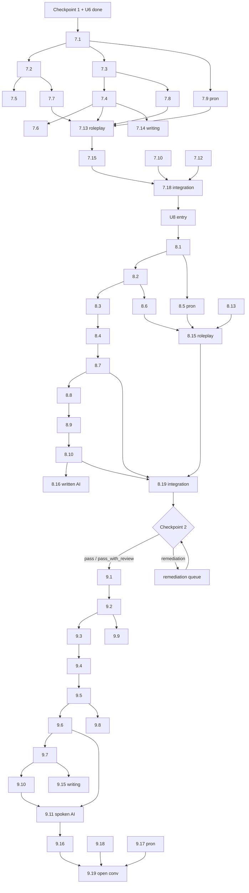

# Palavox Overhaul — Spanish for English Speakers — Early A2 Band (Units 7–9 + Checkpoint 2)

**Status:** WIP planning document — no app code changes.
**Direction:** Spanish for English speakers (designed for anglophone learners; NOT a mirror of the ESL course).
**Band scope:** Units 7–9 of the 12-unit skeleton, plus Checkpoint 2 (after U8).
**Band target level:** CEFR A2.1 (early A2); ACTFL Novice High consolidating → Intermediate Low emerging.
**Regional policy:** broadly useful Latin American standard — seseo, `ustedes` as the productive plural; `vosotros` receptive only, labeled "Spain"; major lexical variants flagged, not drilled.
**Date:** 2026-07-30.

Label conventions: **[proposed]** = design decision open to owner revision · **[assumption]** = depends on what earlier bands actually deliver · **[requires validation]** = needs data, SME review, or piloting.

---

## 0. Band-entry assumptions (contract with the late-A1 / U6 planner)

These must be true at band entry; if the upstream plan diverges, this band re-plans. **[assumption]**

- **Grammar in hand (productive):** present tense of regular -ar/-er/-ir; high-frequency irregulars (ser, estar, ir, tener, hacer, querer, poder, salir at least receptively); gustar + noun/infinitive; articles, gender, number agreement; basic adjective agreement/position; question formation (intonation + interrogatives); negation; `hay`; numbers 0–1000; time and dates; basic prepositions of place; basic `usted` forms receptively (from U4 directions).
- **Grammar in hand (receptive only):** simple `usted` commands for directions (siga, doble, cruce); `ir a + infinitive` may have been previewed as formulaic chunk ("voy a comer") but is NOT assumed productive — futures belong to U10.
- **Vocabulary in hand:** ~950–1,050 items/chunks (A1 ≈ 780 + U6 shopping/money ≈ 170). Includes money, prices, clothing/sizes, food, family, routines, places-in-town, directions basics.
- **Pronunciation in hand:** pure vowels introduced; syllable-timed rhythm; ñ, ll/y; question intonation; `rr` attempted but not mastered; accent-mark reading (á é í ó ú recognized as stress marks) introduced in A1 — this band makes accent literacy *productive* because the preterite depends on it.
- **Behavioral habits:** daily FSRS review habit; comfort with 1–2-turn AI micro-interactions in every lesson; has completed at least 4 guided spoken roleplays and Checkpoint 1.
- **Not yet available (deliberately out of this band):** imperfect tense (late A2), future forms beyond formulaic `voy a` chunks (U10), subjunctive (post-course), object-pronoun system beyond formulaic `me/te/le` in chunks (`me duele`, `me gusta`, `¿me puede…?`) **[proposed]** — full clitic paradigm is deferred to late A2/B1 tools; this band teaches the chunks, names the pattern, and does not drill the paradigm.

---

## 1. Refined unit definitions

### Unit 7 — «De aquí para allá» (Getting around: local transport & intercity travel)

**Theme:** using public transport, taxis/rideshare, and intercity buses/trains: tickets, schedules, delays, asking transport questions, reading signage.
**Rationale for refinement:** the skeleton's "Getting around (transport)" is kept, but scoped to *transactional survival travel* and explicitly builds on U4 (Places & directions) rather than re-teaching directions. Directions vocabulary is recycled, not re-introduced. **[proposed]**

**CEFR anchors (quoted from CEFR Companion Volume, 2020, A2 unless noted):**
- Transactions to obtain goods and services: *"Can get simple information about travel, use public transport (e.g. buses, trains and taxis), ask and give directions and buy tickets."*
- *"Can ask about things and make simple transactions in shops…"* (applied here to ticket windows and taxi negotiation).
- Understanding an interlocutor: *"Can understand enough to manage simple, routine exchanges without undue effort."*

**Unit can-do outcomes:**
- Interpretive (listening/reading): I can extract destination, time, platform/gate, and price from short, clearly articulated announcements, schedule boards, and transit signs. (CEFR A2 listening: *"…provided speech is clearly and slowly articulated."*)
- Interpersonal (spoken/written): I can buy the right ticket, ask which bus/train goes where, ask how long a trip takes, and handle a schedule change by asking simple clarification questions. (ACTFL NH→IL interpersonal: exchanges information on familiar topics using simple sentences, sometimes supported by memorized language.)
- Presentational (spoken/written): I can describe my trip plan (mode, times, transfers) in a short series of connected sentences, and write a short message telling someone when and how I will arrive.

**Key language use:** transactional; obtaining services; information questions; obligation (`tener que`, `hay que`).
**Content objective:** navigating Latin American transit realities (named variants: camión/guagua/colectivo; negotiated taxi fares; 24-hour schedules).
**Language objective:** obligation structures + movement prepositions + schedule questions, produced intelligibly with tapped/trilled r distinction emerging.

---

### Unit 8 — «Salud y necesidades» (Health & needs)

**Theme:** body, symptoms, pharmacy visits, medical appointments, giving/receiving simple advice, urgent needs.
**Rationale for refinement:** kept as-is; sequenced after transport because the pharmacy/clinic roleplays reuse U7's transactional skeleton (request → clarify → confirm) with higher personal stakes, and because `doler` extends the already-known `gustar` pattern. **[proposed]**

**CEFR anchors (CEFR CV 2020, A2):**
- *"Can communicate in simple and routine tasks requiring a simple and direct exchange of information on familiar and routine matters."* (Overall oral interaction)
- Asking for clarification: *"Can ask very simply for repetition when they do not understand."*
- Written interaction: *"Can write short, simple formulaic notes relating to matters in areas of immediate need."*

**Unit can-do outcomes:**
- Interpretive: I can understand a pharmacist's or receptionist's simple questions and instructions (dosage, frequency, appointment time) when spoken clearly, asking for repetition when needed.
- Interpersonal: I can describe my symptoms, say how long I've felt this way (formulaic `desde hace…`), answer triage questions, and make/change a medical appointment by phone-style chat.
- Presentational: I can give simple advice with `deber + infinitive` and write a short message canceling or rescheduling an appointment with a reason.

**Key language use:** describing states; requesting help; understanding instructions; register switching (tú ↔ usted).
**Content objective:** Latin American pharmacy culture (pharmacist as first-line care), emergency numbers differ by country **[requires validation]**.
**Language objective:** `doler`/`tener`-expressions/`estar`+state (deepening ser vs estar), formulaic reflexives (`me siento`), receptive usted commands from a clinician.

---

### Unit 9 — «¿Qué hiciste?» (Past experiences)

**Theme:** narrating yesterday/last weekend/a past trip; life events; reacting to and asking about other people's stories.
**Rationale for refinement:** kept as-is; the preterite is the band's summit and the single biggest grammatical jump for anglophones (conjugation density + stress-bearing endings). The unit deliberately recycles U2 (routines), U5 (food), U7 (travel) lexis into past-tense narration so ~70% of vocabulary is known and cognitive load lands on morphology. **[proposed]**

**CEFR anchors (CEFR CV 2020, A2):**
- Describing experience: *"Can describe past activities and personal experiences."*
- Overall spoken production: *"Can tell a story or describe something in a simple list of points."*
- Correspondence: *"Can write very simple personal letters expressing thanks and apology."* (applied to "sorry I missed it" messages).

**Unit can-do outcomes:**
- Interpretive: I can follow a short, clearly told anecdote about familiar topics and identify what happened, when, and in what order.
- Interpersonal: I can exchange weekend/trip stories, ask follow-up questions (¿adónde fuiste?, ¿con quién?, ¿qué pasó después?), and react naturally (¡no me digas!). (ACTFL IL interpersonal: *participates in conversations on familiar topics using simple sentences*.)
- Presentational: I can write and tell a 6–8 sentence connected past narrative using sequencers (primero, luego, después, al final).

**Key language use:** narration; interpersonal storytelling; repair and follow-up.
**Content objective:** storytelling as social glue; backchanneling norms in Latin American conversation.
**Language objective:** preterite regular + 8 high-frequency irregulars; accent-mark literacy as meaning-bearing (hablo/habló).

---

### ACTFL mode coverage matrix (band)

| Mode | U7 | U8 | U9 |
|---|---|---|---|
| Interpretive listening | announcements, transit app audio | triage/pharmacy dialogues | anecdotes, voicemails |
| Interpretive reading | signs, schedule boards, transit messages | labels, appointment confirmations | short narrative texts, social messages |
| Interpersonal spoken | ticket window, taxi, terminal roleplay | triage Q&A, pharmacy roleplay | story swap, follow-up questioning |
| Interpersonal written | schedule info-gap chat, arrival texts | reschedule chat with clinic | reacting to a friend's story in chat |
| Presentational spoken | describe trip plan | give simple advice | tell a weekend story |
| Presentational written | travel-plan message | cancellation note | connected past narrative |

---

## 2. Lessons per unit (core deliverable)

Core lesson estimated duration: 12–15 min (avg 13). Non-core items (cumulative reviews R, missions M, remediation X) are listed after each unit and do not count against the ~240-core-lesson budget. **[proposed]**

### Unit 7 — De aquí para allá (18 core lessons)

| # | Lesson | One-line objective |
|---|---|---|
| 7.1 | ¿Cómo vas? — modes of transport | Name common transport modes and say how you get places (`voy en metro`, `a pie`). |
| 7.2 | Ir, venir, volver | Conjugate and use ir/venir/volver in present to describe coming, going, returning. |
| 7.3 | Quisiera un boleto | Buy a ticket with the polite transactional frame `quisiera… / me da… por favor` + ida y vuelta. |
| 7.4 | Horarios y la hora de 24 | Ask and answer `¿A qué hora sale/llega?` and read 24-hour schedules. |
| 7.5 | ¿Cuánto tarda? | Use salir/llegar/tardar to talk about trip duration and departure/arrival. |
| 7.6 | Listening: en la estación | Extract destination, platform, and time from slow, clear station announcements. |
| 7.7 | Tener que / hay que | Express obligation about travel steps (`tienes que cambiar de línea en…`). |
| 7.8 | ¿Este autobús va a…? | Ask transport-help questions and deploy clarification chunks (`¿puede repetir?`, `más despacio`). |
| 7.9 | Pronunciation: pero/perro | Produce tapped r vs trilled rr in transport words; hear the contrast reliably. |
| 7.10 | Por aquí, hasta allá | Recycle U4 directions and extend with `por/hasta` + receptive usted commands (`siga por…`). |
| 7.11 | En taxi | State a destination, confirm the fare, and manage a short taxi exchange with numbers under pressure. |
| 7.12 | Se puede / no se puede | Read signs and rules with impersonal `se` (`no se puede fumar`, `se puede pagar con tarjeta`). |
| 7.13 | Roleplay: en la terminal (spoken AI) | Buy the correct intercity ticket while handling one level-appropriate complication. |
| 7.14 | Writing: llego a las ocho | Write a short arrival message (mode, departure/arrival time, one contingency). |
| 7.15 | Hay un retraso | React to delays/cancellations in the present tense and ask what to do next. |
| 7.16 | ¿Carro, coche o auto? | Recognize major transport lexical variants and pick one productive default (LatAm). |
| 7.17 | Listening: mensajes de viaje | Understand voicemail/app-style audio messages about pickups, delays, and meeting points. |
| 7.18 | Integration: plan the trip (info-gap) | Combine tickets, schedules, and obligation language to co-plan a trip with the AI partner. |

Non-core: **R7** cumulative review (60% U7 / 30% U6 / 10% A1 seed) · **M7** mission «Ruta real»: plan an actual route in a Spanish-speaking city with a real transit map, then explain it aloud · **X7.a/b** remediation variants (obligation structures; schedule numbers under time pressure).

### Unit 8 — Salud y necesidades (19 core lessons)

| # | Lesson | One-line objective |
|---|---|---|
| 8.1 | El cuerpo | Name 16 core body parts with correct gender and article. |
| 8.2 | Me duele la cabeza | Say what hurts using `me duele(n)` + definite article (not possessive), extending the gustar pattern. |
| 8.3 | Tengo fiebre | Describe symptoms with `tener` + noun (fiebre, tos, sueño, náuseas, frío/calor). |
| 8.4 | Estoy enfermo | Describe states with `estar` + adjective and sharpen the ser/estar boundary for health. |
| 8.5 | Pronunciation: la jota y la h muda | Produce /x/ (garganta, ojo, jarabe) and suppress English h in silent-h words (hospital, hombro). |
| 8.6 | En la farmacia | Ask for a remedy with `¿Tiene algo para…?` and understand basic pharmacist offers. |
| 8.7 | ¿Qué te pasa? / ¿Qué le pasa? | Answer triage questions and switch tú↔usted appropriately in medical settings. |
| 8.8 | Debes descansar | Give and receive simple advice with `deber + infinitive`. |
| 8.9 | Tome una cada ocho horas | Understand usted-command instructions (dosage, frequency) and produce 4 formulaic ones. |
| 8.10 | Una cita, por favor | Make a medical appointment: dates, times, spelling your name, confirming. |
| 8.11 | Listening: en el consultorio | Follow a clinic dialogue and pull out symptoms, instructions, and next appointment. |
| 8.12 | Me siento mal | Use formulaic reflexive `sentirse` (me siento / se siente) to report and ask about wellbeing. |
| 8.13 | ¿Desde cuándo? | Say how long symptoms have lasted with formulaic `desde hace + time` (receptive-first). |
| 8.14 | ¡Es urgente! | Handle urgent-need language: ask for help, state an emergency simply, understand instructions. |
| 8.15 | Roleplay: en la farmacia (spoken AI) | Describe symptoms, handle an out-of-stock complication, and confirm dosage aloud. |
| 8.16 | Writing: cambiar la cita (written AI) | Reschedule an appointment by chat: request, reason, propose new time, confirm. |
| 8.17 | Mi rutina y mi cuerpo | Extend reflexives to body-care routines (me acuesto, me levanto, me baño), recycling U2. |
| 8.18 | ¡Que te mejores! | Use sympathy/politeness formulas (lo siento, qué pena, que te mejores) at the right register. |
| 8.19 | Integration: la clínica (adaptive dialogue) | Chain triage → advice → appointment in one adaptive spoken interaction. |

Non-core: **R8** cumulative review (60% U8 / 30% U7 / 10% earlier) · **M8** mission «Botiquín»: build a labeled home first-aid vocabulary card set and voice-record a 60-second "what I have and why" · **X8.a/b** remediation (doler agreement; tú/usted switching).

### [Checkpoint 2 — after U8; see §12]

### Unit 9 — ¿Qué hiciste? (19 core lessons)

| # | Lesson | One-line objective |
|---|---|---|
| 9.1 | Ayer y hoy | Recognize past-time markers (ayer, anoche, la semana pasada) and the concept of the preterite. |
| 9.2 | Hablé, hablaste, habló | Conjugate regular -ar preterite with correctly stressed endings. |
| 9.3 | Accent literacy: hablo vs habló | Read and write accent marks as meaning-bearing (present vs preterite; papa/papá; esta/está). |
| 9.4 | Comí y viví | Conjugate regular -er/-ir preterite and contrast the shared endings. |
| 9.5 | ¿Qué hiciste ayer? | Ask and answer past questions with hacer (hice/hiciste/hizo) about yesterday. |
| 9.6 | Fui al cine | Use ir/ser preterite (fui, fuiste, fue) and disambiguate by context. |
| 9.7 | Primero, luego, después | Sequence a simple past narrative with ordering connectors. |
| 9.8 | Tuve y estuve | Use tener/estar preterite for past states and events (tuve un examen, estuve enfermo). |
| 9.9 | Llegué y busqué | Handle -car/-gar/-zar spelling changes and see why the spelling protects the sound. |
| 9.10 | Listening: la anécdota de Marta | Follow a 90-second past anecdote and order its events. |
| 9.11 | Guided Q&A: tu último viaje (spoken AI) | Answer and ask guided questions about a past trip, recycling U7 lexis in preterite. |
| 9.12 | Acabo de llegar | Express the immediate past with `acabar de + infinitive` (no new morphology). |
| 9.13 | Nací en… | Talk about life events (nací, crecí, conocí, me mudé) in a 4–5 sentence mini-bio. |
| 9.14 | No pude ir, lo siento | Decline/apologize about the past (no pude, no fui, tuve que) and give a simple reason. |
| 9.15 | Writing: mi fin de semana | Write a connected 60–80 word past narrative with at least three sequencers. |
| 9.16 | ¿Y qué pasó después? | Sustain someone else's story with follow-up questions (¿con quién?, ¿adónde?, ¿qué pasó?). |
| 9.17 | Pronunciation: comí, comió | Keep final stressed vowels pure (no English glide) so tense marking survives. |
| 9.18 | ¡No me digas! | React to stories with backchannels (¿en serio?, ¡qué bien!, ¡qué mal!) at natural points. |
| 9.19 | Integration: story swap (open conversation) | Hold a genuine two-way exchange of weekend stories with follow-ups and repair. |

Non-core: **R9** cumulative review (55% U9 / 30% U7–U8 / 15% A1–U6) · **M9** mission «Historias del fin de semana» (full contract in §13d) · **X9.a/b/c** remediation (preterite -ar endings; irregular set 1; accent placement).

**Band core total: 56 lessons** (18+19+19) — inside the owner's 16–22/unit guidance and consistent with ~120–150 A2 lessons across seven A2 units. **[proposed]**

---

## 3. Prerequisite graph

### Gating principles **[proposed]**
1. **Unit entry gates:** U7 requires Checkpoint 1 passed + U6 integration lesson complete + U6 vocab mastery ≥ 70% (FSRS retention on unit-tagged set). U8 requires 7.18 complete + skill_mastery(obligation) ≥ 0.6. U9 requires Checkpoint 2 outcome ∈ {pass, pass_with_review}.
2. **Within-unit spine:** lessons are sequenced, but only *hard* dependencies gate; others are advisory ordering so learners can interleave.
3. **Interaction gates:** every major roleplay/integration lesson is gated on the lessons whose language it consumes (listed below), not merely on position.
4. **Pronunciation lessons** gate the spoken interactions that depend on them, never written work.

### Hard dependencies



Advisory-only ordering (non-gating): 7.11, 7.16, 7.17 anywhere after 7.5; 8.12, 8.14, 8.17, 8.18 anywhere after 8.4; 9.12, 9.13, 9.14 anywhere after 9.6.

**Skill-level gates:** `skill_mastery` thresholds **[proposed]**: a lesson's grammar skill must reach ≥ 0.6 before dependent interaction lessons unlock; < 0.4 after two attempts triggers the unit's remediation variant (X-lessons) automatically (§11).

---

## 4. Vocabulary + lexical-chunk targets

### Counts per unit **[proposed]**

| Unit | New single lexemes | New multiword chunks | Total new | Recycled-under-load (from A1–U6) |
|---|---|---|---|---|
| U7 | 115 | 45 | 160 | ~120 (directions, numbers, time, places) |
| U8 | 125 | 45 | 170 | ~90 (routines, family, feelings) |
| U9 | 95 | 50 | 145 | ~180 (deliberately high: past-tense recycling) |
| **Band** | **335** | **140** | **475** | — |

Rationale: U9 introduces fewer lexemes because morphology carries the load and the unit's job is converting known words into past narration. Band contribution (475) keeps the course on track for ~1,850–1,950 total items, inside the owner's 1,800–2,200 envelope. The owner's count target is judged **right in magnitude but should be governed by frequency, not hit exactly** — see principles. **[proposed]**

### Selection principles
1. **Frequency-first with a communicative override:** default from a LatAm-weighted frequency list (e.g., Davies Corpus del Español bands 1–3 **[requires validation]** for licensing), overridden upward for scenario-critical low-frequency items (andén, jarabe) and downward for high-frequency items with no A2 job.
2. **Chunks are first-class citizens:** anything the learner needs whole-before-parsed (¿me puede repetir?, quisiera una cita) is stored as a vocabulary row with `is_chunk` **[proposed schema extension]** and drilled unanalyzed first.
3. **One productive default per variant set:** teach `boleto`, flag `billete (España)` receptively; never test variants productively.
4. **Cognate leverage with false-friend guards:** anglophone learners get cognates cheap (estación, hospital, medicina) — spend teaching time on false friends (embarazada, constipado [ES], asistir) and pronunciation of cognates (English speakers mangle stress).
5. **Every item ships with a natural example sentence at or below band level**, IPA, cefr_level, frequency_rank, and the `translation_l1` slot — for this direction, single-column `translation_l1` = English is sufficient (the multilingual limitation affects only the ESL direction).
6. **`doler`-class and `gustar`-class verbs are tagged with a pattern label** so review can interleave same-pattern items. **[proposed schema extension: `grammar_pattern` tag]**

### Sample list — Unit 7 (46 items; representative, not exhaustive)

`translation_l1` column shown as EN; POS uses existing `part_of_speech`; VAR = flagged regional variants (receptive).

| # | Item | POS/type | translation_l1 (EN) | IPA (LatAm) | Freq band | Notes |
|---|---|---|---|---|---|---|
| 1 | el autobús | n m | bus | /au̯.toˈβus/ | 1 | VAR: el camión (MX), la guagua (Carib.), el colectivo (AR) |
| 2 | el metro | n m | subway/metro | /ˈme.tɾo/ | 1 | |
| 3 | el tren | n m | train | /tɾen/ | 1 | tapped r cluster |
| 4 | el boleto | n m | ticket | /boˈle.to/ | 2 | VAR: el billete (ES), el pasaje |
| 5 | la estación | n f | station | /es.taˈsjon/ | 1 | cognate; stress on -ción |
| 6 | la parada | n f | (bus) stop | /paˈɾa.ða/ | 2 | intervocalic d = [ð] |
| 7 | el andén | n m | platform | /anˈden/ | 3 | scenario-critical despite freq |
| 8 | el aeropuerto | n m | airport | /a.e.ɾoˈpweɾ.to/ | 2 | vowel sequence drill |
| 9 | el vuelo | n m | flight | /ˈbwe.lo/ | 2 | b/v single phoneme |
| 10 | el taxi | n m | taxi | /ˈtak.si/ | 1 | |
| 11 | el carro | n m | car | /ˈka.ro/ | 1 | trilled rr; VAR: el coche (ES/MX), el auto (Cono Sur) |
| 12 | la bicicleta | n f | bicycle | /bi.siˈkle.ta/ | 2 | |
| 13 | a pie | chunk | on foot | /a ˈpje/ | 1 | no article — contrast EN "on foot" |
| 14 | el horario | n m | schedule/timetable | /oˈɾa.ɾjo/ | 2 | silent h |
| 15 | la salida | n f | departure; exit | /saˈli.ða/ | 1 | polysemy flagged |
| 16 | la llegada | n f | arrival | /ʝeˈɣa.ða/ | 2 | |
| 17 | el retraso | n m | delay | /reˈtɾa.so/ | 3 | |
| 18 | la línea | n f | line (metro/bus) | /ˈli.ne.a/ | 2 | |
| 19 | el viaje | n m | trip | /ˈbja.xe/ | 1 | jota |
| 20 | viajar | v | to travel | /bja.ˈxaɾ/ | 1 | |
| 21 | salir | v irreg (yo salgo) | to leave/depart | /saˈliɾ/ | 1 | |
| 22 | llegar | v | to arrive | /ʝeˈɣaɾ/ | 1 | |
| 23 | tardar | v | to take (time) | /taɾˈðaɾ/ | 2 | no EN cognate frame: "tarda 20 minutos" |
| 24 | tomar | v | to take (transport) | /toˈmaɾ/ | 1 | VAR: coger (ES only — usage warning, receptive) |
| 25 | cambiar (de línea) | v + chunk | to change (lines) | /kamˈbjaɾ/ | 2 | |
| 26 | subir(se) | v | to get on | /suˈβiɾ/ | 2 | formulaic reflexive |
| 27 | bajar(se) | v | to get off | /baˈxaɾ/ | 2 | formulaic reflexive |
| 28 | esperar | v | to wait (for) | /es.peˈɾaɾ/ | 1 | no "for": contrast EN |
| 29 | manejar | v | to drive | /ma.neˈxaɾ/ | 2 | VAR: conducir (ES) |
| 30 | la maleta | n f | suitcase | /maˈle.ta/ | 2 | |
| 31 | el equipaje | n m | luggage | /e.kiˈpa.xe/ | 3 | mass noun like EN |
| 32 | el asiento | n m | seat | /aˈsjen.to/ | 2 | |
| 33 | la puerta | n f (new sense) | gate (airport) | /ˈpweɾ.ta/ | 1 | sense extension of known word |
| 34 | próximo/a | adj | next | /ˈpɾok.si.mo/ | 1 | pre-noun position: la próxima parada |
| 35 | directo/a | adj | direct/nonstop | /diˈɾek.to/ | 2 | |
| 36 | lento/a · rápido/a | adj pair | slow · fast | — | 1 | |
| 37 | ¿A qué hora sale…? | chunk | What time does … leave? | — | — | schedule frame |
| 38 | ¿Cuánto tarda? | chunk | How long does it take? | — | — | |
| 39 | ¿Este autobús va a…? | chunk | Does this bus go to…? | — | — | survival question |
| 40 | Quisiera un boleto a… | chunk | I'd like a ticket to… | — | — | politeness frame (quisiera unanalyzed) |
| 41 | ida y vuelta | chunk | round trip | — | — | |
| 42 | solo ida | chunk | one way | — | — | |
| 43 | ¿Cuánto cuesta el pasaje? | chunk | How much is the fare? | — | — | recycles U6 cuesta |
| 44 | Hay que bajarse en… | chunk | You have to get off at… | — | — | impersonal obligation |
| 45 | ¿Me puede ayudar? | chunk | Can you help me? | — | — | usted register; me+puede unanalyzed |
| 46 | ¡Se me va el bus! | chunk | My bus is leaving! (receptive) | — | — | receptive color; not tested productively |

---

## 5. Grammar progression across the band

Ordered; each point tied to the communicative need that motivates it. English-contrastive notes inline (the anglophone-specific design mandate).

| # | Grammar point | Unit/lessons | Communicative need | English-contrastive note |
|---|---|---|---|---|
| G1 | ir/venir/volver present (full) | 7.2 | say how you come/go/return | EN "come/go" deixis differs: `venir` is speaker-anchored |
| G2 | `quisiera` + NP/inf (formulaic) | 7.3 | polite transactional requests | politeness by verb form, not "please" alone |
| G3 | `tener que` / `hay que` + inf | 7.7, 7.12 | obligations in travel steps | two obligation frames vs EN "have to"; `hay que` has no subject — subject-drop reinforcement |
| G4 | movement prepositions a/de/en/por/hasta | 7.5, 7.10 | routes, durations, endpoints | `en` for vehicles ("in the bus" trap); `por` ≠ "for" |
| G5 | impersonal `se puede` | 7.12 | rules/signs | EN passive/"you can" maps to subjectless `se` |
| G6 | `doler` (gustar-pattern) + definite article | 8.2 | say what hurts | inverse construction: *it-hurts-to-me*; body parts take `la/el`, never `mi` |
| G7 | `tener` + noun states | 8.3 | symptoms | EN "be hungry/cold" → ES "have hunger/cold" |
| G8 | `estar` + adjective states; ser/estar boundary deepened | 8.4 | health states | `soy enfermo` vs `estoy enfermo` meaning shift — highest-value ser/estar payoff so far |
| G9 | `deber` + inf | 8.8 | give/get advice | softer than EN "must"; no do-support in questions |
| G10 | usted commands (receptive; 4 productive formulas: tome, descanse, vuelva, llame) | 8.9, 8.14 | understand clinician/pharmacist instructions | imperative morphology previewed, not drilled — full command paradigm deferred **[proposed]** |
| G11 | formulaic reflexives: me siento, me acuesto, me levanto, me baño | 8.12, 8.17 | wellbeing + body routines | reflexive pronoun has no EN counterpart; taught as chunk-with-pattern-label |
| G12 | `desde hace` + time (formulaic, receptive-first) | 8.13 | symptom duration | EN present perfect "I've had it for…" maps to ES *present* — flagged explicitly |
| G13 | preterite regular -ar | 9.2 | narrate completed past | one EN "-ed" vs six person-marked forms; stress carries meaning |
| G14 | accent marks as morphology (hablo/habló) | 9.3 | write/read past correctly | EN has no orthographic stress; this is where accents stop being decoration |
| G15 | preterite regular -er/-ir | 9.4 | narrate completed past | shared -er/-ir endings reduce load — taught as one set |
| G16 | preterite irregulars set 1: hacer, ir/ser | 9.5–9.6 | ask/answer "what did you do / where did you go" | suppletion (fui) has EN parallel (go/went) — leveraged as analogy |
| G17 | sequencing connectors primero/luego/después/al final | 9.7 | ordered narrative | discourse glue; prevents "and… and…" narration |
| G18 | preterite irregulars set 2: tener, estar (+ver, dar receptive) | 9.8 | past states/events | u-stem pattern named once, not drilled as paradigm |
| G19 | -car/-gar/-zar spelling changes | 9.9 | write llegué/busqué correctly | orthography-protects-sound principle; ties to G14 |
| G20 | `acabar de` + inf | 9.12 | immediate past without morphology | free win: EN "just did" → present-tense frame |
| G21 | past negation/excuses: no pude, no fui, tuve que | 9.14 | apologize, decline, explain | poder in preterite meaning shift ("couldn't ≈ failed to") kept formulaic |

Explicitly **out of band**: imperfect (late A2 — narration background), full object-pronoun paradigm, future/conditional, present perfect (regional complexity; late A2 receptive **[proposed]**), subjunctive.

---

## 6. Pronunciation progression

Principle: intelligibility-first — targets are chosen where mispronunciation breaks meaning or marks speech as hard-to-parse, not for accent perfection. Each target gets: noticing → minimal-pair discrimination → controlled production (speaking exercises with ASR scoring) → carry-over check in the unit's roleplay. **[proposed]**

| Order | Target | Unit | Minimal pairs / items | Intelligibility rationale |
|---|---|---|---|---|
| P1 | tapped ɾ vs trilled r | 7.9 | pero/perro, caro/carro, coro/corro | lexical contrasts in high-freq words; carro/tren/retraso are unit-critical |
| P2 | b/v single phoneme | 7 (embedded 7.1, 7.11) | tubo/tuvo (homophones — proof b=v), vuelo, viaje | stops EN /v/ labiodental habit; hearing side prevents phantom distinctions |
| P3 | jota /x/ | 8.5 | jarabe, ojo, garganta, gente | EN /dʒ/ or /h/ substitution garbles core health vocab |
| P4 | silent h | 8.5 | hospital, hombro, hora, hasta | EN /h/ insertion is a strong foreign-accent marker in exactly the survival words |
| P5 | tú/usted question intonation + softening | 8.7, 8.18 | ¿Qué le pasa? vs statement | register + question marking without do-support rests on intonation |
| P6 | intervocalic d = [ð] | 8 (embedded 8.1, 8.2) | cada, nada, mareado, parada | full [d] is parseable but heavy; light-touch target **[proposed]** |
| P7 | word-final stressed vowels, pure (no glide) | 9.17 | comí, comió, llegué, habló; -ó ≠ EN "oh" [oʊ] | THE band-critical target: diphthongized -ó/-é smears the preterite/present contrast |
| P8 | stress placement as morphology | 9.3 + 9.17 | hablo/habló, esta/está, papa/papá | wrong stress = wrong tense; pairs P8 with accent-mark literacy |
| P9 | linking & rhythm in narration | 9.19 warm-ups | fui-al-cine, qué-hiciste | syllable-timed delivery keeps narratives followable |

ASR scoring policy **[requires validation]**: score P1, P3, P7, P8 as gateable (min threshold to pass speaking exercises); P2, P4, P6, P9 as feedback-only. Thresholds tuned on pilot data; never block progress on accent features that don't impair intelligibility.

---

## 7. Listening progression

| Stage | Unit | Text types | Speed / delivery | Support | Tasks |
|---|---|---|---|---|---|
| L1 | U7 early | scripted 2-line exchanges; single announcements | ~110–120 wpm, studio-clear, LatAm neutral | 2 listens + transcript after | pick data (time/platform/price); binary + MC |
| L2 | U7 late | station announcements with light noise; voicemails | ~120–130 wpm; one Mexican + one Colombian voice | 2 listens, no transcript until after task | extract 3 fields into a form; detect the changed detail |
| L3 | U8 | service dialogues (pharmacy, triage) 45–90 s | ~125–135 wpm; natural hesitations added | 1 listen + optional replay of hard segment | follow instructions (dosage grid); answer triage-content MC; spot tú vs usted |
| L4 | U9 | first-person anecdotes 60–120 s; friend voicemail about a past event | ~130–140 wpm; mild Caribbean sample introduced receptively **[proposed]** | 1 listen; replay costs a "hint" (analytics-tracked) | order events; who/where/when grid; choose the natural reaction |
| L5 | band exit (R9, CP2) | mixed: announcement + dialogue + anecdote chained | mixed speeds | checkpoint conditions (defined replays) | integrated comprehension across text types |

Accent policy: core input remains a broadly neutral LatAm standard; by U9 learners have *heard* Mexican, Colombian, and one Caribbean-lite voice, satisfying "intelligible accented speech" at band-appropriate difficulty. Peninsular /θ/ appears once, labeled, receptive only. **[proposed]**

---

## 8. Writing progression

| Stage | Unit | Task type | Length | Focus |
|---|---|---|---|---|
| W1 | 7.14 | arrival/travel text message | 25–40 words | formulaic frames + times; capitalization/punctuation differences (¿ ¡) |
| W2 | 7.18 | trip-plan note (info-gap output) | 30–50 words | obligation + schedule data accuracy |
| W3 | 8.10/8.16 | appointment request + reschedule chat | 30–50 words/turn set | register (usted), dates, courtesy formulas |
| W4 | 8.18 | sympathy/thanks note | 20–35 words | CEFR A2 correspondence: *"very simple personal letters expressing thanks and apology"* |
| W5 | 9.15 | connected past narrative | 60–80 words | preterite accuracy + 3 sequencers + one `porque` |
| W6 | 9.16/9.19 | written reactions + follow-up questions in chat | turn-level | interactional writing: questions, backchannels |

Accent-mark policy in scoring **[proposed]**: through U8, missing accents are flagged-not-failed; from 9.3 onward, tense-bearing accents (habló, comí, llegué) are scored as errors (meaning-changing), while non-tense accents remain flagged-only. This operationalizes accent literacy without blanket punitiveness.

---

## 9. Speaking progression & embedded AI interaction plan (ratios: 40–50% / 35–45% / 10–20%)

### Band engagement mix **[proposed]**

| Unit | Structured | Guided interaction | Open conversation |
|---|---|---|---|
| U7 | 47% | 40% | 13% |
| U8 | 45% | 40% | 15% |
| U9 | 42% | 40% | 18% |
| Band avg | ~45% | ~40% | ~15% |

Structured = drills, flashcards, cloze, dictation, FSRS review, listening tasks. Guided = controlled dialogue completion, guided Q&A, info-gap, scaffolded roleplay. Open = adaptive conversation with genuine information exchange and learner-initiated turns (9.19, missions, checkpoint interpersonal task).

### Micro-interaction rule
Every core lesson ends with a 1–2-turn AI micro-interaction (written or spoken, alternating) using that lesson's target language — e.g., after 7.4 the AI asks «¿A qué hora sale tu tren?» and the learner answers from a shown schedule. Cost-light (single exchange, tight system prompt). **[proposed]**

### Per-unit embedded AI interactions (each unit has BOTH written and spoken)

**U7**
- Written: (a) 7.8-adjacent chat info-gap — learner must obtain three schedule facts from an AI "taquilla" agent by asking questions; (b) 7.14 arrival-message task with AI replying once with a complication ("ese día no puedo, ¿y el jueves?") requiring one adaptive rewrite.
- Spoken: (a) 7.13 terminal roleplay (guided, complication: requested departure sold out); (b) 7.18 spoken info-gap trip planning (learner and AI each hold half the schedule); micro speech drills in 7.3/7.11 (say destination + confirm price against ASR).

**U8**
- Written: (a) 8.16 reschedule chat (full contract §13b); (b) 8.10 short appointment-request form+message hybrid.
- Spoken: (a) 8.7 guided triage Q&A (AI doctor asks fixed question set, adapts follow-up once per answer); (b) 8.15 pharmacy roleplay (full contract §13c); (c) 8.19 adaptive clinic chain (triage → advice → booking) — the band's hardest guided task.

**U9**
- Written: (a) 9.15 narrative submitted to AI "reader" who asks two follow-up questions in chat; learner answers in past tense; (b) 9.16 chat reacting to the AI's story with backchannels + questions.
- Spoken: (a) 9.11 guided Q&A on a past trip; (b) 9.19 open story-swap conversation (min 8 learner turns, genuine two-way); (c) M9 mission (§13d).

### Scaffolding gradient across the band **[proposed]**
- U7: response frames visible by default; AI speaks at L2 listening speed; retry buttons on every turn.
- U8: frames collapse behind a hint button; AI introduces one unexpected-but-level-appropriate turn per roleplay; learner must use a clarification chunk at least once (engineered by design: one AI turn is deliberately fast/quiet, "repair moment").
- U9: no frames in open tasks; hints cost analytics-tracked "assists"; AI backchannels and expects learner follow-ups; breakdown-repair is a scored criterion, not just a support.

---

## 10. Cultural & pragmatic content (woven in, never standalone-tested)

| Where | Content |
|---|---|
| 7.3, 7.11 | Politeness economy of transactions: `quisiera`, `me da… por favor`, `¿me puede…?`; bare imperatives sound rude from strangers — softening is the anglophone's cheapest likability win. |
| 7.11 | Taxi culture: confirming fare before departure where meters are uncommon; rideshare naming norms. **[requires validation per city]** |
| 7.16 | Variant awareness as cultural literacy: camión (MX city bus), guagua, colectivo; `coger` usage warning (ES vs LatAm) handled factually, receptively. |
| 8.6 | Pharmacist as first-line healthcare in much of Latin America; asking the pharmacist directly is normal, not presumptuous. |
| 8.7 | tú/usted switching: default usted with clinicians/elders; accept invitations to tutear; the AI models both and the lesson names the rule. |
| 8.14 | Emergency numbers differ by country (e.g., 911 MX, 123 CO) — taught as "know your country's number." **[requires validation]** |
| 8.18 | Sympathy scripts: `¡que te mejores!`, `lo siento mucho`, `¡qué pena!` — and that `¡qué pena!` shades toward "how embarrassing" in some regions (flag, don't drill). |
| 9.18 | Backchanneling norms: Spanish conversation expects audible engagement (¿en serio?, ¡no me digas!); silence reads as disinterest — direct contrast with anglophone listening habits. |
| 9.13 | Life-event small talk: where you were born/grew up is normal early-acquaintance material; models comfortable disclosure at A2 level. |
| Throughout | Written pragmatics: opening/closing formulas for messages (Hola + name, saludos, gracias de antemano-lite), emoji-register in chat tasks. |

---

## 11. Review scheduling & remediation

### Touchpoints **[proposed]**
1. **FSRS daily queue** (existing `vocab_card_state`): all new items enter at first productive exposure; chunks scheduled like lexemes; `grammar_pattern`-tagged items interleave (never two `doler`-class cards adjacent).
2. **In-lesson warm-up:** every core lesson opens with 2 FSRS-due items biased toward that lesson's assumed vocabulary (pre-activation, not testing).
3. **Cumulative reviews R7/R8/R9** after each unit: 20 min, mixed-skill, composition 60/30/10 (current/previous/older) — R9 shifts to 55/30/15 to pull A1 material forward before the late-A2 band.
4. **Past-tense conversion recycling (U9-specific):** R9 and U9 warm-ups systematically re-present U2/U5/U7 vocabulary inside preterite frames — old words, new morphology.
5. **Checkpoint 2 doubles as a cumulative review event**; its item bank draws 30% from U6-and-earlier.
6. **Error-fed review:** saved error categories from AI interactions (§13 contracts) inject targeted cards/micro-drills into the FSRS queue within 24h. **[proposed schema extension: `error_log(category, source_interaction, lesson_id, resolved)`]**

### Remediation rules for the band **[proposed]**
- **Trigger A (skill):** `skill_mastery` < 0.4 after two attempts at any gating lesson → auto-assign the unit's matching X-lesson variant (same objective, new items, heavier scaffolding); the original lesson unlocks after the X-lesson.
- **Trigger B (vocab):** FSRS lapse rate > 40% on a unit's tagged set at unit end → "rescue set" of the 15 weakest items with example-sentence-first re-presentation.
- **Trigger C (interaction):** two consecutive AI-interaction failures (per failure handling in contracts) → route to the feeding controlled lessons, not to repetition of the interaction.
- **Trigger D (pronunciation):** gateable ASR target (P1, P3, P7, P8) below threshold twice → targeted minimal-pair micro-drill; never blocks written progress.
- **Ceiling:** remediation inventory per unit is 2–3 X-lessons; beyond that, the system surfaces "review with different modality" rather than more of the same. Median-learner remediation budget ≈ 60 min/band (planning estimate).

---

## 12. Checkpoint 2 design (after U8)

**Purpose:** verify the learner can *do things* with U7–U8 language before the preterite raises the stakes. Proficiency evidence comes only from performance — never XP, streaks, completion, or time.

**Format:** ~35 min, 3 tasks, all machine- or rubric-scored. **[proposed]**

| Task | Mode | Content | Scoring |
|---|---|---|---|
| T1 Interpretive (10 min) | listening + reading | (a) station announcement → extract 3 fields; (b) pharmacy dialogue → dosage grid; (c) read appointment-confirmation message + sign with `se puede` | auto-scored; ≥ 7/10 items |
| T2 Interpersonal spoken (15 min) | adaptive AI roleplay chain | travel problem (missed connection) → pharmacy visit (headache after travel); includes one engineered repair moment and one register switch (stranger→usted) | rubric, 4 criteria × 0–3: task completion; comprehensibility (intelligibility, not accent); comprehension/repair (uses clarification chunk appropriately); language control (obligation frames, doler/tener/estar states). Pass = ≥ 2 on every criterion. |
| T3 Presentational written (8 min) | message | 40–60 word message: cancel an appointment, give a reason, propose alternative, close politely | rubric 0–3 × 3: task/content, register/formulas, accuracy (accents flagged-not-failed at this point) |

**Evidence gates (prerequisites to attempt):** U7+U8 integration lessons complete; FSRS retention ≥ 75% on the U7–U8 high-utility tagged subset (~120 items); skill_mastery ≥ 0.6 on G3, G6, G7, G8. **[proposed]**

**Pass logic → outcomes:**
- **pass:** all three tasks at threshold → unlock U9.
- **pass_with_review:** T2 or T3 has exactly one criterion at 1 → unlock U9 + mandatory targeted review queue (error categories from the checkpoint feed it); re-check embedded in R9.
- **remediation:** any task below threshold → auto-generated remediation path (specific X-lessons + weakest-skill drills), retake after completion. Max 2 retakes with fresh item forms; after that, alternate-evidence route (asynchronous portfolio: 3 recorded tasks reviewed against the same rubric) so no learner is hard-walled. **[proposed]**

**Analytics captured:** per-criterion rubric scores, repair-attempt count and success, assist usage, response latency, error categories → drives U9 personalization (e.g., weak doler-agreement → U9 warm-ups bias to it).

---

## 13. Fully-specified samples

### 13a. Complete lesson — 8.2 «Me duele la cabeza»

```
lesson_id: es-a2-u8-l02          status: draft
unit: U8  skill: grammar (vocab co-tagged)  est_total: 13 min
prereqs: 8.1 complete; A1 gustar skill_mastery ≥ 0.6
new_vocab_map: doler(v, pattern:gustar-class), la garganta, la espalda, el estómago,
  el dolor, "me duele la cabeza"(chunk), "¿qué te duele?"(chunk), "un poco / mucho"(chunk)
recycled_under_load: la cabeza, el pie/los pies, la mano (8.1); me gusta (A1)
pronunciation_focus: P6 intervocalic d in "duele" onset cluster; seseo in "cabeza"
```

**intro_md (abridged):**
> En español, las cosas te duelen *a ti* — el verbo funciona como «gustar»: **Me duele la cabeza** (literalmente: "the head hurts to-me"). Dos reglas que el inglés no tiene: (1) el verbo concuerda con *lo que duele* — `duele` (una cosa), `duelen` (dos o más); (2) usa **el/la/los/las**, no "mi": *Me duele **la** cabeza*, no ~~mi cabeza~~.

**Exercises (12 items, ~11 min + intro 2 min):**

| # | Type | R/P | Diff | Prompt | Options (✓=key) + rationale | Vocab map | Est s |
|---|---|---|---|---|---|---|---|
| E1 | flashcard | R | 1 | «me duele la cabeza» (audio + card) | reveal: "my head hurts" — note: article, not possessive | chunk:me-duele-la-cabeza | 20 |
| E2 | flashcard | R | 1 | «la garganta» (audio) | reveal: "throat" — jota preview: /gaɾˈɣan.ta/ | garganta | 20 |
| E3 | flashcard | R | 1 | «la espalda» (audio) | reveal: "back (body)" — guard: NOT "shoulder" (el hombro) | espalda | 20 |
| E4 | flashcard | R | 2 | «el dolor» (audio) | reveal: "pain" — noun vs verb doler | dolor | 20 |
| E5 | listening_mc | R | 2 | Audio: «Me duelen los pies.» — What hurts? | ✓ feet ("duelen"+plural article) · foot (misses plural agreement) · head (wrong item) · hands (plausible plural, wrong item — trains listening to the noun, not just the verb) | doler, pies | 35 |
| E6 | matching | R | 2 | Match: me duele / me duelen / el estómago / la garganta | ✓ me duele↔+singular · me duelen↔+plural · el estómago↔stomach · la garganta↔throat; rationale: agreement is with the body part | doler, estómago, garganta | 45 |
| E7 | cloze | P | 2 | «Me ___ la garganta.» | ✓ duele (la garganta = singular subject) · duelen (plural agreement error — most common EN-speaker slip) · dolor (noun, needs verb) | doler, garganta | 30 |
| E8 | cloze | P | 3 | «Me duelen ___ pies.» | ✓ los (Spanish uses definite article with body parts) · mis (grammatical but unnatural — the EN-transfer trap; rationale teaches the norm, marks "almost") · el (number agreement) | doler, pies | 30 |
| E9 | ordering | P | 3 | Order: [duele] [me] [mucho] [la] [espalda] | ✓ «Me duele mucho la espalda.» rationale: clitic `me` first; intensifier before the subject NP is the neutral order | doler, espalda, chunk:mucho | 40 |
| E10 | dictation | P | 3 | Audio: «¿Te duele el estómago?» — type what you hear | key: exact string; tolerance: missing ¿ ¡ flagged-not-failed; «duele/duelen» error = fail with rationale | doler, estómago | 50 |
| E11 | translation | P | 3 | EN→ES: "My feet hurt." | ✓ «Me duelen los pies.» accept: «A mí me duelen los pies.» reject+rationale: «Mis pies duelen» (word-for-word transfer — understandable but non-native; shows the inverse pattern again) | doler, pies | 40 |
| E12 | speaking | P | 3 | Image: figure with highlighted head. «Di qué te duele.» | target: «Me duele la cabeza.» ASR keys: duele (not duela/dolé), cabeza with /s/ (seseo), pure final -a; feedback tiers: exact / intelligible-with-note / retry | chunk:me-duele-la-cabeza | 45 |
| E13 | dialogue | P | 4 | Controlled completion, pharmacy opener (text+audio): Farmacéutico: «Buenas, ¿qué le pasa?» → learner slot 1 → «¿Le duele mucho o un poco?» → learner slot 2 | slot 1 key: any well-formed «Me duele(n) + body part»; slot 2 key: «(Me duele) mucho/un poco». AI micro-turn follows: one recast if slot has agreement error, then closes: «Tome agua y descanse.» (previews 8.9 receptively — permitted unfamiliar language, glossed on tap) | doler + unit chunks | 90 |

Timing total ≈ 8.1 min exercises + 2 min intro + ~2 min micro-interaction/feedback = **~12–13 min**. Mastery effects: success on E7–E12 initializes `skill_mastery(G6)` and enters the 8 new items into FSRS as productive cards; E5–E6 alone enter them receptive-only.

---

### 13b. Written AI interaction spec — 8.16 «Cambiar la cita» (full contract)

```yaml
interaction_id: es-a2-u8-w01
mode: written (async-paced chat, mobile-keyboard friendly)
lesson: 8.16   type: transactional chat roleplay
communicative_objective: >
  Reschedule an existing medical appointment by chat: state the problem, give a
  simple reason, propose/accept a new time, confirm, and close politely (usted).
curriculum_context: >
  Late U8. Consumes 8.10 (appointment language), 8.7 (usted register), 8.3/8.4
  (reason: symptoms/states), U7 dates-times under load. Feeds Checkpoint 2 T3.
assumed_vocabulary: cita, doctor(a), consultorio, cambiar, cancelar, "quisiera cambiar
  mi cita", days/dates/hours (A1+U7), "no puedo", "¿tiene algo el jueves?",
  gracias/disculpe formulas, tener+symptom set.
target_grammar: quisiera + inf (G2 reuse); tener que (G3); tener+noun reason (G7);
  usted verb forms in comprehension; question formation for alternatives.
target_pronunciation: n/a (written) — orthography targets instead: ¿?/¡!, date format,
  accents flagged-not-failed (pre-9.3 policy).
permitted_unfamiliar_language: AI may use up to 2 out-of-list items per conversation
  IF cognate-transparent or tap-glossed (e.g., "disponible", "confirmar"). Never
  unfamiliar grammar above band (no subjunctive lures like "quiere que venga" —
  AI phrasing constrained to band grammar).
scaffolding_rules: >
  Turn-1 frame visible ("Hola, quisiera cambiar mi cita del [día]…"). Later frames
  behind a hint button (each use logged as assist). If learner stalls >45s, AI sends
  a natural nudge question, not the answer.
expected_ai_behavior: >
  Persona: Marisol, clinic receptionist; warm-professional usted. 6–9 total turns.
  Must: acknowledge, ask ONE clarifying question (reason OR preferred day — not both
  at once), offer two concrete slots, handle one learner counter-proposal, confirm
  with full date-time echo, close. One engineered complication: first proposed slot
  conflicts ("a esa hora el doctor no está"). Never breaks character; meta-help only
  via the hint UI, not in-chat.
correction_rules: >
  Priority per owner spec: (1) understanding-blocking errors → in-flight concise
  recast inside a natural confirmation ("¿El martes 12 a las 10, verdad?"); (2)
  current targets (quisiera-frame, usted consistency) → recast once, then log; (3)
  repeated high-value (date format, tener-reason) → log only; (4) n/a (written).
  Full feedback AFTER: max 3 items, each = learner line → model line → one-line why.
success_criteria: >
  Task: new appointment agreed and confirmed with correct day+time echoed by learner.
  Language: ≥1 well-formed quisiera-request; usted maintained (≤1 slip); reason given.
  Interaction: responded to complication without abandoning task.
mastery_effects: >
  Success updates skill_mastery(G2,+G3 if used) and marks chunk set "citas" productive;
  partial success (task done, language criteria missed) = no mastery credit, review
  cards injected instead.
saved_error_categories: [register_slip_tu_usted, date_time_form, request_frame_error,
  article_gender, EN_transfer_word_order, accent_omission(meaning_safe)]
review_behavior: >
  Logged errors spawn FSRS micro-cards within 24h (max 4/conversation to avoid queue
  flooding); register slips additionally bias 8.18 warm-up selection.
analytics: turns, learner-initiated questions, assist count, latency/turn, complication
  outcome, error-category counts, completion state.
failure_handling: >
  Fail = task not completed in 12 learner turns or learner opts out. First fail →
  replay with heavier scaffolding (frames pinned). Second fail → route to 8.10 redo
  + X8.b, interaction re-unlocks after. Never a third identical attempt (Trigger C).
cost_expectations: >
  Single lightweight model, ~8 short turns, constrained persona prompt ≈ 2–3k tokens
  total context; no audio. Est. <$0.01/session at current pricing. [requires validation]
```

---

### 13c. Spoken AI interaction spec — 8.15 «En la farmacia» (full contract)

```yaml
interaction_id: es-a2-u8-s02
mode: spoken (real-time voice, ASR + TTS), 4–6 min
lesson: 8.15   type: scaffolded roleplay with complication
communicative_objective: >
  Obtain a remedy at a pharmacy: describe symptoms, answer two pharmacist questions,
  handle an out-of-stock complication, and confirm dosage instructions aloud.
curriculum_context: >
  Consumes 8.2 (doler), 8.3 (tener+symptom), 8.5 (jota/silent-h words), 8.6
  (¿Tiene algo para…?), 8.13 (desde hace, receptive). Rehearses Checkpoint 2 T2.
assumed_vocabulary: pharmacy set (jarabe, pastillas, algo para), symptom set,
  body parts, "¿cuánto cuesta?" (U6), clarification chunks ("¿puede repetir?,
  más despacio, ¿qué significa…?").
target_grammar: doler agreement (G6); tener+noun (G7); understanding usted commands
  (G10 receptive: "tome una cada ocho horas").
target_pronunciation: P3 jota (jarabe, ojo); P4 silent h (hombro, hasta); P1 carry-over
  (garganta cluster r). ASR gate on P3 only; others feedback-only.
permitted_unfamiliar_language: >
  AI may use "receta" (prescription) and "cada ocho horas" pattern even if unseen —
  both are mission-critical comprehension targets; tap-gloss available post-hoc in
  transcript review, not live.
scaffolding_rules: >
  Pre-task 30s: symptom card shown (learner's "condition": headache + sore throat,
  since yesterday). No visible frames during. One "lifeline" button (AI repeats
  slower) — unlimited but logged. Speech speed: 125 wpm, drops to 110 after any
  lifeline for the next turn only.
expected_ai_behavior: >
  Persona: don Rafael, pharmacist, kind, uses usted. 8–10 turns. Script skeleton:
  greet+¿qué le pasa? → follow-up (¿desde cuándo? or ¿le duele mucho?) → recommend
  product → COMPLICATION: it's out of stock, offers alternative (jarabe vs pastillas)
  → learner must choose/ask price → dosage instruction → asks learner to repeat it
  back ("¿me repite cómo lo va a tomar?") → close. Complication is mandatory; AI
  waits through silences up to 8s before nudging.
correction_rules: >
  (1) understanding-blocking (wrong body part, unintelligible symptom) → in-flight
  clarification-as-recast ("¿La garganta, dice?"); (2) lesson targets doler/tener
  agreement → one concise recast max, then log; (3) repeated high-value → log; (4)
  intelligibility-affecting pronunciation (jota as /dʒ/, inserted /h/) → recast by
  natural repetition of the word once, log always. Fuller feedback after: transcript
  with ≤4 highlights, each replayable with model audio.
success_criteria: >
  Task: leaves with a product + states dosage back correctly (the repeat-back is the
  comprehension proof). Language: ≥2 well-formed symptom statements (one doler, one
  tener); handled complication verbally (not by lifeline alone). Interaction: used a
  clarification chunk if (and only if) breakdown occurred — engineered fast turn
  guarantees one opportunity.
mastery_effects: >
  Success → skill_mastery(G6,G7)+; P3 ASR pass recorded; pharmacy chunk set marked
  productive; counts as the "spoken interaction" evidence row for U8.
saved_error_categories: [doler_agreement, tener_estar_confusion, jota_substitution,
  h_insertion, clarification_chunk_missing_at_breakdown, dosage_comprehension_fail]
review_behavior: >
  dosage_comprehension_fail → 8.9 micro-redo injected next session; pronunciation
  categories → P3/P4 minimal-pair micro-drill in next 2 warm-ups.
analytics: turn latency, lifeline count, ASR confidence per target word, complication
  resolution path, repeat-back accuracy, total speaking seconds (target ≥90s learner
  speech).
failure_handling: >
  Fail = repeat-back wrong twice or task abandoned. First fail → guided replay: same
  scenario, AI slower + frames on screen. Second fail → route to 8.6 + 8.9 redo
  (Trigger C), then re-unlock. Anxiety valve: learner may switch one attempt to
  written mode; logged, does not satisfy the spoken-evidence requirement. [proposed]
cost_expectations: >
  Real-time voice session ~5 min: ASR+TTS+LLM ≈ $0.05–0.12/session depending on
  stack. [requires validation] Budget assumption: ≤2 attempts/learner median.
```

---

### 13d. Conversation mission — M9 «Historias del fin de semana» (full contract)

```yaml
mission_id: es-a2-u9-m01
mode: spoken, open conversation (adaptive), 8–10 min; optional real-world extension
placement: after 9.16; feeds graduation-conversation readiness metrics
communicative_objective: >
  Hold a genuine two-way story exchange: tell your own weekend/past-event story
  (4+ connected utterances), elicit the partner's story with at least three
  follow-up questions, react naturally, and repair at least one breakdown.
curriculum_context: >
  Capstone of U9 interpersonal strand. Consumes G13–G21, sequencers (9.7),
  follow-up questions (9.16), backchannels (9.18), P7/P8 pronunciation.
assumed_vocabulary: full U9 set + recycled U2/U5/U7 activity lexis in preterite;
  reaction chunks (¿en serio?, ¡no me digas!, ¡qué bien/mal!).
target_grammar: preterite regulars + irregular sets 1–2 in free production;
  sequencers; past questions (¿qué hiciste?, ¿adónde fuiste?, ¿qué pasó después?).
target_pronunciation: P7 final stressed vowels (comí/comió) — ASR-monitored, feedback
  only (no gate in open conversation to protect fluency). P8 stress monitored.
permitted_unfamiliar_language: >
  AI story includes up to 3 unknown-but-guessable items (cognates or picture-context)
  to exercise tolerance of ambiguity; one is deliberately clarifiable ("¿qué
  significa madrugada?") to invite a repair move. No above-band grammar except one
  formulaic imperfect scene-setter ("estaba en casa…") — receptive seed for late A2,
  glossed in post-transcript. [proposed]
scaffolding_rules: >
  Open mode: no frames, no visible hints. "Assist" long-press gives an English→ES
  chunk suggestion (max 3; each logged and reduces the autonomy score, never blocks
  completion). Pre-task 60s planning screen: learner picks their story skeleton
  (3 event icons) — planning is allowed, scripting is not (no text entry).
expected_ai_behavior: >
  Persona: Cami, a friendly peer (tú register — contrast with U8 usted world; the
  register shift is named in the pre-task card). Genuinely reciprocal: shares own
  36–60s story in 2 installments, pauses for reactions, asks the learner 2–3
  follow-ups, answers learner questions with new information (real information
  exchange, not quiz behavior). Adapts topic to learner's stated interests from
  profile. Tolerates errors silently unless understanding-blocking.
correction_rules: >
  In-flight: ONLY priority-1 (understanding-blocking) as natural clarification
  ("¿Fuiste o vas a ir?" — which doubles as tense-repair modeling). All p2/p3/p4
  deferred entirely to post-conversation review: max 5 highlights, grouped by
  category, each with model audio; preterite-accent errors (habló/hablo class)
  always included if present (band-critical).
success_criteria: >
  Task: both stories exchanged; ≥3 learner follow-up questions; ≥1 successful repair
  (either direction); ≥8 learner turns; ≥120s cumulative learner speech.
  Language: ≥6 distinct preterite forms across ≥2 conjugation classes; ≥2 sequencers.
  NOT criteria: accent perfection, zero errors, vocabulary breadth.
mastery_effects: >
  Success sets the U9 interpersonal evidence flag (a graduation prerequisite),
  updates skill_mastery(G13–G16) from free-production evidence (weighted higher
  than drill evidence [proposed]), and unlocks the optional real-world extension.
real_world_extension: >
  Optional, unscored: send a voice note (or have a 5-min chat) with a real
  Spanish-speaking partner (tandem feature/community) telling the same story; learner
  self-reports one thing that worked and one that broke down. App provides the frame,
  never the claim: extension never affects proficiency records. [proposed]
saved_error_categories: [preterite_ending_wrong_person, present_for_past_substitution,
  stress_final_vowel, sequencer_missing, question_formation_past, avoidance_of_irregulars]
review_behavior: >
  present_for_past_substitution (the classic anglophone fallback) → next 3 sessions'
  warm-ups become convert-to-past micro-drills; avoidance_of_irregulars (detected via
  zero irregular tokens despite opportunities) → 9.6/9.8 booster cards.
analytics: learner speech seconds, turn count, follow-up-question count, repair events,
  assist usage, preterite token diversity, topic drift tolerance, enjoyment
  self-report (1 tap) — mission NPS feeds curriculum iteration. [proposed]
failure_handling: >
  No hard fail on a mission: incomplete run → "continue the story" resume once; a
  second incomplete → mission shrinks to guided mode (frames on) and completion in
  guided mode is recorded as guided-level evidence only. Tech failure (ASR/network)
  never recorded as learner failure.
cost_expectations: >
  ~9 min voice adaptive session ≈ $0.10–0.20 [requires validation]; capped at 2 full
  runs + 1 resume per learner in base plan assumptions.
```

---

## 14. Band totals

| Metric | Value |
|---|---|
| Units | 3 (U7, U8, U9) + Checkpoint 2 |
| Core lessons | 56 (18 + 19 + 19) |
| Non-core: cumulative reviews / missions / remediation variants | 3 / 3 / 7 |
| New vocabulary (lexemes + chunks) | 475 (335 + 140) |
| Grammar points | 21 (G1–G21) |
| Pronunciation targets | 9 (P1–P9) |

**Estimated engagement minutes (planning estimates, never a guarantee):**

| Activity type | Minutes | Notes |
|---|---|---|
| Core lessons (incl. embedded micro-interactions) | ~730 | 56 × ~13 min |
| Spaced review (FSRS) | ~440 | ~8 min/day × ~55 active days |
| Guided speaking (major roleplays + guided Q&A) | ~300 | 9 major spoken events + retries |
| Open conversation (9.19, missions, adaptive) | ~190 | grows across band |
| Extensive listening (L-lessons + extras) | ~120 | |
| Writing tasks | ~100 | W1–W6 + retries |
| Cumulative reviews (R7–R9) | ~60 | 3 × 20 |
| Remediation (median learner) | ~60 | heavy tail absorbed by X-lessons |
| Checkpoint 2 | ~35 | |
| **Band total** | **~2,035 min ≈ 34 h** | range 29–38 h by learner |

Mix check: structured ≈ 45%, guided ≈ 40%, open ≈ 15% — inside the owner's 40–50 / 35–45 / 10–20 band. **[proposed]**
Cumulative course position after this band (running estimate): ~95–105 h of the 100–165 h envelope consumed through U9 **[assumption — depends on A1/U6 actuals]**.

---

## 15. Machine-readable band map

```yaml
band: es-early-a2
direction: es-for-en
cefr: A2.1
actfl: NH-consolidating_to_IL-emerging
release_ratios: {structured: [40, 50], guided: [35, 45], open: [10, 20]}
totals: {core_lessons: 56, new_vocab: 475, grammar_points: 21, est_hours: [29, 38]}
units:
  - id: U7
    slug: de-aqui-para-alla
    theme: getting-around-transport
    can_do:
      - {framework: CEFR, mode: interpersonal, level: A2, ref: transactions-travel-tickets}
      - {framework: CEFR, mode: interpretive, level: A2, ref: announcements-clear-slow}
      - {framework: NCSSFL-ACTFL, mode: interpersonal, level: NH, ref: exchange-familiar-simple-sentences}
    vocab_new: 160
    grammar: [G1-ir-venir-volver, G2-quisiera, G3-tener-que-hay-que, G4-movement-preps, G5-se-puede]
    pronunciation: [P1-r-rr, P2-b-v]
    missions: [M7-ruta-real]
    lessons:
      - {id: 7.1,  slug: como-vas,            obj: name-transport-modes, skills: [vocab, speaking]}
      - {id: 7.2,  slug: ir-venir-volver,     obj: conjugate-motion-verbs, gates_on: [7.1]}
      - {id: 7.3,  slug: quisiera-un-boleto,  obj: buy-ticket-politely, gates_on: [7.1]}
      - {id: 7.4,  slug: horarios-24h,        obj: ask-answer-departure-times, gates_on: [7.3]}
      - {id: 7.5,  slug: cuanto-tarda,        obj: trip-duration-salir-llegar-tardar, gates_on: [7.2]}
      - {id: 7.6,  slug: listening-estacion,  obj: extract-announcement-data, gates_on: [7.4]}
      - {id: 7.7,  slug: tener-que-hay-que,   obj: express-travel-obligation, gates_on: [7.2]}
      - {id: 7.8,  slug: este-autobus-va-a,   obj: transport-help-plus-clarification, gates_on: [7.3]}
      - {id: 7.9,  slug: pron-pero-perro,     obj: tap-vs-trill-r, gates_on: [7.1]}
      - {id: 7.10, slug: por-hasta,           obj: extend-directions-por-hasta}
      - {id: 7.11, slug: en-taxi,             obj: taxi-destination-fare}
      - {id: 7.12, slug: se-puede,            obj: impersonal-se-signs-rules}
      - {id: 7.13, slug: roleplay-terminal,   obj: spoken-ai-buy-ticket-complication, gates_on: [7.4, 7.7, 7.8, 7.9], ai: spoken}
      - {id: 7.14, slug: llego-a-las-ocho,    obj: write-arrival-message, gates_on: [7.4], ai: written}
      - {id: 7.15, slug: hay-un-retraso,      obj: react-to-delays-present, gates_on: [7.13]}
      - {id: 7.16, slug: carro-coche-auto,    obj: variant-awareness-latam-default}
      - {id: 7.17, slug: listening-mensajes,  obj: understand-travel-voicemails}
      - {id: 7.18, slug: integration-plan-trip, obj: info-gap-co-plan-trip, gates_on: [7.10, 7.12, 7.15], ai: spoken+written}
  - id: U8
    slug: salud-y-necesidades
    theme: health-and-needs
    can_do:
      - {framework: CEFR, mode: interpersonal, level: A2, ref: simple-direct-exchange-routine-matters}
      - {framework: CEFR, mode: interpersonal, level: A2, ref: ask-simply-for-repetition}
      - {framework: CEFR, mode: presentational-written, level: A2, ref: short-formulaic-notes-immediate-need}
    vocab_new: 170
    grammar: [G6-doler, G7-tener-states, G8-estar-states-ser-estar, G9-deber, G10-usted-commands-receptive, G11-formulaic-reflexives, G12-desde-hace]
    pronunciation: [P3-jota, P4-silent-h, P5-register-intonation, P6-intervocalic-d]
    missions: [M8-botiquin]
    lessons:
      - {id: 8.1,  slug: el-cuerpo,           obj: body-parts-gender-article, gates_on: [U7-complete]}
      - {id: 8.2,  slug: me-duele-la-cabeza,  obj: doler-agreement-definite-article, gates_on: [8.1], sample: full-spec-13a}
      - {id: 8.3,  slug: tengo-fiebre,        obj: tener-noun-symptoms, gates_on: [8.2]}
      - {id: 8.4,  slug: estoy-enfermo,       obj: estar-states-ser-estar-boundary, gates_on: [8.3]}
      - {id: 8.5,  slug: pron-jota-h-muda,    obj: produce-jota-suppress-h, gates_on: [8.1]}
      - {id: 8.6,  slug: en-la-farmacia,      obj: request-remedy-tiene-algo-para, gates_on: [8.2]}
      - {id: 8.7,  slug: que-te-pasa,         obj: triage-qa-tu-usted-switch, gates_on: [8.4], ai: spoken}
      - {id: 8.8,  slug: debes-descansar,     obj: advice-deber-inf, gates_on: [8.7]}
      - {id: 8.9,  slug: tome-cada-ocho-horas, obj: understand-usted-commands-dosage, gates_on: [8.8]}
      - {id: 8.10, slug: una-cita-por-favor,  obj: make-appointment-dates-times, gates_on: [8.9]}
      - {id: 8.11, slug: listening-consultorio, obj: follow-clinic-dialogue}
      - {id: 8.12, slug: me-siento-mal,       obj: formulaic-sentirse}
      - {id: 8.13, slug: desde-cuando,        obj: symptom-duration-desde-hace}
      - {id: 8.14, slug: es-urgente,          obj: urgent-needs-emergency-language}
      - {id: 8.15, slug: roleplay-farmacia,   obj: spoken-ai-pharmacy-complication, gates_on: [8.5, 8.6, 8.13], ai: spoken, sample: full-spec-13c}
      - {id: 8.16, slug: cambiar-la-cita,     obj: written-ai-reschedule-chat, gates_on: [8.10], ai: written, sample: full-spec-13b}
      - {id: 8.17, slug: rutina-y-cuerpo,     obj: reflexive-body-routines-recycle-u2}
      - {id: 8.18, slug: que-te-mejores,      obj: sympathy-politeness-formulas}
      - {id: 8.19, slug: integration-clinica, obj: adaptive-triage-advice-booking-chain, gates_on: [8.7, 8.10, 8.15], ai: spoken}
  - id: CP2
    slug: checkpoint-2
    after: U8
    minutes: 35
    tasks:
      - {id: T1, mode: interpretive, content: announcement+pharmacy-dialogue+reading, scoring: auto, threshold: 7-of-10}
      - {id: T2, mode: interpersonal-spoken, content: adaptive-chain-travel-then-pharmacy, scoring: rubric-4x0-3, threshold: min-2-each}
      - {id: T3, mode: presentational-written, content: cancel-reschedule-message-40-60w, scoring: rubric-3x0-3, threshold: min-2-each}
    entry_gates: {integrations_complete: [7.18, 8.19], fsrs_retention_tagged_set: 0.75, skill_mastery_min: {G3: 0.6, G6: 0.6, G7: 0.6, G8: 0.6}}
    outcomes: [pass, pass_with_review, remediation]
    retake_policy: {max_retakes: 2, then: alternate-evidence-portfolio}
  - id: U9
    slug: que-hiciste
    theme: past-experiences
    can_do:
      - {framework: CEFR, mode: presentational-spoken, level: A2, ref: describe-past-activities-personal-experiences}
      - {framework: CEFR, mode: presentational-spoken, level: A2, ref: tell-story-simple-list-of-points}
      - {framework: NCSSFL-ACTFL, mode: interpersonal, level: IL, ref: converse-familiar-topics-simple-sentences}
    vocab_new: 145
    grammar: [G13-pret-ar, G14-accent-morphology, G15-pret-er-ir, G16-hacer-ir-ser, G17-sequencers, G18-tener-estar-pret, G19-car-gar-zar, G20-acabar-de, G21-past-excuses]
    pronunciation: [P7-final-stressed-vowels, P8-stress-as-morphology, P9-linking-rhythm]
    missions: [M9-historias-fin-de-semana]
    lessons:
      - {id: 9.1,  slug: ayer-y-hoy,          obj: past-time-markers-concept, gates_on: [CP2-pass-or-review]}
      - {id: 9.2,  slug: hable-hablaste,      obj: preterite-ar-regular, gates_on: [9.1]}
      - {id: 9.3,  slug: hablo-vs-hablo,      obj: accent-marks-meaning-bearing, gates_on: [9.2]}
      - {id: 9.4,  slug: comi-y-vivi,         obj: preterite-er-ir-regular, gates_on: [9.3]}
      - {id: 9.5,  slug: que-hiciste-ayer,    obj: past-questions-hacer, gates_on: [9.4]}
      - {id: 9.6,  slug: fui-al-cine,         obj: ir-ser-preterite-context, gates_on: [9.5]}
      - {id: 9.7,  slug: primero-luego,       obj: sequence-past-narrative, gates_on: [9.6]}
      - {id: 9.8,  slug: tuve-y-estuve,       obj: tener-estar-preterite, gates_on: [9.5]}
      - {id: 9.9,  slug: llegue-y-busque,     obj: car-gar-zar-spelling, gates_on: [9.2]}
      - {id: 9.10, slug: listening-anecdota,  obj: follow-order-past-anecdote, gates_on: [9.7]}
      - {id: 9.11, slug: tu-ultimo-viaje,     obj: spoken-ai-guided-past-qa, gates_on: [9.6, 9.10], ai: spoken}
      - {id: 9.12, slug: acabo-de-llegar,     obj: acabar-de-immediate-past}
      - {id: 9.13, slug: naci-en,             obj: life-events-mini-bio}
      - {id: 9.14, slug: no-pude-ir,          obj: past-excuses-apologies}
      - {id: 9.15, slug: mi-fin-de-semana,    obj: write-connected-past-narrative, gates_on: [9.7], ai: written}
      - {id: 9.16, slug: que-paso-despues,    obj: follow-up-questions-past, gates_on: [9.11]}
      - {id: 9.17, slug: pron-comi-comio,     obj: pure-final-stressed-vowels}
      - {id: 9.18, slug: no-me-digas,         obj: storytelling-backchannels}
      - {id: 9.19, slug: story-swap,          obj: open-conversation-exchange-stories, gates_on: [9.16, 9.17, 9.18], ai: spoken-open}
schema_extensions_proposed:
  - vocabulary.is_chunk: boolean
  - vocabulary.grammar_pattern: enum-tag (gustar-class, reflexive-formulaic, ...)
  - vocabulary.variant_of + variant_region: lexical-variant flagging
  - exercises.accent_sensitivity: enum (fail, flag, ignore) per band policy
  - ai_interactions: new table carrying the full contract fields of section 13b-d
  - missions: new table (contract + evidence flags + real-world extension)
  - error_log: {category, source_interaction, lesson_id, resolved}
  - checkpoint_attempts: {task_scores, outcome, retake_n, evidence_refs}
```

---

*End of early-A2 band plan. Interfaces upstream with the late-A1/U6 planner (entry contract §0) and downstream with the late-A2 planner (imperfect, futures, object pronouns, U10–U12, graduation).*
